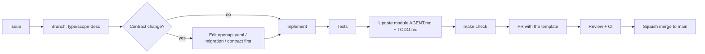

# CONTRIBUTING.md

Applies to humans **and** AI agents. Agents: read [AGENT.md](AGENT.md) first — it is the
operational version of this document.

---

## 1. Before you start

| Step | Why |
|---|---|
| Read `AGENT.md` and `MODULE_INDEX.md` | Know the rules and where things live |
| Find the module you are changing and read its `AGENT.md` | Know the local rules and the "do not" list |
| Check `docs/adr/` for a relevant decision | Do not re-litigate a settled question silently |
| Check the guides at the end of this file | Do not invent a procedure that already exists |
| Open or claim an issue | Work without an issue is invisible work |

## 2. Local setup

```bash
git clone <repo> && cd fluentra
cp .env.example .env
make setup     # installs tool binaries, git hooks, pnpm deps
make dev       # brings up the full stack
make check     # confirm a green baseline before changing anything
```

Prerequisites: Go 1.25+, Node 24+, Docker with Compose v2, `make`.

## 3. Workflow



## 4. Branches and commits

| Item | Convention |
|---|---|
| Branch | `feat/srs-fsrs-scheduler`, `fix/auth-refresh-loop`, `docs/adr-0021` |
| Commit | Conventional Commits: `feat(srs): add FSRS scheduler` |
| Scope | The module name |
| Body | Explain **why**; reference the issue |
| Size | One module, one concern. Over ~400 changed lines needs justification |

## 5. Pull requests

The PR template requires:

- [ ] What changed and why (2–5 sentences)
- [ ] Modules touched — and confirmation that no boundary was crossed
- [ ] Spec/migration updated if the contract changed
- [ ] Tests added, and what they prove
- [ ] Module `AGENT.md` and `TODO.md` updated
- [ ] Observability: spans, metrics, logs for the new path
- [ ] Security checklist (see `docs/CONVENTIONS.md#security` §10)
- [ ] Rollback plan if the change is risky
- [ ] Screenshots for UI changes
- [ ] If AI-assisted: which prompt was used, and what you verified by hand

## 6. Review standards

Reviewers check, in order:

1. **Boundaries** — did this cross a module line? (arch-lint catches imports; humans catch design)
2. **Correctness** — do the tests actually prove the claim?
3. **Contracts** — spec, migration, and events consistent with the code
4. **Security** — the §10 checklist
5. **Observability** — can we debug this at 3 a.m.?
6. **Docs** — will the next agent find what it needs?
7. **Style** — last, and mostly automated

Two reviewers required for: `auth`, `rbac`, `payment`, anything handling uploads, anything
changing a migration that already shipped, and any ADR.

Response time expectation: first review within one working day.

## 7. Working with AI assistants

| Do | Don't |
|---|---|
| Give the agent the module `AGENT.md` and a precise task | Say "improve the codebase" |
| Ask for a plan first on anything non-trivial | Accept a 20-file diff unread |
| Constrain the blast radius explicitly | Let it wander into other modules |
| Verify with `make check` and read the diff | Trust "all tests pass" without looking |
| Fix the docs when the agent got lost | Blame the model for missing context |
| Disclose AI assistance in the PR | Hide it — reviewers calibrate differently |

You are responsible for every line you submit, regardless of who or what wrote it.

## 8. Adding things

| Adding | Read first |
|---|---|
| A module | [Guide: add a module](#guide-add-a-module) — manifest, arch-lint, docs, migrations |
| An endpoint | [Guide: add an endpoint](#guide-add-an-endpoint) — spec first |
| A table | [docs/CONVENTIONS.md#database](docs/CONVENTIONS.md#database) — ownership, naming, indexes, reversibility |
| An AI feature | [docs/AI.md](docs/AI.md) — task, prompt, eval, budget |
| A dependency | `DEPENDENCIES.md` — a row with alternatives considered is mandatory |
| A decision | `docs/templates/adr.md` — at least two rejected alternatives |
| A glossary term | `ARCHITECTURE.md#appendix-glossary` — before the term appears in code |

## 9. Documentation duties

Documentation is not a follow-up task; it is part of the change.

| Change | Doc to update |
|---|---|
| Any module change | That module's `AGENT.md` (§Database, §Endpoints, §Business rules) + `last_verified` |
| New endpoint | `openapi.yaml` + the module's `API.md` |
| New table | Module `AGENT.md` front-matter `tables:` + `docs/database/er/` |
| New flow | Module `FLOW.md` |
| New decision | `docs/adr/` + `DECISIONS.md` index |
| User-visible change | `CHANGELOG.md` under `Unreleased` |
| New term | `ARCHITECTURE.md#appendix-glossary` |

CI enforces most of this. What it cannot enforce — accuracy — is what review is for.

## 10. Getting unstuck

| Situation | Do this |
|---|---|
| Two modules seem to need the same table | Stop. Post the question. It is a boundary design issue |
| A rule blocks the obvious solution | Stop. Propose an ADR rather than working around it |
| The module `AGENT.md` is wrong | Fix it in your PR and say so |
| A test is flaky | Quarantine it with an issue the same day |
| CI fails for a reason you cannot reproduce | `make ci` locally; if it still passes, that discrepancy is a bug worth reporting |
| You have read six files and are still unsure | Ask. That is the rule for agents and it is good advice for humans |

## 11. Code of conduct

Be direct about code and kind about people. Review the change, not the author. Disagreements
are resolved with an ADR, not with volume.

## Guide: add a module

> Before starting, be sure you actually need a module. A new module is justified when the
> concept has its **own tables, its own business rules, and its own reason to change**.
> If it is a new capability of an existing bounded context, add it there instead.
> If you are unsure, ask — a wrongly placed module is expensive to move later.

Estimated time: 60–90 minutes for the scaffolding, before any feature work.

---

### Step 0 — Decide and record

| Question | Where the answer goes |
|---|---|
| What does it own that nothing else owns? | Its `AGENT.md` §2 |
| What does it explicitly *not* own? | Its `AGENT.md` §2 |
| Which tier: `platform` or a business tier? | The manifest |
| Which schema will its tables live in? | The manifest and `ARCHITECTURE.md` §8.2 |
| Which modules will it depend on, and why each? | The manifest and `.go-arch-lint.yml` |
| Which modules will depend on it? | Its `contract` design |
| Does it introduce an external dependency? | If yes, **write an ADR first** |

If it crosses an existing boundary or adds a vendor, stop and write the ADR. Everything below
assumes the decision is made.

---

### Step 1 — Register it (four files, one commit)

1. `tools/docgen/data/<group>.json` — add the entry.
2. `tools/docgen/data/<tier>.json` — add the full module definition (purpose, responsibilities,
   tables, endpoints, rules, tasks, limitations, testing, decisions, TODO).
3. `MODULE_INDEX.md` — add it to §1 quick lookup, §2 register, and the §3 dependency graph.
4. `.go-arch-lint.yml` — add the `c_<name>` and `m_<name>` components and the `deps` entry.

A module that is not in all four is not real. CI's `dep-drift` job checks that the manifest and
the arch-lint config agree.

### Step 2 — Generate the documentation

```bash
make docs
```

This writes the nine files under `internal/<group>/<name>/`. Read the generated `AGENT.md` and
fill in anything the manifest could not express. **The documentation exists before the code —
that is deliberate.** It is the specification you will implement against, and the context the
next agent will read.

### Step 3 — Create the code skeleton

```
internal/modules/<name>/
├── contract/          service.go · dto.go · events.go
├── domain/            entities, value objects, invariants, errors
├── service/           use cases
├── repository/        sqlc output + mappers
├── transport/http/    handlers + routes
├── job/               (only if it owns background work)
└── module.go          New(deps) (*Module, error)
```

`module.go` is the module's only export to `cmd/`:

- it accepts a dependency struct containing **contract interfaces**, never concrete types
- it returns the module, exposing `Routes() chi.Router`, `Contract() contract.Service`, and
  `JobWorkers()` if it has any
- it performs no I/O at construction beyond validating that its dependencies are non-nil

### Step 4 — Schema

```bash
make migrate-new MODULE=<name> NAME=create_<table>
```

Rules: tables go in the module's own schema; no foreign key crosses a schema boundary except to
`core.users(id)`; every migration is reversible; every FK gets an index. See
[`docs/CONVENTIONS.md#database`](docs/CONVENTIONS.md#database).

Then write queries in `db/queries/<name>/*.sql` and run `make gen-sql`.

### Step 5 — API surface

Edit `api/openapi/openapi.yaml` **before** writing a handler:

- add a tag matching the module name
- put schemas in `api/openapi/components/<name>.yaml`
- give every operation an `operationId`, a description, at least one example, and — unless it is
  public — an `x-permission`

Then `make gen-api`. The generated server interface will not compile until your handlers match
the spec. That is the mechanism that stops invented endpoints.

### Step 6 — Permissions

Add the module's permissions to `rbac`: constants in `contract/permissions.go`, rows in a
migration, and mapping to the roles that should hold them. Call `rbac.Require` in the service
methods, not only in middleware.

### Step 7 — Wire it up

In `cmd/api/main.go`, construct the module after its dependencies and mount its router.
In `cmd/worker/main.go`, register its job workers. Both are plain constructor calls in
dependency order — no framework, no magic (ADR-0006).

### Step 8 — Observability

- Spans on every service method: `<module>.<Operation>`, with `module` and `operation` attributes
- Use the shared instruments from `platform/telemetry`; add a new one only if none fits
- Business counters for outcomes that matter
- A dashboard panel if this is a new user-facing capability
- An alert **and a runbook** if it can fail in a way learners notice

### Step 9 — Tests

| Layer | What |
|---|---|
| `domain` | Table-driven tests for every invariant. Target 90 % |
| `service` | Use cases with mocked ports; every business-rule violation maps to the right `apperr` code. Target 80 % |
| `repository` | Integration tests with testcontainers; assert query counts to catch N+1 |
| `transport` | A contract test per endpoint against the OpenAPI spec |

### Step 10 — Close the loop

- [ ] `make check` green
- [ ] `make docs-check` green (front-matter, drift, links)
- [ ] The module's `AGENT.md` reflects what you actually built, with `last_verified` bumped
- [ ] `TODO.md` populated with the remaining work and acceptance criteria
- [ ] `CHANGELOG.md` entry under `Unreleased` if anything is user-visible
- [ ] `MODULE_INDEX.md` status changed from `PLANNED` to `IN_PROGRESS`

---

### Prompt for an AI assistant

```
Read /AGENT.md, then the "Guide: add a module" section of CONTRIBUTING.md.

Create the module <name>:
  tier:        <platform|core|learning|commerce>
  schema:      <schema>
  owns:        <one sentence>
  depends on:  <modules, and why each>

Do steps 1–3 only (registration, docs generation, code skeleton).
Do not implement business logic yet.
Do not add a dependency that is not listed above — if you think one is needed, stop and say so.

When done, show me:
  · the diff to the four registration files
  · the generated AGENT.md
  · the module.go skeleton
```

Keeping the first pass to scaffolding is deliberate: it is the part where a mistake is cheap to
fix and expensive to discover later.

## Guide: add an endpoint

The order of these steps is the whole point. Writing the handler first means the spec, the
generated client, the mocks and the tests all get retrofitted to whatever the handler happened
to do — and they drift from that moment on.

Estimated time: 30–60 minutes including tests.

---

### Step 1 — Confirm ownership

Open [`/MODULE_INDEX.md`](MODULE_INDEX.md) §1 and find which module owns this resource.
If the endpoint needs data from two modules, it still belongs to **one** of them; the other's
data comes through its `contract`.

If no module clearly owns it, stop. That is a boundary question, not an endpoint question.

### Step 2 — Design the contract, in the spec

Edit `api/openapi/openapi.yaml` (schemas go in `api/openapi/components/<module>.yaml`).

| Element | Requirement |
|---|---|
| Path | Plural, kebab-case, ≤ 2 levels of nesting |
| Method | See [`docs/CONVENTIONS.md#api`](docs/CONVENTIONS.md#api) §2 |
| `operationId` | `<module><Action><Resource>` — this becomes the generated function name |
| `tags` | The module name |
| `x-permission` | Required unless the operation is genuinely public |
| Request schema | `snake_case` fields; unknown fields rejected |
| Response schema | Include a realistic example — MSW handlers are generated from it |
| Errors | Document every failure with its stable `code` |
| Pagination | Cursor, unless this is a bounded admin list |
| Idempotency | Required if it creates an attempt, a submission, or a charge |

```bash
npx @stoplight/spectral-cli lint api/openapi/openapi.yaml
make gen-api
```

The generated server interface now has a method your handler must implement. If you invented a
path or a shape, this is where you find out.

### Step 3 — Schema, if needed

If the endpoint needs new data:

```bash
make migrate-new MODULE=<module> NAME=<verb>_<object>
```

Then the query in `db/queries/<module>/`, then `make gen-sql`. Rules in
[`docs/CONVENTIONS.md#database`](docs/CONVENTIONS.md#database). Every FK gets an index; every `:many`
query has a `LIMIT`.

### Step 4 — Domain and service

Business rules live here, not in the handler.

- New invariants go in `domain/` as pure functions with their own tests.
- The service method orchestrates: authorise, load, apply rules, persist, publish events.
- Call `rbac.Require(ctx, perm)` — the route group is not sufficient on its own.
- Filter by `actor.UserID` in the query for anything user-owned. **This is the line that
  prevents IDOR**, and no amount of middleware substitutes for it.
- Open a transaction only if you write more than one row; never let it span modules.
- Map rule violations to `apperr` with the codes you documented in step 2.

### Step 5 — Handler

Implement the generated interface method. It should decode, validate shape, call the service,
and render. Nothing else — no SQL, no `if` on business conditions, no direct repository access.

Register it in the module's `transport/http/routes.go`. `cmd/api` already mounts the module.

### Step 6 — Observability

The HTTP middleware gives you a span and access logging for free. Add:

- a span on the service method if it is not already instrumented
- a business counter if the endpoint represents a meaningful outcome
- structured log fields on state changes — IDs, never content

### Step 7 — Tests

| Test | Asserts |
|---|---|
| Domain unit | Each new invariant, including its boundaries |
| Service unit | Happy path, each rule violation → the right `apperr` code, repository error handling, events published |
| Repository integration | The SQL is correct against real Postgres; query count is what you expect |
| Contract | Response matches the OpenAPI schema; golden JSON |
| Authorization | A user without the permission gets 403; another user's resource gets **404**, not 403 |

### Step 8 — Frontend

```bash
cd web && pnpm run gen:api
```

Then add the query or mutation hook in the feature slice's `api/` folder, add the query key,
add the MSW handler (generated from the spec example), and use it. Never hand-write the type.

### Step 9 — Documentation

- The module's `API.md` — add the row and the detail block
- The module's `AGENT.md` §6 — add the endpoint; bump `last_verified`
- `CHANGELOG.md` under `Unreleased` if it is user-visible

### Step 10 — Verify

```bash
make check
make docs-check
```

---

### Checklist

- [ ] Spec edited **before** the handler
- [ ] `x-permission` declared and enforced in the service
- [ ] Ownership filter in the query
- [ ] Errors use documented, stable codes
- [ ] Cursor pagination on any list
- [ ] `Idempotency-Key` required where it should be
- [ ] Integration test proves the SQL
- [ ] Contract test proves the shape
- [ ] Another user gets 404, not 403
- [ ] Frontend types regenerated, not hand-written
- [ ] Module docs updated

---

### Prompt for an AI assistant

```
Read /AGENT.md, then internal/<group>/<module>/AGENT.md, then
the "Guide: add an endpoint" section of CONTRIBUTING.md.

Add: <METHOD> <path> — <one-sentence purpose>
Permission: <permission>
Request:  <fields>
Response: <fields>
Rules:    <the business rules that apply>

Follow the steps in the guide **in order**. Edit api/openapi/openapi.yaml first
and show me that diff before writing any Go.

Do not touch any module other than <module>. If you need data from another
module, use its contract package and tell me which method you used.
```
