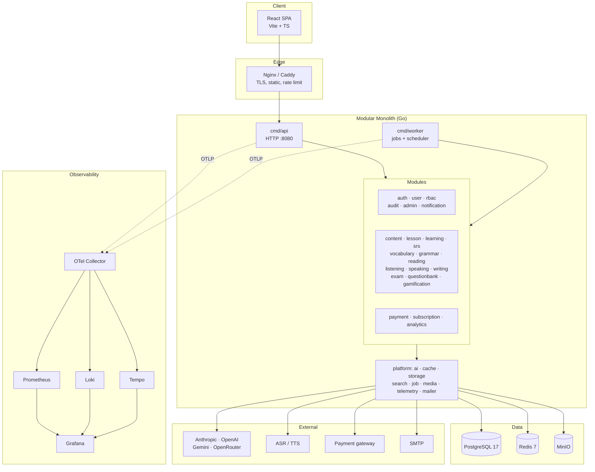

# Fluentra

> **AI-first English learning platform.** A Go modular monolith and a React SPA that teach
> vocabulary, grammar, reading, listening, speaking and writing through adaptive lessons,
> spaced repetition, mock exams (IELTS, TOEIC, VSTEP) and AI-graded practice.

[](go.mod)
[](web/package.json)
[](DEPENDENCIES.md)

**AI assistants:** read [`AGENT.md`](AGENT.md) first, then [`MODULE_INDEX.md`](MODULE_INDEX.md).

## Quick start

```bash
make dev-infra     # postgres, redis, minio, mailpit
make migrate-up
make seed          # demo accounts, courses, 10k words, mock tests (about 20 min)
make api           # :8080
make worker        # :8081
make web           # :5173
```

Copy `.env.example` to `.env` first. It is the full configuration reference: a key that
is not in it is not read.

## Documentation

| Document | What it answers |
|---|---|
| [ARCHITECTURE.md](ARCHITECTURE.md) | How the system is built and why; project layout; glossary |
| [MODULE_INDEX.md](MODULE_INDEX.md) | Every module, its owner and its allowed dependencies |
| `internal/<group>/<module>/AGENT.md` | One module: contract, schema, endpoints, flows, decisions, backlog |
| [docs/CONVENTIONS.md](docs/CONVENTIONS.md) | Coding, API, database, errors, logging, security and testing rules |
| [docs/OPERATIONS.md](docs/OPERATIONS.md) | Deploying on the free tier (Vercel, Render, Supabase, Upstash, R2), CI, releases, runbooks |
| [docs/AI.md](docs/AI.md) | Working with AI assistants and the product's LLM calls |
| [DECISIONS.md](DECISIONS.md) | Index of the ADRs in `docs/adr/` |
| [DEPENDENCIES.md](DEPENDENCIES.md) | Every library, why it was chosen, third-party notices |
| [CONTRIBUTING.md](CONTRIBUTING.md) | How to contribute, including the add-a-module and add-an-endpoint guides |
| [CHANGELOG.md](CHANGELOG.md) | Release history |
| [web/AGENT.md](web/AGENT.md) | The frontend |

## Architecture at a glance



## Local services

`make dev` runs everything in containers instead. Then open:

| Service | URL |
|---|---|
| Web app | <http://localhost:5173> |
| API | <http://localhost:8080> |
| API docs (Scalar) | <http://localhost:8080/docs> |
| Grafana | <http://localhost:3000> |
| MinIO console | <http://localhost:9001> |
| Mailpit | <http://localhost:8025> |

## License

Proprietary. All rights reserved.
