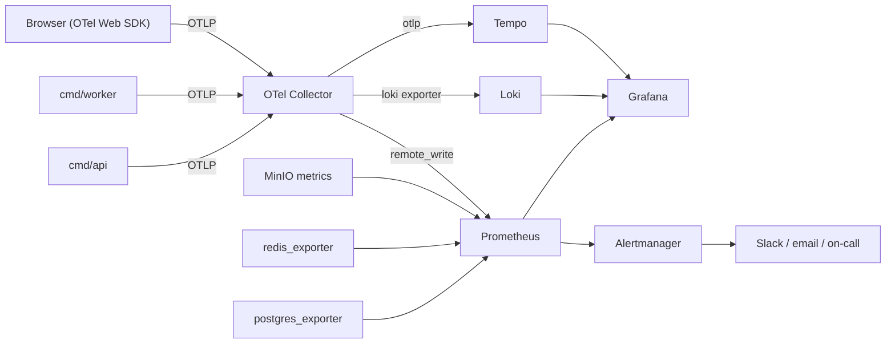

# Conventions

Repository-wide rules. Module-specific additions live in each module's `AGENT.md` §12.

- [Coding standard](#coding-standard)
- [API](#api)
- [Database](#database)
- [Error handling](#error-handling)
- [Logging](#logging)
- [Observability](#observability)
- [Security](#security)
- [Testing](#testing)

## Coding standard

Enforced by `golangci-lint`, `go-arch-lint`, ESLint and review. When this document and a
linter disagree, the linter wins and this document is a bug.

---

### 1. Go — general

| Rule | Detail |
|---|---|
| Formatting | `gofmt` + `goimports-reviser` (std / external / internal groups) |
| Naming | Follow *Effective Go*. No stutter: `vocabulary.Service`, not `vocabulary.VocabularyService` |
| Package names | Short, lowercase, singular, no underscores, no `util`/`common`/`helpers`/`misc` |
| File names | `snake_case.go`; one primary type per file; `xxx_test.go` beside it |
| Line length | Soft 120 |
| Comments | Exported identifiers have a doc comment starting with the identifier name. Comments explain **why**, never **what** |
| Receivers | 1–2 letters, consistent per type; pointer receivers unless the type is a small immutable value |
| Errors | Always handled or explicitly ignored with `_ =` and a reason comment |
| Context | First parameter, named `ctx`, never stored in a struct |
| Globals | Forbidden except `var ErrX = errors.New(...)` sentinels and generated code |
| `init()` | Forbidden outside generated code |
| Panics | Only in `cmd/` startup, and only for unrecoverable misconfiguration |
| Struct literals | Always keyed |
| Interfaces | Defined by the **consumer**, kept small (1–3 methods). `contract/` interfaces are the exception — they are producer-defined and larger by necessity |
| Generics | Use when they remove real duplication (`Page[T]`, `Cache[K,V]`); do not use them to be clever |
| Concurrency | `errgroup` with a bound; every goroutine has an owner and a shutdown path; no naked `go func()` in request handling |
| Time | `time.Time` in UTC; comparisons via the injected `clock.Clock` |
| Numbers | Money as integer minor units (`shared/money`); never `float64` for currency |

### 2. Go — layering rules

```go
// transport/http  — decode, validate, call, render. Nothing else.
// service         — orchestrate, enforce rules, own transactions, publish events.
// repository      — sqlc calls and mapping. No branching on business conditions.
// domain          — pure. No imports from the layers above. No I/O.
// contract        — the only package other modules may import.
```

| Anti-pattern | Correct |
|---|---|
| SQL in a handler | Handler → service → repository |
| `http.Request` in a service signature | Pass a typed input struct |
| Business `if` in a repository | Move it into the service or domain |
| A service returning `*http.Response`-shaped data | Return domain types; the handler maps to DTOs |
| A domain type importing `pgx` | Repository maps between DB rows and domain types |
| `context.Background()` in a service | Propagate the caller's `ctx` |

### 3. Go — function shape

| Rule | Limit |
|---|---|
| Function length | ≤ 60 lines (guideline); a longer one needs a reason |
| Cyclomatic complexity | ≤ 15 (`gocyclo`) |
| Parameters | ≤ 4; beyond that use an input struct |
| Return values | ≤ 3; prefer `(T, error)` |
| Nesting | ≤ 3 levels; return early |
| Naked returns | Forbidden |

### 4. Go — errors

See [ERROR_HANDLING.md](#error-handling). Short version:

```go
// wrap with context, never with a bare "error: "
if err != nil {
    return fmt.Errorf("load deck %s: %w", deckID, err)
}
// classify at the boundary of your module
return apperr.NotFound("DECK_NOT_FOUND", "deck not found").WithCause(err)
```

Never: `errors.New(fmt.Sprintf(...))`, `panic(err)`, `log.Fatal(err)` outside `cmd/`,
swallowing an error to "keep going", or returning a nil error with a nil result.

### 5. Go — tests

| Rule | Detail |
|---|---|
| Style | Table-driven with a named `tests` slice; subtests via `t.Run(tc.name, …)` |
| Naming | `TestSubject_Condition_Expectation` |
| Parallelism | `t.Parallel()` unless the test mutates shared state |
| Assertions | `require` for preconditions (stop on failure), `assert` for expectations |
| Fixtures | Builders from `test/fixtures`; no anonymous magic structs |
| Mocks | Generated by `moq` into `mocks/`; hand-written stubs only for one-method interfaces |
| Golden files | `testdata/*.golden.json`, refreshed with `-update` |
| No sleeping | Use `synctest`, channels, or the fake clock — never `time.Sleep` |
| No network | Unit and integration tests never reach the internet; the `mock` AI provider is used |

### 6. TypeScript / React

| Rule | Detail |
|---|---|
| `strict: true` | Plus `noUncheckedIndexedAccess`, `exactOptionalPropertyTypes` |
| `any` | Banned. Use `unknown` and narrow |
| Components | Function components; props typed with an exported `interface`; no `React.FC` |
| Files | `PascalCase.tsx` for components, `camelCase.ts` for everything else |
| Exports | Named exports; default export only for lazy-loaded route modules |
| Hooks | `use` prefix; rules-of-hooks enforced; custom hooks live beside their feature |
| State | See ARCHITECTURE §7.2 — server state never duplicated into a store |
| Effects | `useEffect` is a last resort. Derive during render; use query hooks for data |
| Styling | Tailwind utilities + `cn()` merge helper; no inline `style` except for computed values |
| Imports | Absolute via `@/`; a feature slice may only import another slice's root export |
| Data fetching | Only through generated client hooks; never a raw `fetch` in a component |
| Forms | React Hook Form + Zod; the Zod schema is the single source of client-side validation |
| Errors | Route error boundary + typed Problem Details mapping; never a bare `catch {}` |
| a11y | Every interactive element is keyboard reachable and labelled; `eslint-plugin-jsx-a11y` is on |
| Testing | Query by role and accessible name — never by test-id unless there is no alternative |
| Bundle | Route-level code splitting; heavy libs (Tiptap, wavesurfer) lazy-loaded |

### 7. SQL

| Rule | Detail |
|---|---|
| Location | `db/queries/<module>/*.sql` only |
| Keywords | Uppercase; identifiers lowercase `snake_case` |
| Naming | `-- name: GetDeckByID :one` — verb + subject + qualifier |
| `SELECT *` | Forbidden — list the columns |
| Joins | Explicit `JOIN … ON`; never comma joins |
| Cross-schema joins | Forbidden across module boundaries (rule L2) |
| Deletes/updates | Always have a `WHERE`; a migration that lacks one fails review |
| Pagination | Keyset for user-facing lists |
| Timestamps | `timestamptz`, defaulted to `now()` |
| Enums | Postgres enum for closed sets; lookup table otherwise |
| Indexes | Named `idx_<table>_<cols>[_<predicate>]`; every FK indexed |
| Migrations | Reversible; destructive changes split expand→migrate→contract across releases |

### 8. Git

| Item | Convention |
|---|---|
| Branch | `feat/…`, `fix/…`, `chore/…`, `docs/…`, `refactor/…`, `test/…` |
| Commit | Conventional Commits: `type(scope): subject` — scope is the module name |
| Body | Why, not what. Reference an issue |
| Size | One module, one concern. > 400 changed lines needs a reason |
| PR | Uses the template; boundary checklist completed; docs updated |
| Merge | Squash to `main`; `main` always releasable |

### 9. Comments and TODOs

```go
// Good: explains a non-obvious decision.
// FSRS treats a lapse as a full reset only below stability 2.5; above that we
// apply the partial-decay branch from the reference implementation (docs/knowledge/fsrs.md).

// Bad: restates the code.
// increment the counter
counter++
```

`TODO` must carry an issue: `// TODO(#412): support B2 rubric bands.`
A `TODO` without an issue fails lint.

### 10. What "done" looks like

Same list as `AGENT.md` §11. If a PR does not satisfy it, it is not ready, regardless of who
or what wrote it.

## API

The contract is [`api/openapi/openapi.yaml`](../api/openapi/openapi.yaml). This document explains
the rules that spec must follow. **Edit the spec before writing a handler** (rule L10).

---

### 1. Fundamentals

| Aspect | Rule |
|---|---|
| Style | REST, resource-oriented, JSON only |
| Base path | `/api/v1` |
| Versioning | Major version in the path. One major version supported at a time; the previous one gets 6 months of deprecation notice |
| Media type | `application/json`; errors use `application/problem+json` |
| Encoding | UTF-8 |
| Casing | Paths kebab-case, JSON fields `snake_case`, query params `snake_case` |
| Resource names | Plural nouns: `/decks`, `/submissions`, `/review-cards` |
| Verbs in paths | Only for non-CRUD actions, as a sub-resource: `POST /exams/{id}/submit` |
| Nesting depth | Maximum 2 levels: `/courses/{id}/lessons` is fine; `/courses/{id}/lessons/{id}/activities/{id}/attempts` is not — use `/attempts?activity_id=` |
| Trailing slash | Not accepted |
| Nulls | Omit absent optional fields rather than sending `null`, except when `null` is semantically meaningful |
| Unknown fields | Rejected with `422` (strict decoding) |

### 2. Methods and status codes

| Method | Use | Success | Idempotent |
|---|---|---|---|
| `GET` | Read | 200, 304 | ✅ |
| `POST` | Create, or an action | 201 (+`Location`), 202, 200 | ❌ (unless `Idempotency-Key`) |
| `PUT` | Full replace | 200, 204 | ✅ |
| `PATCH` | Partial update (JSON Merge Patch) | 200 | ❌ |
| `DELETE` | Remove | 204 | ✅ |

| Status | When |
|---|---|
| 200 | OK with a body |
| 201 | Created — `Location` header required |
| 202 | Accepted — long-running; body has a job/stream reference |
| 204 | No content |
| 304 | `If-None-Match` matched |
| 400 | Malformed request (bad JSON, bad cursor) |
| 401 | Missing/invalid/expired credentials |
| 403 | Authenticated but not permitted |
| 404 | Not found **or** not visible to this actor (never leak existence) |
| 409 | State conflict (already submitted, duplicate lemma) |
| 412 | `If-Match` failed |
| 413 | Payload too large |
| 415 | Unsupported media type |
| 422 | Semantically invalid (validation failures) |
| 429 | Rate limited — `Retry-After` required |
| 500 | Unexpected — never leaks internals |
| 503 | Dependency unavailable — `Retry-After` when known |

**404 vs 403:** if the actor may not know the resource exists, return 404. Use 403 only when
existence is already public knowledge to that actor.

### 3. Standard headers

#### Request

| Header | Notes |
|---|---|
| `Authorization: Bearer <jwt>` | All authenticated endpoints |
| `X-Request-Id` | Optional client-supplied ULID; generated if absent; echoed in the response |
| `traceparent` | W3C trace context; propagated end-to-end |
| `Idempotency-Key` | Required on POSTs that create attempts, submissions, or charge money |
| `If-Match` / `If-None-Match` | Optimistic concurrency and caching on admin resources |
| `Accept-Language` | Drives message localisation |

#### Response

| Header | Notes |
|---|---|
| `X-Request-Id` | Always |
| `ETag` | On cacheable and mutable resources |
| `Cache-Control` | `no-store` by default for authenticated responses |
| `RateLimit-Limit` / `RateLimit-Remaining` / `RateLimit-Reset` | On rate-limited endpoints |
| `Retry-After` | With 429 and 503 |
| `Deprecation` / `Sunset` | On deprecated operations |

### 4. Pagination

Cursor-based for everything user-facing.

```
GET /api/v1/vocabulary/decks?limit=20&cursor=eyJjIjoiMjAyNi0wOC0wNlQxMDowMDowMFoiLCJpIjoiMDE5M2E3In0

{
  "data": [ … ],
  "page": {
    "next_cursor": "eyJjIjoiMjAyNi0wOC0wNlQwOTowMDowMFoiLCJpIjoiMDE5M2E2In0",
    "has_more": true,
    "limit": 20
  }
}
```

| Rule | Detail |
|---|---|
| `limit` | default 20, max 100 |
| Cursor | Opaque base64 of `{sort_value, id}`; clients must not construct one |
| Ordering | Stable and explicit; ties broken by `id` |
| Total counts | Not returned by default (expensive). `?include_total=true` allowed only on admin lists |
| Offset pagination | Permitted only on admin tables with a bounded row count, and documented as such |

### 5. Filtering, sorting, sparse fields

| Feature | Syntax | Rule |
|---|---|---|
| Filter | `?status=published&level=B1` | Explicit, whitelisted params only. No generic query language |
| Range | `?created_after=…&created_before=…` | ISO-8601 |
| Search | `?q=` | Server decides the strategy |
| Sort | `?sort=-created_at,name` | Whitelisted fields only |
| Expand | `?expand=deck,author` | Whitelisted; max 2 |
| Fields | `?fields=id,name` | Optional; ignore unknown fields |

### 6. Errors

RFC 9457 Problem Details, always. Full catalogue in [ERROR_HANDLING.md](#error-handling).

```json
{
  "type": "https://fluentra.dev/errors/deck-limit-reached",
  "title": "Deck limit reached",
  "status": 409,
  "detail": "Free plan allows up to 5 decks.",
  "instance": "/api/v1/vocabulary/decks",
  "code": "DECK_LIMIT_REACHED",
  "request_id": "01J8XQ…",
  "meta": { "limit": 5, "current": 5 }
}
```

| Rule | Detail |
|---|---|
| `code` | Stable, `SCREAMING_SNAKE_CASE`, never changes once released — clients branch on it |
| `title` / `detail` | Human-readable, safe to show, localised by `Accept-Language` |
| `errors[]` | Present on 422 with `field`, `code`, `message` per failure |
| Internals | Stack traces, SQL, provider messages **never** appear in a response; they go to logs with the same `request_id` |

### 7. Authentication & authorisation

| Aspect | Rule |
|---|---|
| Access token | `Authorization: Bearer`, JWT, 15 min |
| Refresh | `POST /auth/refresh`, cookie-based, rotating |
| Public endpoints | Explicitly marked in the spec with `security: []`; everything else is authenticated by default |
| Admin endpoints | Under `/admin/`; require the `admin` role at the route group |
| Permission | Every operation declares the permission it requires in an `x-permission` extension; CI checks the handler enforces it |
| Ownership | Enforced in the query, not the handler |

### 8. Idempotency

```
POST /api/v1/writing/submissions
Idempotency-Key: 01J8XQ7Z9K3M4N5P6Q7R8S9T0V
```

- The key is stored with a hash of the request body and the resulting response.
- A replay with the same key **and** same body returns the original response with
  `Idempotency-Replayed: true`.
- Same key, different body → `409 IDEMPOTENCY_KEY_REUSE`.
- Keys expire after 24 h.
- Required on: submissions, exam attempts, payments, any credit-consuming AI call.

### 9. Long-running operations

```
POST /writing/submissions        → 202 { submission_id, stream_url, poll_url }
GET  /writing/submissions/{id}   → 200 { status: queued|processing|graded|failed, … }
GET  /writing/submissions/{id}/stream  → text/event-stream
```

| Rule | Detail |
|---|---|
| Never block | An operation expected to exceed 2 s returns 202 |
| SSE | Events: `progress`, `chunk`, `done`, `error`; heartbeat every 15 s; client reconnects with `Last-Event-ID` |
| Terminal states | `graded` and `failed` are terminal; a failed job exposes a safe reason code |
| Polling | Allowed as a fallback with `Retry-After` guidance |

### 10. Webhooks (inbound, payment)

| Rule | Detail |
|---|---|
| Verification | Signature verified before parsing; raw body preserved |
| Idempotency | Provider event ID stored; duplicates acknowledged without reprocessing |
| Response | 2xx quickly; the work happens in a job |
| Replay | Admin can replay a stored webhook from the audit trail |

### 11. Rate limits (initial)

| Class | Limit |
|---|---|
| Anonymous per IP | 60 req/min |
| Authenticated per user | 600 req/min |
| `/auth/login`, `/auth/register`, `/auth/forgot-password` | 5/min per IP **and** per account, with exponential lockout |
| AI-consuming endpoints | Per-plan daily quota + 10/min burst |
| Upload intents | 30/hour |
| Admin bulk operations | 10/min |

### 12. Deprecation policy

1. Mark the operation `deprecated: true` in the spec with a `Sunset` date.
2. Emit `Deprecation` and `Sunset` response headers.
3. Log and meter usage per client.
4. Announce in `CHANGELOG.md`.
5. Remove no earlier than 6 months after announcement, and only when usage is zero for 30 days.

### 13. Spec conventions

| Rule | Detail |
|---|---|
| `operationId` | `camelCase`, unique, `<module><Action><Resource>` — e.g. `vocabularyCreateDeck`. It becomes the generated function name |
| Tags | One per module, matching the module name |
| Components | Shared schemas in `components/`, split per module file |
| Examples | Every operation has at least one request and response example — these generate MSW handlers |
| Descriptions | Every operation and every non-obvious field has one |
| `x-permission` | Required on every non-public operation |
| Lint | `spectral` with the repo ruleset runs in CI |

## Database

PostgreSQL 17 · pgx v5 · sqlc · goose. One instance, one schema per module.

---

### 1. Ownership rules

| # | Rule |
|---|---|
| DB1 | Every table belongs to exactly one module, in that module's schema |
| DB2 | A module reads and writes **only** its own tables |
| DB3 | Cross-module data is obtained through `contract` interfaces, never through a JOIN |
| DB4 | The only cross-schema foreign key permitted is `→ core.users(id)` (ADR-0004) |
| DB5 | Migrations live in `db/migrations/<module>/`; queries in `db/queries/<module>/` |
| DB6 | No transaction spans two modules (rule L4) |

**Why DB4 is an exception:** almost every table references a user. Denormalising a user ID
without a FK would trade referential integrity for a purity that buys nothing while we are a
monolith. When a module is extracted, that FK becomes the module's own `user_id` column with
integrity maintained by events. This is documented, deliberate, and bounded to one column.

### 2. Naming

| Object | Convention | Example |
|---|---|---|
| Schema | module tier name | `core`, `learn`, `skill`, `assess`, `content`, `comm`, `billing`, `ai`, `ops`, `audit`, `analytics` |
| Table | plural, `snake_case` | `skill.word_senses` |
| Column | singular, `snake_case` | `next_due_at` |
| PK | `id` | `id uuid` |
| FK | `<singular_referenced>_id` | `deck_id`, `user_id` |
| Boolean | `is_`/`has_`/`can_` prefix | `is_published` |
| Timestamp | `_at` suffix | `created_at`, `deleted_at`, `published_at` |
| Date | `_on` suffix | `expires_on` |
| Count | `_count` suffix | `attempt_count` |
| Index | `idx_<table>_<cols>` | `idx_review_cards_user_due` |
| Unique index | `uq_<table>_<cols>` | `uq_decks_user_slug` |
| FK constraint | `fk_<table>_<ref>` | `fk_decks_user` |
| Check | `ck_<table>_<rule>` | `ck_attempts_score_range` |
| Enum type | singular | `content_status` |
| Partition | `<table>_yYYYYmMM` | `attempts_y2026m08` |

### 3. Standard columns

Every table:

```sql
id          uuid        PRIMARY KEY DEFAULT gen_random_uuid()   -- UUIDv7 generated in app code
created_at  timestamptz NOT NULL DEFAULT now()
updated_at  timestamptz NOT NULL DEFAULT now()
```

Add only when justified:

| Column | When |
|---|---|
| `deleted_at timestamptz` | A business reason exists to recover the row. Otherwise hard-delete |
| `version integer` | Optimistic locking on concurrently edited resources |
| `created_by`, `updated_by uuid` | Admin-authored content (audit already logs the event) |
| `metadata jsonb` | Genuinely open-ended attributes only — never as a way to avoid designing columns |

**IDs are UUIDv7 generated in Go** (`shared/id`), not by the database: the app knows the ID
before insert, which makes outbox events, logging, and idempotency simpler. The DB default is a
safety net only.

### 4. Types

| Need | Type | Never |
|---|---|---|
| Identifier | `uuid` | `serial`, `bigserial` (enumerable, leaks volume) |
| Text | `text` | `varchar(n)` unless the limit is a real business rule |
| Money | `numeric(14,2)` + `currency char(3)` | `float`, `double` |
| Score / percentage | `numeric(5,2)` | `float` |
| Timestamp | `timestamptz` | `timestamp`, epoch integers |
| Duration | `interval` or `_ms integer` | ambiguous "duration" numbers |
| Enum (closed, stable) | Postgres `enum` | `text` with a comment |
| Enum (evolving) | lookup table + FK | ad-hoc strings |
| Flexible attributes | `jsonb` + a check constraint or a validated schema | `json`, EAV tables |
| Arrays | `text[]`/`uuid[]` for small, non-queried sets | as a substitute for a join table |
| Binary | Never — object storage + a reference | `bytea` for files |

### 5. Constraints

Push invariants into the database wherever the database can express them:

```sql
CHECK (score >= 0 AND score <= 100)
CHECK (published_at IS NULL OR status = 'published')
CHECK (char_length(lemma) BETWEEN 1 AND 100)
UNIQUE (user_id, slug)
EXCLUDE USING gist (user_id WITH =, active_period WITH &&)   -- e.g. no overlapping subscriptions
FOREIGN KEY (deck_id) REFERENCES skill.decks(id) ON DELETE CASCADE
```

`NOT NULL` is the default posture; nullability must be justified.
`ON DELETE`: `CASCADE` for owned children, `RESTRICT` for referenced masters, `SET NULL` only
when the relationship is genuinely optional.

### 6. Indexing

| Rule | Detail |
|---|---|
| Every FK gets an index | Postgres does not create one |
| Index the actual query | Column order = equality columns, then range, then sort |
| Partial indexes for skewed predicates | `WHERE deleted_at IS NULL`, `WHERE status = 'published'` |
| Covering indexes | `INCLUDE (…)` when it turns a heap fetch into an index-only scan |
| GIN | `jsonb` containment and full-text (`tsvector`) |
| BRIN | Very large append-only tables ordered by time |
| Unique constraints | Express business uniqueness — do not rely on application checks |
| Never | Index everything "just in case"; every index costs write throughput and space |

Every PR that adds a query must include the `EXPLAIN (ANALYZE, BUFFERS)` output in the
description if the query touches a table expected to exceed 100k rows.

### 7. Migrations

```sql
-- +goose Up
-- +goose StatementBegin
CREATE TABLE skill.decks (…);
-- +goose StatementEnd

-- +goose Down
-- +goose StatementBegin
DROP TABLE skill.decks;
-- +goose StatementEnd
```

| Rule | Detail |
|---|---|
| Naming | `<unix_ts>_<verb>_<object>.sql` — the timestamp orders migrations across module folders |
| Reversible | Every migration has a working `Down`. If it truly cannot be reversed, say so explicitly in a comment and get review |
| One concern | One logical change per migration |
| Idempotent guards | `IF NOT EXISTS` on creates where safe |
| Locks | `CREATE INDEX CONCURRENTLY` on tables > 100k rows (and therefore **outside** a transaction — goose `--no-transaction`) |
| Data backfills | Separate migration, batched, restartable; large backfills run as a job, not a migration |
| Destructive changes | Never in one release. **Expand → migrate → contract**: |

```
Release N   : add the new nullable column; write to both; read from old
Release N+1 : backfill; read from new; still write both
Release N+2 : stop writing old; drop it
```

This is what makes rollback safe (§17.5 of ARCHITECTURE.md).

### 8. Queries (sqlc)

```sql
-- name: ListDueReviewCards :many
SELECT rc.id, rc.content_item_id, rc.stability, rc.difficulty, rc.due_at
FROM learn.review_cards rc
WHERE rc.user_id = $1
  AND rc.due_at <= $2
  AND rc.suspended_at IS NULL
ORDER BY rc.due_at ASC, rc.id ASC
LIMIT $3;
```

| Rule | Detail |
|---|---|
| Annotations | `:one`, `:many`, `:exec`, `:execrows`, `:batchexec` |
| Naming | Verb + subject: `GetDeckByID`, `ListDueReviewCards`, `CountUserDecks` |
| No `SELECT *` | Explicit columns, so adding a column cannot silently change a struct |
| No dynamic SQL | Need three filter combinations? Write three queries, or use `sqlc.narg` and `COALESCE` |
| Batch | Use `:batchexec`/`copyfrom` for bulk inserts (seeding, imports) |
| Always bounded | Every `:many` has a `LIMIT` |

### 9. Transactions

| Rule | Detail |
|---|---|
| Opened in | The service layer only |
| Isolation | `READ COMMITTED` default; `REPEATABLE READ` for read-modify-write on counters; document any use of `SERIALIZABLE` |
| Duration | Short. No LLM call, no HTTP call, no S3 upload inside a transaction |
| Locking | `SELECT … FOR UPDATE` on the aggregate root; `SKIP LOCKED` for queue-like scans |
| Retries | Serialisation failures (`40001`) retried up to 3 times with backoff |
| Scope | Never across modules (rule L4) — use the outbox |

### 10. Partitioning

Partition by month on `created_at` from day one for high-growth tables:

`learn.attempts` · `learn.review_logs` · `ai.ai_requests` · `audit.audit_logs` ·
`analytics.analytics_events`

| Rule | Detail |
|---|---|
| Creation | A monthly job creates the next three partitions in advance |
| Retention | Old partitions detached and archived per the retention table (ARCHITECTURE §8.5) |
| Indexes | Defined on the parent so partitions inherit them |
| Queries | Must include the partition key in the `WHERE` clause, or accept a full scan |

### 11. Performance budget

| Rule | Threshold |
|---|---|
| Any query in a request path | p95 < 50 ms |
| Any query anywhere | logged with its plan above 100 ms |
| CI performance test | fails above 500 ms on the seeded dataset |
| Connection pool | max 25 per API replica, 10 per worker; `pool_waiting` alerted |
| N+1 | Detected by an integration-test query counter around each service method |

### 12. Operations

| Concern | Approach |
|---|---|
| Backups | Nightly `pg_dump` + continuous WAL archiving to MinIO; 30-day retention |
| Restore drill | Monthly, timed, documented in `docs/operations/runbooks/restore.md` |
| Monitoring | `postgres_exporter`: connections, locks, replication lag, bloat, slow queries, cache hit ratio |
| Vacuum | Autovacuum tuned per hot table; monitored for wraparound risk |
| Extensions | `pgcrypto`, `pg_stat_statements`, `pg_trgm`, `btree_gin`, `citext` (case-insensitive email, created by `db/migrations/user/`); `pgvector` when semantic caching ships |
| Access | The app uses a least-privilege role; migrations use a separate owner role; no superuser at runtime |
| PII | Encrypted columns for MFA secrets and refresh-token hashes; anonymisation script for deleted users |

## Error handling

One error model, from the domain to the browser.

---

### 1. The model

```
domain error  →  apperr.Error  →  Problem Details JSON  →  typed frontend error  →  user message
   (sentinel)      (typed, coded)     (RFC 9457)              (discriminated union)   (i18n catalogue)
```

`shared/apperr.Error` carries:

| Field | Purpose | Exposed to client? |
|---|---|---|
| `Kind` | Category → HTTP status (see §2) | as status |
| `Code` | Stable machine code (`DECK_NOT_FOUND`) | ✅ |
| `Message` | Safe, human-readable, localisable | ✅ |
| `Fields` | Per-field validation failures | ✅ |
| `Meta` | Safe structured context (`{limit: 5}`) | ✅ |
| `Cause` | Wrapped underlying error | ❌ logs only |
| `Internal` | Developer detail, SQL state, provider message | ❌ logs only |
| `Retryable` | Hint for the caller and for job retry logic | via `Retry-After` |

### 2. Kinds → status

| Kind | HTTP | Meaning | Logged at |
|---|---|---|---|
| `Validation` | 422 | Input is well-formed but semantically invalid | debug |
| `BadRequest` | 400 | Malformed request | debug |
| `Unauthenticated` | 401 | No or invalid credentials | info |
| `Forbidden` | 403 | Authenticated, not permitted | warn |
| `NotFound` | 404 | Absent, or not visible to this actor | debug |
| `Conflict` | 409 | State conflict | info |
| `PreconditionFailed` | 412 | `If-Match` mismatch | info |
| `TooLarge` | 413 | Payload exceeds limit | info |
| `RateLimited` | 429 | Quota or rate limit | info |
| `Unavailable` | 503 | Dependency down | error |
| `Timeout` | 504 | Upstream timeout | error |
| `Internal` | 500 | Bug or unexpected condition | error |

Anything not an `apperr.Error` at the HTTP boundary is treated as `Internal`, logged with a
stack trace, and rendered as a generic 500. **The client never sees an unclassified message.**

### 3. Layer responsibilities

| Layer | Does |
|---|---|
| `domain` | Returns sentinel errors expressing invariants (`ErrDeckLimitReached`) |
| `repository` | Translates driver errors: `pgx.ErrNoRows` → `apperr.NotFound`, unique violation `23505` → `apperr.Conflict`, FK violation `23503` → `apperr.Conflict`; wraps everything else with query context |
| `service` | Maps domain sentinels to `apperr` with a code and a user-safe message; adds `Meta` |
| `transport/http` | Renders Problem Details; never invents an error; never adds business meaning |
| `job` | Decides retry from `Retryable`; on final failure records a safe reason and emits a failure event |
| frontend | Maps `code` → message via the i18n catalogue; falls back to `title` |

### 4. Wrapping

```go
// repository: add query context
return fmt.Errorf("select deck %s: %w", id, err)

// service: classify at the module boundary
if errors.Is(err, domain.ErrDeckLimitReached) {
    return apperr.Conflict("DECK_LIMIT_REACHED", "You have reached the deck limit for your plan.").
        WithMeta("limit", limit).
        WithCause(err)
}
```

Rules: wrap with `%w` exactly once per layer · never wrap an `apperr` in another `apperr` ·
never `errors.New(fmt.Sprintf(...))` · never log **and** return the same error (the boundary
logs it once).

### 5. Error code catalogue

Codes are permanent public API. Adding one is a normal change; changing or removing one is a
breaking change.

#### Common

| Code | Kind | Meaning |
|---|---|---|
| `VALIDATION_FAILED` | 422 | One or more fields invalid; see `errors[]` |
| `MALFORMED_REQUEST` | 400 | Body is not valid JSON or has unknown fields |
| `INVALID_CURSOR` | 400 | Pagination cursor is not decodable |
| `RESOURCE_NOT_FOUND` | 404 | Generic not-found |
| `PERMISSION_DENIED` | 403 | Missing permission |
| `RATE_LIMITED` | 429 | Too many requests |
| `IDEMPOTENCY_KEY_REUSE` | 409 | Same key, different payload |
| `PRECONDITION_FAILED` | 412 | ETag mismatch |
| `DEPENDENCY_UNAVAILABLE` | 503 | Downstream unavailable |
| `INTERNAL_ERROR` | 500 | Unexpected |

#### auth

| Code | Kind | Meaning |
|---|---|---|
| `INVALID_CREDENTIALS` | 401 | Wrong email or password (never say which) |
| `ACCOUNT_LOCKED` | 429 | Too many failed attempts |
| `EMAIL_NOT_VERIFIED` | 403 | Verification required for this action |
| `TOKEN_EXPIRED` | 401 | Access token expired — refresh |
| `TOKEN_INVALID` | 401 | Malformed or bad signature |
| `SESSION_REVOKED` | 401 | Session revoked (includes refresh-reuse detection) |
| `MFA_REQUIRED` | 401 | Second factor needed |
| `MFA_INVALID` | 401 | Wrong TOTP code |
| `EMAIL_ALREADY_REGISTERED` | 409 | Registration conflict |
| `PASSWORD_TOO_WEAK` | 422 | Fails policy or appears in a breach list |
| `SESSION_ABSOLUTE_EXPIRED` | 401 | Absolute session lifetime reached; full re-authentication required |
| `DEVICE_LIMIT_REACHED` | 409 | Too many trusted devices |

#### auth — one-time codes (ADR-0021)

| Code | Kind | Meaning |
|---|---|---|
| `OTP_INVALID` | 401 | Wrong code; response carries `attempts_remaining` |
| `OTP_EXPIRED` | 401 | Code older than its 10-minute TTL |
| `OTP_ATTEMPTS_EXCEEDED` | 429 | Challenge burned after 5 attempts; a new one must be requested |
| `OTP_RESEND_TOO_SOON` | 429 | Within the 60-second cooldown; `Retry-After` set |
| `CHALLENGE_NOT_FOUND` | 404 | Unknown, consumed or expired challenge |

#### auth — OAuth (ADR-0023)

| Code | Kind | Meaning |
|---|---|---|
| `OAUTH_STATE_INVALID` | 400 | Missing, reused or expired state — possible CSRF; raises a security event |
| `OAUTH_EMAIL_UNVERIFIED` | 403 | The provider did not assert a verified email |
| `OAUTH_ACCOUNT_CONFLICT` | 409 | The address belongs to an unverified local account; verify by OTP first |
| `OAUTH_EMAIL_MISMATCH` | 409 | Linking attempted with an address other than the account's |
| `OAUTH_ALREADY_LINKED` | 409 | That provider identity is linked to another account |
| `LAST_SIGN_IN_METHOD` | 409 | Unlinking would leave the account with no way to sign in |

#### learning / skills

| Code | Kind | Meaning |
|---|---|---|
| `LESSON_LOCKED` | 403 | Prerequisites not met |
| `ACTIVITY_ALREADY_COMPLETED` | 409 | Re-submission not allowed |
| `ATTEMPT_EXPIRED` | 409 | Time limit exceeded |
| `DECK_LIMIT_REACHED` | 409 | Plan limit |
| `WORD_ALREADY_IN_DECK` | 409 | Duplicate |
| `REVIEW_CARD_SUSPENDED` | 409 | Card is suspended |
| `SUBMISSION_TOO_SHORT` / `_TOO_LONG` | 422 | Outside task bounds |
| `AUDIO_TOO_LONG` | 422 | Recording exceeds the limit |
| `UNSUPPORTED_AUDIO_FORMAT` | 415 | Bad mime type |
| `PLAY_LIMIT_REACHED` | 403 | Listening replay policy |
| `EXAM_ALREADY_SUBMITTED` | 409 | Terminal state |
| `EXAM_WINDOW_CLOSED` | 403 | Outside the availability window |

#### AI

| Code | Kind | Meaning |
|---|---|---|
| `AI_QUOTA_EXCEEDED` | 429 | Per-user daily quota |
| `AI_BUDGET_EXCEEDED` | 503 | Global budget cap reached |
| `AI_UNAVAILABLE` | 503 | All providers in the chain failed |
| `AI_TIMEOUT` | 504 | Provider timed out |
| `AI_OUTPUT_INVALID` | 500 | Output failed schema validation after repair |
| `AI_CONTENT_FLAGGED` | 422 | Moderation blocked the input |
| `AI_OPTED_OUT` | 403 | User disabled AI processing |

#### content / admin

| Code | Kind | Meaning |
|---|---|---|
| `CONTENT_NOT_PUBLISHED` | 404 | Draft not visible to learners |
| `INVALID_STATE_TRANSITION` | 409 | e.g. archived → published |
| `CONTENT_IN_USE` | 409 | Referenced by a published lesson |
| `SELF_APPROVAL_FORBIDDEN` | 403 | An author cannot approve their own content |

#### billing

| Code | Kind | Meaning |
|---|---|---|
| `PAYMENT_FAILED` | 402 | Gateway declined |
| `SUBSCRIPTION_ALREADY_ACTIVE` | 409 | Duplicate subscribe |
| `PLAN_NOT_AVAILABLE` | 409 | Plan withdrawn or region-restricted |
| `REFUND_WINDOW_CLOSED` | 409 | Outside the refund period |

### 6. Frontend handling

| Situation | UI behaviour |
|---|---|
| 422 with `errors[]` | Map each `field` to the form field; focus the first |
| 401 `TOKEN_EXPIRED` | Silent refresh (single-flight), retry once; on failure redirect to login preserving the route |
| 401 `SESSION_REVOKED` | Clear state, redirect to login with an explanatory toast |
| 403 | Inline "you don't have access" panel — never a blank page |
| 404 | Route-level not-found view |
| 409 | Contextual toast plus a refetch of the affected query |
| 429 | Disable the action, show a countdown from `Retry-After` |
| 5xx | Error boundary with a retry button and the `request_id` shown for support |
| Network offline | Offline banner; queue the mutation where the feature supports drafts |

Every `code` has an entry in `web/src/lib/errors/catalogue.ts`; a missing entry falls back to
`title` and logs a warning so the gap is visible.

### 7. Logging policy for errors

| Kind | Level | Includes |
|---|---|---|
| 4xx caused by the client | `debug`/`info` | code, path, user_id, request_id |
| 403 | `warn` | plus the permission that was required |
| 429 | `info` | plus the limiter that fired |
| 5xx | `error` | plus cause chain and stack, never PII |

An error is logged **once**, at the boundary that renders or retries it. Logging at every layer
produces noise and makes the real failure harder to find.

### 8. Retry semantics

| Context | Rule |
|---|---|
| HTTP client → API | Retry only idempotent methods, or POSTs carrying an `Idempotency-Key`, on 429/503/504 |
| Job → external service | Retry on `Retryable` errors with exponential backoff + jitter, capped attempts |
| Job → business rejection | Do **not** retry; fail the job, record a reason, emit a failure event |
| Database serialisation failure | Retry the whole transaction up to 3 times |
| Provider chain | On a non-retryable provider error, move to the next provider rather than retrying the same one |

### 9. Anti-patterns

| Anti-pattern | Why it is wrong |
|---|---|
| `if err != nil { return nil }` | Silently produces wrong data |
| Returning `500` for a validation failure | Pages the on-call for a user typo |
| Leaking `pq: duplicate key value violates unique constraint "uq_decks_user_slug"` | Discloses schema and confuses the user |
| A generic `"something went wrong"` with no code | Un-debuggable, un-branchable |
| Different codes for the same condition across modules | Clients cannot handle it uniformly |
| Retrying a 422 | Wastes budget and never succeeds |
| Using an error to control normal flow | Errors are for exceptional conditions |

## Logging

Logging is one third of observability. Read this together with
[OBSERVABILITY_GUIDELINE.md](#observability) (§5) — this file goes deeper on
*how to write a log line*.

---

### 1. Stack

`log/slog` (stdlib) → `otelslog` bridge → OTLP → Collector → Loki → Grafana.
JSON to stdout. The application never writes log files, never rotates, never ships logs itself.

### 2. The shape of a good log line

```
{"time":"2026-08-06T10:14:22.913Z","level":"INFO","msg":"submission graded",
 "trace_id":"4bf92f...","span_id":"00f067...","request_id":"01J8XQ7Z...",
 "module":"writing","service":"fluentra-worker","env":"production","version":"v1.4.2",
 "user_id":"0193a7c1-...","submission_id":"0193a7c2-...",
 "task":"writing.grade_essay","prompt_version":3,"provider":"anthropic",
 "band_overall":6.5,"duration_ms":18421}
```

| Property | Rule |
|---|---|
| `msg` | A short, constant, lowercase phrase. It is effectively an event name — you will group by it |
| Variables | Always attributes, never interpolated into `msg` |
| Naming | `snake_case` attribute keys, consistent across modules (`user_id`, never `userId` or `uid`) |
| Types | Numbers as numbers, booleans as booleans, durations as `*_ms` integers |
| Size | A record over 8 KB is truncated with `truncated: true` |

**Bad:** `slog.Info(fmt.Sprintf("graded submission %s for user %s in %v", id, uid, d))`
Un-groupable, un-queryable, and the user ID ends up in the message index.

### 3. Levels — the decision rule

| Ask | Level |
|---|---|
| Would an engineer act on this at 3 a.m.? | `error` |
| Did something degrade but the system handled it? | `warn` |
| Is this a meaningful state change someone might audit or debug later? | `info` |
| Is this only useful while developing? | `debug` |

Common mistakes: logging every function entry at `info`; logging user input validation
failures at `error`; using `warn` for things nobody will ever look at.

### 4. What to log — by situation

| Situation | Level | Required attributes |
|---|---|---|
| User registered | info | `user_id`, `source` |
| Login succeeded / failed | info | `user_id` (or `email_hash` on failure), `ip_country`, `reason` |
| Refresh reuse detected | warn | `user_id`, `family_id` |
| Permission denied | warn | `user_id`, `permission`, `route` |
| Rate limit hit | info | `limiter`, `subject_hash`, `route` |
| Content published | info | `content_id`, `version`, `actor_id` |
| Submission graded | info | `submission_id`, `task`, `prompt_version`, `provider`, `duration_ms` |
| AI provider fallback | warn | `task`, `from_provider`, `to_provider`, `reason` |
| AI schema violation | warn | `task`, `prompt_version`, `attempt` |
| Cache unavailable | warn | `module`, `op` |
| Job failed (will retry) | warn | `kind`, `attempt`, `max_attempts`, `error_code` |
| Job failed (final) | error | `kind`, `job_id`, `error_code` |
| Outbox publish failure | error | `event_id`, `attempt` |
| Migration applied | info | `version`, `duration_ms` |
| Startup / shutdown | info | `version`, `config_digest` |
| Panic recovered | error | `route`, stack trace |

### 5. What must never be logged

Passwords · access, refresh, verification, or reset tokens · session cookies · API keys ·
full JWTs · payment card data · full essay or transcript text · audio bytes · email addresses,
phone numbers, or full names · a learner's exact score history in aggregate exports.

**Enforcement:** a `slog.Handler` wrapper applies an **allowlist**. An attribute key not in the
allowlist is replaced with `"[redacted]"`. Adding a key to the allowlist is a reviewed change.
This means a new field is redacted by default — fail closed, not open.

For identity, log `user_id` (an opaque UUID). To debug an email-specific issue, log
`email_hash` (SHA-256, truncated), never the address.

### 6. Correlation

Every log record carries `trace_id`, `span_id`, and `request_id`. These are attached
automatically by the middleware and the `otelslog` bridge — **do not add them by hand**.

For background work, the enqueuing request's `trace_id` and `request_id` travel in the job
payload and are re-attached by the job middleware, so a user's click and the worker's log lines
share a trace.

Grafana is configured with a derived field: clicking `trace_id` in a Loki line opens the trace
in Tempo.

### 7. Volume control

| Technique | When |
|---|---|
| Log once per operation, at the boundary | Always |
| Sample repetitive `info` (e.g. cache miss) | Above 100/s per key, sample at 1 % |
| Aggregate loop results | Log a summary, not a line per item |
| `debug` disabled in production | Enabled per-module at runtime via a feature flag for time-boxed investigation |
| Rate-limit error logs | Deduplicate identical errors within a 1-minute window with a `count` attribute |

Budget: an API replica should produce well under 100 lines/second at steady state. If it does
not, the cause is almost always logging inside a loop or logging an error at every layer.

### 8. Retention and access

| Stream | Hot (Loki) | Archive |
|---|---|---|
| Application | 30 days | 90 days in MinIO |
| Security events | 90 days | 2 years |
| Audit (in Postgres, not Loki) | — | 2 years |
| Access logs | 14 days | 30 days |

Access to production logs is role-restricted and itself audited.

### 9. Frontend logging

| Rule | Detail |
|---|---|
| Console | `console.log` is banned in committed code (lint); `console.error` allowed in the error boundary |
| Telemetry | Errors and key interactions go through the OTel Web SDK to the Collector |
| PII | Never send form contents, essay text, or audio; send IDs and error codes |
| Sampling | 100 % of errors, 5 % of navigation traces |
| Consent | Product analytics respects the user's preference; error telemetry is essential-service and documented in the privacy notice |

### 10. Review checklist

- [ ] `msg` is constant and lowercase; variables are attributes
- [ ] Attribute keys match existing conventions
- [ ] Level matches the decision rule in §3
- [ ] No PII, no secret; new keys added to the allowlist deliberately
- [ ] Not inside a hot loop
- [ ] The error is logged exactly once across the whole call chain
- [ ] Enough context to debug without reproducing (IDs, not text)

## Observability

The application emits **only OTLP**, to the OpenTelemetry Collector. Backends are the
Collector's concern, never the code's.

---

### 1. Pipeline



Collector processors: `memory_limiter` → `k8sattributes`(n/a) → `resource` (service.name,
version, env) → `attributes` (PII redaction) → `tail_sampling` → `batch`.

### 2. Resource attributes (every signal)

`service.name` (`fluentra-api` / `fluentra-worker` / `fluentra-web`) · `service.version`
(git tag) · `service.instance.id` · `deployment.environment` (`local|ci|staging|production`) ·
`git.commit.sha`.

### 3. Tracing

#### 3.1 What is instrumented

| Automatic | Manual |
|---|---|
| HTTP server (`otelhttp`) | Every service method: `<module>.<Method>` |
| HTTP client | Every AI call: `ai.<task>` |
| pgx (`otelpgx`) | Every media stage: `media.transcode`, `media.asr` |
| go-redis (`redisotel`) | Cache lookups with hit/miss |
| minio-go | Outbox publish, event handling |
| River jobs | Domain-significant decisions (e.g. FSRS scheduling) |

#### 3.2 Span naming and attributes

| Rule | Detail |
|---|---|
| Name | Low-cardinality: `GET /api/v1/decks/{id}`, never the concrete ID |
| Required attributes | `module`, `operation` |
| When authenticated | `enduser.id` (the user UUID; never email or name) |
| Errors | `span.RecordError(err)` + `span.SetStatus(codes.Error, code)` — set the `apperr` code, not the raw message |
| IDs | Resource IDs go in attributes (`deck.id`), not the span name |
| Cardinality | An attribute must have < 100 distinct values, unless it is an ID used only for search |

#### 3.3 AI span attributes (required)

`ai.task` · `ai.prompt.version` · `ai.provider` · `ai.model` · `ai.tokens.input` ·
`ai.tokens.output` · `ai.cost_usd` · `ai.cache_hit` · `ai.attempt` · `ai.fallback_from` ·
`ai.schema_valid` · `ai.latency_ms`

#### 3.4 Sampling

| Traffic | Rate |
|---|---|
| Errors (any span with status Error) | 100 % |
| AI and media operations | 100 % |
| Auth operations | 100 % |
| Everything else | 10 % parent-based |
| Local development | 100 % |

Implemented as tail sampling in the Collector so the decision can see the whole trace.

### 4. Metrics

#### 4.1 Conventions

OTel semantic conventions where they exist. Units in the name (`_seconds`, `_bytes`,
`_total`). Histograms for latency, counters for events, gauges for levels.
**Cardinality budget: no metric may exceed 10,000 series.** Never label with a user ID, an
email, a free-text string, or an unbounded ID.

#### 4.2 Required metrics

| Domain | Metric | Labels |
|---|---|---|
| HTTP | `http_server_request_duration_seconds` (histogram) | `route`, `method`, `status_class` |
| HTTP | `http_server_active_requests` (gauge) | `route` |
| DB | `db_query_duration_seconds` | `module`, `query_name` |
| DB | `db_pool_connections` | `state` (`acquired`/`idle`/`waiting`) |
| Cache | `cache_operation_duration_seconds` | `op` |
| Cache | `cache_requests_total` | `module`, `result` (`hit`/`miss`/`error`) |
| Storage | `storage_operation_duration_seconds` | `op`, `bucket` |
| Storage | `storage_bytes_total` | `direction`, `bucket` |
| Jobs | `job_duration_seconds` | `kind`, `result` |
| Jobs | `job_queue_depth` (gauge) | `queue` |
| Jobs | `job_oldest_pending_seconds` (gauge) | `queue` |
| Jobs | `job_attempts_total` | `kind`, `outcome` |
| AI | `ai_request_duration_seconds` | `task`, `provider`, `model`, `result` |
| AI | `ai_tokens_total` | `task`, `provider`, `direction` |
| AI | `ai_cost_usd_total` | `task`, `provider`, `model` |
| AI | `ai_requests_total` | `task`, `result`, `cache_hit` |
| AI | `ai_fallback_total` | `from_provider`, `to_provider` |
| AI | `ai_schema_violation_total` | `task`, `prompt_version` |
| Outbox | `outbox_lag_seconds` (gauge) | — |
| Events | `events_published_total` / `events_handled_total` | `event`, `result` |
| Business | `signups_total` | `source` |
| Business | `lessons_completed_total` | `skill`, `cefr_level` |
| Business | `reviews_answered_total` | `grade` |
| Business | `submissions_graded_total` | `skill`, `result` |
| Business | `streak_events_total` | `type` (`started`/`extended`/`broken`) |
| Business | `active_users` (gauge, from a recording rule) | `window` (`dau`/`wau`/`mau`) |
| Runtime | Go runtime metrics | — |

#### 4.3 CI/CD metrics

Pushed from GitHub Actions to a Pushgateway (or the Collector's OTLP receiver):

`ci_pipeline_duration_seconds{workflow}` · `ci_job_result_total{job,result}` ·
`deploy_total{env,result}` · `deploy_duration_seconds{env}` · `rollback_total{env}` ·
plus the DORA four keys derived by recording rules: deployment frequency, lead time for
changes, change failure rate, time to restore.

### 5. Logging

#### 5.1 Format

JSON to stdout via `log/slog`, bridged to OTLP. Every record carries:

`time` · `level` · `msg` · `trace_id` · `span_id` · `request_id` · `module` · `service` ·
`env` · `version` · plus `user_id` when authenticated.

#### 5.2 Levels

| Level | Use | Example |
|---|---|---|
| `debug` | Development detail; disabled in production by default | "cache miss for key …" |
| `info` | Meaningful state change | "submission graded", "user registered" |
| `warn` | Degraded but handled | "provider fell back to openai", "redis unavailable, serving from db" |
| `error` | Needs a human | "outbox publisher failed 5 times", "migration failed" |

There is no `fatal` outside `cmd/` startup.

#### 5.3 Rules

| # | Rule |
|---|---|
| LG1 | Structured attributes only — never `fmt.Sprintf` into the message |
| LG2 | Message is a short, constant, lowercase phrase; variables go in attributes |
| LG3 | Never log: passwords, tokens, refresh cookies, API keys, full essay text, audio content, payment details, email addresses (log `user_id` instead) |
| LG4 | Log an error once, at the boundary |
| LG5 | No logging inside tight loops; aggregate and log a summary |
| LG6 | A redaction handler enforces LG3 by allowlist — new fields default to redacted |
| LG7 | Retention: 30 days hot in Loki, 1 year archived to MinIO for `audit` streams |

### 6. Correlation

```
Browser click
  → generates traceparent + X-Request-Id
  → API span (same trace)
  → slog lines carry trace_id
  → job payload carries trace_id + request_id
  → worker span links to the original trace
  → AI call span nested under it
```

In Grafana: a log line's `trace_id` links to the trace; a trace span links back to its logs;
an exemplar on a latency histogram links to a representative trace. Setting this up once, in
Phase 0, is why incident triage takes minutes instead of hours.

### 7. Dashboards (as code, `deploy/grafana/dashboards/`)

| Dashboard | Answers |
|---|---|
| API Overview | Are we up, fast, and error-free? (RED per route) |
| Database | Slow queries, pool saturation, locks, replication lag |
| Cache & Redis | Hit ratio per module, latency, evictions, memory |
| Jobs & Queues | Depth, age, failure rate, retry storms per queue |
| AI Cost & Quality | Spend per task/provider/day, token burn, cache-hit ratio, fallback rate, schema violations, eval scores |
| Storage & Media | Bucket sizes, transcode throughput, ASR latency, failures |
| Business KPIs | Signups, DAU, lessons completed, reviews, streaks, submissions |
| CI/CD & DORA | Pipeline duration, failure rate, deployment frequency, MTTR |
| SLO Overview | Error budget burn per SLO |

### 8. Alerts

| Alert | Condition | Severity |
|---|---|---|
| API error budget burn | 14.4× over 1 h | page |
| API p95 latency | > 400 ms for 10 min | warn |
| 5xx rate | > 2 % for 5 min | page |
| DB pool exhausted | `waiting > 0` for 5 min | page |
| DB replication lag | > 60 s | warn |
| Job queue stalled | `job_oldest_pending_seconds{queue="ai"} > 300` | page |
| Job failure spike | failure rate > 10 % over 15 min | warn |
| Outbox lag | > 60 s | page |
| AI budget | 80 % of daily cap | warn |
| AI budget | 100 % of daily cap | page |
| AI all-providers-down | `ai_requests_total{result="unavailable"}` > 0 for 5 min | page |
| Schema violations | > 5 % for a task over 30 min | warn |
| Disk | > 80 % on any volume | warn |
| Certificate | expires in < 14 days | warn |
| Backup | no successful backup in 26 h | page |

Every alert links to a runbook in `docs/operations/runbooks/`. **An alert without a runbook is
not allowed to page anyone.**

### 9. Adding observability to new code — checklist

- [ ] The operation has a span with `module` and `operation` attributes
- [ ] Errors recorded on the span with the `apperr` code
- [ ] Latency histogram exists, or the operation is covered by an existing one
- [ ] Business-meaningful outcomes emit a counter
- [ ] New labels are bounded (< 100 values)
- [ ] Logs at the right level with no PII
- [ ] A dashboard panel exists if this is a new user-facing capability
- [ ] An alert + runbook exists if this can fail in a way users notice

## Security

Full design in [ARCHITECTURE.md §14](../ARCHITECTURE.md#14-security-architecture) and
`docs/security/`. This document is the working rulebook.

---

### 1. Non-negotiables

| # | Rule |
|---|---|
| S1 | No secret in code, tests, fixtures, seeds, docs, logs, or commit history. `gitleaks` runs pre-commit and in CI |
| S2 | Every endpoint is authenticated unless explicitly marked public in the OpenAPI spec |
| S3 | Authorization is deny-by-default and checked in the service layer, not only in middleware |
| S4 | Every query touching user-owned data filters by the actor's user ID |
| S5 | All SQL is parameterised via sqlc. String-built SQL fails lint |
| S6 | All external input is validated at the edge and again as a domain invariant |
| S7 | No user-controlled value is ever interpolated into an LLM instruction block |
| S8 | Passwords are Argon2id; tokens are stored hashed; nothing sensitive is reversible without a key |
| S9 | Binary uploads go directly to object storage with a presigned, size- and type-pinned URL |
| S10 | Errors returned to clients never contain SQL, stack traces, provider messages, or internal IDs |
| S11 | Any change to auth, RBAC, payments, or upload handling requires a second reviewer |
| S12 | Dependencies are pinned and scanned; a known-exploitable CVE blocks release |

### 2. Authentication rules

| Aspect | Rule |
|---|---|
| Password storage | Argon2id, m=64 MiB, t=3, p=2; parameters stored in the hash; rehash on login if outdated |
| Password policy | ≥ 12 characters; rejected if found in a breach corpus (k-anonymity range query, or a local Bloom filter offline) |
| Login response | Identical message and comparable timing for "unknown email" and "wrong password" |
| Access token | JWT, 15 min, `sub`, `sid`, `role`, `jti`, `iat`, `exp`, `aud`, `iss`; no PII in claims |
| Refresh token | Opaque 256-bit random, stored as a SHA-256 hash, 30 days, single-use, rotating, grouped by `family_id` |
| Reuse detection | A used refresh token presented again revokes the whole family and raises a security event |
| Transport | Refresh in `HttpOnly; Secure; SameSite=Lax; Path=/api/v1/auth`; access token in memory only — **never** `localStorage` |
| Logout | Deletes the session, revokes the family, adds the `jti` to a short-lived denylist in Redis |
| MFA | TOTP with 10 single-use recovery codes; mandatory for `admin` |
| Verification & reset tokens | Single-use, 30-minute TTL, stored hashed, invalidated on use and on password change |
| Brute force | Per-IP and per-account counters in Redis with exponential backoff; CAPTCHA after 5 failures |
| Session listing | Users can see and revoke their sessions (device, IP city, last seen) |

### 3. Authorization rules

```
1. Route group     : /admin/* requires role=admin
2. Service guard   : authz.Require(ctx, "content.publish")
3. Ownership       : WHERE user_id = $actor   ← the one that actually stops IDOR
```

| Rule | Detail |
|---|---|
| Deny by default | An operation with no declared permission is rejected |
| Permission naming | `<resource>.<action>[.<qualifier>]` — `content.publish`, `content.read.published` |
| Admin ≠ omnipotent | Admin actions on user data are audited and, for sensitive reads, require a stated reason |
| Impersonation | Allowed for support, time-boxed, banner shown to the impersonating admin, fully audited, never for payment actions |
| Testing | Every user-owned resource has an integration test asserting that user B receives 404 for user A's resource |

### 4. Input handling

| Input | Controls |
|---|---|
| JSON body | Strict decoding (unknown fields rejected), size limit (1 MB default), depth limit |
| Query params | Whitelisted names and values; enums validated |
| Path params | UUID format validated before any lookup |
| File upload | Presigned URL pins content type and max size; server verifies the object after upload (`HEAD`, magic-byte sniff, duration probe) |
| Rich text | Sanitised server-side with a strict allowlist; rendered through DOMPurify client-side |
| Learner free text | Length-bounded; passed to LLMs only inside the untrusted-content wrapper |
| Webhooks | Signature verified on the raw body before parsing |
| CSV/bulk import (admin) | Row-count and size limits, streaming parse, per-row validation, dry-run mode |

### 5. Output and headers

| Header | Value |
|---|---|
| `Strict-Transport-Security` | `max-age=63072000; includeSubDomains; preload` |
| `Content-Security-Policy` | `default-src 'self'; script-src 'self' 'nonce-…'; img-src 'self' data: <cdn>; media-src 'self' <cdn>; connect-src 'self' <otlp>; frame-ancestors 'none'; base-uri 'none'; object-src 'none'` |
| `X-Content-Type-Options` | `nosniff` |
| `Referrer-Policy` | `strict-origin-when-cross-origin` |
| `Permissions-Policy` | `camera=(), geolocation=(), microphone=(self)` — microphone is needed for speaking |
| `Cross-Origin-Opener-Policy` | `same-origin` |
| `Cache-Control` | `no-store` on authenticated responses |

CORS: explicit origin allowlist, `credentials: true` only on the refresh path, no wildcard.

### 6. Secrets

| Rule | Detail |
|---|---|
| Source | Environment variables, injected from Docker secrets or the platform's secret store |
| Never | In `.env` committed, in images, in CI logs, in error messages, in the frontend bundle |
| Rotation | Documented per secret in `docs/security/secrets.md`; JWT signing key rotation supports two active keys |
| Scanning | `gitleaks` pre-commit + CI; a hit fails the build and triggers rotation of whatever leaked |
| Access | Least privilege; production secrets accessible to two named people plus the deployment role |

### 7. AI-specific security

| Threat | Control |
|---|---|
| Prompt injection via learner content | Content wrapped in delimiters; system preamble declares wrapped content to be data; instructions inside it must be ignored and reported |
| Score manipulation | Output schema validation, rubric-bound clamping, cross-field consistency check, anomaly detection against the learner's history |
| Data exfiltration through model output | Output is schema-constrained; free-form fields are length-limited and sanitised before rendering |
| PII leaking to a provider | Redaction pass before send; only providers contractually barred from training on API data are used for learner content |
| Cost abuse | Per-user quota, global budget, rate limits, and per-request max-token caps |
| Model supply chain | Exact model IDs pinned; nightly evals detect silent behaviour changes |
| Jailbreak / abuse of the feedback channel | Moderation pass on input; flagged content routed to admin review, not graded |

### 8. Privacy operations

| Right | Implementation |
|---|---|
| Access / portability | `GET /me/export` → async job → signed link, 24 h expiry |
| Erasure | `DELETE /me` → 30-day grace → PII hard-deleted, learning statistics anonymised |
| Rectification | Profile editing |
| Objection to AI processing | Preference flag; disables AI grading only, with a clear explanation of what is lost |
| Voice data | Explicit consent before the first recording; 90-day retention; per-recording deletion |
| Minors | Age gate; under-16 requires a guardian email; no marketing communications; reduced retention |
| Breach | 72-hour notification process in `docs/operations/runbooks/security-incident.md` |

### 9. Secure development lifecycle

| Stage | Activity |
|---|---|
| Design | Threat model updated for any new external interface or data class |
| Code | Guidelines above; `gosec` in golangci-lint |
| Review | Security checklist in the PR template; second reviewer for S11 areas |
| CI | gitleaks, govulncheck, npm audit, CodeQL, Trivy, SBOM |
| Pre-release | Dependency review; ASVS checklist for the changed area |
| Production | Alerting on auth anomalies, admin actions, and rate-limit spikes |
| Periodic | Quarterly dependency audit; annual external penetration test |

### 10. PR security checklist

- [ ] No new secret, and no secret in a test fixture
- [ ] New endpoints declare and enforce a permission
- [ ] User-owned queries filter by actor
- [ ] Input validated at the edge and in the domain
- [ ] Errors leak nothing internal
- [ ] New external calls have timeout, retry bounds, and a circuit breaker
- [ ] New uploads use presigned URLs with pinned type and size
- [ ] New LLM input uses the untrusted-content wrapper
- [ ] Audit log entries added for admin or state-changing actions
- [ ] Rate limits considered for anything expensive
- [ ] Dependencies added are in `DEPENDENCIES.md` and scanned

## Testing

---

### 1. The pyramid and what each level is *for*

| Level | Proves | Speed | Tool |
|---|---|---|---|
| Domain unit | Business rules and invariants are correct | ms | `testing` + testify |
| Service unit | Use cases orchestrate correctly, with mocked ports | ms | testify + moq |
| Repository integration | The SQL is right against a real Postgres | seconds | testcontainers |
| Contract | Handlers match the OpenAPI spec exactly | ms | oapi-codegen validator + golden files |
| Module integration | A module works end-to-end in-process | seconds | testcontainers |
| Frontend unit | Components and hooks behave | ms | Vitest + RTL + MSW |
| E2E | The user journey works in a browser | minutes | Playwright |
| Load | Capacity assumptions hold | minutes | k6 |
| AI eval | LLM output quality has not regressed | minutes | custom harness |

**Rule: test at the lowest level that can prove the thing.** A rule about FSRS intervals is a
domain unit test, not an E2E test.

### 2. Coverage policy

| Package | Target | Gate |
|---|---|---|
| `internal/*/*/domain` | 90 % | hard fail |
| `internal/*/*/service` | 80 % | hard fail |
| `internal/*/*/repository` | covered by integration tests | no line gate |
| `internal/*/*/transport` | every endpoint has a contract test | hard fail |
| `internal/shared` | 90 % | hard fail |
| `web/src/features/*` | 70 % | hard fail |
| Overall backend | 75 % | hard fail |
| Delta on a PR | may not drop > 0.5 pp | hard fail |

Coverage is a floor, not a goal. A 100 %-covered module with assertions that never fail is
worse than an 80 %-covered one with sharp tests. Mutation testing (`go-mutesting`, quarterly)
is the check on that.

### 3. Unit tests

```go
func TestScheduleNextReview(t *testing.T) {
    t.Parallel()
    tests := []struct {
        name        string
        card        domain.ReviewCard
        grade       domain.Grade
        wantMinDays float64
        wantMaxDays float64
    }{
        {"again resets a young card", fixtures.YoungCard(), domain.GradeAgain, 0, 1},
        {"good grows a mature card", fixtures.MatureCard(), domain.GradeGood, 10, 30},
        // …
    }
    for _, tc := range tests {
        t.Run(tc.name, func(t *testing.T) {
            t.Parallel()
            got := domain.ScheduleNextReview(tc.card, tc.grade, fixtures.FixedNow)
            interval := got.DueAt.Sub(fixtures.FixedNow).Hours() / 24
            require.GreaterOrEqual(t, interval, tc.wantMinDays)
            require.LessOrEqual(t, interval, tc.wantMaxDays)
        })
    }
}
```

| Rule | Detail |
|---|---|
| Deterministic | Injected clock, seeded randomness, no network, no filesystem beyond `testdata` |
| Independent | Any order, any subset, in parallel |
| One behaviour per case | The name states the behaviour |
| Arrange-Act-Assert | Visually separated |
| Boundaries | Test the edges: empty, one, max, max+1, zero, negative, unicode, very long |
| Property-based | Used for FSRS scheduling, scoring aggregation, and cursor encode/decode |

### 4. Service tests with mocks

Mock only what crosses a port: repositories, other modules' contracts, platform contracts.
**Never mock the module's own domain.** Mocks are generated by `moq` into `mocks/`.

```
service_test.go
├── happy path
├── each business-rule violation → the correct apperr code
├── repository error → wrapped and classified
├── transaction rollback on a mid-flight failure
├── the expected events were published
└── the expected job was enqueued
```

### 5. Integration tests

```go
func TestDeckRepository(t *testing.T) {
    ctx := context.Background()
    db := testdb.New(t)          // testcontainers: Postgres + migrations, cached per package
    repo := repository.New(db)
    // each test runs in a transaction that is rolled back at the end
}
```

| Rule | Detail |
|---|---|
| Real dependencies | Postgres, Redis, MinIO via testcontainers — never a mock of these |
| Container reuse | One container per package, migrations applied once, template database cloned per test |
| Isolation | Transaction rollback, or a fresh clone. Never a shared mutable dataset |
| Build tag | `//go:build integration` — excluded from `make test`, included in `make test-int` |
| No internet | The `mock` AI provider and a local SMTP sink are used |
| Query counting | A helper asserts the number of queries, catching N+1 regressions |

### 6. Contract tests

Every endpoint gets one. It sends a request, validates the response against the OpenAPI schema,
and compares to a golden JSON file.

This catches: spec drift, accidental field renames, wrong status codes, missing error codes,
and changes that would break the generated TypeScript client — all before the frontend sees them.

### 7. Frontend tests

| Kind | Rule |
|---|---|
| Component | Query by role and accessible name. `getByTestId` only when there is no accessible alternative |
| Hook | Test through a component or `renderHook`; never assert on internal state |
| Network | MSW handlers generated from the OpenAPI examples, so mocks cannot drift from the API |
| Async | `findBy*` and `waitFor`; never a fixed timeout |
| Forms | Test validation messages, submission, and server-error mapping |
| a11y | `vitest-axe` on every page-level component |
| Visual | Storybook + Chromatic-style snapshots on the design system only, not on feature screens |

### 8. E2E tests

| Rule | Detail |
|---|---|
| Scope | Only the journeys in ARCHITECTURE §16.3 — E2E is expensive; keep it to what matters |
| Data | Seeded accounts per journey; each test creates what it needs and cleans up |
| Selectors | Role-based; `data-testid` allowed for stable anchors on complex widgets |
| Flakiness | Zero tolerance. A flaky test is quarantined within 24 h and fixed or deleted |
| Artefacts | Trace, video, and screenshot retained on failure |
| Parallelism | Sharded in CI; each shard gets its own compose stack |
| External services | Stubbed at the boundary (payment sandbox, mock AI, local SMTP) |

### 9. Load tests

| Scenario | Target |
|---|---|
| Dashboard read burst | 300 RPS, p95 < 200 ms |
| Review session (read + write mix) | 100 RPS, p95 < 250 ms |
| Essay submission surge | 20/s enqueue, queue drains within 5 min |
| Media upload | 10 concurrent 5 MB uploads, no API memory growth |
| Exam start stampede | 500 users starting within 60 s |

Run nightly against staging; thresholds fail the run and open an issue.

### 10. AI-assisted test generation

| Rule | Why |
|---|---|
| Generate tests **from the spec and `AGENT.md`**, never from the implementation | Otherwise the test inherits the implementation's bug |
| Provide the business rules verbatim in the prompt | The rules are the test oracle |
| Require boundary and error cases explicitly | Models default to happy paths |
| Review generated assertions individually | The most common defect is an assertion that cannot fail |
| Never let an agent "fix" a failing test by relaxing it | If the test was right, the code is wrong |
| Run mutation testing on AI-heavy areas | Confirms the tests actually detect defects |

Prompts: `docs/prompts/dev/testing/`.

### 11. Test data

| Mechanism | Use |
|---|---|
| Builders (`test/fixtures/builders`) | Valid domain objects with overrides — the default choice |
| Seeds (`db/seeds`) | Reference data only |
| Golden files | Response and AI-output snapshots; refreshed with `-update` and reviewed as a diff |
| Factories (frontend) | Typed fake payloads derived from generated types |
| Realistic English content | A small, curated corpus in `test/fixtures/corpus/` — never scraped copyrighted text |

### 12. Commands

```bash
make test          # unit, race detector on, no containers
make test-int      # integration, testcontainers
make test-contract # OpenAPI conformance
make test-e2e      # Playwright
make test-load     # k6
make test-eval     # AI eval suites (mock provider)
make cover         # coverage report, opens HTML
```

### 13. Definition of a good test

- [ ] Its name tells you what broke without opening the file
- [ ] It fails if you break the behaviour, and only then
- [ ] It does not assert on implementation details (private functions, call order, SQL text)
- [ ] It runs in under a second, or it is at the right level to be slower
- [ ] It has no sleeps, no shared state, no ordering assumptions
- [ ] A reader learns the business rule from reading it
