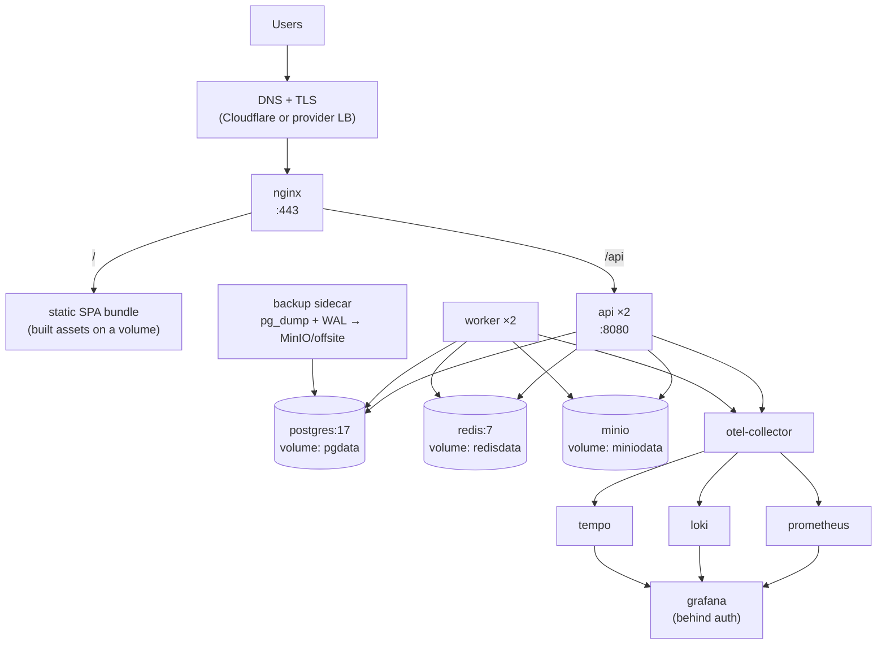
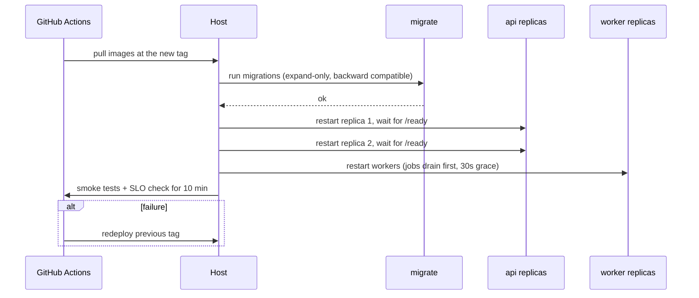
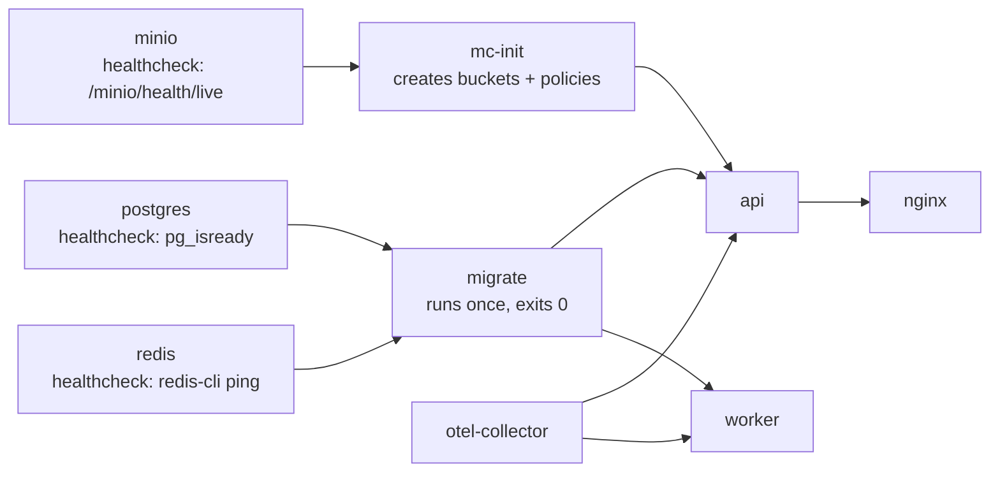
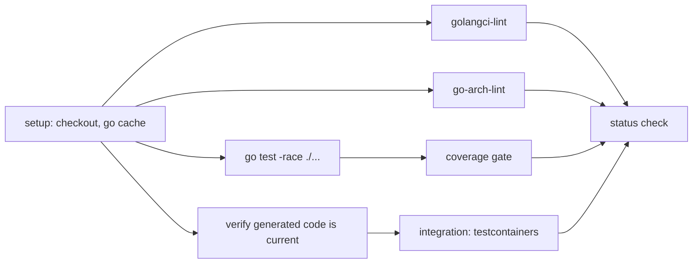
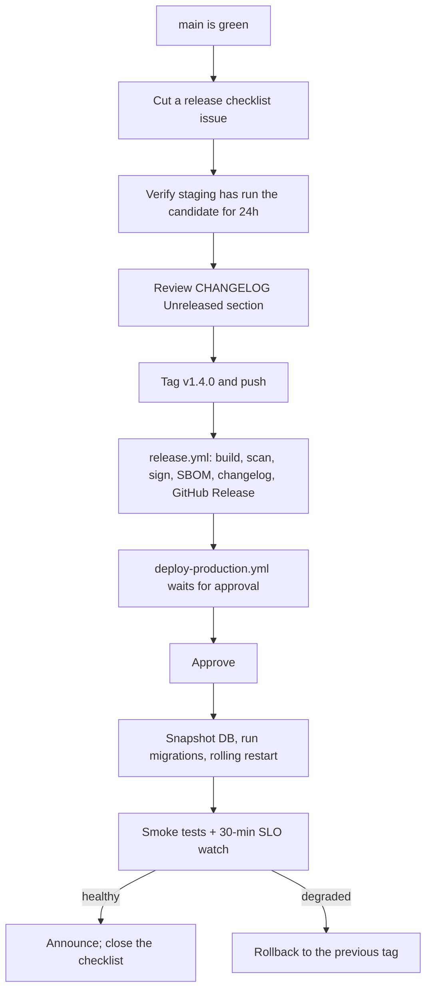

# Operations

Deploying, releasing and running Fluentra.

- [Free-tier deployment](#free-tier-deployment)
- [Deployment](#deployment)
- [Docker](#docker)
- [GitHub Actions](#github-actions)
- [Releases](#releases)
- [Runbook: db-pool-exhausted](#runbook-db-pool-exhausted)
- [Runbook: high-error-rate](#runbook-high-error-rate)
- [Runbook: job-failures](#runbook-job-failures)
- [Runbook: job-queue-backlog](#runbook-job-queue-backlog)
- [Runbook: lockout-spike](#runbook-lockout-spike)
- [Runbook: missing-monthly-partition](#runbook-missing-monthly-partition)
- [Runbook: outbox-lag](#runbook-outbox-lag)
- [Runbook: refresh-reuse](#runbook-refresh-reuse)
- [Runbook: slow-queries](#runbook-slow-queries)
- [Runbook: slow-requests](#runbook-slow-requests)
- [Runbook: stuck-attempt](#runbook-stuck-attempt)

## Free-tier deployment

How v1 runs on free plans. The [Deployment](#deployment) section below describes
the self-hosted Docker Compose topology instead.

| Piece | Host | Notes |
|---|---|---|
| Web (`web/`) | Vercel Hobby | `web/vercel.json` proxies `/api/*` to Render, so cookies stay same-site |
| API and worker | Render free web service | One service runs both through `deploy/render/start.sh` |
| PostgreSQL | Supabase free | Session pooler, port 5432 |
| Redis | Upstash free | `rediss://` URL |
| Object storage | Cloudflare R2 | Five buckets, created by hand, CORS on three |
| Mail | Resend | Render blocks outbound SMTP |

### Render service

| Setting | Value |
|---|---|
| Runtime | Go |
| Build command | `go build -o bin/api ./cmd/api && go build -o bin/worker ./cmd/worker` |
| Start command | `bash deploy/render/start.sh` |
| Health check path | `/health` — never `/ready`, which pings Redis and R2 on every check and would spend the Upstash quota |

`start.sh` maps Render's `PORT` to the API's `HTTP_PORT`, runs the worker on
8081, points `WORKER_URL` at it, and splits the database pool (API 8, worker
`WORKER_DB_MAX_CONNS`, default 5).

Environment variables (everything else keeps its `.env.example` default):

| Key | Value |
|---|---|
| `APP_ENV` | `production` (Secure cookies; the demo seed refuses to run) |
| `DB_DSN` | `postgresql://postgres.<ref>:<password>@aws-0-<region>.pooler.supabase.com:5432/postgres?sslmode=require` |
| `DB_MAX_CONNS` | `8` |
| `REDIS_URL` | `rediss://default:<password>@<host>.upstash.io:6379` |
| `S3_ENDPOINT` | `https://<account-id>.r2.cloudflarestorage.com` |
| `S3_REGION`, `S3_USE_SSL`, `S3_USE_POST_POLICY` | `auto`, `true`, `false` |
| `S3_ACCESS_KEY`, `S3_SECRET_KEY` | An R2 "Object Read & Write" token for the five buckets |
| `JWT_SIGNING_KEY`, `OTP_HMAC_KEY` | Two different random values of at least 32 bytes |
| `CORS_ALLOWED_ORIGINS` | The site's origins, comma-separated |
| `HTTP_TRUSTED_PROXIES` | Render's internal range (`10.0.0.0/8`). Without it every client shares one IP, and the per-IP auth limits and lockout hit everyone at once |
| `OTEL_EXPORTER_OTLP_ENDPOINT` | Empty: logs go to stdout (the Render log view) and nothing is exported |
| `MAIL_TRANSPORT`, `RESEND_API_KEY`, `MAIL_FROM` | `resend`, the key, an address on a domain verified in Resend |
| `OAUTH_GOOGLE_CLIENT_ID`, `OAUTH_GOOGLE_CLIENT_SECRET`, `OAUTH_GOOGLE_REDIRECT_URL` | `https://<site>/auth/google/callback` |
| `AI_PROVIDER_1_*`, `SPEECH_ASR_*` | A real provider; `mock` grades everything as correct |

Session mode (5432) is required: transaction mode (6543) breaks River's
`LISTEN`, the cron scheduler's advisory locks and the migrator's `SET ROLE`.

### First deploy

1. **Supabase.** Create the project. Under API settings, turn the Data API off; the
   app does not use it.
2. **GitHub environment.** Create `seed-production` (Settings → Environments),
   restrict it to `main`, add yourself as a required reviewer, and give it
   `DB_DSN` (the session pooler DSN), `SEED_ADMIN_EMAIL` (the address you will
   register with in step 5), and the R2 values the API uses, `S3_ENDPOINT`,
   `S3_ACCESS_KEY` and `S3_SECRET_KEY`: the seed uploads the dashboard's
   promotional slides (`db/fixtures/banners`, rendered by `tools/banners`).
3. **R2.** Create the buckets and apply CORS: [deploy/r2/README.md](../deploy/r2/README.md).
4. **Migrate.** Actions → **seed-production** → Run workflow, task `migrate`,
   confirm `production`. Render's free plan has no shell or pre-deploy step, so
   migrations run from here.
5. **Render**, then **Vercel** (root directory `web`). If the Render hostname
   changes, update the `/api` rewrite in `web/vercel.json`. Register on the site
   with `SEED_ADMIN_EMAIL` and verify the address.
6. **Catalogue.** Run **seed-production** again with task `migrate-and-seed`. It
   promotes that account to admin (it never creates one), loads the courses,
   10,000 words and the mock tests (about 77 MB) with `cmd/seed -reference`, and
   starts **tts-render** to voice the listening items. It is idempotent, so an
   interrupted run can simply be repeated.

From a machine instead of Actions, `APP_ENV` must say where the DSN goes:
`APP_ENV=production DB_DSN='<DSN>' go run ./cmd/migrate up`, then
`APP_ENV=production DB_DSN='<DSN>' go run ./cmd/seed -reference -admin-email you@example.com`.
`cmd/migrate`, `cmd/seed` and `cmd/tts` refuse a remote DSN while `APP_ENV` says
`local`, `development` or `ci`: a `.env` pointed at production but still named
local is how demo accounts reach production.

### Every deploy

Push to `main`; Render rebuilds. When the release adds migrations, run
**seed-production** with task `migrate` first. Migrations must stay
backward-compatible with the running version.

### Free-plan limits

- **Render:** sleeps after 15 idle minutes. The first request then takes about a
  minute, inside Vercel's 120 s proxy timeout. 750 instance-hours a month.
- **Supabase:** 500 MB; pauses after 7 days without activity.
- **Upstash:** 500K commands a month, roughly 4,000–8,000 API requests a day.
- **Resend:** 100 emails a day.
- **Vercel Hobby:** non-commercial use only. Move to Pro before taking payments.
- **GitHub Actions:** on a private repository the hourly `tts-render` and
  `media-render` schedules use most of the 2,000 free minutes.
- **Memory:** a password hash costs 64 MiB. `start.sh` sets `GOMEMLIMIT` for both
  processes, but many simultaneous sign-ins can still exhaust 512 MB.

## Deployment

---

### 1. Environments

| Env | Host | Data | Deploys on | Who can deploy |
|---|---|---|---|---|
| `local` | developer machine | seeded | `make dev` | anyone |
| `ci` | GitHub runner | ephemeral | every push | automation |
| `staging` | single VM | anonymised copy of production | merge to `main` | automation |
| `production` | single VM (year 1) | live | tag `v*.*.*` + approval | release manager |

### 2. Topology (production)



Two API replicas and two workers on one host give rolling restarts without downtime. That is
the ceiling of this topology; beyond it, move to two hosts or a container platform (§9).

### 3. Configuration

Every key is documented in `docs/deployment/configuration.md` and mirrored in `.env.example`.
The application **fails to start** if a required key is missing or invalid.

| Group | Keys (abridged) |
|---|---|
| App | `APP_ENV`, `APP_VERSION`, `APP_BASE_URL`, `HTTP_PORT`, `HTTP_READ_TIMEOUT`, `SHUTDOWN_GRACE` |
| Database | `DB_DSN`, `DB_MAX_CONNS`, `DB_MAX_IDLE`, `DB_CONN_LIFETIME` |
| Redis | `REDIS_URL`, `REDIS_POOL_SIZE`, `REDIS_TLS` |
| Storage | `S3_ENDPOINT`, `S3_ACCESS_KEY`, `S3_SECRET_KEY`, `S3_REGION`, `S3_BUCKET_*`, `S3_PRESIGN_TTL` |
| Auth | `JWT_SIGNING_KEY`, `JWT_PREVIOUS_KEY`, `ACCESS_TTL`, `REFRESH_TTL`, `ARGON2_*` |
| Mail | `SMTP_*` or `MAIL_PROVIDER_*`, `MAIL_FROM` |
| AI | `AI_ENABLED`, `AI_DEFAULT_CHAIN`, `AI_TASK_ROUTES` (file path), `AI_DAILY_BUDGET_USD`, `ANTHROPIC_API_KEY`, `OPENAI_API_KEY`, `GEMINI_API_KEY`, `OPENROUTER_API_KEY` |
| Speech | `SPEECH_PROVIDER`, `SPEECH_API_KEY`, `SPEECH_REGION` |
| Jobs | `WORKER_QUEUES`, `WORKER_CONCURRENCY`, `JOB_MAX_ATTEMPTS` |
| Telemetry | `OTEL_EXPORTER_OTLP_ENDPOINT`, `OTEL_SERVICE_NAME`, `OTEL_TRACES_SAMPLER_ARG`, `LOG_LEVEL` |
| Limits | `RATE_LIMIT_*`, `UPLOAD_MAX_MB`, `AUDIO_MAX_SECONDS` |
| Payments | `PAYMENT_PROVIDER`, `PAYMENT_*_KEY`, `PAYMENT_WEBHOOK_SECRET` |

Secrets are injected as Docker secrets or from the host's secret store — never baked into an
image, never committed.

### 4. First-time production setup

```bash
# 1. Host prep: docker engine + compose v2, firewall (80/443 only), unattended security updates
# 2. Clone the repo at the release tag
# 3. Create the secrets files under /etc/fluentra/secrets/ (0600, root-owned)
# 4. Configure DNS + obtain certificates
# 5. Bring up data services first, then run migrations, then the app
docker compose -f deploy/compose/compose.yaml -f deploy/compose/compose.prod.yaml up -d postgres redis minio
docker compose -f deploy/compose/compose.yaml -f deploy/compose/compose.prod.yaml run --rm migrate
docker compose -f deploy/compose/compose.yaml -f deploy/compose/compose.prod.yaml up -d
```

#### 4.1 Object storage CORS

Avatars upload from the browser straight to object storage, and a cross-origin
`PUT` is always preceded by a CORS preflight. A bucket with no CORS policy
refuses that preflight, so the upload never leaves the browser — no environment
variable and no code change substitutes for the bucket setting.

On Cloudflare R2, apply [deploy/r2/cors.json](../deploy/r2/cors.json) to the avatar
bucket; that folder's README has the command and the one-line `curl` that tells
you whether it took. R2 also needs `S3_REGION=auto` and
`S3_USE_POST_POLICY=false`, because it does not implement S3 POST policies.

Then verify with the checklist in §6.

### 5. Rolling deployment



Rules:

- **Migrations run before the new code and must be backward compatible** with the previous
  release (expand → migrate → contract). This is what makes rollback safe.
- Old and new code run simultaneously during the rollout. Design every change for that.
- Workers finish in-flight jobs during the 30-second grace period; River re-queues anything unfinished.

### 6. Post-deploy verification

- [ ] `/health` and `/ready` return 200 on both replicas
- [ ] Version endpoint reports the expected tag
- [ ] A synthetic login journey passes
- [ ] Error rate and p95 latency unchanged after 10 minutes
- [ ] Job queues draining; `job_oldest_pending_seconds` normal
- [ ] No new `error` log signatures
- [ ] AI spend rate normal
- [ ] Grafana annotations record the deploy

### 7. Rollback

| Trigger | Action |
|---|---|
| Smoke tests fail | Automatic redeploy of the previous tag |
| SLO burn after deploy | Manual `rollback.yml` dispatch |
| Bad migration | Restore from the pre-deploy snapshot (taken automatically before migrations) |

Because migrations are expand-only, rolling back code alone is almost always sufficient.
A down-migration is only run when the release notes explicitly declare it safe.

### 8. Backup and restore

| What | How | Frequency | Retention | Verified |
|---|---|---|---|---|
| Postgres | `pg_dump` (custom format) + continuous WAL archiving | nightly / continuous | 30 days | monthly restore drill |
| MinIO | `mc mirror` to offsite | nightly | 30 days | quarterly |
| Secrets | Encrypted export to the password manager | on change | — | on change |
| Grafana dashboards | In git | — | — | — |

RPO 15 minutes, RTO 1 hour. The restore procedure is in
`docs/operations/runbooks/restore.md` and is **timed** during each drill; if the drill exceeds
the RTO, that is an incident in itself.

### 9. Scaling path

| Stage | Trigger | Action |
|---|---|---|
| 1 | Baseline | 2 api + 2 worker on one host |
| 2 | CPU > 60 % sustained | Vertical: bigger host |
| 3 | DB read-bound | Add a read replica; route reads through the repository interface |
| 4 | Worker-bound | Split workers by queue onto a second host |
| 5 | Host is the limit | Move to two hosts + external load balancer, or a container platform |
| 6 | A module is resource-asymmetric | Extract it — see ARCHITECTURE §20; **not before** |

### 10. Operational runbooks

`docs/operations/runbooks/` — one per alert:
`api-down.md` · `high-latency.md` · `db-pool-exhausted.md` · `queue-stalled.md` ·
`ai-provider-outage.md` · `ai-budget-exceeded.md` · `disk-full.md` · `restore.md` ·
`rollback.md` · `security-incident.md` · `payment-reconciliation.md`

Each follows: **Symptom → Impact → Diagnosis (with the exact query/command) → Mitigation →
Root-cause follow-up → Escalation**.

## Docker

---

### 1. Images

| Image | Base (build → runtime) | Size target | Contains |
|---|---|---|---|
| `fluentra-api` | `golang:1.26.9-alpine` → `gcr.io/distroless/static-debian12:nonroot` | < 40 MB | the `api` binary, CA certs, timezone data |
| `fluentra-worker` | `golang:1.26.9-alpine` → `debian:12-slim` | < 220 MB | the `worker` binary + `ffmpeg` + `audiowaveform` |
| `fluentra-migrate` | `golang:1.26.9-alpine` → distroless | < 25 MB | the `migrate` binary + embedded migrations |
| `fluentra-web` | `node:24-alpine` → `nginx:1.27-alpine` | < 60 MB | built SPA assets + nginx config |

The worker cannot be distroless because it shells out to `ffmpeg`; it is the one image where we
accept a fuller base, and it is scanned accordingly.

### 2. Dockerfile rules

| # | Rule | Why |
|---|---|---|
| D1 | Multi-stage always | Compilers and toolchains never ship |
| D2 | Order layers by change frequency: base → deps → source | Cache hits on the common case |
| D3 | `go mod download` in its own layer before copying source | Dependency layer survives source edits |
| D4 | Cache mounts: `--mount=type=cache,target=/go/pkg/mod` and `/root/.cache/go-build` | 3–5× faster rebuilds |
| D5 | `CGO_ENABLED=0`, `-trimpath`, `-ldflags "-s -w -X main.version=…"` | Static, reproducible, smaller |
| D6 | Non-root user; read-only root filesystem; `no-new-privileges` | Least privilege |
| D7 | Pin base images by digest | Reproducible and tamper-evident |
| D8 | `HEALTHCHECK` on every long-running service | Compose can gate dependents |
| D9 | No secrets in `ARG`/`ENV`/layers | They persist in the image history |
| D10 | `.dockerignore` excludes `.git`, `node_modules`, `web/dist`, `docs`, test data | Smaller, faster context |
| D11 | Exactly one process per container | No supervisors, no bundled cron |
| D12 | `STOPSIGNAL SIGTERM` + graceful shutdown in the app | Clean drains |

### 3. Compose layout

```
deploy/compose/
├── compose.yaml                  # base: api, worker, postgres, redis, minio, migrate
├── compose.dev.yaml              # air, vite, mailpit, jaeger, adminer, seed, exposed ports
├── compose.observability.yaml    # otel-collector, prometheus, loki, tempo, grafana
├── compose.prod.yaml             # nginx, limits, restart policies, log rotation, no exposed DB ports
└── .env.example
```

```bash
make dev            # base + dev + observability — the full local stack
make dev-infra      # postgres + redis + minio only, ports published
make dev-infra-down # stop those three, leaving everything else alone
make prod-up        # base + prod + observability
```

**Never run `compose.yaml` on its own for local work.** Its `backend` network is
`internal: true` and it publishes no ports, so the services come up healthy and nothing
on the host can reach them — a failure that looks like a connection bug rather than a
missing overlay. `compose.dev.yaml` is what publishes the ports and flips the network;
`make dev` and `make dev-infra` combine them for you.

Use `make dev-infra` when you only need the data services: running the integration suite,
`go run ./cmd/api` on the host, or `psql` against the dev database. It skips building the
application images, which is most of the wait.

#### Port already in use

Another project's container on 5432 or 6379 is common. Borrow the port, then give it
back:

```bash
docker ps --format "{{.Names}} {{.Ports}}"   # find the holder
docker stop <name>
# ... your work ...
docker start <name>                             # do not skip this
```

`docker stop` / `docker start` keep the container and its volumes; the data is untouched.
Never `docker rm` or `docker volume rm` something you did not create in order to free a
port, and never renumber the project's ports to dodge a conflict — the DSNs in
`compose.dev.yaml`, the CI workflow and every runbook assume the standard ones.

Prefer `make dev-infra-down` over `docker compose down`. `down` operates on the whole
project and has stopped unrelated containers carrying matching labels; the target names
the three services explicitly.

### 4. Service definitions — required properties

| Property | Rule |
|---|---|
| `restart` | `unless-stopped` in prod |
| `healthcheck` | Every service; `depends_on: condition: service_healthy` |
| `deploy.resources.limits` | CPU and memory set for every service in prod |
| `logging` | `json-file` with `max-size: 10m`, `max-file: 3` |
| `volumes` | Named volumes for state; bind mounts only in dev |
| `networks` | `frontend` (nginx ↔ api) and `backend` (api ↔ data); data services are **not** on `frontend` |
| `ports` | In prod only nginx publishes ports; Postgres/Redis/MinIO stay internal |
| `env_file` / `secrets` | Secrets via Docker secrets, not environment literals |
| `user` | Non-root everywhere it is supported |

### 5. Startup order



`migrate` is a one-shot service with `restart: "no"`. The API refuses to start if the schema
version is older than the binary expects — a mismatch is a loud failure, not a subtle one.

### 6. Resource allocation (single production host, 8 vCPU / 16 GB baseline)

| Service | CPU limit | Memory limit | Replicas |
|---|---|---|---|
| api | 1.5 | 768 MB | 2 |
| worker | 2.0 | 1.5 GB | 2 |
| postgres | 2.0 | 4 GB | 1 |
| redis | 0.5 | 512 MB | 1 |
| minio | 0.5 | 512 MB | 1 |
| nginx | 0.5 | 128 MB | 1 |
| otel-collector | 0.5 | 512 MB | 1 |
| prometheus | 0.5 | 1 GB | 1 |
| loki | 0.5 | 768 MB | 1 |
| tempo | 0.5 | 768 MB | 1 |
| grafana | 0.25 | 256 MB | 1 |

The worker gets the largest allocation because `ffmpeg` and ASR pre-processing are the CPU-heavy
parts of the system. Tune from the dashboards, not from these guesses.

### 7. Volumes and data

| Volume | Contents | Backed up |
|---|---|---|
| `pgdata` | PostgreSQL | ✅ dump + WAL |
| `redisdata` | Redis AOF | ❌ (rebuildable — nothing authoritative lives only in Redis) |
| `miniodata` | Objects | ✅ mirrored offsite |
| `promdata`, `lokidata`, `tempodata` | Telemetry | ❌ (retention-bounded) |
| `grafanadata` | Grafana state | dashboards are in git; only user prefs live here |

**Never** run `docker compose down -v` without an explicit decision. It deletes learner data.
The Makefile target that does this is named `db-reset-DANGEROUS` and prompts for confirmation.

### 8. Security posture

| Control | Setting |
|---|---|
| User | `nonroot` / explicit `user:` |
| Filesystem | `read_only: true` + `tmpfs` for `/tmp` |
| Capabilities | `cap_drop: [ALL]`, add back only what a service needs |
| Privileges | `security_opt: [no-new-privileges:true]` |
| Networking | Internal networks; no data service published |
| Images | Digest-pinned, Trivy-scanned, cosign-verified before deploy |
| Secrets | Docker secrets mounted at `/run/secrets`, `0400` |
| Updates | Base images rebuilt weekly even without code changes |

### 9. Local development

`compose.dev.yaml` provides the full application and development overlay:

| Service | Purpose |
|---|---|
| `api` | Go API server running under `air` hot reload at :8080 |
| `worker` | Background worker daemon running under `air` hot reload at :8081 |
| `web` | React frontend running under `vite` dev server with HMR at :5173 |
| `mailpit` | Catches all outbound email. HTTP API at :8025, SMTP at :1025 |
| `postgres` | Port published at 127.0.0.1:5432 |
| `redis` | Port published at 127.0.0.1:6379 |
| `minio` | S3 API at :9000 and console at :9001 |
| `createbuckets` | One-shot. Creates the five buckets; exits 0 and stays exited |

Four things in this overlay exist because the stack did not work without them, and each
is easy to remove by accident:

- **Mailpit publishes 1025 as well as 8025.** The HTTP port is how a test reads a
  message; the SMTP port is where the worker delivers it. With only 8025 published, an
  API run on the host has nowhere to send, registration writes the challenge, and no code
  ever arrives.
- **`createbuckets`.** MinIO starts empty and nothing in the application creates its
  buckets — the storage client presigns against a bucket it expects to exist. Without it
  the stack comes up healthy and the first avatar upload fails against it.
- **`VITE_USE_POLLING=true` on `web`.** A bind-mounted source tree delivers no inotify
  events to the container on Windows or macOS, so Vite never learns a file changed and
  serves the module it transformed at startup. The app then looks stale while the file on
  disk is right. The polling is scoped in `vite.config.ts`; unscoped it costs a core.
- **`CI=true` on `web`.** `pnpm dev` runs a dependency check first, and when it decides
  the mounted `node_modules` volume is stale it wants to purge and reinstall. Without a
  TTY it refuses and exits 1, so the container reports "running" and serves nothing.
- **The `gomodcache` volume on `api` and `worker`.** The image downloads modules behind a
  BuildKit cache mount the container cannot see; without the volume every restart
  re-downloads the module graph. Ready in 15s with it, 170s without.

`compose.dev.yaml` overrides `backend` to `internal: false` so that published data ports are accessible from localhost for host tooling (`psql`, `redis-cli`, `make migrate-up`, tests).

For running application binaries on the host directly (pointing at containerized data services on localhost):

- `make api` — starts the API server on the host
- `make worker` — starts the worker daemon on the host
- `make web` — starts Vite dev server on the host

`make dev-infra` starts only the data services — postgres, redis, minio, mailpit — with
their ports published and the buckets provisioned. It is what the integration suite and
the E2E job both use, so the stack has one description rather than a second one written
out by hand in a workflow file. Tests point at it through `TEST_DATABASE_URL`,
`TEST_REDIS_ADDR` and `TEST_S3_*`; they never start their own containers.

### 10. Troubleshooting

| Symptom | Check |
|---|---|
| `api` restarts in a loop | `docker compose logs api` — usually a missing required config key |
| Migration fails | Check for a lock held by a previous crashed run; `goose status` |
| Worker idle while jobs pile up | `WORKER_QUEUES` does not include the queue the jobs were enqueued to |
| Uploads fail with 403 | MinIO bucket policy or clock skew breaking presigned signatures |
| No traces in Grafana | Collector endpoint wrong, or tail sampling dropping them; check the Collector's own logs |
| Slow rebuilds | Cache mounts not used, or `.dockerignore` missing an entry |
| Out of disk | Telemetry retention, or orphaned MinIO objects — run the GC job |

## GitHub Actions

---

### 1. Workflow inventory

| Workflow | Trigger | Duration target | Blocking |
|---|---|---|---|
| `ci-backend.yml` | push/PR touching `**.go`, `db/**`, `api/**` | < 8 min | ✅ |
| `ci-frontend.yml` | push/PR touching `web/**` | < 6 min | ✅ |
| `ci-e2e.yml` | PR to `main`, nightly | < 15 min | ✅ on PR to main |
| `security.yml` | push, weekly schedule | < 10 min | ✅ (high/critical only) |
| `docs.yml` | push touching `docs/**`, `**/AGENT.md`, `*.md` | < 3 min | ✅ |
| `ai-eval.yml` | PR touching `docs/prompts/runtime/**`, nightly | < 20 min | ✅ on prompt change |
| `build.yml` | push to `main`, tag `v*` | < 10 min | — |
| `release.yml` | tag `v*` | < 15 min | — |
| `deploy-staging.yml` | after `build.yml` on `main` | < 5 min | — |
| `deploy-production.yml` | tag `v*` + environment approval | < 10 min | — |
| `rollback.yml` | manual dispatch | < 5 min | — |
| `deps.yml` | weekly (Renovate) | — | — |

### 2. Shared conventions

| Convention | Detail |
|---|---|
| Concurrency | `group: ${{ github.workflow }}-${{ github.ref }}`, `cancel-in-progress: true` for PRs |
| Permissions | `permissions: {contents: read}` at the top; elevated only on the job that needs it |
| Action pinning | Third-party actions pinned to a commit SHA, not a tag |
| Caching | Go build + module cache keyed on `go.sum`; pnpm store keyed on the lockfile; Docker buildx cache to GHA |
| Matrix | Only where it buys something (e.g. Postgres 17 now, 18 when it lands) |
| Secrets | Repository/environment secrets; OIDC for registry auth — no long-lived tokens |
| Timeouts | Every job sets `timeout-minutes`; no job may hang the queue |
| Artefacts | Coverage reports, Playwright traces, SBOMs, eval reports uploaded on failure or release |
| Annotations | Failures annotated inline on the PR diff |

### 3. `ci-backend.yml` — job graph



| Step | Fails when |
|---|---|
| `verify generated code` | `make gen` produces a diff — someone edited generated code or forgot to regenerate |
| `golangci-lint` | Any enabled linter reports an issue |
| `go-arch-lint` | **A module imported another module's internals** — the boundary guard |
| `go test -race` | Any test fails or a data race is detected |
| coverage gate | Below the thresholds in `TESTING_GUIDELINE.md` §2 |
| integration | testcontainers tests fail against real Postgres/Redis/MinIO |
| `spectral` on the OpenAPI spec | Spec lint violations |
| migration check | A migration lacks a `Down`, or is not in a module folder |

### 4. `ci-frontend.yml`

`tsc --noEmit` → `eslint` (including the feature-boundary rule) → `vitest --coverage` →
`vite build` → bundle-size budget check → `vitest-axe` accessibility assertions.

The bundle budget fails the build if the initial chunk exceeds 200 KB gzip or any route chunk
exceeds 120 KB.

### 5. `ci-e2e.yml`

Spins up the full compose stack (with the `mock` AI provider and a local SMTP sink), seeds the
demo dataset, runs Playwright sharded across 3 runners, uploads traces on failure.

Rules: no external network calls; deterministic seed data; each shard has its own stack;
a flaky test is quarantined by label and must be fixed or deleted within 24 hours.

### 6. `security.yml`

| Check | Tool | Fails on |
|---|---|---|
| Secrets | gitleaks | any finding |
| Go vulnerabilities | govulncheck | any reachable vulnerability |
| npm vulnerabilities | `pnpm audit` | high/critical |
| SAST | CodeQL (go, javascript) | high/critical |
| Image scan | Trivy | high/critical with a fix available |
| Licence check | `go-licenses` + `license-checker` | a copyleft licence in a distributed artefact |
| SBOM | Syft → CycloneDX | — (artefact only) |

### 7. `docs.yml`

| Check | What it catches |
|---|---|
| markdownlint | Formatting drift |
| lychee link check | Broken internal and external links |
| front-matter schema | Missing `module`, `status`, `last_verified`, … |
| section presence | A module `AGENT.md` missing one of the 14 required sections |
| `docs-drift` | `tables:` front-matter ≠ actual migrations |
| `api-drift` | An endpoint in `API.md` not present in `openapi.yaml` (and vice versa) |
| `dep-drift` | `depends_on` front-matter ≠ `.go-arch-lint.yml` |
| staleness | `last_verified` older than 90 days on a module changed since (warning, weekly report) |

### 8. `ai-eval.yml`

Runs each changed task's eval suite against the `mock` provider (deterministic, free) and one
cheap real model, then posts a comparison table as a PR comment:

| Task | Metric | Current active (v3) | This PR (v4) | Threshold | Verdict |
|---|---|---|---|---|---|
| `writing.grade_essay` | band MAE | 0.38 | 0.31 | ≤ 0.40 | ✅ improved |
| `writing.grade_essay` | schema valid | 0.995 | 0.999 | ≥ 0.99 | ✅ |
| `writing.grade_essay` | injection resisted | 1.00 | 1.00 | = 1.00 | ✅ |

A regression below threshold blocks the merge. Promotion of a prompt to `active` additionally
requires a human approval from the learning team.

### 9. `build.yml` and `release.yml`

| Step | Detail |
|---|---|
| Build | Buildx, multi-stage, `linux/amd64` (+`arm64` when a runner is available) |
| Tag | `ghcr.io/<org>/fluentra-api:{sha}` and `:{semver}`; `:latest` only on a release tag |
| Sign | cosign keyless with OIDC |
| Attest | SBOM + provenance attached |
| Changelog | `git-cliff` from Conventional Commits |
| Release | GitHub Release with notes, SBOM, and image digests |
| Deploy | Triggers `deploy-production.yml`, gated by the `production` environment's required reviewers |

### 10. Pipeline metrics

Each workflow pushes to the Collector:
`ci_pipeline_duration_seconds{workflow}` · `ci_job_result_total{job,result}` ·
`deploy_total{env,result}` · `rollback_total{env}`.

Recording rules derive the DORA four keys, shown on the CI/CD dashboard. If lead time or
change-failure rate degrades for two consecutive weeks, it goes on the retro agenda.

### 11. Local parity

```bash
make ci          # runs the same checks CI runs, in the same order
make ci-fast     # lint + unit only, for the inner loop
```

`make ci` passing locally should mean CI passes. When it does not, that discrepancy is a bug in
the tooling and gets fixed — developers must be able to trust the local command.

### 12. Cost and speed hygiene

| Practice | Effect |
|---|---|
| Path filters on every workflow | Frontend changes do not run backend integration tests |
| `cancel-in-progress` on PRs | No wasted runners on superseded pushes |
| Aggressive caching (Go, pnpm, Docker layers, Playwright browsers) | 3–5× faster warm runs |
| Integration tests only on backend changes | Keeps the median PR under 8 minutes |
| Nightly for expensive suites (E2E full, load, real-provider evals) | Fast PRs, thorough nights |
| Self-hosted runner (optional, later) | Considered only if queue time becomes the bottleneck |

## Releases

---

### 1. Versioning

Semantic Versioning `MAJOR.MINOR.PATCH`, applied to the **product as a whole** (one version
for API + web + workers — they deploy together).

| Bump | When |
|---|---|
| `MAJOR` | Breaking API change, or a migration that cannot roll back |
| `MINOR` | New feature, new endpoint, new module, backward compatible |
| `PATCH` | Bug fix, performance, docs, dependency bump |

Pre-releases: `v1.4.0-rc.1`. The **API** version (`/api/v1`) is independent and changes far more
slowly — a `MAJOR` product bump does not automatically bump the API path.

### 2. Conventional Commits

```
<type>(<scope>): <subject>

[body: why, not what]

[BREAKING CHANGE: description]
Refs: #123
```

| Type | Bump | Appears in changelog |
|---|---|---|
| `feat` | MINOR | ✅ Added |
| `fix` | PATCH | ✅ Fixed |
| `perf` | PATCH | ✅ Changed |
| `refactor` | PATCH | — |
| `docs` | PATCH | — |
| `test`, `chore`, `ci`, `build`, `style` | PATCH | — |
| any with `BREAKING CHANGE:` | MAJOR | ✅ Breaking |

Scope is the module name (`auth`, `srs`, `platform/ai`, `web`). CI rejects a commit that does
not parse.

### 3. Branching

`main` is always releasable. Short-lived feature branches, squash-merged. No `develop` branch;
no long-running release branches. A hotfix branches from the release tag, is fixed, tagged, and
cherry-picked back to `main`.

### 4. Release process



### 5. Pre-release checklist

- [ ] `main` CI fully green, including nightly E2E and eval suites
- [ ] Candidate has run on staging for ≥ 24 h with production-like data
- [ ] `CHANGELOG.md` `Unreleased` section reviewed and accurate
- [ ] All migrations in this release are backward compatible with the previous release
- [ ] Any destructive step is scheduled for a later release (expand → migrate → contract)
- [ ] New config keys documented in `.env.example` and `docs/deployment/configuration.md`, and set on the target host
- [ ] New feature flags default to **off** in production
- [ ] New alerts and dashboards deployed
- [ ] Runbooks exist for anything new that can page
- [ ] Module `AGENT.md` files updated; `docs.yml` green
- [ ] Security scans clean of high/critical
- [ ] Rollback path confirmed (and, if a migration is not reversible, the plan is written down)

### 6. Migration safety by release

| Change | Release N | Release N+1 | Release N+2 |
|---|---|---|---|
| Add a column | add nullable, backfill lazily | make it `NOT NULL` when fully populated | — |
| Rename a column | add new, write both, read old | read new, still write both | drop old |
| Drop a column | stop writing it | — | drop it |
| Change a type | add a new column, dual-write | migrate reads | drop old |
| Add an index | `CREATE INDEX CONCURRENTLY` | — | — |
| Add a NOT NULL constraint | add as `NOT VALID`, backfill | `VALIDATE CONSTRAINT` | — |

A release containing a destructive step and the code that depends on it in the same tag cannot
be rolled back. That combination requires explicit sign-off and a tested restore plan.

### 7. Feature flags

| Rule | Detail |
|---|---|
| Default | New flags default to `off` in production |
| Rollout | internal → 5 % → 25 % → 100 %, with a metric watched at each step |
| Kill switch | Every AI feature and every external-provider integration has one |
| Lifetime | A flag that has been at 100 % for 30 days is removed; a lingering flag is tech debt |
| Ownership | Each flag has an owner and an expiry date in the flag table |

### 8. Changelog

`CHANGELOG.md` follows Keep a Changelog. It is generated by `git-cliff` from Conventional
Commits and then **edited by a human** before release — generated text describes commits;
release notes should describe user-visible change.

Sections: Added · Changed · Deprecated · Removed · Fixed · Security · Breaking · Migration notes.

### 9. Hotfix

1. Branch from the production tag: `hotfix/v1.4.1-fix-refresh-loop`
2. Minimal fix + a regression test
3. Full CI, plus a targeted manual verification
4. Tag `v1.4.1`, deploy with the normal approval (expedited, not skipped)
5. Cherry-pick to `main` the same day
6. Postmortem if it was a user-visible incident

### 10. Post-release

- [ ] Grafana annotation added at the deploy time
- [ ] 30-minute SLO watch clean
- [ ] Error budget consumption recorded
- [ ] Release notes shared with the team
- [ ] Feature-flag rollout schedule started
- [ ] The release checklist issue closed with actual timings (they feed the DORA metrics)

### 11. Deprecating an API operation

1. Mark `deprecated: true` in `openapi.yaml` with a `Sunset` date at least 6 months out.
2. Emit `Deprecation` and `Sunset` headers; meter usage per client.
3. Announce in `CHANGELOG.md` and the release notes.
4. Provide the replacement and a migration note in `docs/api/`.
5. Remove only after the sunset date **and** 30 consecutive days of zero usage.

## Runbook: db-pool-exhausted

**Alert:** `DatabaseConnectionPoolExhausted`
**Threshold:** `db_pool_connections{state="acquired"} / db_pool_connections{state="max"} > 0.9` for 5 minutes
**Severity:** High

The pool is nearly all handed out. Requests are not failing yet — they queue inside
`pgxpool.Acquire` — so the first symptom users see is latency, not errors. If it stays
here, `Acquire` starts timing out and the API returns 503.

### Diagnosis

Which states the pool is actually in — run this first, because it separates "genuinely
busy" from "leaking":

```promql
db_pool_connections
```

`acquired` near `max` with `idle` at zero is real load or a leak. `constructing` high is
a pool still warming up, which is normal shortly after a deploy and resolves itself.

Then find what is holding the connections:

```sql
SELECT pid, usename, client_addr, state, now() - query_start AS age, query
FROM pg_stat_activity
WHERE state != 'idle'
ORDER BY query_start ASC
LIMIT 20;
```

A handful of very old rows is a stuck query. Many young rows is load. Rows sitting in
`idle in transaction` are a leak — a transaction opened and never committed or rolled
back.

### Common causes

1. A query with no index doing sequential scans under load — cross-check the
   `SlowQueries` alert and the Database dashboard's p95 panel.
2. A connection leak: a `Begin` without a matching `Commit`/`Rollback` on some path.
   `internal/shared/dbx`'s `InTx` helper exists to make this impossible; a leak usually
   means somewhere took a connection without it.
3. Traffic genuinely above what the pool is sized for.
4. A long-running job holding a connection while it does non-database work.

### Remediation

1. If rows are `idle in transaction` and old, that is the leak. Identify the code path
   from the query text before killing anything — the terminate below frees the pool but
   loses the evidence.
2. Terminate the worst offenders when the pool must be freed now:

   ```sql
   SELECT pg_terminate_backend(pid)
   FROM pg_stat_activity
   WHERE state = 'idle in transaction'
     AND now() - query_start > interval '5 minutes';
   ```

3. If it is load rather than a leak, raise the pool ceiling — but check Postgres'
   own `max_connections` first, because a pool larger than the server allows moves the
   failure rather than fixing it.
4. If it began at a deploy, roll back and diagnose from the previous version.

### Escalation

Page the on-call engineer if `acquired/max` stays above 0.9 for more than 15 minutes, or
if the API begins returning 503 — at that point it is a user-visible outage, not a
warning.

## Runbook: high-error-rate

**Alert:** `HighErrorRate`  
**Threshold:** Error rate > 5% for 5 minutes  
**Severity:** Warning

### Diagnosis

```sql
-- Check recent HTTP 5xx errors
SELECT status, path, count(*)
FROM http_requests
WHERE occurred_at > now() - interval '10 minutes'
  AND status >= 500
GROUP BY status, path
ORDER BY count DESC
LIMIT 10;
```

### Common Causes

1. Database connection pool exhausted or PostgreSQL unresponsive
2. Redis connection timeout
3. External dependency (e.g. Google OAuth) failure
4. Recent application deployment regression

### Remediation

1. Check database pool: `SELECT * FROM pg_stat_activity WHERE state != 'idle';`
2. Check Redis connectivity: `redis-cli ping`
3. Inspect application logs: `kubectl logs -l app=fluentra-api --tail=100`
4. Rollback deployment if recent release: `kubectl rollout undo deployment/fluentra-api`

### Escalation

If error rate > 20% or lasts > 30 minutes, page the on-call engineer.

## Runbook: job-failures

**Alert:** `JobFailureRateHigh`  
**Threshold:** Failed jobs > 10% for 10 minutes  
**Severity:** High

### Diagnosis

Check failed job logs in Loki or stdout of worker binaries.

### Remediation

1. Identify failing job class (e.g. data export, email delivery).
2. Fix underlying dependency issue (e.g. SMTP server rate limits or MinIO permissions).
3. Retry failed jobs via River admin tool or operational endpoint.

## Runbook: job-queue-backlog

**Alert:** `JobQueueBacklog`  
**Threshold:** River queue depth > 1000 for 15 minutes  
**Severity:** Warning

### Diagnosis

Inspect River queue depth metrics and worker process CPU/Memory utilization.

### Remediation

1. Scale background worker replicas (`cmd/worker`).
2. Verify worker concurrency settings in environment configuration.

## Runbook: lockout-spike

**Alert:** `LoginLockoutSpike`  
**Threshold:** Rate of account lockouts > 50/5m  
**Severity:** Warning

### Diagnosis

Check auth module security logs to see if a specific IP or set of IPs is attempting credential stuffing.

### Remediation

1. Block offending IP addresses at Nginx/gateway layer.
2. Verify rate-limiting middleware is operational.

## Runbook: missing-monthly-partition

**Alert:** `ScheduledJobFailing` (`kind="srs.rotate_partitions"` or `kind="learning.rotate_partitions"`)
**Symptom:** `ERROR: no partition of relation "review_logs" found for row` on insert
**Severity:** Page — every graded attempt and every answered review fails until it is fixed

`learn.attempts` and `learn.review_logs` are partitioned monthly by their
timestamp. Both migrations pre-create the current month and three ahead, and a
cron job in the worker extends the window every six hours. An insert fails only
when that job has been failing long enough for the window to run out, which is
why the alert watches the job rather than the error.

### Diagnosis

```sql
-- Which partitions exist? The naming is review_logs_yYYYYmMM — see Remediation.
SELECT c.relname
FROM pg_class c
JOIN pg_namespace n ON n.oid = c.relnamespace
WHERE n.nspname = 'learn'
  AND c.relkind = 'r'
  AND (c.relname ~ '^attempts_y\d{4}m\d{2}$' OR c.relname ~ '^review_logs_y\d{4}m\d{2}$')
ORDER BY c.relname;
```

If the newest partition is the current month, the window has run out and the
next insert dated into next month will fail.

Then find out why the job stopped:

```bash
docker compose logs --tail=200 worker | grep -i "cron job failed"
```

### Common causes

1. The worker has been down or crash-looping, so the rotation never ran.
2. The rotation ran but the function errored — usually a permission change on
   `learn.ensure_partitions` / `learn.ensure_srs_partitions`, which are
   `SECURITY DEFINER` and granted to `fluentra_app`.
3. Someone created a partition by hand under the wrong name. See the warning
   below; this one is self-inflicted and looks like cause 2 in the logs.

### Remediation

Call the functions the migrations created. They are idempotent, they take the
number of months to look ahead, and they return how many partitions they made:

```sql
SELECT learn.ensure_partitions(3);      -- learn.attempts
SELECT learn.ensure_srs_partitions(3);  -- learn.review_logs
```

A return of `0` means nothing was missing. Anything higher is the number of
months that had been lost.

Then confirm an insert dated into next month lands where it should:

```sql
-- Substitute a real card and user; the point is the partition it reports.
INSERT INTO learn.review_logs (card_id, user_id, grade, reviewed_at)
VALUES ('<CARD_ID>', '<USER_ID>', 'good', date_trunc('month', now()) + interval '1 month 14 days')
RETURNING tableoid::regclass::text;
```

> **Do not create the partition with `CREATE TABLE ... PARTITION OF` by hand.**
>
> The rotation functions look for `review_logs_yYYYYmMM` (and
> `attempts_yYYYYmMM`) with `to_regclass` before creating anything. A partition
> added under any other name — `review_logs_2026_10`, say — is invisible to that
> check, so the next scheduled run tries to create the correctly-named one and
> fails on an overlap:
>
> ```
> ERROR: partition "review_logs_y2026m10" would overlap partition "review_logs_2026_10"
> ```
>
> The rotation then fails on every run, silently extending the outage into the
> following months. If this has already happened, drop the wrongly-named
> partition — after copying any rows out of it — and re-run the function.

### Verification

```sql
SELECT learn.ensure_srs_partitions(3);  -- expect 0 on a second call
```

The `ScheduledJobFailing` alert clears within one job interval (six hours) once
the underlying cause is fixed. If it does not, the job is still erroring for a
different reason — go back to the logs.

### Escalation

If the functions themselves are missing, the migration was rolled back. Check
`goose_db_version` and re-apply; do not recreate the functions by hand, because
the advisory-lock ids and the partition naming both live in the migration.

---

*Walked through on 2026-08-25 against a migrated database: the September
partition was dropped, an insert dated 2026-09-15 failed with
`no partition of relation "review_logs" found for row`,
`learn.ensure_srs_partitions(3)` returned `1`, and the retried insert landed in
`learn.review_logs_y2026m09`. The wrong-name warning above was reproduced the
same way.*

## Runbook: outbox-lag

**Alert:** `OutboxLagHigh`  
**Threshold:** Outbox lag > 60s for 2 minutes  
**Severity:** Page

### Diagnosis

1. Check worker process logs for outbox publisher errors (`shared/outbox`).
2. Check database connectivity or transaction locks on the outbox table.
3. Check Redis or event bus listener health.

### Remediation

1. Restart worker instances if outbox publisher goroutine is stalled.
2. Verify outbox table indexes and active worker polling loops.

## Runbook: refresh-reuse

**Alert:** `RefreshReuseDetected`  
**Threshold:** Any refresh token reuse event > 0  
**Severity:** Critical

### Diagnosis

Refresh token reuse indicates potential session hijacking (a single-use token was presented twice).

### Remediation

1. Automatic security reaction revokes ALL sessions for the affected user.
2. Verify audit events log both session ID and user ID.
3. Contact affected user if unauthorized access is suspected.

## Runbook: slow-queries

**Alert:** `SlowQueries`  
**Threshold:** Rate of slow queries > 10 per 5 minutes  
**Severity:** Warning

### Diagnosis

```sql
SELECT query, calls, total_exec_time, mean_exec_time
FROM pg_stat_statements
ORDER BY mean_exec_time DESC
LIMIT 10;
```

### Remediation

1. Run EXPLAIN ANALYZE on identified queries.
2. Add missing composite or keyset indices.

## Runbook: slow-requests

**Alert:** `SlowRequests`  
**Threshold:** P95 latency > 2s for 10 minutes  
**Severity:** Warning

### Diagnosis

1. Check Grafana API Overview dashboard for top 10 slowest endpoints.
2. Inspect OpenTelemetry traces for spans with duration > 2s.

### Remediation

1. Identify unindexed database queries on slow endpoints.
2. Check Redis cache hit ratio.
3. Scale API replicas if CPU/Memory pressure is detected.

## Runbook: stuck-attempt

**Alert:** `GradingErrorRateHigh`
**Symptom:** rows in `learn.attempts` sitting in `grading` for more than a few minutes
**Severity:** Page if it is more than a handful — a learner in this state has answered and been told nothing

`grading` is a claim, not a queue. `SubmitAttempt` takes it with a conditional
`UPDATE`, grades, and writes the score, the rollup and the status in one
transaction — so an attempt is only ever in `grading` for as long as that
transaction takes. Anything longer means the process holding the claim died
between taking it and committing.

> **Phase 2 has no asynchronous grading.** The exercise engine supports it —
> `GradeResult.Async` leaves the attempt in `grading` for a consumer to settle —
> but the only registered grader is `vocabulary`, and it always returns
> `Async: false`. There is no `learning.grade_attempt` River worker and no DLQ to
> check. If attempts are stuck *and* a grader has started returning `Async: true`,
> that is the bug: the consumer that clears them is Phase 3.

### Diagnosis

```sql
-- Attempts that took the claim and never settled.
SELECT id, user_id, activity_id, status, created_at, updated_at
FROM learn.attempts
WHERE status = 'grading'
  AND updated_at < now() - interval '5 minutes'
ORDER BY updated_at ASC
LIMIT 20;
```

`'grading'` is the only stuck state worth querying: `ck_attempts_status` permits
`in_progress`, `grading`, `graded` and `failed`, and `in_progress` is simply an
attempt the learner has not submitted yet.

Then check whether the API was restarting around `updated_at`:

```bash
docker compose logs --since 30m api | grep -iE "panic|shutting down|signal"
```

### Common causes

1. The API process was killed — deploy, OOM, or a panic — while holding the claim.
2. The grading transaction failed to commit: database failover, or the pool
   exhausted mid-transaction. `DatabaseConnectionPoolExhausted` usually fires too.
3. A grader was registered that returns `Async: true`. See the note above.

### What the learner sees

A resubmission with the **same** `Idempotency-Key` waits briefly for the claim to
settle and then returns the stored result, so a learner who retries the same
answer recovers on their own. A resubmission with a *different* key gets
`ALREADY_GRADED`. So a stuck attempt blocks that one activity for that learner
and nothing else — it is not an outage, and it does not need a 3am fix unless
the count is climbing.

### Remediation

Release the claim so the learner can submit again. Attempts are partitioned
monthly, so scope the update by `created_at` to keep it to one partition:

```sql
UPDATE learn.attempts
SET status = 'in_progress', updated_at = now()
WHERE status = 'grading'
  AND updated_at < now() - interval '15 minutes'
  AND created_at >= date_trunc('month', now());
```

`in_progress`, not `failed`: the learner has not failed anything — their answer
was never graded — and `in_progress` is the state a resubmission expects. Do not
invent a score.

If the count is large, stop the bleeding first: the cause is upstream (cause 1 or
2), and released attempts will re-stick until it is fixed.

### Verification

```sql
SELECT count(*) FROM learn.attempts
WHERE status = 'grading' AND updated_at < now() - interval '15 minutes';
```

Expect `0`, and expect it to stay `0` on a second check five minutes later.

### Escalation

If attempts re-enter `grading` and stay there after the release, the API is
crashing mid-transaction — treat it as an availability incident and page the
on-call engineer rather than repeating the update.

---

*Walked through on 2026-08-25 against a migrated database: an attempt was moved
into `grading` by hand, the diagnosis query found it, the remediation query
returned it to `in_progress`, and the verification query returned 0.*
