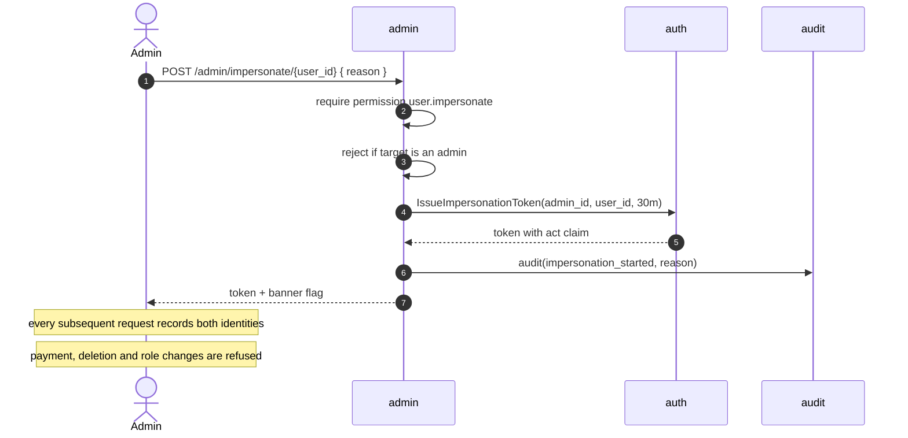

# admin — AGENT.md

> AI entry point for this module. Read [`/AGENT.md`](../../../AGENT.md) and
> [`/MODULE_INDEX.md`](../../../MODULE_INDEX.md) first if you have not.
> **Everything you need for this module is below. Do not scan other modules.**

| | |
|---|---|
| Tier | `core` |
| Path | `internal/modules/admin` |
| Schema | `core` |
| Delivery phase | 2 |
| Status | **PLANNED** |
| Owner | @backend-team |

---

## 1. Overview

<!-- BEGIN GENERATED: overview -->
The back-office surface. It owns almost no data of its own; it composes other modules' contracts into the screens an administrator needs: dashboards, user management, content moderation, feature flags, and operational tooling.
<!-- END GENERATED: overview -->

## 2. Responsibilities

<!-- BEGIN GENERATED: responsibilities -->
**This module owns:**

- Admin dashboard aggregation across modules
- User management screens (list, search, inspect, suspend, reinstate, impersonate)
- Moderation queues (flagged content, reported names, flagged submissions)
- Feature flag management
- Dashboard banners of two kinds: announcements shown once as a dialog, and image-only promo slides in a carousel (create, schedule, switch on/off, delete)
- Operational actions: retry a job, replay a webhook, invalidate a cache key
- System health summary for non-engineers

**This module does NOT own:**

- Any business rule — those live in the owning module; admin only calls contracts
- Content authoring logic — that is `content`
- Its own copies of other modules' data
<!-- END GENERATED: responsibilities -->

## 3. Entry points

<!-- BEGIN GENERATED: entrypoints -->
| File | Read it when |
|---|---|
| `internal/modules/admin/module.go` | You need to see what this module depends on and what it exposes |
| `internal/modules/admin/contract/` | You are calling this module from another module |
| `internal/modules/admin/service/` | You are changing behaviour |
| `db/migrations/admin/` | You need the real schema |
<!-- END GENERATED: entrypoints -->

## 4. Public API (contract)

Other modules may import **only** `internal/modules/admin/contract`.

<!-- BEGIN GENERATED: contract -->
| Kind | Name | Purpose |
|---|---|---|
| interface | `admin.FlagReader` | `IsEnabled(ctx, key, userID) bool` — used by every module that gates a feature |

### Events

| Event | Direction | Payload summary |
|---|---|---|
| `admin.impersonation_started` | publishes | `{admin_id, user_id, expires_at}` |
<!-- END GENERATED: contract -->

## 5. Database schema

<!-- BEGIN GENERATED: schema -->
All tables live in the `core` schema and are owned exclusively by this module (rule DB1).
Migrations: `db/migrations/admin/` · Queries: `db/queries/admin/`

| Table | Purpose | Key columns / notes |
|---|---|---|
| `core.admin_actions` | Audit log of admin operations on accounts | `actor_id`, `target_id`, `action` (suspend/reinstate/revoke_sessions), `reason`, `occurred_at`. CHECK actor_id != target_id |
| `core.feature_flags` | Runtime feature toggles | `key`, `enabled`, `rollout_percent`, `owner`, `expires_on`. Cached 30 s in-process. |
| `core.admin_notes` | Free-text notes attached to a user or content item | Visible to admins only; audited on create |
| `core.moderation_items` | The moderation queue | `kind`, `target_type`, `target_id`, `reason`, `status`, `assignee_id` |
| `core.banners` | Announcement banners shown on the learner dashboard | `title`, `body`, `cta_label`/`cta_url`, `tone`, `is_active`, `priority`, `dismissible`, `starts_at`/`ends_at`, `created_by`. CHECKs repeat the service rules (lengths, tone, safe link, window order). `kind` is `announcement` or `slide` (migration 953; a slide needs an image and has no body, button text or dismissal). Partial index on active rows. Optional image: `image_key` (a processed JPEG under `banners/images/` in fluentra-media), `image_alt`, `image_width`/`image_height`, all-or-none by CHECK and unique per banner (migration 952). Active list cached 30 s in-process, image URLs signed when it fills. |

<!-- END GENERATED: schema -->

## 6. HTTP endpoints

Full definitions are in [`api/openapi/openapi.yaml`](../../../api/openapi/openapi.yaml)
(tag: `admin`). Per-endpoint detail is in §15.

<!-- BEGIN GENERATED: endpoints -->
| Method | Path | Permission | Purpose |
|---|---|---|---|
| `GET` | `/api/v1/admin/users` | `user.list` | Search accounts, cursor-paginated |
| `GET` | `/api/v1/admin/users/{id}` | `user.read` | One account in full |
| `POST` | `/api/v1/admin/users/{id}/suspend` | `user.suspend` | Suspend an account and end its sessions |
| `POST` | `/api/v1/admin/users/{id}/reinstate` | `user.reinstate` | Return a suspended account to active |
| `POST` | `/api/v1/admin/users/{id}/delete` | `user.delete` | Soft-delete an account and end its sessions |
| `POST` | `/api/v1/admin/users/{id}/sessions/revoke` | `user.manage_sessions` | Sign a user out everywhere |
| `GET` | `/api/v1/admin/flags` | `system.flags` | List every feature flag |
| `GET` | `/api/v1/admin/ai/usage` | `admin.dashboard` | Read today's AI usage and budget headroom per provider |
| `POST` | `/api/v1/admin/flags` | `system.flags` | Create a feature flag |
| `PUT` | `/api/v1/admin/flags/{key}` | `system.flags` | Update a feature flag |
| `DELETE` | `/api/v1/admin/flags/{key}` | `system.flags` | Delete a feature flag |
| `GET` | `/api/v1/banners/active` | `self` | The dashboard banners showing now (at most 3 announcements and 6 slides) |
| `GET` | `/api/v1/admin/banners` | `system.flags` | List every banner |
| `POST` | `/api/v1/admin/banners` | `system.flags` | Create a banner |
| `PUT` | `/api/v1/admin/banners/{id}` | `system.flags` | Replace a banner |
| `DELETE` | `/api/v1/admin/banners/{id}` | `system.flags` | Delete a banner |
| `POST` | `/api/v1/admin/banners/image-upload-intent` | `system.flags` | Presigned upload for a banner image |
| `POST` | `/api/v1/admin/banners/images` | `system.flags` | Check and publish an uploaded banner image |
| `GET` | `/api/v1/admin/dashboard` | `admin.dashboard` | Composed KPI summary |
| `GET` | `/api/v1/admin/moderation` | `moderation.read` | Moderation queue |
| `POST` | `/api/v1/admin/moderation/{id}/resolve` | `moderation.act` | Resolve a queue item |
| `POST` | `/api/v1/admin/jobs/{id}/retry` | `system.jobs` | Retry a failed job |
| `POST` | `/api/v1/admin/impersonate/{user_id}` | `user.impersonate` | Start a time-boxed impersonation session |
<!-- END GENERATED: endpoints -->

## 7. Folder map

<!-- BEGIN GENERATED: folders -->
| Path | Contains |
|---|---|
| `contract/` | Interfaces, DTOs and event types other modules may import — the only public package |
| `domain/` | Entities, value objects, invariants, domain errors. Pure Go, no I/O |
| `service/` | Use cases, orchestration, transactions, event publishing |
| `repository/` | sqlc-generated queries and row↔domain mappers |
| `transport/http/` | Handlers, request/response DTOs, route registration |
| `module.go` | `New(deps)` — wiring; the only symbol `cmd/` imports |
<!-- END GENERATED: folders -->

## 8. Related modules

<!-- BEGIN GENERATED: related -->
| Module | Direction | Why |
|---|---|---|
| [`user`](../../modules/user/AGENT.md) | → depends on | User management screens |
| [`rbac`](../../modules/rbac/AGENT.md) | → depends on | Role assignment |
| [`audit`](../../modules/audit/AGENT.md) | → depends on | Every admin action is recorded |
| [`auth`](../../modules/auth/AGENT.md) | → depends on | Session revocation and impersonation token issuance |
| [`content`](../../modules/content/AGENT.md) | → depends on | Moderation and publishing actions |
| [`cache`](../../platform/cache/AGENT.md) | → depends on | Flag caching and operational cache invalidation |
<!-- END GENERATED: related -->

**Boundary reminder:** you may call these through their `contract` package only.
Reaching into `service/`, `repository/`, `domain/` or their tables violates rules L1/L2
and fails `go-arch-lint` in CI.

## 9. Business rules

<!-- BEGIN GENERATED: rules -->
1. **BR-ADMIN-01** — Admin composes, it does not compute. Any rule an admin screen needs belongs in the owning module's service.
2. **BR-ADMIN-02** — Every admin write action is audited with the acting admin's ID and, where the UI requires it, a stated reason.
3. **BR-ADMIN-03** — Impersonation is time-boxed to 30 minutes, produces a visually distinct session, is fully audited, and is blocked for payment and deletion actions.
4. **BR-ADMIN-04** — A feature flag defaults to disabled and carries an owner and an expiry date; expired flags are reported weekly.
5. **BR-ADMIN-05** — Operational actions are idempotent — retrying a retry must not double-execute.
6. **BR-ADMIN-06** — An admin cannot act on their own account through admin screens (suspension, role change) — that path goes through another admin.
7. **BR-ADMIN-07** — A banner shows only while `is_active` is true and now is inside its optional `starts_at`..`ends_at` window; the dashboard gets at most three announcements and six slides, each kind highest priority first, then newest. An announcement opens as a dialog once per visit; a slide is always shown while live and cannot be dismissed.
8. **BR-ADMIN-08** — Banner text is plain text, never HTML. A banner link is an internal path starting with `/` (not `//`) or an `https://` URL; `javascript:`, `data:` and protocol-relative links are refused by the service and by a CHECK.
9. **BR-ADMIN-09** — A banner image is only ever one the admin module processed itself: the browser uploads to a holding key, the server re-encodes it, and a banner may name only a `banners/images/` key that exists. Replacing, clearing or deleting a banner's image deletes the object.
<!-- END GENERATED: rules -->

## 10. Common tasks

<!-- BEGIN GENERATED: tasks -->
### Add an admin screen

1. Identify which module owns the data and which contract methods you need. If a method does not exist, add it to that module's contract — do not query its tables.
2. Add the endpoint under `/api/v1/admin/` in `openapi.yaml` with an `x-permission`.
3. Implement a thin handler that composes contract calls.
4. Add the permission to `rbac` and map it to the admin role.
5. Audit any write.
6. Add the React page under `web/src/features/admin/`.
<!-- END GENERATED: tasks -->

## 11. Known limitations

<!-- BEGIN GENERATED: limitations -->
- The dashboard aggregates synchronously across several modules; above a few thousand rows it will need a materialised read model.
- Moderation is manual — there is no automated classification in Phase 2.
- Feature flags are boolean plus a percentage; there is no targeting by attribute.
<!-- END GENERATED: limitations -->

## 12. Coding conventions (module-specific)

Global rules: [`docs/CONVENTIONS.md#coding-standard`](../../../docs/CONVENTIONS.md#coding-standard). Deviations and additions
for this module:

<!-- BEGIN GENERATED: conventions -->
_No deviations from the global standard._
<!-- END GENERATED: conventions -->

### Error codes owned by this module

| Code | Status | Meaning |
|---|---|---|
| `IMPERSONATION_FORBIDDEN_ACTION` | 403 | The attempted action is not permitted while impersonating |
| `SELF_ADMIN_ACTION_FORBIDDEN` | 403 | An admin may not administer their own account |
| `BANNER_INVALID` | 422 | A banner field failed validation; `errors[]` names each field |
| `BANNER_NOT_FOUND` | 404 | No banner has that id |

### Security considerations

- All `/admin/*` routes require the `admin` role at the route group and a specific permission at the service.
- Admin accounts require MFA.
- Reads of personal data are audited, not just writes.
- Impersonation tokens carry an `act` claim so downstream audit entries record both identities.

## 13. Testing

<!-- BEGIN GENERATED: testing -->
Coverage target: **80% service, 90% domain**

```bash
go test ./internal/modules/admin/...                    # unit
go test -tags=integration ./internal/modules/admin/...  # integration (testcontainers)
```

**Focus areas**

- A non-admin receives 403 on every `/admin/*` route
- Impersonation cannot perform forbidden actions and expires on time
- Self-administration is refused
- Every write produces an audit entry with the correct actor
- Flag changes propagate within the cache TTL
- Banner links refuse `javascript:`, `data:` and protocol-relative values; the active list honours the window, the order and the limit of three
<!-- END GENERATED: testing -->

## 14. Do NOT

<!-- BEGIN GENERATED: donot -->
- Do not query another module's tables from admin — call its contract.
- Do not implement business rules here.
- Do not add an admin action without a permission and an audit entry.
- Do not allow impersonation of another admin.
<!-- END GENERATED: donot -->

## 15. API detail

### Endpoint detail

<!-- BEGIN GENERATED: api-detail -->
#### `GET /api/v1/admin/users`

Search accounts, cursor-paginated

| | |
|---|---|
| Permission | `user.list` |
| Success | 200 |
| Errors | standard set |
| Notes | The search itself is not audited; opening one result is |

#### `GET /api/v1/admin/users/{id}`

One account in full

| | |
|---|---|
| Permission | `user.read` |
| Success | 200 |
| Errors | standard set |
| Notes | Recorded as `admin.user_viewed` |

#### `POST /api/v1/admin/users/{id}/suspend`

Suspend an account and end its sessions

| | |
|---|---|
| Permission | `user.suspend` |
| Success | 200 |
| Errors | standard set |
| Notes | Reason required; refused on the caller's own account |

#### `POST /api/v1/admin/users/{id}/reinstate`

Return a suspended account to active

| | |
|---|---|
| Permission | `user.reinstate` |
| Success | 200 |
| Errors | standard set |
| Notes | Reason required; sessions are not restored |

#### `POST /api/v1/admin/users/{id}/delete`

Soft-delete an account and end its sessions

| | |
|---|---|
| Permission | `user.delete` |
| Success | 200 |
| Errors | standard set |
| Notes | Reason required; opens the same 30-day grace period the owner's own request opens, and only the owner can cancel it |

#### `POST /api/v1/admin/users/{id}/sessions/revoke`

Sign a user out everywhere

| | |
|---|---|
| Permission | `user.manage_sessions` |
| Success | 200 |
| Errors | standard set |
| Notes | Reason required; status is unchanged |

#### `GET /api/v1/admin/flags`

List every feature flag

| | |
|---|---|
| Permission | `system.flags` |
| Success | 200 |
| Errors | standard set |
| Notes | Unpaginated — the set is small by design |

#### `GET /api/v1/admin/ai/usage`

Read today's AI usage and budget headroom per provider

| | |
|---|---|
| Permission | `admin.dashboard` |
| Success | 200 |
| Errors | standard set |
| Notes | A read over ai_usage and ai_budgets; shows an exhausted provider before a learner meets one |

#### `POST /api/v1/admin/flags`

Create a feature flag

| | |
|---|---|
| Permission | `system.flags` |
| Success | 201 |
| Errors | standard set |
| Notes | `owner` and a future `expires_on` are required |

#### `PUT /api/v1/admin/flags/{key}`

Update a feature flag

| | |
|---|---|
| Permission | `system.flags` |
| Success | 200 |
| Errors | standard set |
| Notes | Visible within one 30 s cache generation |

#### `DELETE /api/v1/admin/flags/{key}`

Delete a feature flag

| | |
|---|---|
| Permission | `system.flags` |
| Success | 204 |
| Errors | standard set |
| Notes | Evaluations of the key then return false |

#### `GET /api/v1/banners/active`

The dashboard banners showing now (at most 3 announcements and 6 slides)

| | |
|---|---|
| Permission | `self` |
| Success | 200 |
| Errors | standard set |
| Notes | Any signed-in account; no admin fields; cached 30 s |

#### `GET /api/v1/admin/banners`

List every banner

| | |
|---|---|
| Permission | `system.flags` |
| Success | 200 |
| Errors | standard set |
| Notes | Unpaginated, capped at 200 |

#### `POST /api/v1/admin/banners`

Create a banner

| | |
|---|---|
| Permission | `system.flags` |
| Success | 201 |
| Errors | standard set |
| Notes | Audited as `admin.banner_created` |

#### `PUT /api/v1/admin/banners/{id}`

Replace a banner

| | |
|---|---|
| Permission | `system.flags` |
| Success | 200 |
| Errors | standard set |
| Notes | Audited as `admin.banner_updated`; invalidates the active cache |

#### `DELETE /api/v1/admin/banners/{id}`

Delete a banner

| | |
|---|---|
| Permission | `system.flags` |
| Success | 204 |
| Errors | standard set |
| Notes | Audited as `admin.banner_deleted`; deletes its image |

#### `POST /api/v1/admin/banners/image-upload-intent`

Presigned upload for a banner image

| | |
|---|---|
| Permission | `system.flags` |
| Success | 200 |
| Errors | standard set |
| Notes | JPEG, PNG or WebP, at most 5 MB, ten minutes; key scoped to the admin |

#### `POST /api/v1/admin/banners/images`

Check and publish an uploaded banner image

| | |
|---|---|
| Permission | `system.flags` |
| Success | 201 |
| Errors | standard set |
| Notes | Sniffs the bytes, refuses over 40 MP, fits 1600x900, re-encodes JPEG without metadata, deletes the raw upload |

#### `GET /api/v1/admin/dashboard`

Composed KPI summary

| | |
|---|---|
| Permission | `admin.dashboard` |
| Success | 200 |
| Errors | standard set |

#### `GET /api/v1/admin/moderation`

Moderation queue

| | |
|---|---|
| Permission | `moderation.read` |
| Success | 200 |
| Errors | standard set |

#### `POST /api/v1/admin/moderation/{id}/resolve`

Resolve a queue item

| | |
|---|---|
| Permission | `moderation.act` |
| Success | 200 |
| Errors | standard set |

#### `POST /api/v1/admin/jobs/{id}/retry`

Retry a failed job

| | |
|---|---|
| Permission | `system.jobs` |
| Success | 202 |
| Errors | standard set |

#### `POST /api/v1/admin/impersonate/{user_id}`

Start a time-boxed impersonation session

| | |
|---|---|
| Permission | `user.impersonate` |
| Success | 200 |
| Errors | standard set |
| Notes | Audited; blocked for payment actions; a banner is shown throughout |

<!-- END GENERATED: api-detail -->

### Error codes

<!-- BEGIN GENERATED: api-errors -->
| Code | Status | Meaning |
|---|---|---|
| `IMPERSONATION_FORBIDDEN_ACTION` | 403 | The attempted action is not permitted while impersonating |
| `SELF_ADMIN_ACTION_FORBIDDEN` | 403 | An admin may not administer their own account |
| `REASON_REQUIRED` | 422 | A state-changing admin action was sent without a reason of at least 10 characters |
| `USER_NOT_FOUND` | 404 | The target user account does not exist |
| `FEATURE_FLAG_NOT_FOUND` | 404 | The requested feature flag does not exist |
| `FEATURE_FLAG_ALREADY_EXISTS` | 409 | A feature flag with that key already exists |
| `BANNER_INVALID` | 422 | A banner field failed validation; `errors[]` names each field |
| `BANNER_NOT_FOUND` | 404 | No banner has that id |
| `BANNER_IMAGE_INVALID` | 422 | The image type is not JPEG, PNG or WebP, or the upload is not a usable image |
| `BANNER_IMAGES_UNAVAILABLE` | 503 | Storage is not configured or not reachable |
<!-- END GENERATED: api-errors -->

### Rate limits

<!-- BEGIN GENERATED: api-rate -->
Standard limits apply — see [/docs/CONVENTIONS.md](../../../docs/CONVENTIONS.md#rate-limiting).
<!-- END GENERATED: api-rate -->

## 16. Flows

### Impersonation



<!-- END GENERATED: flows -->

<!-- BEGIN GENERATED: states -->
_This module has no explicit state machine._
<!-- END GENERATED: states -->

### Failure paths

<!-- BEGIN GENERATED: failures -->
_None yet._
<!-- END GENERATED: failures -->

## 17. Decisions

### Decisions taken

<!-- BEGIN GENERATED: decisions -->
| Question | Decision | Rationale |
|---|---|---|
| Separate admin service or the same binary? | Same binary, separate route group | A separate service would duplicate every contract call over the network for a handful of screens; the route group plus per-operation permissions gives the isolation that matters |
| Does admin own data? | Only flags, notes and the moderation queue | Anything else would duplicate another module's state and drift from it |
| Does user erasure purge `core.admin_actions`? | Retained as an accountability record | The rows record who acted on whom and why. Like `audit`, this is an accountability log that must outlive the account it describes, or an administrator could erase the evidence of their own action by deleting the target. The erasure completeness check excludes it by name for this reason — see `internal/modules/user/job/erasure_checker.go` |
<!-- END GENERATED: decisions -->

### Related repository ADRs

<!-- BEGIN GENERATED: decisions-adr -->
_None specific to this module._
<!-- END GENERATED: decisions-adr -->

### Open questions

<!-- BEGIN GENERATED: decisions-open -->
_None._
<!-- END GENERATED: decisions-open -->

## 18. Backlog

### Phase 2

- [ ] Dashboard composing user, learning and AI-cost summaries
- [ ] Moderation queue with assignment and resolution
- [ ] Job retry and webhook replay tooling
- [ ] Impersonation with all its guards
<!-- END GENERATED: todo -->

### Done (hand-written)

- [x] Dashboard announcement banners (2026-10-08): `core.banners`, `GET /banners/active`,
  `/admin/banners` CRUD under `system.flags`, audited writes, 30 s in-process cache of the
  active list, admin screen and dashboard carousel. A write invalidates the cache only on the
  instance that served it; other instances catch up within the TTL. Repository SQL has no
  integration test yet (add one to `admin_integration_test.go` beside the flag cases).
- [x] Banner images (2026-10-08, migration 952): presigned upload to `banners/raw/<admin>/`,
  server-side sniff, 40 MP guard, fit 1600x900, JPEG re-encode (metadata dropped, alpha on
  white), unique `image_key` per banner, old image deleted on replace/clear/delete, URLs signed
  when the active cache fills. Migration constraints checked by hand against dev Postgres in a
  rolled-back transaction; still no integration test (same gap as above).
- [x] Banner kinds (2026-10-09, migration 953): `announcement` (dialog once per visit; a
  dismissible one stays closed on the device, a non-dismissible one returns next session)
  and `slide` (image-only carousel, 6 s autoplay with pause, prev/next, dots and swipe,
  never dismissed). Per-kind limits 3 and 6. Constraints checked against dev Postgres in
  a rolled-back transaction.
- [ ] Sweep orphaned banner images: an image processed but never saved on a banner (the admin
  closed the form) stays under `banners/images/`. Done when a periodic job deletes objects
  older than a day that no `core.banners.image_key` names. Raw uploads that were never
  processed need a bucket lifecycle rule on `banners/raw/`.

### Deferred (deliberately not doing yet)

<!-- BEGIN GENERATED: todo-deferred -->
_Nothing deferred._
<!-- END GENERATED: todo-deferred -->

### Future improvements

<!-- BEGIN GENERATED: todo-future -->
- Materialised dashboard read model
- Bulk content operations
- Saved admin searches
- Automated moderation triage
<!-- END GENERATED: todo-future -->

---

_Generated by `tools/docgen` from `tools/docgen/data/`. Hand-written text outside the
GENERATED markers is preserved. Update the manifest, then run `make docs`._
