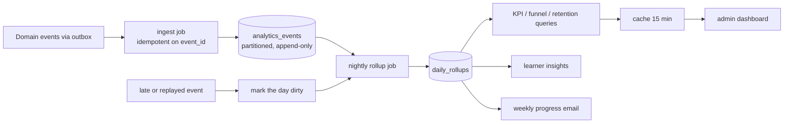

# analytics — AGENT.md

> AI entry point for this module. Read [`/AGENT.md`](../../../AGENT.md) and
> [`/MODULE_INDEX.md`](../../../MODULE_INDEX.md) first if you have not.
> **Everything you need for this module is below. Do not scan other modules.**

| | |
|---|---|
| Tier | `commerce` |
| Path | `internal/modules/analytics` |
| Schema | `analytics` |
| Delivery phase | 4 |
| Status | **PLANNED** |
| Owner | @data-team |

---

## 1. Overview

<!-- BEGIN GENERATED: overview -->
Turns the event stream into answers: event ingestion, daily rollups, funnels, cohorts, retention curves and the admin KPI dashboards. It reads events; it never writes to another module's data.
<!-- END GENERATED: overview -->

## 2. Responsibilities

<!-- BEGIN GENERATED: responsibilities -->
**This module owns:**

- Event ingestion from the outbox into an analytics store
- Daily and weekly rollups by learner, cohort, skill and level
- Funnels: signup → placement → first lesson → day-7 return → subscription
- Retention curves and cohort analysis
- Learning outcome metrics: level progression, review accuracy, band improvement
- AI cost per active learner
- Admin KPI dashboards and scheduled reports
- The weekly learner progress email payload

**This module does NOT own:**

- Operational metrics — that is Prometheus and `platform/telemetry`
- Owning the source data — it derives, never mutates
- Personal profiling for advertising
<!-- END GENERATED: responsibilities -->

## 3. Entry points

<!-- BEGIN GENERATED: entrypoints -->
| File | Read it when |
|---|---|
| `internal/modules/analytics/module.go` | You need to see what this module depends on and what it exposes |
| `internal/modules/analytics/contract/` | You are calling this module from another module |
| `internal/modules/analytics/service/` | You are changing behaviour |
| `db/migrations/analytics/` | You need the real schema |
<!-- END GENERATED: entrypoints -->

## 4. Public API (contract)

Other modules may import **only** `internal/modules/analytics/contract`.

<!-- BEGIN GENERATED: contract -->
| Kind | Name | Purpose |
|---|---|---|
| interface | `analytics.Reporter` | `KPIs`, `Funnel`, `Retention` — used by `admin` |
| interface | `analytics.InsightReader` | `InsightsFor(ctx, userID)` — the learner-facing view |

### Events

| Event | Direction | Payload summary |
|---|---|---|
| `analytics.weekly_report_ready` | publishes | `{user_id, period}` — triggers the email |
| `*` | consumes | Every domain event is ingested; this module is the one legitimate universal subscriber |
<!-- END GENERATED: contract -->

## 5. Database schema

<!-- BEGIN GENERATED: schema -->
All tables live in the `analytics` schema and are owned exclusively by this module (rule DB1).
Migrations: `db/migrations/analytics/` · Queries: `db/queries/analytics/`

| Table | Purpose | Key columns / notes |
|---|---|---|
| `analytics.analytics_events` | Flattened event stream | Partitioned monthly. `event`, `user_id`, `properties` jsonb, `occurred_at`. Append-only. |
| `analytics.daily_rollups` | Pre-aggregated daily facts | `date`, `dimension`, `dimension_value`, `metric`, `value`. The read path for every dashboard. |
| `analytics.cohorts` | Cohort definitions and membership | `cohort_key` (e.g. signup week), `user_id` |
| `analytics.funnel_steps` | Per-user funnel progression | `user_id`, `funnel`, `step`, `reached_at` |
| `analytics.learner_outcomes` | Longitudinal outcome facts | `user_id`, `period`, `level_estimate`, `reviews`, `accuracy`, `bands` jsonb |

<!-- END GENERATED: schema -->

## 6. HTTP endpoints

Full definitions are in [`api/openapi/openapi.yaml`](../../../api/openapi/openapi.yaml)
(tag: `analytics`). Per-endpoint detail is in §15.

<!-- BEGIN GENERATED: endpoints -->
| Method | Path | Permission | Purpose |
|---|---|---|---|
| `GET` | `/api/v1/admin/analytics/kpis` | `analytics.read` | Headline KPIs with period comparison |
| `GET` | `/api/v1/admin/analytics/funnel` | `analytics.read` | Funnel conversion by cohort |
| `GET` | `/api/v1/admin/analytics/retention` | `analytics.read` | Retention curve by cohort |
| `GET` | `/api/v1/admin/analytics/outcomes` | `analytics.read` | Learning outcome metrics |
| `POST` | `/api/v1/admin/analytics/export` | `analytics.export` | Async CSV export |
| `GET` | `/api/v1/me/insights` | `self` | The learner's own progress insights |
<!-- END GENERATED: endpoints -->

## 7. Folder map

<!-- BEGIN GENERATED: folders -->
| Path | Contains |
|---|---|
| `contract/` | Interfaces, DTOs and event types other modules may import — the only public package |
| `domain/` | Entities, value objects, invariants, domain errors. Pure Go, no I/O |
| `service/` | Use cases, orchestration, transactions, event publishing |
| `repository/` | sqlc-generated queries and row↔domain mappers |
| `transport/http/` | Handlers, request/response DTOs, route registration |
| `job/` | Background job handlers owned by this module |
| `module.go` | `New(deps)` — wiring; the only symbol `cmd/` imports |
<!-- END GENERATED: folders -->

## 8. Related modules

<!-- BEGIN GENERATED: related -->
| Module | Direction | Why |
|---|---|---|
| [`job`](../../platform/job/AGENT.md) | → depends on | Ingestion, rollups and reports are scheduled work |
| [`cache`](../../platform/cache/AGENT.md) | → depends on | Dashboard reads |
| [`admin`](../../modules/admin/AGENT.md) | ← used by | consumes this module's contract |
| [`notification`](../../modules/notification/AGENT.md) | ← used by | consumes this module's contract |
<!-- END GENERATED: related -->

**Boundary reminder:** you may call these through their `contract` package only.
Reaching into `service/`, `repository/`, `domain/` or their tables violates rules L1/L2
and fails `go-arch-lint` in CI.

## 9. Business rules

<!-- BEGIN GENERATED: rules -->
1. **BR-ANALYTICS-01** — Analytics derives; it never writes to another module's tables. If it needs a fact, the fact must arrive as an event.
2. **BR-ANALYTICS-02** — Ingestion is idempotent on `event_id` — at-least-once delivery must not inflate counts.
3. **BR-ANALYTICS-03** — Dashboards read rollups, never raw events. A dashboard query that scans `analytics_events` is a bug.
4. **BR-ANALYTICS-04** — Rollups are recomputable: a late or replayed event triggers a recompute of the affected day rather than an in-place adjustment.
5. **BR-ANALYTICS-05** — Personal data in analytics is minimised — user IDs, never names or emails; free-text content is never ingested.
6. **BR-ANALYTICS-06** — A deleted user's events are anonymised to a synthetic ID so aggregate history stays truthful while the person disappears.
7. **BR-ANALYTICS-07** — Learner-facing insights are computed from the same rollups the admin dashboards use, so the two can never disagree.
8. **BR-ANALYTICS-08** — Every metric has a written definition in `docs/product/metrics.md`; an undefined metric on a dashboard is not allowed, because two people will interpret it differently.
9. **BR-ANALYTICS-09** — Cohort membership is immutable once assigned — a learner's signup week does not change.
<!-- END GENERATED: rules -->

## 10. Common tasks

<!-- BEGIN GENERATED: tasks -->
### Add a metric

1. Write its definition in `docs/product/metrics.md` first — including what it excludes.
2. Confirm the source event carries the properties needed; if not, extend the event (a versioned change).
3. Add the rollup computation and backfill historical days with a job.
4. Add the dashboard panel.
5. Add a test with a known dataset and a hand-computed expected value.
<!-- END GENERATED: tasks -->

## 11. Known limitations

<!-- BEGIN GENERATED: limitations -->
- Rollups are nightly, so dashboards are up to a day stale for anything not also computed live.
- There is no real-time analytics path; Prometheus covers operational immediacy.
- Everything lives in the same PostgreSQL instance — at high volume this becomes the first candidate for a separate analytical store.
- No cross-device identity resolution.
<!-- END GENERATED: limitations -->

## 12. Coding conventions (module-specific)

Global rules: [`docs/CONVENTIONS.md#coding-standard`](../../../docs/CONVENTIONS.md#coding-standard). Deviations and additions
for this module:

<!-- BEGIN GENERATED: conventions -->
_No deviations from the global standard._
<!-- END GENERATED: conventions -->

### Cache strategy

| Key | TTL | Invalidated by |
|---|---|---|
| `fluentra:{env}:analytics:kpi:{period}:v1` | 15 min | Rollup job completion |
| `fluentra:{env}:analytics:insights:{user_id}:v1` | 1 h | Nightly rollup |

### Error codes owned by this module

| Code | Status | Meaning |
|---|---|---|
| `PERIOD_TOO_LARGE` | 422 | Requested range exceeds the query limit |
| `ROLLUP_NOT_READY` | 409 | The requested day has not been rolled up yet |

### Security considerations

- Analytics access requires a specific permission and is audited.
- Exports are delivered by short-lived signed URL and are logged.
- No free-text learner content is ever ingested — not essay bodies, not transcripts.

## 13. Testing

<!-- BEGIN GENERATED: testing -->
Coverage target: **80% service, 90% domain**

```bash
go test ./internal/modules/analytics/...                    # unit
go test -tags=integration ./internal/modules/analytics/...  # integration (testcontainers)
```

**Focus areas**

- Ingestion idempotency under duplicate delivery
- Rollup recomputation on a late event
- Cohort immutability
- Anonymisation on user deletion preserves aggregate totals
- Dashboard queries hit rollups, asserted by a query-plan test
- Metric values match hand-computed expectations on a fixture dataset
<!-- END GENERATED: testing -->

## 14. Do NOT

<!-- BEGIN GENERATED: donot -->
- Do not query another module's tables — consume events.
- Do not run a dashboard query against raw events.
- Do not ingest learner free text.
- Do not add a metric without a written definition.
- Do not mutate a rollup in place — recompute the day.
<!-- END GENERATED: donot -->

## 15. API detail

### Endpoint detail

<!-- BEGIN GENERATED: api-detail -->
#### `GET /api/v1/admin/analytics/kpis`

Headline KPIs with period comparison

| | |
|---|---|
| Permission | `analytics.read` |
| Success | 200 |
| Errors | standard set |

#### `GET /api/v1/admin/analytics/funnel`

Funnel conversion by cohort

| | |
|---|---|
| Permission | `analytics.read` |
| Success | 200 |
| Errors | standard set |

#### `GET /api/v1/admin/analytics/retention`

Retention curve by cohort

| | |
|---|---|
| Permission | `analytics.read` |
| Success | 200 |
| Errors | standard set |

#### `GET /api/v1/admin/analytics/outcomes`

Learning outcome metrics

| | |
|---|---|
| Permission | `analytics.read` |
| Success | 200 |
| Errors | standard set |

#### `POST /api/v1/admin/analytics/export`

Async CSV export

| | |
|---|---|
| Permission | `analytics.export` |
| Success | 202 |
| Errors | standard set |

#### `GET /api/v1/me/insights`

The learner's own progress insights

| | |
|---|---|
| Permission | `self` |
| Success | 200 |
| Errors | standard set |

<!-- END GENERATED: api-detail -->

### Error codes

<!-- BEGIN GENERATED: api-errors -->
| Code | Status | Meaning |
|---|---|---|
| `PERIOD_TOO_LARGE` | 422 | Requested range exceeds the query limit |
| `ROLLUP_NOT_READY` | 409 | The requested day has not been rolled up yet |
<!-- END GENERATED: api-errors -->

### Rate limits

<!-- BEGIN GENERATED: api-rate -->
Standard limits apply — see [/docs/CONVENTIONS.md](../../../docs/CONVENTIONS.md#rate-limiting).
<!-- END GENERATED: api-rate -->

## 16. Flows

### Ingestion to dashboard



<!-- END GENERATED: flows -->

<!-- BEGIN GENERATED: states -->
_This module has no explicit state machine._
<!-- END GENERATED: states -->

### Failure paths

<!-- BEGIN GENERATED: failures -->
_None yet._
<!-- END GENERATED: failures -->

## 17. Decisions

### Decisions taken

<!-- BEGIN GENERATED: decisions -->
| Question | Decision | Rationale |
|---|---|---|
| Same database or a separate analytical store? | Same, partitioned, for now | A second datastore adds a synchronisation problem and operational burden that our volume does not justify; the rollup design means moving later is a change of destination, not of pipeline |
| Ingest content? | Never | Essay and transcript text would turn an analytics store into a second copy of the most sensitive data we hold, for no analytical benefit that aggregate metrics do not already provide |
<!-- END GENERATED: decisions -->

### Related repository ADRs

<!-- BEGIN GENERATED: decisions-adr -->
_None specific to this module._
<!-- END GENERATED: decisions-adr -->

### Open questions

<!-- BEGIN GENERATED: decisions-open -->
_None._
<!-- END GENERATED: decisions-open -->

## 18. Backlog

### Phase 4

- [ ] Event ingestion with idempotency and partitioning
- [ ] Nightly rollup job with dirty-day recomputation
- [ ] Funnel and retention computation
- [ ] Learning outcome metrics
- [ ] AI cost per active learner
- [ ] Admin KPI dashboards
- [ ] Learner insights endpoint
- [ ] Weekly progress email payload
- [ ] Metric definitions document
<!-- END GENERATED: todo -->

### Deferred (deliberately not doing yet)

<!-- BEGIN GENERATED: todo-deferred -->
_Nothing deferred._
<!-- END GENERATED: todo-deferred -->

### Future improvements

<!-- BEGIN GENERATED: todo-future -->
- Real-time streaming metrics
- A dedicated analytical store
- Experiment framework with proper statistics
- Predictive churn scoring
<!-- END GENERATED: todo-future -->

---

_Generated by `tools/docgen` from `tools/docgen/data/`. Hand-written text outside the
GENERATED markers is preserved. Update the manifest, then run `make docs`._
