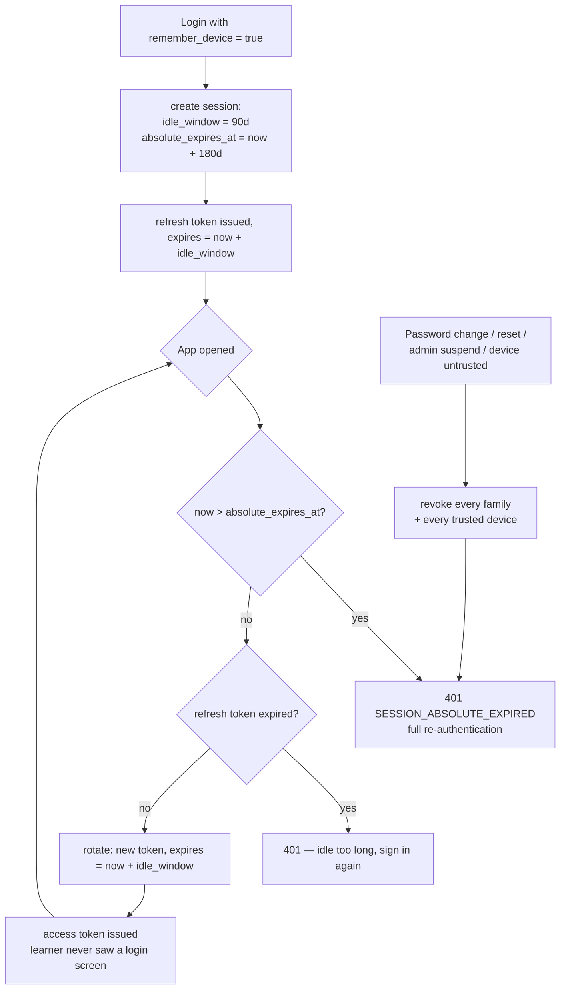
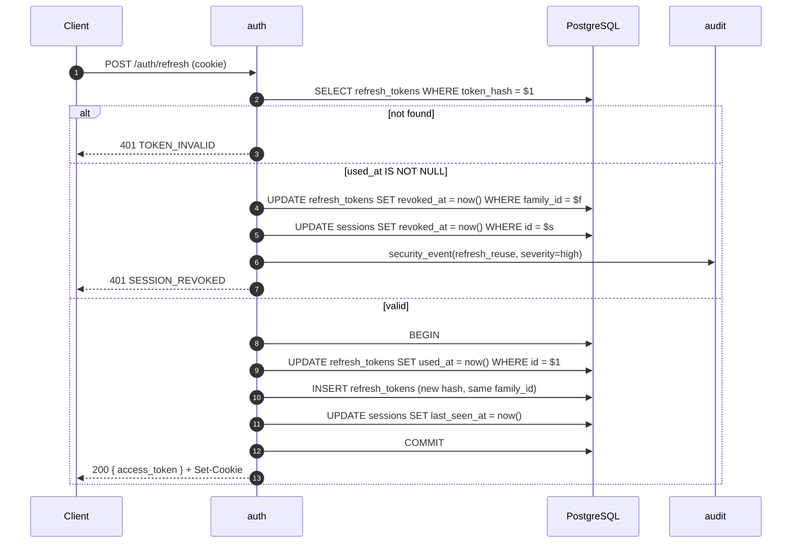
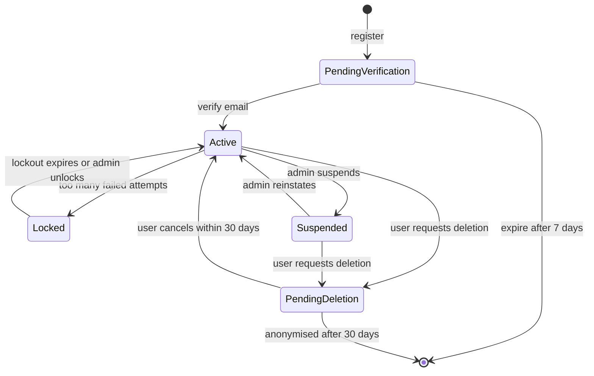

# auth — AGENT.md

> AI entry point for this module. Read [`/AGENT.md`](../../../AGENT.md) and
> [`/MODULE_INDEX.md`](../../../MODULE_INDEX.md) first if you have not.
> **Everything you need for this module is below. Do not scan other modules.**

| | |
|---|---|
| Tier | `core` |
| Path | `internal/modules/auth` |
| Schema | `core` |
| Delivery phase | 1 |
| Status | **PLANNED** |
| Owner | @backend-team |

---

## 1. Overview

<!-- BEGIN GENERATED: overview -->
Owns everything about proving who a caller is: registration, email verification, login, multi-factor authentication, token issuance and rotation, session lifecycle, password reset, and OAuth sign-in. It answers "who is this?" and nothing else.
<!-- END GENERATED: overview -->

**Context.** Authentication is deliberately separated from `user` (profile data) and `rbac` (what the caller may do). Keeping the three apart means a change to profile fields cannot break login, and a change to permissions cannot break token issuance.

## 2. Responsibilities

<!-- BEGIN GENERATED: responsibilities -->
**This module owns:**

- Registration and email verification by one-time code (OTP)
- The generic challenge subsystem: issue, resend, verify and burn short-lived codes for any purpose
- Password hashing (Argon2id), verification, and policy enforcement including breached-password checks
- Access token (JWT, 15 min) issuance and validation
- Refresh token issuance, **sliding** rotation, reuse detection and family revocation
- Persistent sign-in: trusted devices, sliding idle window, absolute re-authentication cap
- Session records: creation, listing, revocation (by the user and by an admin)
- TOTP multi-factor enrolment, verification and recovery codes
- Password reset and change flows
- Google OAuth sign-in (authorization code + PKCE) and account linking by verified email only
- Brute-force protection: per-IP, per-account and per-challenge lockout
- Emitting security events for the audit trail

**This module does NOT own:**

- Profile data, preferences, avatars — that is `user`
- What a caller is allowed to do — that is `rbac`
- Storing the audit log — it emits events, `audit` persists them
- Sending the emails — it asks `platform/mailer` to
- Rate limiting infrastructure — it uses `platform/cache`
<!-- END GENERATED: responsibilities -->

## 3. Entry points

<!-- BEGIN GENERATED: entrypoints -->
| File | Read it when |
|---|---|
| `internal/modules/auth/module.go` | You need to see what this module depends on and what it exposes |
| `internal/modules/auth/contract/` | You are calling this module from another module |
| `internal/modules/auth/service/` | You are changing behaviour |
| `db/migrations/auth/` | You need the real schema |
<!-- END GENERATED: entrypoints -->

## 4. Public API (contract)

Other modules may import **only** `internal/modules/auth/contract`.

<!-- BEGIN GENERATED: contract -->
| Kind | Name | Purpose |
|---|---|---|
| interface | `auth.TokenVerifier` | Validate an access token and return the actor — used by the HTTP middleware |
| interface | `auth.SessionRevoker` | `RevokeAll(ctx, userID) (int, error)` — used by `admin` on suspension and by `user` on account deletion. Published and unconsumed until those modules exist |
| struct | `auth.Actor` | `{UserID, SessionID, Role, TokenID}` — placed in the request context |
| event | `auth.UserRegistered` | Published after a successful registration |
| event | `auth.SecurityEvent` | Published when something needs investigating — `refresh_reuse` (a single-use credential presented twice) and `oauth_state_invalid` (a Google callback carrying a state this server did not issue, or already spent) |

### Events

| Event | Direction | Payload summary |
|---|---|---|
| `user.registered` | publishes | `{user_id, email_hash, locale, source, occurred_at}` |
| `auth.login_succeeded` | publishes | `{user_id, session_id, ip_country}` |
| `auth.security_event` | publishes | `{user_id, kind, severity, detail}` — consumed by `audit` |
| `auth.password_changed` | publishes | `{user_id}` — triggers a notification |
| `user.deletion_requested` | consumes | Revoke all sessions and credentials immediately. **Not yet subscribed** — `contract.SessionRevoker.RevokeAll` is built and tested but nothing calls it. P3.3 adds the subscription |
<!-- END GENERATED: contract -->

## 5. Database schema

<!-- BEGIN GENERATED: schema -->
All tables live in the `core` schema and are owned exclusively by this module (rule DB1).
Migrations: `db/migrations/auth/` · Queries: `db/queries/auth/`

| Table | Purpose | Key columns / notes |
|---|---|---|
| `core.credentials` | Password hash per user | `user_id` UNIQUE, `password_hash`, `algo_params`, `updated_at`. Never selected in a list query. |
| `core.sessions` | One row per active sign-in | `user_id`, `device_label`, `ip_hash`, `user_agent_hash`, `last_seen_at`, `revoked_at` |
| `core.refresh_tokens` | Rotating refresh tokens | `token_hash` (SHA-256) UNIQUE, `family_id`, `session_id`, `used_at`, `expires_at`. Reuse of a used row revokes the whole family. |
| `core.mfa_secrets` | TOTP seeds and recovery codes | Seed encrypted with a KEK; recovery codes stored hashed and single-use |
| `core.auth_challenges` | Short-lived one-time codes for every purpose | `id` (the challenge handle returned to the client), `purpose` enum (`verify_email`, `login_otp`, `password_reset`, `link_oauth`), `subject_hash`, `code_hash` (HMAC-SHA256 with a server key), `attempts`, `max_attempts`, `expires_at`, `consumed_at`. 10-minute TTL, single use. |
| `core.trusted_devices` | Devices the learner chose to stay signed in on | `user_id`, `device_id` (client-generated, stored hashed), `label`, `idle_window`, `absolute_expires_at`, `last_seen_at`, `revoked_at` |
| `core.login_attempts` | Brute-force accounting and forensics | `email_hash`, `ip_hash`, `success`, `failure_reason`, `created_at`; indexed for lockout-window lookups |
| `core.login_lockouts` | Persistent exponential lockout state | One row per `account` or `ip` HMAC; guarded upsert advances `lockout_level` and `locked_until` atomically |
| `core.oauth_identities` | Linked external identities | `provider`, `subject`, `email_hash`, `linked_at`, UNIQUE(provider, subject) |
| `core.oauth_states` | In-flight OAuth authorization requests | `state` UNIQUE, `nonce`, `pkce_verifier_hash`, `redirect_to`, `expires_at`. 10-minute TTL, single use — this is the CSRF defence for the OAuth flow. |

**Indexes of note**

- `uq_refresh_tokens_hash` — unique on `token_hash`, the lookup path on every refresh
- `idx_refresh_tokens_family` — used to revoke a whole family in one statement
- `idx_sessions_user_active` — partial index `WHERE revoked_at IS NULL`
- `idx_login_attempts_email_time` — the lockout query
- `login_lockouts_pkey` — one lockout state per scope and subject hash
<!-- END GENERATED: schema -->

### What exists today

`core.credentials` (P2.1, `1700000050`), `core.auth_challenges` (P2.1b, `1700000060`),
`core.login_attempts` (P2.3, `1700000080`), `core.login_lockouts` (P2.3, `1700000090`), and
`core.sessions` + `core.refresh_tokens` (P2.5, `1700000100`), and `core.trusted_devices` plus the
session columns that make sign-in persistent (P2.9, `1700000110`), and `core.oauth_states` +
`core.oauth_identities` (P2.10, `1700000120`). The rest of the table above is
specification, not schema — each arrives with the card that needs it.

Three things about the OAuth pair beyond the summary:

- **`pkce_verifier_hash` is a check, not the source.** The verifier itself is derived, not drawn:
  `Keyring.PKCEFor(state)` is an HMAC of the `state` under the server key. It has to be derivable,
  because the exchange happens minutes and one redirect after the authorization request and may
  land on a different instance, and there is nothing to carry it across that gap — the row keeps a
  digest, and the client is never told it. The column is what the callback compares its
  recomputation against, so a rotated key or a changed derivation is a refused sign-in here rather
  than an opaque `invalid_grant` from Google. A dump of the table still completes no flow, because
  the key is not in it.
- **The `state` and the `nonce` are two values because they are checked in two places.** The state
  comes back on the redirect and proves this server started the flow; the nonce comes back inside
  the ID token and proves the token was minted for this flow. One value could not do both jobs —
  they travel by different routes, and a value appearing in both would be checked twice against
  the same evidence.
- **A refused state is the only refusal in this module that names nobody.** A forged callback
  identifies no account, which is what makes it forged, so `oauth_state_invalid` carries a nil
  user id and nothing from the request. It is `medium` rather than `high` because one of them is
  ordinary — a consent screen left open past its ten minutes — and the rate is the signal.

Four things about the refresh pair beyond the summary:

- **Spent rows are kept, not deleted.** A deleted row and a token that never existed are
  indistinguishable, and that difference is the entire detection: a token presented after it was
  already spent proves two parties hold it. `used_at` is what makes reuse visible.
- **`used_at` and `revoked_at` are separate columns** because a spent token was exchanged
  legitimately and a revoked one was taken away. Collapsing them would make the audit trail unable
  to say which happened to each row in a burnt family.
- **`token_hash` is a plain SHA-256, not an HMAC and not a password hash.** The token is 256 bits
  from `crypto/rand`, so there is no dictionary to attack and nothing a keyed digest or a work
  factor would buy. The argument that makes an unkeyed digest wrong for an email address does not
  apply to a value with full entropy.
- **`core.sessions.device_label`, `ip_hash` and `user_agent_hash` are all written at sign-in**, and
  they have to be: the raw address and user agent exist for the duration of one request and are
  never stored, so nothing can be derived from the digests afterwards. The label is coarse by
  design — "Chrome on macOS", never a version — and is null for a sign-in with no readable user
  agent, including email verification, which has a context but no request.
- **`core.sessions` carries its own `absolute_expires_at` and `idle_window`.** Rotation slides the
  idle window from now on every use and clamps the result to the cap, which is never moved by
  anything. The cap is enforced in the claim's own WHERE clause, so a session past it never spends a
  token, and `refuse` reports it **before** checking idle expiry — the clamp makes the last token
  expire at exactly the cap, and whichever is tested first is what the learner is told.
- **A lapsed session is never revoked, so `GET /auth/sessions` filters it out in the service.**
  `ListLiveSessions` means "not revoked" and nothing sweeps rows that passed their cap or idle
  window; listing them showed one browser dozens of times (one row per expired sign-in).
  `SessionService.List` drops rows for which `domain.Session.ExpiredAt(now)` holds, keeping the
  caller's own session. `RevokeAll`/`RevokeAllExcept` still read every unrevoked row, on purpose.
- **`core.trusted_devices` keys on a keyed digest of a client-generated id**, one live row per device
  per account. Trusting buys the longer idle window and nothing else: it does not move the cap, and
  an `admin` account gets neither extension. `domain.WindowsFor` returns for an admin before it reads
  the trusted flag, which is what stops the two cases interleaving.
- **There is no `ip_country` column.** The session list is specified to show one, and it cannot be
  worked out from `ip_hash`; resolving it needs a local GeoIP database, a licence key and a CI
  secret, which is an infrastructure change with its own card. `TODO.md` carries it.

Two things about the credential row that the summary does not carry:

- `algo_params` is a **generated** column, `split_part(password_hash, '$', 4)`. The PHC string is
  the only source of truth for the cost parameters; the column exists so a rehash campaign can be
  sized and indexed without parsing hashes in the application, and it is generated so the two can
  never disagree. Writing to it directly fails.
- `ck_credentials_hash_is_argon2id` rejects anything that is not a PHC-encoded Argon2id hash. It
  is cheap, and the bug it catches — a plaintext password reaching the column — is the one that
  would otherwise be discovered in production.

An account may legitimately have no row here: Google sign-in (P2.10) creates no credential, which
is why this is a separate table rather than columns on `core.users`.

Four things about `core.auth_challenges` beyond the summary:

- **The window is per purpose.** `verify_email` gets ten minutes and `password_reset` thirty
  (`PASSWORD_RESET_TTL`), because a reset email can sit unread through a meeting while a signup code
  is typed on the screen that asked for it. A purpose that names no override keeps the shared
  `OTP_TTL`. Issuing a `password_reset` challenge also burns every outstanding one for the same
  address, so an older email in an inbox stops being a way in — burned by spending the attempt
  budget, which is the derived state this table already uses rather than a new column.

- `code_hash` is `HMAC-SHA256(challenge_id ‖ 0x00 ‖ code, server_key)`, **not** the code alone.
  Binding the id in is what makes "a code from challenge A does not verify challenge B" a property
  of the construction rather than a one-in-a-million coincidence between two live challenges that
  drew the same six digits.
- There is no `burned_at` column. Burned is `attempts >= max_attempts`, derived — a second stored
  record of the same fact could disagree with the first, and a disagreement is what an attacker
  looks for. `ck_auth_challenges_attempts` makes the cap a constraint, so a missing guard in
  application code is a failed statement rather than an unbounded guessing budget.
- `last_sent_at` backs the resend cooldown in the database as well as in Redis. `cache.Limiter`
  allows the request when Redis is unreachable, by design; without the second guard a Redis outage
  would turn resend into an email flood aimed at any address an attacker names.

The table has no `user_id` and no foreign key. A challenge identifies its subject only by an HMAC,
so the row says nothing about which account it belongs to and can exist for an address that has no
account yet.

## 6. HTTP endpoints

Full definitions are in [`api/openapi/openapi.yaml`](../../../api/openapi/openapi.yaml)
(tag: `auth`). Per-endpoint detail is in §15.

<!-- BEGIN GENERATED: endpoints -->
| Method | Path | Permission | Purpose |
|---|---|---|---|
| `POST` | `/api/v1/auth/register` | `public` | Create an account and issue a `verify_email` OTP challenge |
| `POST` | `/api/v1/auth/challenges/{id}/verify` | `public` | Submit the OTP code for a challenge |
| `POST` | `/api/v1/auth/challenges/{id}/resend` | `public` | Resend the code for a challenge |
| `POST` | `/api/v1/auth/login` | `public` | Validate credentials and enforce lockout |
| `GET` | `/api/v1/auth/oauth/google/start` | `public` | Begin Google sign-in; returns the authorization URL |
| `POST` | `/api/v1/auth/mfa/verify` | `public` | Complete a login that required a second factor |
| `POST` | `/api/v1/auth/refresh` | `public` | Rotate the refresh token and issue a new access token |
| `POST` | `/api/v1/auth/logout` | `self` | Revoke the current session and refresh family |
| `POST` | `/api/v1/auth/forgot-password` | `public` | Send a reset code |
| `POST` | `/api/v1/auth/reset-password` | `public` | Consume a reset token and set a new password |
| `POST` | `/api/v1/auth/change-password` | `self` | Change the password while signed in |
| `GET` | `/api/v1/auth/sessions` | `self` | List the caller's active sessions |
| `DELETE` | `/api/v1/auth/sessions/{id}` | `self` | Revoke one session |
| `POST` | `/api/v1/auth/mfa/enroll` | `self` | Begin TOTP enrolment; returns a provisioning URI and recovery codes |
| `POST` | `/api/v1/auth/oauth/google/callback` | `public` | Complete Google sign-in: verify state, exchange the code, validate the ID token, link or create the account |
| `POST` | `/api/v1/auth/oauth/google/link` | `self` | Link a Google identity to the signed-in account |
| `DELETE` | `/api/v1/auth/oauth/google` | `self` | Unlink Google |
| `GET` | `/api/v1/auth/devices` | `self` | List trusted devices with their idle and absolute expiry |
| `DELETE` | `/api/v1/auth/devices/{id}` | `self` | Untrust a device, revoking its refresh family |
| `POST` | `/api/v1/admin/users/{id}/sessions/revoke` | `user.manage_sessions` | Admin revokes all sessions for a user |
<!-- END GENERATED: endpoints -->

## 7. Folder map

<!-- BEGIN GENERATED: folders -->
| Path | Contains |
|---|---|
| `contract/` | Interfaces, DTOs and event types other modules may import — the only public package |
| `domain/` | Entities, value objects, invariants, domain errors. Pure Go, no I/O |
| `service/` | Use cases, orchestration, transactions, event publishing |
| `repository/` | sqlc-generated queries and row↔domain mappers |
| `transport/http/` | Handlers, request/response DTOs, route registration |
| `job/` | Background job handlers owned by this module |
| `module.go` | `New(deps)` — wiring; the only symbol `cmd/` imports |
<!-- END GENERATED: folders -->

## 8. Related modules

<!-- BEGIN GENERATED: related -->
| Module | Direction | Why |
|---|---|---|
| [`user`](../../modules/user/AGENT.md) | → depends on | Create the user record on registration; read status (active/suspended) on login |
| [`rbac`](../../modules/rbac/AGENT.md) | → depends on | Attach the caller's role to the issued token |
| [`audit`](../../modules/audit/AGENT.md) | → depends on | Record authentication and security events |
| [`mailer`](../../platform/mailer/AGENT.md) | → depends on | Send verification, reset and new-device emails |
| [`cache`](../../platform/cache/AGENT.md) | → depends on | Lockout counters, rate limits, token denylist |
| [`admin`](../../modules/admin/AGENT.md) | ← used by | Revoke sessions, force password reset, inspect login history |
<!-- END GENERATED: related -->

**Boundary reminder:** you may call these through their `contract` package only.
Reaching into `service/`, `repository/`, `domain/` or their tables violates rules L1/L2
and fails `go-arch-lint` in CI.

## 9. Business rules

<!-- BEGIN GENERATED: rules -->
1. **BR-AUTH-01** — A password must be at least 12 characters and must not appear in the breached-password corpus.
2. **BR-AUTH-02** — Login responses for an unknown email and a wrong password are indistinguishable in content and comparable in timing.
3. **BR-AUTH-03** — An access token is valid for 15 minutes and carries no personal data beyond the user ID.
4. **BR-AUTH-04** — A refresh token is single-use. Presenting a used token revokes every token in its family and raises a `refresh_reuse` security event.
5. **BR-AUTH-05** — Changing or resetting a password revokes all sessions except, optionally, the current one.
6. **BR-AUTH-06** — Email verification is required before any AI-consuming feature may be used.
7. **BR-AUTH-07** — MFA is mandatory for accounts holding the `admin` role; a promotion to admin forces enrolment on next login.
8. **BR-AUTH-08** — Five failed attempts within 15 minutes lock the account for an exponentially increasing period, tracked per account and per IP independently.
9. **BR-AUTH-09** — A suspended user's tokens stop working within one access-token lifetime (15 min); their sessions are revoked immediately on suspension.
10. **BR-AUTH-10** — Every one-time code is 6 digits, single-use, allows at most 5 verification attempts, and is stored only as an HMAC — never in plaintext, never in a log. It expires in 10 minutes unless its purpose sets otherwise; `password_reset` gets 30, because a reset email can sit unread in a way a signup code typed on the next screen cannot.
11. **BR-AUTH-11** — A code is worthless without its `challenge_id`. The client receives the id; the code goes to the email. Guessing a code alone gets an attacker nothing.
12. **BR-AUTH-12** — Exceeding `max_attempts` burns the challenge permanently. A new one must be requested — the code is not simply retried.
13. **BR-AUTH-13** — Resend has a 60-second cooldown and a cap of 3 issuances per subject per hour. Resending replaces the code and resets attempts; it does not extend the absolute expiry.
14. **BR-AUTH-14** — Challenge issuance never reveals whether an account exists. `POST /auth/register` on an existing verified email returns the same shape as a fresh registration and sends a 'someone tried to register with your address' email instead.
15. **BR-AUTH-15** — Google sign-in links to an existing account **only** when Google asserts `email_verified: true` and the email matches a verified local account. An unverified Google email is refused outright.
16. **BR-AUTH-16** — If a Google email matches an existing account that is **not** yet verified, no automatic link occurs — the learner must complete an OTP challenge on that address first. Otherwise anyone who can register an unverified address could hijack it via a Google account.
17. **BR-AUTH-17** — The OAuth `state` is server-side, single-use and 10-minute-lived, and PKCE is mandatory even though we hold a client secret.
18. **BR-AUTH-18** — Google's ID token is verified against Google's JWKS: signature, `iss`, `aud`, `exp`, and the `nonce` we issued. A token that fails any check is rejected without a partial account being created.
19. **BR-AUTH-19** — An account signed in via Google skips email verification — Google has already performed it.
20. **BR-AUTH-20** — Unlinking the last sign-in method is refused; the account must always retain at least one way in.
21. **BR-AUTH-21** — Refresh tokens are **sliding**: each rotation issues a new token with a fresh idle window, so an active learner never signs in again.
22. **BR-AUTH-22** — Every session carries an **absolute** expiry independent of activity. When it passes, full re-authentication is required regardless of how recently the learner was active.
23. **BR-AUTH-23** — Idle windows: 30 days by default, 90 days on a device the learner explicitly chose to trust. Absolute cap: 180 days. Admin accounts get neither extension — 12-hour idle, 7-day absolute.
24. **BR-AUTH-24** — Trusting a device is an explicit opt-in, is listed in the account's device list, and can be revoked from any other device.
25. **BR-AUTH-25** — A password change, a password reset, or an admin suspension revokes every trusted device and every refresh family.
26. **BR-AUTH-26** — The system never reveals whether an email address is registered — `forgot-password` always returns 202.
<!-- END GENERATED: rules -->

### Validation rules

| Field / input | Rule | Error code |
|---|---|---|
| `email` | RFC 5322, normalised to lowercase, max 254 chars, MX-checkable domain | `VALIDATION_FAILED` |
| `password` | ≥ 12 chars, not in the breach corpus, not equal to the email local part | `PASSWORD_TOO_WEAK` |
| `totp_code` | 6 digits, ±1 time step tolerance, each code usable once | `MFA_INVALID` |
| `token` | Opaque, exists, unused, unexpired | `TOKEN_INVALID` |

## 10. Common tasks

<!-- BEGIN GENERATED: tasks -->
### Add a new OAuth provider

1. Add the provider config keys to `shared/config` and `.env.example`.
2. Implement the provider adapter in `service/oauth/<provider>.go` behind the existing `oauthProvider` interface.
3. Register it in `module.go`'s provider map.
4. Add the callback path to `api/openapi/openapi.yaml` (it is parameterised, so usually no change).
5. Add a fixture-backed unit test and an integration test with a stubbed token endpoint.
6. Update §4 and §9 of this AGENT.md and `docs/security/authentication.md`.

### Change token lifetimes

1. Change `ACCESS_TTL` / `REFRESH_TTL` in config — never hard-code a duration.
2. Check the frontend's silent-refresh margin still fits (it refreshes at 80 % of the access TTL).
3. Update the denylist TTL, which must be ≥ the access TTL.
4. Update `.env.example` and this file §9.

### Add a new security event kind

1. Add the kind to `contract/events.go` with a severity.
2. Publish it from the relevant service method through the outbox.
3. Confirm `audit` persists it (it consumes the generic event, so usually no change there).
4. Add an alert rule if the event should page someone, plus a runbook.
<!-- END GENERATED: tasks -->

## 11. Known limitations

<!-- BEGIN GENERATED: limitations -->
- MFA is TOTP only. WebAuthn/passkeys are the obvious next step but are not in Phase 1.
- A 6-digit OTP is 10^6 of entropy. Five attempts per challenge plus per-subject and per-IP issuance limits keep the per-challenge guess probability at 5 in a million, but a distributed guessing campaign across many challenges still needs the global rate limiter to catch it — that limiter is load-bearing, not decorative.
- OTP delivery depends on email latency. A learner on a slow provider may wait; the resend cooldown is deliberately short (60 s) to compensate.
- Google is the only social provider. Apple is deferred until an iOS app exists, where the App Store requires it.
- Device identity is a client-generated `device_id` in local storage plus a coarse fingerprint. Clearing browser storage looks like a new device, which is the correct failure direction but does mean a re-login.
- The breached-password check requires an outbound call; the offline Bloom-filter fallback is not yet built.
- OAuth account linking requires a verified email match; providers that do not assert verification are not supported.
- Session geolocation is IP-country only, from a local database — it is indicative, not evidence.
<!-- END GENERATED: limitations -->

## 12. Coding conventions (module-specific)

Global rules: [`docs/CONVENTIONS.md#coding-standard`](../../../docs/CONVENTIONS.md#coding-standard). Deviations and additions
for this module:

<!-- BEGIN GENERATED: conventions -->
- Never log an email address. Log `user_id`, or `email_hash` when there is no user yet.
- Every timing-sensitive comparison uses `crypto/subtle` or the argon2id verifier.
- Token strings never appear in a struct that has a `String()` or is ever logged — wrap them in `shared/secret.Redacted[string]`.
- All token TTLs come from config; a literal duration in this module is a review failure.
<!-- END GENERATED: conventions -->

### Cache strategy

| Key | TTL | Invalidated by |
|---|---|---|
| `fluentra:{env}:auth:lockout:{email_hash}:v1` | 15 min sliding | Successful login |
| `fluentra:{env}:auth:lockout:ip:{ip_hash}:v1` | 15 min sliding | Natural expiry |
| `fluentra:{env}:auth:denylist:{jti}:v1` | remaining token TTL | Natural expiry |
| `fluentra:{env}:auth:session:{session_id}:v1` | 5 min | Session revoked |

### Error codes owned by this module

| Code | Status | Meaning |
|---|---|---|
| `INVALID_CREDENTIALS` | 401 | Wrong email or password — never says which |
| `ACCOUNT_LOCKED` | 429 | Too many failed attempts. Clears itself — the client may retry after the lockout window |
| `ACCOUNT_SUSPENDED` | 403 | An administrator disabled the account. Distinct from `ACCOUNT_LOCKED` because it never clears itself, and telling a suspended learner to try again in fifteen minutes is advice that will never come true |
| `EMAIL_NOT_VERIFIED` | 403 | Verification required for this action. 403 and not 401: the credential presented was correct, what is missing is permission to use the account |
| `TOKEN_EXPIRED` | 401 | Access token expired; refresh |
| `SESSION_REVOKED` | 401 | Explicit logout denylisted this token id. The signature is valid and it has not expired — it was taken away |
| `TOKEN_INVALID` | 401 | Malformed, unknown, or bad signature |
| `SESSION_REVOKED` | 401 | Session revoked, including refresh-reuse detection |
| `MFA_REQUIRED` | 401 | Second factor needed to complete login |
| `MFA_INVALID` | 401 | Wrong or reused TOTP code |
| `EMAIL_ALREADY_REGISTERED` | 409 | Registration conflict |
| `PASSWORD_TOO_WEAK` | 422 | Fails policy or found in a breach corpus — one code for all three rules, so the response never confirms an address is in the corpus |
| `CREDENTIAL_NOT_FOUND` | 404 | The account exists but has no password. Not an error state: a Google-only account has none |
| `CREDENTIAL_ALREADY_EXISTS` | 409 | A second password was written for one account — a caller bug, not something a learner can provoke |
| `PASSWORD_HASH_MALFORMED` | 500 | The stored string is not a readable Argon2id hash. Deliberately not reported as a wrong password, which would lock a learner out of an account nothing is wrong with |
| `CHALLENGE_NOT_FOUND` | 404 | Unknown challenge id. Also what an id that never existed returns — the id is the secret gating the flow (BR-AUTH-11), so "wrong id" and "swept" must not be distinguishable |
| `OTP_INVALID` | 401 | Wrong code. Carries `attempts_remaining` in `meta`, which ADR-0021 promises the learner |
| `OTP_EXPIRED` | 401 | The ten-minute window closed. Separate from a wrong code because the next action differs: request a new challenge, do not re-read the email |
| `OTP_ATTEMPTS_EXCEEDED` | 429 | The challenge is burned (BR-AUTH-12). A 429 rather than a 401: nothing is wrong with the code presented, the budget for presenting one is spent |
| `OTP_ALREADY_USED` | 409 | A code presented twice. Single use is the point of a one-time code |
| `OTP_RESEND_TOO_SOON` | 429 | Inside the 60-second cooldown; carries `Retry-After` |
| `OTP_ISSUE_LIMIT_REACHED` | 429 | Either issuance cap — per subject or per IP. One code for both, because naming the limit tells a caller how to spread load around it |

### Security considerations

- Access tokens live in browser memory only — never `localStorage`, never a non-HttpOnly cookie.
- Refresh tokens are `HttpOnly; Secure; SameSite=Lax; Path=/api/v1/auth`.
- Password comparison is constant-time; Argon2id parameters are stored in the hash so they can be raised without a migration.
- Every authentication failure is logged with `email_hash`, never the address.
- Admin session revocation is audited with the acting admin's ID.
- The JWT signing key supports two active keys so rotation does not sign everyone out.

## 13. Testing

<!-- BEGIN GENERATED: testing -->
Coverage target: **90% domain, 85% service (elevated: this is security-critical)**

```bash
go test ./internal/modules/auth/...                    # unit
go test -tags=integration ./internal/modules/auth/...  # integration (testcontainers)
```

**Focus areas**

- Refresh reuse detection: reusing a rotated token must revoke the whole family
- Login timing: unknown email and wrong password must not be distinguishable
- Lockout: counters per account and per IP behave independently and expire correctly
- Password change and reset revoke sessions
- MFA: replayed code rejected; recovery code single-use; clock-skew tolerance
- Suspended user cannot refresh, and existing access tokens stop working within one TTL
- OTP: single-use, 10-minute expiry, exactly 5 attempts then burned, constant-time comparison
- OTP: the code is never in the API response, never in a log, never in a span attribute
- OTP: resend cooldown and hourly cap; resend replaces the code but does not extend the absolute expiry
- OTP: a code from challenge A does not verify challenge B
- OAuth: forged, reused and expired `state` all rejected; each raises a security event
- OAuth: an ID token failing signature, `iss`, `aud`, `exp` or `nonce` creates no account and no partial state
- OAuth: unverified Google email refused; match against an unverified local account refused
- OAuth: unlinking the only sign-in method refused
- Sliding refresh: rotation moves the idle window forward but never past the absolute expiry
- Absolute expiry forces re-authentication even for a continuously active session
- Admin accounts do not receive the extended idle window
- Password change, reset and suspension all revoke every trusted device
<!-- END GENERATED: testing -->

## 14. Do NOT

<!-- BEGIN GENERATED: donot -->
- Do not put the access token in `localStorage` or a readable cookie.
- Do not add profile fields here — they belong to `user`.
- Do not check permissions here — that is `rbac`. This module only proves identity.
- Do not return different messages or noticeably different timings for unknown-email and wrong-password.
- Do not extend the access-token lifetime to avoid refresh complexity.
- Do not log tokens, password hashes, email addresses, TOTP seeds, or OTP codes — not even at debug level, not even in a test fixture.
- Do not implement 'stay signed in' as a token with no expiry. Use the sliding idle window plus the absolute cap; an immortal credential cannot be reasoned about or revoked reliably.
- Do not put the OTP code in the API response, in a URL, or in a push notification. It goes to the email channel and nowhere else — otherwise it verifies nothing.
- Do not compare an OTP with `==`. Use a constant-time comparison against the stored HMAC.
- Do not auto-link a Google identity to an unverified local account.
- Do not trust anything in Google's ID token before verifying its signature against the JWKS, plus `iss`, `aud`, `exp` and the `nonce` we issued.
- Do not reuse an OAuth `state` value, and do not accept one that did not come from our own store.
- Do not skip PKCE because we are a confidential client — it costs nothing and blocks code interception on mobile browsers.
<!-- END GENERATED: donot -->

## 15. API detail

### Endpoint detail

<!-- BEGIN GENERATED: api-detail -->
#### `POST /api/v1/auth/register`

Create an account and issue a `verify_email` OTP challenge

| | |
|---|---|
| Permission | `public` |
| Success | 201 |
| Errors | `EMAIL_ALREADY_REGISTERED`, `PASSWORD_TOO_WEAK`, `VALIDATION_FAILED`, `RATE_LIMITED` |
| Notes | Returns a `challenge_id`; the 6-digit code goes to the email. The account cannot sign in until verified. |

#### `POST /api/v1/auth/challenges/{id}/verify`

Submit the OTP code for a challenge

| | |
|---|---|
| Permission | `public` |
| Success | 200 |
| Errors | `OTP_INVALID`, `OTP_EXPIRED`, `OTP_ATTEMPTS_EXCEEDED`, `CHALLENGE_NOT_FOUND` |
| Notes | Generic across every purpose. Consumes the challenge on success; burns it after `max_attempts`. |

#### `POST /api/v1/auth/challenges/{id}/resend`

Resend the code for a challenge

| | |
|---|---|
| Permission | `public` |
| Success | 202 |
| Errors | `OTP_RESEND_TOO_SOON`, `RATE_LIMITED`, `CHALLENGE_NOT_FOUND` |
| Notes | 60-second cooldown, 3 issuances per subject per hour. Issues a new code and resets attempts; the challenge id is unchanged. |

#### `POST /api/v1/auth/login`

Validate credentials and enforce lockout

| | |
|---|---|
| Permission | `public` |
| Success | 200 |
| Errors | `INVALID_CREDENTIALS`, `ACCOUNT_LOCKED`, `MFA_REQUIRED`, `EMAIL_NOT_VERIFIED` |
| Notes | Accepts `remember_device` and an optional client `device_id`. Response timing is equalised between 'unknown email' and 'wrong password'; token issuance arrives in P2.4. |

#### `GET /api/v1/auth/oauth/google/start`

Begin Google sign-in; returns the authorization URL

| | |
|---|---|
| Permission | `public` |
| Success | 200 |
| Errors | standard set |
| Notes | Generates `state`, `nonce` and a PKCE challenge, stored server-side with a 10-minute TTL |

#### `POST /api/v1/auth/mfa/verify`

Complete a login that required a second factor

| | |
|---|---|
| Permission | `public` |
| Success | 200 |
| Errors | `MFA_INVALID`, `TOKEN_EXPIRED` |

#### `POST /api/v1/auth/refresh`

Rotate the refresh token and issue a new access token

| | |
|---|---|
| Permission | `public` |
| Success | 200 |
| Errors | `TOKEN_INVALID`, `SESSION_REVOKED` |
| Notes | Reuse of an already-used token revokes the entire family and raises a security event |

#### `POST /api/v1/auth/logout`

Revoke the current session and refresh family

| | |
|---|---|
| Permission | `self` |
| Success | 204 |
| Errors | standard set |

#### `POST /api/v1/auth/forgot-password`

Send a reset code

| | |
|---|---|
| Permission | `public` |
| Success | 202 |
| Errors | `RATE_LIMITED` |
| Notes | Always returns 202 regardless of whether the email exists |

#### `POST /api/v1/auth/reset-password`

Consume a reset token and set a new password

| | |
|---|---|
| Permission | `public` |
| Success | 200 |
| Errors | `TOKEN_INVALID`, `TOKEN_EXPIRED`, `PASSWORD_TOO_WEAK` |
| Notes | Revokes all sessions on success |

#### `POST /api/v1/auth/change-password`

Change the password while signed in

| | |
|---|---|
| Permission | `self` |
| Success | 200 |
| Errors | `INVALID_CREDENTIALS`, `PASSWORD_TOO_WEAK` |

#### `GET /api/v1/auth/sessions`

List the caller's active sessions

| | |
|---|---|
| Permission | `self` |
| Success | 200 |
| Errors | standard set |

#### `DELETE /api/v1/auth/sessions/{id}`

Revoke one session

| | |
|---|---|
| Permission | `self` |
| Success | 204 |
| Errors | `RESOURCE_NOT_FOUND` |

#### `POST /api/v1/auth/mfa/enroll`

Begin TOTP enrolment; returns a provisioning URI and recovery codes

| | |
|---|---|
| Permission | `self` |
| Success | 200 |
| Errors | standard set |

#### `POST /api/v1/auth/oauth/google/callback`

Complete Google sign-in: verify state, exchange the code, validate the ID token, link or create the account

| | |
|---|---|
| Permission | `public` |
| Success | 200 |
| Errors | `OAUTH_STATE_INVALID`, `OAUTH_EMAIL_UNVERIFIED`, `OAUTH_ACCOUNT_CONFLICT`, `TOKEN_INVALID` |

#### `POST /api/v1/auth/oauth/google/link`

Link a Google identity to the signed-in account

| | |
|---|---|
| Permission | `self` |
| Success | 200 |
| Errors | `OAUTH_ALREADY_LINKED`, `OAUTH_EMAIL_MISMATCH` |

#### `DELETE /api/v1/auth/oauth/google`

Unlink Google

| | |
|---|---|
| Permission | `self` |
| Success | 204 |
| Errors | `LAST_SIGN_IN_METHOD` |
| Notes | Refused if it would leave the account with no way to sign in |

#### `GET /api/v1/auth/devices`

List trusted devices with their idle and absolute expiry

| | |
|---|---|
| Permission | `self` |
| Success | 200 |
| Errors | standard set |

#### `DELETE /api/v1/auth/devices/{id}`

Untrust a device, revoking its refresh family

| | |
|---|---|
| Permission | `self` |
| Success | 204 |
| Errors | standard set |

#### `POST /api/v1/admin/users/{id}/sessions/revoke`

Admin revokes all sessions for a user

| | |
|---|---|
| Permission | `user.manage_sessions` |
| Success | 204 |
| Errors | `PERMISSION_DENIED`, `RESOURCE_NOT_FOUND` |

<!-- END GENERATED: api-detail -->

### Error codes

<!-- BEGIN GENERATED: api-errors -->
| Code | Status | Meaning |
|---|---|---|
| `INVALID_CREDENTIALS` | 401 | Wrong email or password — never says which |
| `ACCOUNT_LOCKED` | 429 | Too many failed attempts |
| `EMAIL_NOT_VERIFIED` | 403 | Verification required for this action |
| `TOKEN_EXPIRED` | 401 | Access token expired; refresh |
| `TOKEN_INVALID` | 401 | Malformed, unknown, or bad signature |
| `SESSION_REVOKED` | 401 | Session revoked, including refresh-reuse detection |
| `MFA_REQUIRED` | 401 | Second factor needed to complete login |
| `MFA_INVALID` | 401 | Wrong or reused TOTP code |
| `EMAIL_ALREADY_REGISTERED` | 409 | Registration conflict |
| `PASSWORD_TOO_WEAK` | 422 | Fails policy or found in a breach corpus |
| `OTP_INVALID` | 401 | Wrong code; the response includes `attempts_remaining` |
| `OTP_EXPIRED` | 401 | Code older than 10 minutes |
| `OTP_ATTEMPTS_EXCEEDED` | 429 | Challenge burned; request a new one |
| `OTP_RESEND_TOO_SOON` | 429 | Within the 60-second cooldown; `Retry-After` set |
| `CHALLENGE_NOT_FOUND` | 404 | Unknown, consumed or expired challenge |
| `OAUTH_STATE_INVALID` | 400 | Missing, reused or expired state — a possible CSRF attempt |
| `OAUTH_EMAIL_UNVERIFIED` | 403 | The provider did not assert a verified email |
| `OAUTH_ACCOUNT_CONFLICT` | 409 | The email belongs to an unverified local account; verify it first |
| `OAUTH_EMAIL_MISMATCH` | 409 | Linking attempted with an address other than the account's |
| `OAUTH_ALREADY_LINKED` | 409 | That Google identity is already linked to another account |
| `LAST_SIGN_IN_METHOD` | 409 | Unlinking would leave no way to sign in |
| `SESSION_ABSOLUTE_EXPIRED` | 401 | Absolute session lifetime reached; full re-authentication required |
| `DEVICE_LIMIT_REACHED` | 409 | Too many trusted devices; untrust one first |
<!-- END GENERATED: api-errors -->

### Rate limits

<!-- BEGIN GENERATED: api-rate -->
- `/auth/login`, `/auth/register`, `/auth/forgot-password`: 5/min per IP **and** per account, with exponential lockout
- `/auth/refresh`: 30/min per session
- `/auth/mfa/verify`: 5 attempts per login challenge
<!-- END GENERATED: api-rate -->

## 16. Flows

### Registration with OTP verification

The account, the credential and the challenge are created in one transaction; the email is dispatched through the outbox so a code can never be sent for a rolled-back registration. The learner stays on the same screen and types the code — no context switch to a second browser.

```mermaid
sequenceDiagram
    autonumber
    actor U as User
    participant A as auth
    participant US as user (contract)
    participant D as PostgreSQL
    participant M as mailer

    U->>A: POST /auth/register { email, password }
    A->>A: validate email + password policy + breach corpus
    A->>D: BEGIN
    A->>US: CreateUser(email, locale)
    US->>D: INSERT core.users (status=pending_verification)
    A->>D: INSERT core.credentials (argon2id)
    A->>D: INSERT auth_challenges (purpose=verify_email, code_hash=HMAC(code), attempts=0, ttl=10m)
    A->>D: INSERT outbox(send verify_email code)
    A->>D: COMMIT
    A-->>U: 201 { challenge_id, expires_at, resend_after }
    Note over D,M: outbox → mailer job — never a direct call
    M->>U: email containing the 6-digit code

    loop up to 5 attempts
        U->>A: POST /auth/challenges/{id}/verify { code }
        A->>D: load challenge; check expiry and attempts
        A->>A: constant-time compare against code_hash
        alt wrong
            A->>D: attempts += 1
            A-->>U: 401 OTP_INVALID { attempts_remaining }
        else attempts exhausted
            A->>D: burn challenge
            A-->>U: 429 OTP_ATTEMPTS_EXCEEDED
        else correct
            A->>D: BEGIN; consume challenge; users.status = active
            A->>D: INSERT outbox(user.registered); COMMIT
            A-->>U: 200 { access_token } + refresh cookie
        end
    end
```

### Google sign-in with account linking

The dangerous branch is the one in the middle: a Google email that matches an **unverified** local account. Auto-linking there is the classic account-takeover path, so it is refused.

```mermaid
sequenceDiagram
    autonumber
    actor U as User
    participant W as SPA
    participant A as auth
    participant G as Google
    participant D as PostgreSQL

    U->>W: tap 'Continue with Google'
    W->>A: GET /auth/oauth/google/start
    A->>D: INSERT oauth_states (state, nonce, pkce_verifier_hash, ttl=10m)
    A-->>W: { authorization_url }
    W->>G: redirect
    U->>G: consent
    G->>W: redirect back with code + state
    W->>A: POST /auth/oauth/google/callback { code, state }
    A->>D: load + consume state (single use)
    alt missing, reused or expired
        A-->>W: 400 OAUTH_STATE_INVALID + security event
    end
    A->>G: exchange code (with PKCE verifier)
    G-->>A: id_token + access_token
    A->>G: fetch JWKS; verify signature, iss, aud, exp, nonce
    alt email_verified is false
        A-->>W: 403 OAUTH_EMAIL_UNVERIFIED
    end
    A->>D: look up oauth_identities by (google, sub)
    alt identity known
        A->>A: sign in
    else email matches a VERIFIED local account
        A->>D: INSERT oauth_identities (link)
        A->>A: sign in
    else email matches an UNVERIFIED local account
        A-->>W: 409 OAUTH_ACCOUNT_CONFLICT — verify by OTP first
    else no local account
        A->>D: create user (status=active, email already verified by Google)
        A->>A: sign in
    end
    A-->>W: 200 { access_token } + refresh cookie
```

### Staying signed in — sliding window with an absolute cap

This is what 'log in once' actually means in a design that can still revoke a stolen credential. The idle window moves forward on every use; the absolute expiry does not.



### Refresh rotation with reuse detection

The single most security-critical flow in the system. A stolen refresh token is detectable because the legitimate client will eventually present the same token the attacker already used.



<!-- END GENERATED: flows -->

<!-- BEGIN GENERATED: states -->
### State machine

Account lifecycle. Note that `suspended` is reversible and `deleted` is not — deletion runs through a 30-day grace period owned by `user`.



<!-- END GENERATED: states -->

### Failure paths

<!-- BEGIN GENERATED: failures -->
| Failure | Detected by | Behaviour |
|---|---|---|
| Mailer unavailable at registration | Outbox job retries | Account is created; the email is retried with backoff; the user can request a resend |
| Redis unavailable | `cache_unavailable_total` | Lockout counters fall back to a database query; login still works, with a warn log |
| Breached-password service unreachable | Timeout after 800 ms | Fail open with a warn log — a weak password is worse than a blocked registration, but an outage must not block signups |
| Clock skew between replicas | Token validation failures spike | 60-second leeway on `exp`/`nbf`; NTP is a host requirement |
<!-- END GENERATED: failures -->

## 17. Decisions

### Decisions taken

<!-- BEGIN GENERATED: decisions -->
| Question | Decision | Rationale |
|---|---|---|
| JWT or opaque access tokens? | JWT (HS256 now, EdDSA when services split) | Stateless validation keeps the middleware free of a database round trip on every request; the 15-minute lifetime bounds the revocation window, and the denylist covers explicit logout |
| Where does the refresh token live? | HttpOnly cookie scoped to `/api/v1/auth` | Not reachable by JavaScript, so an XSS cannot steal it; the narrow path limits CSRF surface to one endpoint, which also carries a double-submit token |
| Argon2id or bcrypt? | Argon2id | OWASP's first recommendation; memory-hardness resists GPU cracking; parameters embedded in the hash allow raising cost without a migration |
| Store sessions in Redis or Postgres? | Postgres, cached in Redis | Sessions are durable state a user can audit and an admin can revoke; Redis is a 5-minute read cache, not the source of truth |
| Verification by emailed link or by OTP code? | OTP code | A majority of learners open email on a phone. A link launches a second browser context with no session, which breaks the flow and loses the registration. A 6-digit code is typed into the tab already open. See ADR-0021 |
| One challenge table or a table per purpose? | One, with a `purpose` enum | Rate limiting, attempt capping, hashing, expiry and burning are identical across purposes. Three copies would mean three places to get constant-time comparison wrong |
| How is 'stay signed in' implemented? | Sliding idle window + absolute cap, not a long-lived token | An active learner is never signed out, which is the actual requirement, while every credential still has a bounded lifetime and a revocation path. See ADR-0022 |
| Which social providers in Phase 1? | Google only | It covers the overwhelming majority of the target market. Apple can wait until there is an iOS app, where it becomes a store requirement |
| What happens when a Google email matches an unverified local account? | Refuse and require OTP verification of that address first | Auto-linking would let anyone who registers an address they do not own capture it later via Google. This is the subtle account-takeover path in every social login integration |
<!-- END GENERATED: decisions -->

### Related repository ADRs

<!-- BEGIN GENERATED: decisions-adr -->
- [ADR-0007](../../../docs/adr/ADR-0007-auth-jwt-refresh-rotation.md) — JWT access + rotating refresh tokens
- [ADR-0021](../../../docs/adr/ADR-0021-email-otp-challenges.md) — Email OTP challenges instead of verification links
- [ADR-0022](../../../docs/adr/ADR-0022-persistent-sessions.md) — Persistent sign-in: sliding window with an absolute cap
- [ADR-0023](../../../docs/adr/ADR-0023-google-oauth-linking.md) — Google OAuth and the account-linking policy
<!-- END GENERATED: decisions-adr -->

### Open questions

<!-- BEGIN GENERATED: decisions-open -->
- Do we support passkeys in Phase 2, and if so do they replace or supplement TOTP?
- Should admin MFA also require a hardware key, or is TOTP sufficient for our threat model?
<!-- END GENERATED: decisions-open -->

## 18. Backlog

### Phase 1 — core

- [ ] Argon2id credential storage with parameter upgrade on login
- [ ] Challenge subsystem: issue, resend, verify, burn — generic over `purpose`
- [ ] Registration + OTP email verification, with the outbox path proven end-to-end
- [ ] Login with equalised timing and per-account/per-IP lockout
- [ ] Access token issuance and validating middleware, with `Actor` in the request context
- [ ] Refresh rotation with family revocation on reuse, covered by an integration test
- [ ] Sliding idle window, absolute cap, trusted devices, device list and revoke
- [ ] Google OAuth: PKCE, state, nonce, JWKS verification, linking policy
- [ ] Session list and revoke, for the user and for an admin
- [ ] Password reset and change, revoking sessions and trusted devices
- [ ] Security event emission wired to `audit`

### Phase 2

- [ ] TOTP enrolment, verification, recovery codes; mandatory for admins
- [ ] OTP as a step-up factor on an untrusted device (reuses the `login_otp` purpose — already built)
- [ ] Apple sign-in (required if an iOS app ships)
- [ ] New-device notification email
- [ ] Offline breached-password Bloom filter as a fallback
<!-- END GENERATED: todo -->

### Progress

The list above is generated from `tools/docgen/data/core.json`, so its checkboxes cannot be ticked
by hand. Completed work is recorded here instead.

| Task | Done | What landed |
|---|---|---|
| P2.1 | 2026-08-10 | `core.credentials`, with the cost parameters as a generated column and a CHECK that only a PHC-encoded Argon2id hash may be stored; `domain.Hasher` at m=64 MiB/t=3/p=2, parameters embedded in the hash, a rehash decision returned by every verify; `domain.Policy` — length, not equal to the email local part, and the breach corpus, failing open; `domain.PasswordRange` and the HIBP k-anonymity adapter over `net/http` |
| P2.1b | 2026-08-10 | `core.auth_challenges` with the `purpose` enum, the attempt cap as a CHECK and no `burned_at`; `domain.Keyring` — subject and code HMACs, the code hash bound to the challenge id; uniform code draw from `crypto/rand`; `ChallengeService.Issue`/`Verify`/`Resend` with the two issuance limiters and the resend cooldown; every state transition a guarded single-statement UPDATE, proven single-use under ten concurrent consumers |
| P2.2 | 2026-08-10 | `module.go` — `New(Deps)`, `Routes`, `Subscribe`, `CronJobs`, adapters for all service surfaces; `RegisterService.Register/VerifyEmail/Resend/PurgeUnverified`; three HTTP endpoints (`POST /auth/register`, `POST /auth/challenges/{id}/verify`, `POST /auth/challenges/{id}/resend`); `registration_attempt` email template (en + vi); outbox consumer for `auth.verification_requested` and `auth.registration_attempted`; `purge_unverified` cron job; OTP_HMAC_KEY plus MAIL_FROM and SMTP transport config wired in both `cmd/api` and `cmd/worker` |
| P2.3 | 2026-08-10 | `core.login_attempts` migration & table; `LoginService` handling Argon2id constant-time timing equalisation (`DummyVerify` for unknown emails), per-account and per-IP lockouts backed by persisted failures with 15-minute-to-24-hour exponential backoff, account status checks (suspended/unverified), transparent Argon2id parameter rehash on login, and `POST /auth/login` HTTP endpoint |
| P2.4 | 2026-08-11 | `TokenService` — HS256 access tokens carrying `sub`/`sid`/`role`/`jti`/`iat`/`exp`/`aud`/`iss` and no PII, two-key rotation, 60-second leeway, the signing method pinned so an `alg: none` token cannot verify, and the parser driven by the injected clock; `TokenDenylist` over Redis for explicit logout, failing open per ADR-0007; `Authenticate` middleware placing `httpx.Actor` in the request context; login and email verification both return an `AuthSession`; `EMAIL_NOT_VERIFIED` corrected to 403 and account suspension split out of `ACCOUNT_LOCKED` into `ACCOUNT_SUSPENDED` |
| P2.10 | 2026-08-12 | `core.oauth_states` + `core.oauth_identities`; `domain.DecideLink` — ADR-0023's five branches as a pure function, ordered so an unverified provider email is refused before anything is matched; `Keyring.PKCEFor` deriving the verifier from the state so the exchange needs nothing stored; `service/oauth/google` — JWKS cache with a refresh floor, ID token verification against signature/`iss`/`aud`/`exp`/`nonce`, and the PKCE token exchange; `OAuthService.Start/Callback/Link/Unlink`; the `oauth_state_invalid` security event on a forged, reused or expired state; four HTTP operations; `sweep_oauth_states` cron job; the `OAUTH_*` config keys wired in `cmd/api` |

### Open after P2.10

- [ ] **`user.Registrar` cannot open an account that is already verified.** Google sign-in for a new
      learner is three writes and they are not one transaction, because rule L4 forbids one spanning
      two modules: `CreateAccount`, then `MarkEmailVerified`, then the identity row. If the second
      fails, the retry finds an unverified local account and takes the conflict branch — so a
      transient failure locks that learner out of Google sign-in for the seven days the sweep takes
      to remove the account. The window is narrow (two consecutive calls on one pool) and the fix is
      a `Verified` field on `user/contract.NewUser`, which is another module's contract and another
      card.
- [ ] **A suspended account is caught by address, not by id.** `OAuthService.checkUsable` resolves
      the account from the address Google asserted, so a learner suspended *after* changing their
      Google address cannot be matched and their status is not read. `service.Accounts` has no lookup
      by id and adding one is a change to the `user` contract. Nothing can suspend an account today —
      `admin` does not exist — and BR-AUTH-09's session revocation still applies to every session
      they already hold.
- [ ] **Nothing prunes consumed `core.oauth_states`.** The hourly sweep deletes rows an hour past
      expiry, consumed or not, which is the whole table's lifecycle — but a row that was spent
      successfully sits there until then. Harmless (it is already refused) and worth folding into
      the same card as the refresh-token, session and trusted-device sweeps.
- [ ] **`redirect_to` is stored and never read.** The column, the query parameter and the same-site
      guard are all in place, and the callback returns JSON rather than a redirect — so nothing
      consumes it yet. The SPA route that will is P3's.

### Open after P2.9

- [ ] **Nothing sweeps expired trusted devices.** A device past its absolute expiry stops being
      listed and stops lengthening anything, because `ListTrustedDevices` filters on it — but the row
      stays. Same shape as the refresh-token and session sweeps already filed; probably one card for
      all three.
- [ ] **`TRUSTED_DEVICE_LIMIT` is in `.env.example` and enforced nowhere.** A learner can trust an
      unbounded number of browsers. The unique index keeps one row per device id, so this is a
      nuisance rather than a hole, and capping it needs a decision about what happens at the limit —
      refuse, or evict the least recently used.
- [ ] **`cmd/worker` gets the default windows.** It builds an auth module for the mailer consumer and
      the sweep, and reads no `SESSION_*` key. Nothing in the worker opens a session, so it does not
      matter today.

### Open after P2.8

- [ ] **`/api/v1/ping` is not rate limited.** The middleware is mounted inside the group the modules
      register into, which is where the auth middleware runs and therefore the only place the actor
      is known. `/ping` is registered outside that group, beside `/health` and `/ready`, and it does
      real work — a `SELECT 1` and a Redis `PING` per call. Limiting it needs either a second
      middleware instance for the anonymous class alone or moving the probe endpoints, and neither
      is worth doing blind.
- [ ] **The upload class has nothing to guard.** `RATE_LIMIT_UPLOAD_PER_HOUR` is read and the class
      matches `/uploads` and `/avatar`, neither of which exists until P3.1. The path matcher is
      written and untested against a real route.
- [ ] **The limiter is a fixed window, not a sliding one.** `cache.RedisLimiter` counts per key with
      an EXPIRE, so a caller can spend a full budget at the end of one window and another at the
      start of the next — twice the nominal rate across the boundary. Acceptable for these classes
      and worth knowing before somebody sizes an alert off the numbers.

### Open after P2.7

- [ ] **A reset does not notify the address it was completed for.** `auth.password_changed` is
      published and nothing consumes it; the mailer has no `password_changed` template. A change the
      learner did not make is the first sign of a takeover, and the notification is often the only
      way they find out. The event is in place so the consumer is a small card.
- [ ] **`PASSWORD_RESET_TTL` is read by `cmd/api` and not by `cmd/worker`.** The worker builds an
      auth module to run the mailer consumer and the sweep, and gets the ten-minute default. Nothing
      in the worker issues a challenge, so it does not matter today; it will the moment something
      does.

### Open after P2.6

- [ ] **The session list shows no country.** P2.6's card specifies "IP country from a local
      database", which cannot coexist with storing only `ip_hash` — a country has to be resolved at
      sign-in, while the address is still in hand, and stored in a column of its own. Doing it needs
      a migration, `oschwald/geoip2-golang` in `DEPENDENCIES.md`, a `GEOIP_DATABASE_PATH` key in
      `.env.example`, and a MaxMind licence key wired into CI and Compose. Deferred deliberately,
      with the human's agreement; the schema description in `components/auth.yaml` says so, so a
      client reading the spec is not surprised when the field appears.
- [ ] **`POST /admin/users/{id}/sessions/revoke` does not exist.** `SessionRevoker.RevokeAll` is
      built and tested and nothing calls it. The endpoint belongs to `admin`, which arrives in P4.1.
- [ ] **Sessions are never swept.** A revoked row is kept for forensics and an idle one simply stops
      being listed once its refresh token expires, so `core.sessions` grows without bound. The same
      argument as the refresh-token sweep, and probably the same card.
- [ ] **`device_label` is null for sessions opened by email verification.** `VerifyEmail` has a
      context but not a request, so there is no user agent to read. Threading the header through
      three signatures was not worth it for a column nothing read at the time; now that the session
      list renders it, it is worth revisiting.

### Open after P2.5

- [ ] **`core.sessions.device_label` is never written.** The column exists and the session list
      P2.6 builds is what fills it, from the user agent digest recorded at sign-in. Until then a
      learner's session list would have nothing to call each device.
- [ ] **Verification opens a session with no user agent.** `RegisterService.VerifyEmail` has a
      context but not a request, so `user_agent_hash` is null on sessions started by proving an
      address — unlike sessions started by login. Threading the header through would touch three
      signatures for a column nothing reads yet; done when P2.6 needs the label there too.
- [ ] **`RefreshService` opens its transactions READ COMMITTED through a private helper** rather
      than `dbx.InTx`, which is SERIALIZABLE-only with three retries. The reason is in the comment
      on `inTx`: the claim's correctness is a row predicate, not a snapshot, and SERIALIZABLE would
      spend retries colliding on exactly the rows a replay storm hammers. The tidy fix is an
      isolation option on `dbx.InTx` — a shared-package change, so it is a card of its own.
- [ ] **Nothing prunes spent refresh tokens.** Rows are kept deliberately (a deleted row cannot be
      told from one that never existed, which is what detection needs), but a family that has
      rotated daily for six months is 180 rows nobody will ever read again. A sweep bounded by
      `expires_at` plus a margin is safe; sizing it wants real data.
- [ ] **The `RefreshCookie` security scheme in `openapi.yaml` is still referenced by nothing.**
      `POST /auth/refresh` declares `security: []` like every other auth operation, because the
      `fluentra-operation-permission` spectral rule demands an `x-permission` for anything with a
      non-empty `security` and there is no RBAC permission that fits a cookie-authenticated
      operation. Done when the rule exempts cookie-only schemes and the operation declares one.

### Open after P2.4

- [x] **Logout has no endpoint yet.** Closed by P2.6: `POST /auth/logout` revokes the session and
      its refresh family in Postgres and denylists the access token id in Redis. The denylist write
      fails open — an unreachable Redis leaves one access token alive for at most its remaining
      fifteen minutes, while the durable half of the sign-out has already committed.
- [x] **`sid` identifies nothing yet.** Closed by P2.5: `core.sessions` exists, `sid` is its
      primary key, and revoking the row stops the refresh family immediately. The access token it
      names still survives to its own expiry — that is ADR-0007's accepted trade, and `POST
      /auth/logout` in P2.6 is what denylists it sooner.
- [ ] **The `/auth/login` 200 schema is declared inline** in `openapi.yaml` rather than in
      `components/auth.yaml` where every other module's schemas live. P2.4 replaced it with a
      `$ref` to `AuthSession`, so this is closed — but check the same has not happened again the
      next time an endpoint is added in a hurry.

### Open after P2.1

- [ ] **Wire the policy to configuration.** `ARGON2_MEMORY_KIB`, `ARGON2_ITERATIONS`,
      `ARGON2_PARALLELISM`, `PASSWORD_MIN_LENGTH` and `BREACHED_PASSWORD_CHECK` are all in
      `.env.example` and none is read yet — P2.1 ships no service and no `module.go`, so there is
      nothing to read them into. `domain.DefaultHashParams` carries the same numbers, so the
      defaults are already the documented ones. Done when `cmd/api` loads them and a test proves
      `BREACHED_PASSWORD_CHECK=false` leaves `Policy.Breaches` nil.
- [ ] **A metric for the breach check.** The fail-open path logs at warn and nothing counts it, so
      "how often did a password go unchecked?" is a log query rather than a number.
      `platform/telemetry.Instruments` has no module-level counter to hang it on, which makes this
      a platform change rather than a follow-up commit — the same blocker
      `internal/modules/audit/TODO.md` records for dropped entries. Done when the fail-open path
      increments something Prometheus scrapes.
- [ ] **The offline fallback.** Listed under Phase 2 above, but worth stating why it matters
      sooner than that: failing open means a sustained HIBP outage silently disables BR-AUTH-01
      entirely, and nothing currently makes that visible. A local Bloom filter satisfies
      `domain.BreachChecker` and needs no new port. Done when the corpus check works with no
      network.

### Open after P2.1b

- [ ] **Sweep expired challenges.** Nothing deletes them, so the table grows without bound and
      keeps subject hashes long past any use for them. It needs a cron job in `job/` and an index
      on `expires_at` to go with it — the only access path this card created is the primary key,
      and an index nothing queries would be dead weight until the sweeper exists. Done when a
      challenge past its expiry is removed on a schedule and the retention window is documented.
- [ ] **Emit `auth.security_event` for a burned challenge.** Five wrong codes against one
      challenge is a signal `audit` should hold; today it is a warn log and nothing more. The
      payload follows the field convention `audit` reads structurally (`occurred_at`, `user_id`,
      `severity`). Blocked on nothing but scope. Done when burning a challenge produces a row in
      `security_events`.
- [x] **Wire the subsystem in.** `module.go` now reads `OTP_HMAC_KEY` and both binaries declare
      it as a required key. The six OTP tuning parameters (`OTP_TTL`, `OTP_MAX_ATTEMPTS`,
      `OTP_CODE_LENGTH`, `OTP_RESEND_COOLDOWN`, `OTP_ISSUE_PER_SUBJECT_PER_HOUR`,
      `OTP_ISSUE_PER_IP_PER_HOUR`) are still read from `service.DefaultConfig`; wiring them to
      the env block is a follow-up that belongs in P2.8 alongside the rate-limiter wiring.
- [ ] **A rotation story for `OTP_HMAC_KEY`.** Changing the key invalidates every live challenge —
      ten minutes of them, so the blast radius is small, but it is currently undocumented and
      there is no two-key path as `JWT_PREVIOUS_KEY` gives tokens. Done when the operational
      consequence is written down in `.env.example`.

### Open after P2.2

- [x] **The code-in-plaintext outbox payload.** Published OTP payloads now have a bounded lifetime. `platform/job` owns `ops.outbox_events` and its daily, advisory-lock-protected retention task deletes only published, non-dead-lettered events after `OUTBOX_PUBLISHED_RETENTION_DAYS` (30 by default). Deletion was chosen over redaction so the OTP and email are actually removed; the bounded dispatch trail is the trade-off, while dead letters remain for operator triage.
- [ ] **OTP tuning parameters wired to config.** `OTP_TTL`, `OTP_MAX_ATTEMPTS`, `OTP_CODE_LENGTH`,
      `OTP_RESEND_COOLDOWN`, `OTP_ISSUE_PER_SUBJECT_PER_HOUR`, and `OTP_ISSUE_PER_IP_PER_HOUR`
      are all in `.env.example` and all read from `service.DefaultConfig` today. Done when
      `cmd/api` loads them and a test proves a non-default `OTP_CODE_LENGTH` takes effect (P2.8).

### Deferred (deliberately not doing yet)

<!-- BEGIN GENERATED: todo-deferred -->
- WebAuthn / passkeys — Phase 3 at the earliest
- SSO / SAML — only if the product ever serves institutions, which would also mean multi-tenancy
- Magic-link login — adds an email-delivery dependency to the critical path
<!-- END GENERATED: todo-deferred -->

### Future improvements

<!-- BEGIN GENERATED: todo-future -->
- Risk-based authentication: step up to MFA on an unusual country or device
- Session anomaly detection feeding the security dashboard
- Per-device token binding once passkeys land
<!-- END GENERATED: todo-future -->

---

_Generated by `tools/docgen` from `tools/docgen/data/`. Hand-written text outside the
GENERATED markers is preserved. Update the manifest, then run `make docs`._
