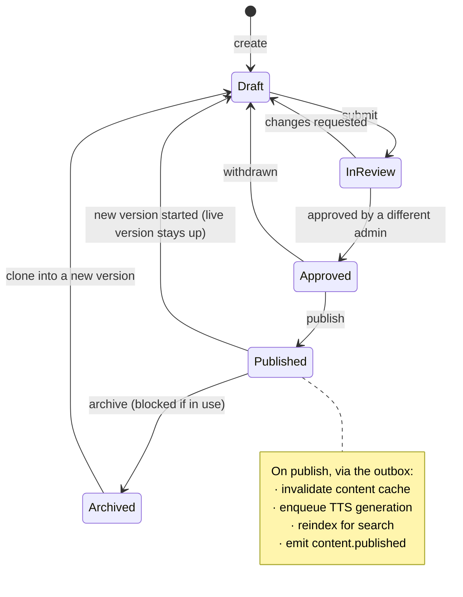

# content — AGENT.md

> AI entry point for this module. Read [`/AGENT.md`](../../../AGENT.md) and
> [`/MODULE_INDEX.md`](../../../MODULE_INDEX.md) first if you have not.
> **Everything you need for this module is below. Do not scan other modules.**

| | |
|---|---|
| Tier | `learning` |
| Path | `internal/modules/content` |
| Schema | `content` |
| Delivery phase | 2 |
| Status | **DONE** |
| Owner | @learning-team |

---

## 1. Overview

<!-- BEGIN GENERATED: overview -->
The canonical model for every piece of learning material, whatever skill it belongs to: content items, immutable versions, media links, taxonomy, CEFR levelling, and the authoring workflow that takes a draft to publication.
<!-- END GENERATED: overview -->

**Context.** This module exists so that vocabulary, grammar, reading, listening, speaking and writing do **not** each reinvent items, versions, media and tagging. Getting it right in Phase 2 makes Phase 3 six thin modules; getting it wrong makes Phase 3 six copies of Phase 2 (ADR-0015).

## 2. Responsibilities

<!-- BEGIN GENERATED: responsibilities -->
**This module owns:**

- `content_items` — the identity of a piece of material, independent of its revisions
- `content_versions` — immutable snapshots; a published lesson references a version, never a mutable item
- The authoring state machine: draft → in_review → approved → published → archived
- Taxonomy: topic, skill, CEFR level, exam relevance, tags
- Media asset references and TTS pre-generation on publish
- Content-level cache invalidation and search reindexing on publish
- Level estimation assistance (AI-suggested, human-approved)

**This module does NOT own:**

- Skill-specific item shape and grading — that belongs to each skill module
- Sequencing content into a course — that is `lesson`
- Storing files — that is `platform/storage`
- Deciding what a learner sees next — that is `learning`
<!-- END GENERATED: responsibilities -->

## 3. Entry points

<!-- BEGIN GENERATED: entrypoints -->
| File | Read it when |
|---|---|
| `internal/modules/content/module.go` | You need to see what this module depends on and what it exposes |
| `internal/modules/content/contract/` | You are calling this module from another module |
| `internal/modules/content/service/` | You are changing behaviour |
| `db/migrations/content/` | You need the real schema |
<!-- END GENERATED: entrypoints -->

## 4. Public API (contract)

Other modules may import **only** `internal/modules/content/contract`.

<!-- BEGIN GENERATED: contract -->
| Kind | Name | Purpose |
|---|---|---|
| interface | `content.Reader` | `GetVersion`, `GetManyVersions`, `Browse` — batched to avoid N+1 from lesson rendering |
| struct | `content.Version` | `{ItemID, Version, Kind, Body, CEFRLevel, MediaRefs, Tags}` |
| event | `content.Published` | Triggers TTS generation, cache invalidation and reindexing |

### Events

| Event | Direction | Payload summary |
|---|---|---|
| `content.published` | publishes | `{item_id, version_id, kind, cefr_level}` |
| `content.archived` | publishes | `{item_id, version_id}` |
| `media.processed` | consumes | Mark an asset ready; block publishing until its media is processed |
<!-- END GENERATED: contract -->

## 5. Database schema

<!-- BEGIN GENERATED: schema -->
All tables live in the `content` schema and are owned exclusively by this module (rule DB1).
Migrations: `db/migrations/content/` · Queries: `db/queries/content/`

| Table | Purpose | Key columns / notes |
|---|---|---|
| `content.content_items` | Stable identity for a piece of material | `kind`, `slug` UNIQUE, `current_version_id`, `status`, `owner_id` |
| `content.content_versions` | Immutable revision | `item_id`, `version`, `body` jsonb (skill-specific payload), `cefr_level`, `status`, `published_at`. Never updated after publication. |
| `content.media_assets` | Reference to an object in storage | `object_key`, `kind`, `duration_ms`, `checksum`, `status` |
| `content.taxonomies` | Controlled vocabularies | `namespace` (topic/skill/exam), `code`, `label`, `parent_id` |
| `content.content_tags` | Item ↔ taxonomy mapping | Composite PK; indexed for filtered browsing |
| `content.content_reviews` | Review workflow record | `version_id`, `reviewer_id`, `decision`, `comments` |
| `content.item_reports` | Learner issue reports on content versions | `content_version_id`, `user_id`, `reason`, `note`. Unique on (content_version_id, user_id). |
| `content.review_samples` | Auto-published versions drawn for a person to spot-check (WO 22 Stage A.5) | `version_id` PK, `batch` (sample/report), `sampled_on`, `decision` (kept/rejected), `decided_by`, `decided_at` |
| `content.foundation_course_nodes` | The Foundation course map: every spine node in exactly one of the thirteen courses (WO 22 Stage E) | PK (`course_slug`, `node_id`), `position`. Unique on `node_id`. |
| `content.tts_cache` | Pre-generated synthesised speech audio keyed by text hash and voice | `text_hash`, `voice`, `engine`, `engine_version`, `object_key`, `created_at` |
| `content.taxonomy_prerequisites` | Prerequisite DAG edges between taxonomy nodes in the same strand | `node_id`, `requires_node_id`, `created_at`. Unique on (node_id, requires_node_id). |

**Indexes of note**

- `idx_content_versions_item_version` — unique on (item_id, version)
- `idx_content_items_status_kind` — partial `WHERE status = 'published'`, the learner-facing browse path
- `idx_content_tags_taxonomy` — filtered browsing by level and topic
<!-- END GENERATED: schema -->

## 6. HTTP endpoints

Full definitions are in [`api/openapi/openapi.yaml`](../../../api/openapi/openapi.yaml)
(tag: `content`). Per-endpoint detail is in §15.

<!-- BEGIN GENERATED: endpoints -->
| Method | Path | Permission | Purpose |
|---|---|---|---|
| `GET` | `/api/v1/content/{slug}` | `content.read.published` | Fetch a published content version |
| `GET` | `/api/v1/content` | `content.read.published` | Browse published content with taxonomy filters |
| `POST` | `/api/v1/content/versions/{id}/reports` | `self` | Report an issue with a content version |
| `POST` | `/api/v1/admin/content` | `content.create` | Create a draft item |
| `PUT` | `/api/v1/admin/content/{id}/draft` | `content.edit` | Update the working draft |
| `POST` | `/api/v1/admin/content/{id}/submit` | `content.edit` | Submit for review |
| `POST` | `/api/v1/admin/content/{id}/review` | `content.review` | Approve or request changes |
| `POST` | `/api/v1/admin/content/{id}/publish` | `content.publish` | Publish the approved version |
| `POST` | `/api/v1/admin/content/{id}/archive` | `content.publish` | Archive |
| `GET` | `/api/v1/foundation/topics` | `content.read.published` | Browse foundation topics with taxonomy filters |
| `GET` | `/api/v1/foundation/topics/{code}` | `content.read.published` | Get a foundation topic by code |
| `GET` | `/api/v1/foundation/path` | `content.read.published` | Get topologically sorted foundation learning path |
| `POST` | `/api/v1/admin/foundation/topics` | `content.create` | Create a new foundation taxonomy topic |
| `PATCH` | `/api/v1/admin/foundation/topics/{code}` | `content.edit` | Update foundation topic metadata |
| `PUT` | `/api/v1/admin/foundation/topics/{code}/prerequisites` | `content.edit` | Replace prerequisites for a foundation topic |
| `GET` | `/api/v1/admin/review-queue` | `content.review` | List machine-generated drafts awaiting review |
| `GET` | `/api/v1/admin/review-queue/batches` | `content.review` | List generation runs awaiting review |
| `POST` | `/api/v1/admin/review-queue/batches/{id}/approve` | `content.review` | Approve a generation run's doubts in one transaction |
| `GET` | `/api/v1/admin/review-queue/samples` | `content.review` | List auto-published items drawn for spot-check |
| `POST` | `/api/v1/admin/review-queue/samples/{id}/decide` | `content.review` | Keep or reject an auto-published sample |
<!-- END GENERATED: endpoints -->

## 7. Folder map

<!-- BEGIN GENERATED: folders -->
| Path | Contains |
|---|---|
| `contract/` | Interfaces, DTOs and event types other modules may import — the only public package |
| `domain/` | Entities, value objects, invariants, domain errors. Pure Go, no I/O |
| `service/` | Use cases, orchestration, transactions, event publishing |
| `repository/` | sqlc-generated queries and row↔domain mappers |
| `transport/http/` | Handlers, request/response DTOs, route registration |
| `job/` | Background job handlers owned by this module |
| `module.go` | `New(deps)` — wiring; the only symbol `cmd/` imports |
<!-- END GENERATED: folders -->

## 8. Related modules

<!-- BEGIN GENERATED: related -->
| Module | Direction | Why |
|---|---|---|
| [`storage`](../../platform/storage/AGENT.md) | → depends on | Media asset objects |
| [`search`](../../platform/search/AGENT.md) | → depends on | Reindex on publish |
| [`audit`](../../modules/audit/AGENT.md) | → depends on | Authoring actions are audited |
| [`ai`](../../platform/ai/AGENT.md) | → depends on | Level estimation and authoring assistance |
| [`media`](../../platform/media/AGENT.md) | → depends on | TTS pre-generation, asset readiness |
| [`lesson`](../../modules/lesson/AGENT.md) | ← used by | consumes this module's contract |
| [`learning`](../../modules/learning/AGENT.md) | ← used by | consumes this module's contract |
| [`vocabulary`](../../modules/vocabulary/AGENT.md) | ← used by | consumes this module's contract |
| [`grammar`](../../modules/grammar/AGENT.md) | ← used by | consumes this module's contract |
| [`reading`](../../modules/reading/AGENT.md) | ← used by | consumes this module's contract |
| [`listening`](../../modules/listening/AGENT.md) | ← used by | consumes this module's contract |
| [`speaking`](../../modules/speaking/AGENT.md) | ← used by | consumes this module's contract |
| [`writing`](../../modules/writing/AGENT.md) | ← used by | consumes this module's contract |
| [`questionbank`](../../modules/questionbank/AGENT.md) | ← used by | consumes this module's contract |
<!-- END GENERATED: related -->

**Boundary reminder:** you may call these through their `contract` package only.
Reaching into `service/`, `repository/`, `domain/` or their tables violates rules L1/L2
and fails `go-arch-lint` in CI.

## 9. Business rules

<!-- BEGIN GENERATED: rules -->
1. **BR-CONTENT-01** — A published version is immutable. Editing published material creates a new version; the old one stays live until the new one is published.
2. **BR-CONTENT-02** — A learner never sees a draft. Every learner-facing query filters `status = 'published'`.
3. **BR-CONTENT-03** — An author cannot approve their own version — review requires a different admin.
4. **BR-CONTENT-04** — Publishing is blocked until every referenced media asset is processed and verified.
5. **BR-CONTENT-05** — Archiving is blocked while a published lesson still references the version (`CONTENT_IN_USE`).
6. **BR-CONTENT-06** — CEFR level is required before review; an AI suggestion is a starting point, never the final value.
7. **BR-CONTENT-07** — `body` is validated against a JSON schema chosen by `kind`, so a skill module's payload cannot be malformed.
8. **BR-CONTENT-08** — Publishing invalidates the content cache, enqueues TTS generation, and triggers reindexing — all through the outbox so a failure in one does not roll back the publish.
9. **BR-CONTENT-09** — Slugs are immutable after first publication; a changed slug would break external links and bookmarks.
10. **BR-CONTENT-10** — Machine-authored exam and curriculum content enters as a draft, and is published by a person or by `ApproveVerified`; practice content may be published directly (`EnsurePublished`).
11. **BR-CONTENT-11** — A machine-authored draft (a body carrying `_provenance`) may be approved directly: the review queue walks it draft → in_review → approved in one transaction, because a generator cannot submit its own output. A human draft still needs its author to submit it. Drafts whose provenance purpose is `resource` never enter the queue: they are a learner's private practice.
<!-- END GENERATED: rules -->

## 10. Common tasks

<!-- BEGIN GENERATED: tasks -->
### Add a content kind

1. Define the JSON schema for its `body` in `api/events/../content-kinds/`.
2. Register the kind and its schema in the validator.
3. Decide whether it needs media, and whether TTS applies on publish.
4. Add the authoring UI in `web/src/features/admin/content/`.
5. Add the skill module that consumes it, and its grader.
6. Add a fixture and a round-trip test through the whole workflow.
<!-- END GENERATED: tasks -->

## 11. Known limitations

<!-- BEGIN GENERATED: limitations -->
- No collaborative editing — one draft per item, last write wins with an ETag check.
- No scheduled publishing in Phase 2.
- Localisation of content itself (as opposed to UI) is not modelled; English-only material in v1.
- Version history has no diff view for `body` beyond raw JSON.
<!-- END GENERATED: limitations -->

## 12. Coding conventions (module-specific)

Global rules: [`docs/CONVENTIONS.md#coding-standard`](../../../docs/CONVENTIONS.md#coding-standard). Deviations and additions
for this module:

<!-- BEGIN GENERATED: conventions -->
_No deviations from the global standard._
<!-- END GENERATED: conventions -->

### Cache strategy

| Key | TTL | Invalidated by |
|---|---|---|
| `fluentra:{env}:content:version:{version_id}:v1` | 24 h | `content.published` / `content.archived` |
| `fluentra:{env}:content:browse:{filter_hash}:v1` | 10 min | Any publish |

### Error codes owned by this module

| Code | Status | Meaning |
|---|---|---|
| `CONTENT_NOT_PUBLISHED` | 404 | Draft or archived content requested by a learner |
| `INVALID_STATE_TRANSITION` | 409 | e.g. publishing something not approved |
| `SELF_APPROVAL_FORBIDDEN` | 403 | The author tried to review their own version |
| `CONTENT_IN_USE` | 409 | Referenced by published material |
| `MEDIA_NOT_READY` | 409 | Referenced assets are still processing |

## 13. Testing

<!-- BEGIN GENERATED: testing -->
Coverage target: **80% service, 90% domain**

```bash
go test ./internal/modules/content/...                    # unit
go test -tags=integration ./internal/modules/content/...  # integration (testcontainers)
```

**Focus areas**

- Published versions are genuinely immutable
- Self-approval is refused
- Archiving is blocked while referenced
- Body schema validation rejects a malformed payload per kind
- Publishing with unprocessed media is refused
- Cache invalidation and reindexing happen after commit, not inside the transaction
<!-- END GENERATED: testing -->

## 14. Do NOT

<!-- BEGIN GENERATED: donot -->
- Do not mutate a published version.
- Do not add skill-specific columns here — put them in `body`, validated by the kind's schema, or in the skill module.
- Do not let a learner-facing query omit the published filter.
- Do not publish inside a transaction that also does cache and search work — use the outbox.
<!-- END GENERATED: donot -->

## 15. API detail

### Endpoint detail

<!-- BEGIN GENERATED: api-detail -->
#### `GET /api/v1/content/{slug}`

Fetch a published content version

| | |
|---|---|
| Permission | `content.read.published` |
| Success | 200 |
| Errors | `CONTENT_NOT_PUBLISHED` |

#### `GET /api/v1/content`

Browse published content with taxonomy filters

| | |
|---|---|
| Permission | `content.read.published` |
| Success | 200 |
| Errors | standard set |

#### `POST /api/v1/content/versions/{id}/reports`

Report an issue with a content version

| | |
|---|---|
| Permission | `self` |
| Success | 201 |
| Errors | `VALIDATION_FAILED` |

#### `POST /api/v1/admin/content`

Create a draft item

| | |
|---|---|
| Permission | `content.create` |
| Success | 201 |
| Errors | standard set |

#### `PUT /api/v1/admin/content/{id}/draft`

Update the working draft

| | |
|---|---|
| Permission | `content.edit` |
| Success | 200 |
| Errors | `INVALID_STATE_TRANSITION` |

#### `POST /api/v1/admin/content/{id}/submit`

Submit for review

| | |
|---|---|
| Permission | `content.edit` |
| Success | 200 |
| Errors | standard set |

#### `POST /api/v1/admin/content/{id}/review`

Approve or request changes

| | |
|---|---|
| Permission | `content.review` |
| Success | 200 |
| Errors | `SELF_APPROVAL_FORBIDDEN` |

#### `POST /api/v1/admin/content/{id}/publish`

Publish the approved version

| | |
|---|---|
| Permission | `content.publish` |
| Success | 200 |
| Errors | standard set |

#### `POST /api/v1/admin/content/{id}/archive`

Archive

| | |
|---|---|
| Permission | `content.publish` |
| Success | 200 |
| Errors | `CONTENT_IN_USE` |

#### `GET /api/v1/foundation/topics`

Browse foundation topics with taxonomy filters

| | |
|---|---|
| Permission | `content.read.published` |
| Success | 200 |
| Errors | standard set |

#### `GET /api/v1/foundation/topics/{code}`

Get a foundation topic by code

| | |
|---|---|
| Permission | `content.read.published` |
| Success | 200 |
| Errors | `NOT_FOUND` |

#### `GET /api/v1/foundation/path`

Get topologically sorted foundation learning path

| | |
|---|---|
| Permission | `content.read.published` |
| Success | 200 |
| Errors | standard set |

#### `POST /api/v1/admin/foundation/topics`

Create a new foundation taxonomy topic

| | |
|---|---|
| Permission | `content.create` |
| Success | 201 |
| Errors | `TAXONOMY_CODE_IMMUTABLE`, `VALIDATION_FAILED` |

#### `PATCH /api/v1/admin/foundation/topics/{code}`

Update foundation topic metadata

| | |
|---|---|
| Permission | `content.edit` |
| Success | 200 |
| Errors | `TAXONOMY_CODE_IMMUTABLE`, `NOT_FOUND` |

#### `PUT /api/v1/admin/foundation/topics/{code}/prerequisites`

Replace prerequisites for a foundation topic

| | |
|---|---|
| Permission | `content.edit` |
| Success | 200 |
| Errors | `TAXONOMY_CYCLE`, `CROSS_NAMESPACE_PREREQUISITE` |

#### `GET /api/v1/admin/review-queue`

List machine-generated drafts awaiting review

| | |
|---|---|
| Permission | `content.review` |
| Success | 200 |
| Errors | standard set |

#### `GET /api/v1/admin/review-queue/batches`

List generation runs awaiting review

| | |
|---|---|
| Permission | `content.review` |
| Success | 200 |
| Errors | standard set |

#### `POST /api/v1/admin/review-queue/batches/{id}/approve`

Approve a generation run's doubts in one transaction

| | |
|---|---|
| Permission | `content.review` |
| Success | 200 |
| Errors | `CONTENT_BATCH_REQUIRED`, `CONTENT_REVIEWER_REQUIRED` |

#### `GET /api/v1/admin/review-queue/samples`

List auto-published items drawn for spot-check

| | |
|---|---|
| Permission | `content.review` |
| Success | 200 |
| Errors | standard set |

#### `POST /api/v1/admin/review-queue/samples/{id}/decide`

Keep or reject an auto-published sample

| | |
|---|---|
| Permission | `content.review` |
| Success | 204 |
| Errors | `INVALID_SAMPLE_DECISION` |

<!-- END GENERATED: api-detail -->

### Error codes

<!-- BEGIN GENERATED: api-errors -->
| Code | Status | Meaning |
|---|---|---|
| `CONTENT_NOT_PUBLISHED` | 404 | Draft or archived content requested by a learner |
| `INVALID_STATE_TRANSITION` | 409 | e.g. publishing something not approved |
| `SELF_APPROVAL_FORBIDDEN` | 403 | The author tried to review their own version |
| `CONTENT_IN_USE` | 409 | Referenced by published material |
| `MEDIA_NOT_READY` | 409 | Referenced assets are still processing |
<!-- END GENERATED: api-errors -->

### Rate limits

<!-- BEGIN GENERATED: api-rate -->
Standard limits apply — see [/docs/CONVENTIONS.md](../../../docs/CONVENTIONS.md#rate-limiting).
<!-- END GENERATED: api-rate -->

## 16. Flows

### Publish

```mermaid
sequenceDiagram
    autonumber
    actor AD as Admin
    participant C as content
    participant DB as PostgreSQL
    participant OB as outbox
    participant ME as media
    participant SE as search
    participant CA as cache

    AD->>C: POST /admin/content/{id}/publish
    C->>C: require content.publish; state must be Approved
    C->>ME: are all referenced assets processed?
    alt not ready
        C-->>AD: 409 MEDIA_NOT_READY
    else ready
        C->>DB: BEGIN
        C->>DB: version.status = published; item.current_version_id = version
        C->>DB: INSERT outbox(content.published)
        C->>DB: COMMIT
        C-->>AD: 200
        OB->>CA: invalidate content keys
        OB->>ME: enqueue TTS for new text
        OB->>SE: reindex
    end
```

<!-- END GENERATED: flows -->

<!-- BEGIN GENERATED: states -->
### State machine

The authoring workflow. The transition that matters most is `Published → Draft`: creating a new version does **not** take the live version down.



<!-- END GENERATED: states -->

### Failure paths

<!-- BEGIN GENERATED: failures -->
_None yet._
<!-- END GENERATED: failures -->

## 17. Decisions

### Decisions taken

<!-- BEGIN GENERATED: decisions -->
| Question | Decision | Rationale |
|---|---|---|
| Shared content model or per-skill models? | Shared | Six near-identical models would diverge within a year and make mixed-skill lessons impossible. The genuinely different part — the grader — stays in the skill module (ADR-0015) |
| Mutable content or versions? | Immutable versions | A learner's attempt must be interpretable against the material they actually saw; editing published material in place would silently rewrite history |
| Who assigns the CEFR level? | A human, with AI assistance | Levelling is a pedagogical judgement with real consequences for learner experience; the model proposes, the author disposes |
| Who may read published content, and who may change it? | Any signed-in learner reads; only an administrator writes | Published material is the first thing a learner reads that is not their own data, so `self` cannot express it and it needs a named permission — `content.read.published`, held by the `user` role. Leaving the reads anonymous would hand a whole course to anyone with the URL and remove the surface Phase 4 attaches entitlements to. Create, edit, review, publish and archive stay with `admin` (migration 1700000180) |
| Where does `archived` live — on the item or on the version? | On the item | A version is an immutable snapshot, and `trg_content_versions_immutable` refuses every UPDATE once it is published — including a status change — so `content_versions.status` can never become `archived`. Archiving sets `content_items.status`. The consequence the reads must honour: a published version stays `published` forever, so filtering only on the version status returns archived material; every learner-facing query joins `content_items` and filters there as well (P7.2) |
| What happens to a learner mid-session when the item is archived? | Version stays readable by direct ID, hidden from discovery only | A learner who opened a lesson holds a version ID. Archiving must not 404 that learner's session; GetVersion by ID has no status filter and remains readable (P7.3 integration test step 12). Discovery queries (Browse, GetPublishedVersionBySlug, Count) join content_items and filter status='published', so archived material disappears from lists. Recorded in P7.3 per its trap. |
| How to associate exercises, quizzes and reviews with a topic? (D16-1) | Tag content items to taxonomy rather than nesting | Exercises belong to each skill module and already have rich schemas; nesting would duplicate kinds and schemas. BR-FOUNDATION-05 enforces completeness at the publish gate. |
| Where do CEFR level and prerequisites live? (D16-2) | On taxonomy nodes and content.taxonomy_prerequisites | The taxonomy spine represents the curriculum DAG independent of any specific content version. |
| How to prevent cycles in the prerequisite graph? (D16-3) | In-memory 3-color DFS check before DB write | Validating before write provides informative error messages naming the offending cycle chain without rolling back transactions. |
| Can a taxonomy code be renamed? (D16-4) | No, codes are permanently immutable | External references and question bank rely on canonical codes; typos are fixed by deprecating and creating a new node. |
| Cross-namespace prerequisite edges? (D16-5) | Forbidden; use related topics instead | Ordering across distinct strands is pedantically indefensible and leads to graph tangling. |
| Anonymous access for foundation spine reads? (D16-6) | Allowed per ADR-0025 | Published curriculum taxonomy and learning paths are public read surfaces. |
<!-- END GENERATED: decisions -->

### Related repository ADRs

<!-- BEGIN GENERATED: decisions-adr -->
- [ADR-0015](../../../docs/adr/ADR-0015-content-exercise-core.md) — Shared content + exercise engine
<!-- END GENERATED: decisions-adr -->

### Open questions

<!-- BEGIN GENERATED: decisions-open -->
_None._
<!-- END GENERATED: decisions-open -->

## 18. Backlog

### Phase 2

- [ ] Items, versions, taxonomy, tags and media references
- [ ] Authoring state machine with a review gate
- [ ] Body schema validation per kind
- [ ] Publish pipeline: cache invalidation, TTS, reindex via outbox
- [ ] Admin authoring UI
- [ ] AI level estimation as a suggestion
- [ ] Seed content: one course, eight lessons, two hundred words

### Phase 4 - Knowledge Spine (Work Order 16)

- [ ] Extend content.taxonomies with description, cefr_level, position, deprecated_at
- [ ] content.taxonomy_prerequisites DAG edge table
- [ ] In-memory cycle detection and stable topological ordering
- [ ] Foundation topic JSON schema validation and BR-FOUNDATION-05 publish gate
- [ ] Public and admin endpoints for foundation topics, prerequisites and path
- [ ] Seed 69 canonical foundation topics and prerequisite DAG edges
<!-- END GENERATED: todo -->

### Progress

The list above is generated from `tools/docgen/data/learning.json`, so its checkboxes cannot be
ticked by hand — `make docs` rewrites the block and `make docs-check` fails until it matches.
Completed work is recorded here instead.

| Task | Done | What landed |
|---|---|---|
| P7.2 | 2026-08-21 | The six tables in schema `content`, with the authoring, review and media status enums; `content_versions` frozen after publish by `trg_content_versions_immutable`; every foreign key indexed and pointing only inside `content` or at `core.users` (DB4); sqlc queries including the batched `GetManyContentVersionsByIDs`; a reversible down; integration tests covering immutability, every check constraint, both unique constraints, FK index coverage and the down migration |
| P7.3 | 2026-08-22 | Authoring state machine with pure domain transitions (5x5 matrix test); service layer enforcing BR-CONTENT-03 (self-approval forbidden) and BR-CONTENT-04 (media readiness verification before publish); outbox event emission for content.published and content.archived; archive-mid-session retrieval preservation; batched Reader.GetManyVersions with query count assertion; HTTP learner routes (/content) and admin authoring routes (/admin/content); full integration test suite. Coverage **86.0%**, measured with `make cover-check` against postgres 17 (80.4% from the unit suite alone). The integration figure only counts because `cover-check` gained `-coverpkg=./...`: without it a test in package `content_test` credits `modules/content` and nothing else, so the repository layer it drives end to end read 0% |
| P3.9 | 2026-09-07 | Content read-side administration endpoints (`GET /admin/content` list with filtering, `GET /admin/content/{id}` detail with versions) implemented in OpenAPI, sqlc, repository, service, and HTTP transport with full unit tests. Content authoring UI connected with permission-gated transitions and raw JSON validation enforcing grader answer keys. |
| WO19 Stage C | 2026-09-21 | Author extensions for generation: `AuthorSpec` gains `Tags []TagRef`, `EnsureDraft(ctx, spec)` creates or advances draft versions, and `RedactForLearner` strips `_provenance` top-level key. |

### Carried into P7.3

- [x] **`media_refs` cannot be a foreign key, so publish has to check it.**
      `content_versions.media_refs` is `text[]` and a Postgres array carries no referential
      constraint. Nothing stops a version being published while it points at a
      `media_assets` row still `pending` — the learner would open a lesson whose audio does
      not exist yet. The publish service must resolve every `object_key` in `media_refs` and
      refuse while any referenced asset is not `ready`, with a test that proves an
      unprocessed asset blocks publishing.
- [x] **Archiving is an item-level action, and the reads have to know that.**
      See `DECISIONS.md`: a published version's `status` never changes, so a query filtered
      only on `content_versions.status = 'published'` still returns archived material.
      Every learner-facing read joins `content_items` and filters there too.

### Carried into P7.4

- [ ] **BR-CONTENT-05 `ErrContentInUse` is dead code.** Declared in `domain/errors.go` but never returned. Archive does not check whether a published lesson still references the version. Either wire `lesson` contract `IsVersionInUse` into `Archive` (blocked → 409 `CONTENT_IN_USE`) or remove the error and document why archiving is unconditionally allowed in Phase 2.
- [ ] **BR-CONTENT-04 `media_refs` has no API surface.** DTOs `CreateContentItemRequest` and `UpdateDraftRequest` (and their service structs) carry no `media_refs`/`tags` that reaches `content_versions.media_refs`; every create/update passes `[]string{}`. `verifyMediaAssetsReady` is therefore unreachable except via direct DB insert. Decide in P7.4 whether authoring UI supplies media_refs (add field to DTOs, validate object_key shape, and add test that publish blocks on non-ready asset supplied via API) or defer with rationale.
- [ ] **Heavier — decide before P7.4 builds on it: `current_version_id` semantics.** `createNewDraftFromPublished` sets `current_version_id` to the new draft and `item.status` to `draft`. Consequences: Archive emits `content.archived{version_id: draft}`; an item that was published but has an open draft cannot be archived (`ValidateTransition(draft, archived)` → 409); consumer of `content.published` reads `current_version_id` assuming "live" version. Proposal: `current_version_id` tracks the live (published) version only; draft ID lives elsewhere, or item has `published_version_id` + `draft_version_id`.
- [ ] **Heavier — decide before P7.4: BR-CONTENT-03 wrong subject.** `Review` checks `item.OwnerID == reviewerID`, but the author of the version under review is not necessarily the item owner (version 2 may be written by someone else). Correct subject is the version's author — requires `created_by` on `content_versions` (or `content_reviews` history). Also blocks `changes_requested` by owner with 403, though self-requesting changes is harmless.
- [ ] **Heavier — decide before P7.4: `actorID` is discarded.** `_ = actorID` in `Publish`, `Archive`, `UpdateDraft`, `SubmitForReview`. No audit trail for who published/archived. Module declares `depends_on: [audit]`; P7.4 should thread actor through to `audit.Log` or outbox payload, or document why audit is intentionally not wired in Phase 2.

### Deferred (deliberately not doing yet)

<!-- BEGIN GENERATED: todo-deferred -->
_Nothing deferred._
<!-- END GENERATED: todo-deferred -->

### Future improvements

<!-- BEGIN GENERATED: todo-future -->
- Scheduled publishing
- Content localisation
- Structural diff view between versions
- Reusable content blocks across items
<!-- END GENERATED: todo-future -->

---

_Generated by `tools/docgen` from `tools/docgen/data/`. Hand-written text outside the
GENERATED markers is preserved. Update the manifest, then run `make docs`._
