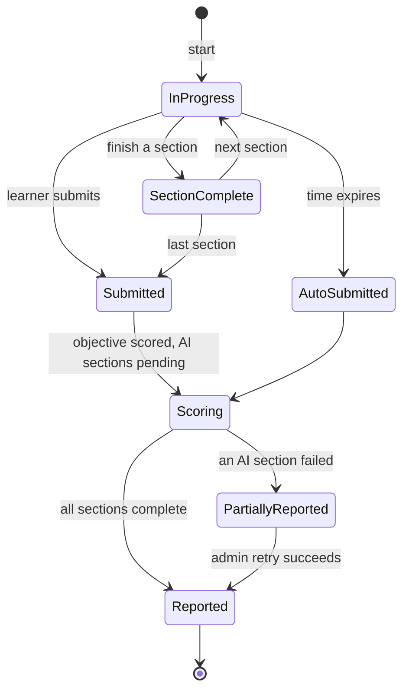

# exam — AGENT.md

> AI entry point for this module. Read [`/AGENT.md`](../../../AGENT.md) and
> [`/MODULE_INDEX.md`](../../../MODULE_INDEX.md) first if you have not.
> **Everything you need for this module is below. Do not scan other modules.**

| | |
|---|---|
| Tier | `learning` |
| Path | `internal/modules/exam` |
| Schema | `assess` |
| Delivery phase | 4 |
| Status | **DONE** |
| Owner | @learning-team |

---

## 1. Overview

<!-- BEGIN GENERATED: overview -->
Timed mock exams in real formats (IELTS, TOEIC): sections, strict timing, auto-submit, integrity signals, scoring and score reports.
<!-- END GENERATED: overview -->

**Context.** An exam is not a lesson with a timer. It has section-level time limits, no going back, one listening play, no dictionary, and a hard stop. Learners take mock exams to rehearse those constraints, so simulating them faithfully is the feature.

## 2. Responsibilities

<!-- BEGIN GENERATED: responsibilities -->
**This module owns:**

- Exam definitions: sections, item sources, timing, scoring model
- Attempt orchestration with server-authoritative timing
- Auto-submit on expiry, including when the client disappears
- Section navigation rules
- Scoring and band conversion per exam format
- Score reports with per-section breakdown and comparison
- Integrity signals: tab changes, paste events, timing anomalies

**This module does NOT own:**

- Authoring items — that is `questionbank`
- Grading writing and speaking sections — those delegate to their skill modules
<!-- END GENERATED: responsibilities -->

## 3. Entry points

<!-- BEGIN GENERATED: entrypoints -->
| File | Read it when |
|---|---|
| `internal/modules/exam/module.go` | You need to see what this module depends on and what it exposes |
| `internal/modules/exam/contract/` | You are calling this module from another module |
| `internal/modules/exam/service/` | You are changing behaviour |
| `db/migrations/exam/` | You need the real schema |
<!-- END GENERATED: entrypoints -->

## 4. Public API (contract)

Other modules may import **only** `internal/modules/exam/contract`.

<!-- BEGIN GENERATED: contract -->
| Kind | Name | Purpose |
|---|---|---|
| interface | `exam.Reader` | `AttemptHistory`, `LatestBand` — used by `learning` and `analytics` |

### Events

| Event | Direction | Payload summary |
|---|---|---|
| `exam.attempt_started` | publishes | `{user_id, exam_id, attempt_id}` |
| `exam.attempt_finished` | publishes | `{user_id, attempt_id, band, per_section}` |
| `writing.graded` | consumes | Complete the writing section score |
| `speaking.scored` | consumes | Complete the speaking section score |
<!-- END GENERATED: contract -->

## 5. Database schema

<!-- BEGIN GENERATED: schema -->
All tables live in the `assess` schema and are owned exclusively by this module (rule DB1).
Migrations: `db/migrations/exam/` · Queries: `db/queries/exam/`

| Table | Purpose | Key columns / notes |
|---|---|---|
| `assess.exams` | Exam definition | Content-versioned. `format`, `total_minutes`, `scoring_model` |
| `assess.exam_sections` | Timed part | `exam_id`, `position`, `skill`, `minutes`, `question_set_id`, `navigation` (linear/free) |
| `assess.exam_attempts` | One sitting | `user_id`, `exam_id`, `mode`, `chosen_duration_minutes`, `started_at`, `deadline_at`, `status`, `section_activities`, `draft_answers`, `submitted_at`, `submitted_by` |
| `assess.score_reports` | Learner-facing result | `attempt_id`, `overall_band`, `per_section` jsonb, `feedback`, `percentile` |
| `assess.integrity_events` | Signals during an attempt | `attempt_id`, `kind`, `occurred_at` — informational, never punitive automatically |
| `assess.exam_versions` | Verified exam versions | `exam_family`, `code`, `title`, `total_minutes`, `scoring`, `source_url`, `verified_at`, `is_current` |
| `assess.exam_parts` | Exam parts per version | `version_id`, `section`, `part_number`, `kind`, `question_count`, `group_size` |
| `assess.blueprints` | Mock test blueprints | `version_id`, `name`, `cefr_distribution`, `node_distribution` |
| `assess.mock_tests` | Composed mock tests | `blueprint_id`, `mode`, `number` (fixed only), `seed`, `composition`, `owner_id` |

<!-- END GENERATED: schema -->

## 6. HTTP endpoints

Full definitions are in [`api/openapi/openapi.yaml`](../../../api/openapi/openapi.yaml)
(tag: `exam`). Per-endpoint detail is in §15.

<!-- BEGIN GENERATED: endpoints -->
| Method | Path | Permission | Purpose |
|---|---|---|---|
| `GET` | `/api/v1/exams` | `content.read.published` | Available mock exams |
| `POST` | `/api/v1/exams/{id}/attempts` | `self` | Start a sitting |
| `GET` | `/api/v1/exam-attempts` | `self` | List past sittings for current user |
| `GET` | `/api/v1/exam-attempts/{id}` | `self` | Current state with server time remaining |
| `PUT` | `/api/v1/exam-attempts/{id}/answers` | `self` | Save answers (autosave) |
| `POST` | `/api/v1/exam-attempts/{id}/sections/{n}/complete` | `self` | Finish a section |
| `POST` | `/api/v1/exam-attempts/{id}/submit` | `self` | Submit the whole exam |
| `GET` | `/api/v1/exam-attempts/{id}/report` | `self` | Score report when ready |
| `GET` | `/api/v1/exam-versions` | `content.read.published` | Current verified exam versions and their blueprints |
| `GET` | `/api/v1/exam-versions/{id}/tests` | `content.read.published` | The numbered fixed tests of one exam version |
| `POST` | `/api/v1/mock-tests` | `self` | Compose a mock test |
| `POST` | `/api/v1/mock-tests/{id}/attempts` | `self` | Start or retake a mock test attempt |
| `GET` | `/api/v1/admin/exams/versions/{id}/coverage` | `questionbank.read` | Exam version coverage report |
<!-- END GENERATED: endpoints -->

## 7. Folder map

<!-- BEGIN GENERATED: folders -->
| Path | Contains |
|---|---|
| `contract/` | Interfaces, DTOs and event types other modules may import — the only public package |
| `domain/` | Entities, value objects, invariants, domain errors. Pure Go, no I/O |
| `service/` | Use cases, orchestration, transactions, event publishing |
| `repository/` | sqlc-generated queries and row↔domain mappers |
| `transport/http/` | Handlers, request/response DTOs, route registration |
| `job/` | Background job handlers owned by this module |
| `module.go` | `New(deps)` — wiring; the only symbol `cmd/` imports |
<!-- END GENERATED: folders -->

## 8. Related modules

<!-- BEGIN GENERATED: related -->
| Module | Direction | Why |
|---|---|---|
| [`questionbank`](../../modules/questionbank/AGENT.md) | → depends on | see its contract |
| [`job`](../../platform/job/AGENT.md) | → depends on | see its contract |
| [`ai`](../../platform/ai/AGENT.md) | → depends on | see its contract |
| [`writing`](../../modules/writing/AGENT.md) | → depends on | see its contract |
| [`speaking`](../../modules/speaking/AGENT.md) | → depends on | see its contract |
| [`learning`](../../modules/learning/AGENT.md) | → depends on | see its contract |
| [`lesson`](../../modules/lesson/AGENT.md) | → depends on | see its contract |
| [`listening`](../../modules/listening/AGENT.md) | → depends on | see its contract |
| [`learning`](../../modules/learning/AGENT.md) | ← used by | consumes this module's contract |
| [`analytics`](../../modules/analytics/AGENT.md) | ← used by | consumes this module's contract |
| [`admin`](../../modules/admin/AGENT.md) | ← used by | consumes this module's contract |
<!-- END GENERATED: related -->

**Boundary reminder:** you may call these through their `contract` package only.
Reaching into `service/`, `repository/`, `domain/` or their tables violates rules L1/L2
and fails `go-arch-lint` in CI.

## 9. Business rules

<!-- BEGIN GENERATED: rules -->
1. **BR-EXAM-01** — Time is server-authoritative. The client displays a countdown; the server decides when it is over.
2. **BR-EXAM-02** — An expired attempt is auto-submitted by a job — a learner who closes the tab still gets their answers scored.
3. **BR-EXAM-03** — Section navigation follows the exam format: linear sections cannot be revisited, free sections can.
4. **BR-EXAM-04** — One attempt in progress per learner per exam.
5. **BR-EXAM-05** — Answers autosave continuously; a lost connection must not lose work.
6. **BR-EXAM-06** — Sections graded by AI (writing, speaking) mark the report incomplete until their events arrive.
7. **BR-EXAM-07** — Band conversion uses the published table for the format, versioned so historical reports remain reproducible.
8. **BR-EXAM-08** — Integrity signals are recorded and shown to the learner as self-awareness information; they never automatically invalidate an attempt.
9. **BR-EXAM-09** — Items are sampled with exposure control so a learner does not see the same items in consecutive attempts.
10. **BR-EXAM-10** — The score report is generated once and stored — it must not change if the scoring table is later revised.
11. **BR-EXAM-11** — Exam structures are seeded data with an `https` source and a verification date.
12. **BR-EXAM-12** — A retake replays its composition; only a new test draws again.
13. **BR-EXAM-13** — A fixed test is a numbered, stored composition shared by everyone; the fixed tests of one blueprint share no question.
14. **BR-EXAM-14** — A part is filled with exactly its question count, in whole groups; a part the bank cannot fill is refused with the part named.
15. **BR-EXAM-15** — The number of distinct tests shown is the coverage report's number.
16. **BR-EXAM-16** — A mock test's composition is stored on the attempt and served from there, so its activity configs are redacted at composition time: a key that reaches the composition reaches the learner.
17. **BR-EXAM-17** — A practice sitting may opt out of a visible time limit; the server still applies a generous backstop deadline so an abandoned sitting cannot block a future attempt indefinitely.
<!-- END GENERATED: rules -->

## 10. Common tasks

<!-- BEGIN GENERATED: tasks -->
### Add an exam format

1. Define sections, timings and navigation rules.
2. Add the band conversion table, versioned.
3. Ensure `questionbank` has enough approved items per section, or the exam cannot be built.
4. Add the score report template.
5. Test the full sitting including auto-submit and a failed AI section.
<!-- END GENERATED: tasks -->

## 11. Known limitations

The current sitting-start guard permits only one open sitting per learner across
all exam versions and mock tests (including unlimited practice). The web hub shows
the open sitting with a resume link in the catalogue, fixed-test list and custom
composer. `ATTEMPT_IN_PROGRESS` explains that the learner must continue and submit
that sitting; it must not silently submit or discard their answers.

<!-- BEGIN GENERATED: limitations -->
- No proctoring; integrity signals are advisory.
- Speaking sections require the learner to have granted microphone access before starting.
- Percentile comparison needs a population; it is suppressed until enough attempts exist.
- No offline exam mode.
<!-- END GENERATED: limitations -->

## 12. Coding conventions (module-specific)

Global rules: [`docs/CONVENTIONS.md#coding-standard`](../../../docs/CONVENTIONS.md#coding-standard). Deviations and additions
for this module:

<!-- BEGIN GENERATED: conventions -->
_No deviations from the global standard._
<!-- END GENERATED: conventions -->

### Error codes owned by this module

| Code | Status | Meaning |
|---|---|---|
| `ATTEMPT_IN_PROGRESS` | 409 | Finish or abandon the existing attempt first |
| `EXAM_ALREADY_SUBMITTED` | 409 | Terminal state |
| `EXAM_WINDOW_CLOSED` | 403 | Outside the availability window |
| `SECTION_TIME_EXPIRED` | 409 | Section time is over |
| `INSUFFICIENT_ITEMS` | 409 | Not enough approved items to build the exam |

## 13. Testing

<!-- BEGIN GENERATED: testing -->
Coverage target: **80% service, 90% domain**

```bash
go test ./internal/modules/exam/...                    # unit
go test -tags=integration ./internal/modules/exam/...  # integration (testcontainers)
```

**Focus areas**

- Server-authoritative timing cannot be extended by the client
- Auto-submit fires for an abandoned attempt
- Section navigation rules enforced
- Autosave preserves answers across a disconnect
- Band conversion reproducible from the versioned table
- Partial report when an AI section fails
- Exposure control across consecutive attempts
<!-- END GENERATED: testing -->

## 14. Do NOT

<!-- BEGIN GENERATED: donot -->
- Do not trust client-reported time.
- Do not let an abandoned attempt sit unsubmitted.
- Do not recompute a stored score report.
- Do not invalidate an attempt automatically from integrity signals.
- Do not duplicate question storage — sample from `questionbank`.
<!-- END GENERATED: donot -->

## 15. API detail

### Endpoint detail

<!-- BEGIN GENERATED: api-detail -->
#### `GET /api/v1/exams`

Available mock exams

| | |
|---|---|
| Permission | `content.read.published` |
| Success | 200 |
| Errors | standard set |

#### `POST /api/v1/exams/{id}/attempts`

Start a sitting

| | |
|---|---|
| Permission | `self` |
| Success | 201 |
| Errors | `EXAM_WINDOW_CLOSED`, `ATTEMPT_IN_PROGRESS`, `INSUFFICIENT_ITEMS` |

#### `GET /api/v1/exam-attempts`

List past sittings for current user

| | |
|---|---|
| Permission | `self` |
| Success | 200 |
| Errors | standard set |

#### `GET /api/v1/exam-attempts/{id}`

Current state with server time remaining

| | |
|---|---|
| Permission | `self` |
| Success | 200 |
| Errors | standard set |

#### `PUT /api/v1/exam-attempts/{id}/answers`

Save answers (autosave)

| | |
|---|---|
| Permission | `self` |
| Success | 200 |
| Errors | `ATTEMPT_EXPIRED` |

#### `POST /api/v1/exam-attempts/{id}/sections/{n}/complete`

Finish a section

| | |
|---|---|
| Permission | `self` |
| Success | 200 |
| Errors | standard set |

#### `POST /api/v1/exam-attempts/{id}/submit`

Submit the whole exam

| | |
|---|---|
| Permission | `self` |
| Success | 202 |
| Errors | standard set |
| Notes | 202 because writing and speaking sections grade asynchronously |

#### `GET /api/v1/exam-attempts/{id}/report`

Score report when ready

| | |
|---|---|
| Permission | `self` |
| Success | 200 |
| Errors | standard set |

#### `GET /api/v1/exam-versions`

Current verified exam versions and their blueprints

| | |
|---|---|
| Permission | `content.read.published` |
| Success | 200 |
| Errors | standard set |

#### `GET /api/v1/exam-versions/{id}/tests`

The numbered fixed tests of one exam version

| | |
|---|---|
| Permission | `content.read.published` |
| Success | 200 |
| Errors | standard set |

#### `POST /api/v1/mock-tests`

Compose a mock test

| | |
|---|---|
| Permission | `self` |
| Success | 201 |
| Errors | standard set |

#### `POST /api/v1/mock-tests/{id}/attempts`

Start or retake a mock test attempt

| | |
|---|---|
| Permission | `self` |
| Success | 201 |
| Errors | standard set |

#### `GET /api/v1/admin/exams/versions/{id}/coverage`

Exam version coverage report

| | |
|---|---|
| Permission | `questionbank.read` |
| Success | 200 |
| Errors | standard set |

<!-- END GENERATED: api-detail -->

### Error codes

<!-- BEGIN GENERATED: api-errors -->
| Code | Status | Meaning |
|---|---|---|
| `ATTEMPT_IN_PROGRESS` | 409 | Finish or abandon the existing attempt first |
| `EXAM_ALREADY_SUBMITTED` | 409 | Terminal state |
| `EXAM_WINDOW_CLOSED` | 403 | Outside the availability window |
| `SECTION_TIME_EXPIRED` | 409 | Section time is over |
| `INSUFFICIENT_ITEMS` | 409 | Not enough approved items to build the exam |
<!-- END GENERATED: api-errors -->

### Rate limits

<!-- BEGIN GENERATED: api-rate -->
Standard limits apply — see [/docs/CONVENTIONS.md](../../../docs/CONVENTIONS.md#rate-limiting).
<!-- END GENERATED: api-rate -->

## 16. Flows

### Exam sitting with auto-submit

```mermaid
sequenceDiagram
    autonumber
    actor U as Learner
    participant E as exam
    participant Q as questionbank
    participant J as job
    participant W as writing/speaking

    U->>E: POST /exams/{id}/attempts
    E->>Q: SampleItems per section with exposure control
    alt not enough items
        E-->>U: 409 INSUFFICIENT_ITEMS
    else
        E->>E: INSERT attempt (expires_at = now + total)
        E->>J: schedule auto-submit at expires_at
        E-->>U: 201 { attempt, section 1, server_time }
    end

    loop while time remains
        U->>E: PUT /answers (autosave)
        E->>E: reject if section time has expired
    end

    alt learner submits
        U->>E: POST /submit
    else time expires
        J->>E: auto-submit
    end

    E->>E: score objective sections immediately
    E->>W: dispatch writing and speaking for async grading
    E-->>U: 202 { report pending }
    W-->>E: graded events
    E->>E: complete the report; publish exam.attempt_finished

```

<!-- END GENERATED: flows -->

<!-- BEGIN GENERATED: states -->
### State machine



<!-- END GENERATED: states -->

### Failure paths

<!-- BEGIN GENERATED: failures -->
| Failure | Detected by | Behaviour |
|---|---|---|
| Learner loses connection mid-exam | No autosave for N seconds | Answers to that point are saved; the timer keeps running (as in a real exam); the learner can rejoin |
| AI section grading fails | `writing.grading_failed` | Report is partial and clearly marked; admin can retry; the learner is not charged an attempt |
<!-- END GENERATED: failures -->

## 17. Decisions

### Decisions taken

<!-- BEGIN GENERATED: decisions -->
| Question | Decision | Rationale |
|---|---|---|
| Client or server timing? | Server, always | Client timing is trivially manipulable, and an exam whose timing can be manipulated has no value as practice |
| Auto-invalidate on integrity signals? | No — record and show | False positives (a notification, a second monitor) would penalise honest learners; the signal is more useful as self-awareness feedback than as enforcement |
| Store or recompute score reports? | Store | A learner's past band must not change because we revised a conversion table |
| How are exam timeouts enforced? | 3-tier expiry: River job at deadline, 1-minute sweep cron, and lazy check on read | Guarantees attempt finalisation and score reporting even if learner abandons sitting or background workers experience delays |
| How does practice mode differ from exam mode? | Custom duration 10–180 minutes or unlimited (a generous backstop still applies), free section navigation, and re-recordable speaking | Enables targeted practice without breaking realistic exam constraints |
| How is the exam pool isolated from the practice pool? | Distinct pool course pool-exam and strict refusal guards in preview and lessons | Prevents exam questions from leaking through regular study or practice routes |
| When can a listening item be drawn for an exam sitting? | Only when TTS audio has been rendered and object key exists in storage | A learner cannot be tested on listening audio that does not exist |
<!-- END GENERATED: decisions -->

### Related repository ADRs

<!-- BEGIN GENERATED: decisions-adr -->
_None specific to this module._
<!-- END GENERATED: decisions-adr -->

### Open questions

<!-- BEGIN GENERATED: decisions-open -->
_None._
<!-- END GENERATED: decisions-open -->

## 18. Backlog

### Backlog

_Empty. Add items with acceptance criteria as they are identified._
<!-- END GENERATED: todo -->

### Deferred (deliberately not doing yet)

<!-- BEGIN GENERATED: todo-deferred -->
_Nothing deferred._
<!-- END GENERATED: todo-deferred -->

### Future improvements

<!-- BEGIN GENERATED: todo-future -->
- Adaptive placement variant
- Percentile comparison once the population is large enough
- Proctoring integration
- Section-only practice mode
<!-- END GENERATED: todo-future -->

---

_Generated by `tools/docgen` from `tools/docgen/data/`. Hand-written text outside the
GENERATED markers is preserved. Update the manifest, then run `make docs`._
