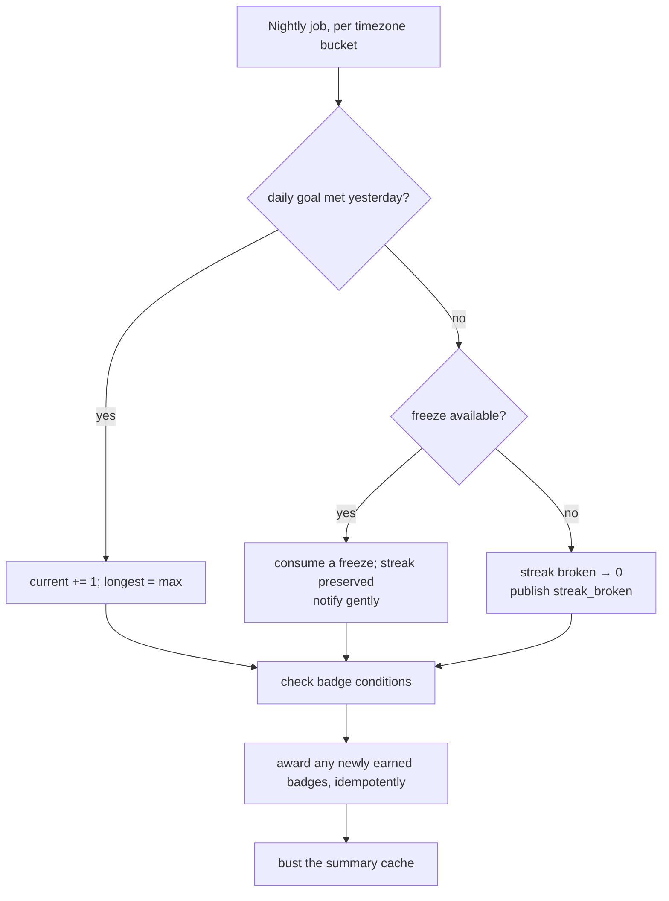

# gamification — AGENT.md

> AI entry point for this module. Read [`/AGENT.md`](../../../AGENT.md) and
> [`/MODULE_INDEX.md`](../../../MODULE_INDEX.md) first if you have not.
> **Everything you need for this module is below. Do not scan other modules.**

| | |
|---|---|
| Tier | `learning` |
| Path | `internal/modules/gamification` |
| Schema | `learn` |
| Delivery phase | 3 |
| Status | **DONE** |
| Owner | @learning-team |

---

## 1. Overview

<!-- BEGIN GENERATED: overview -->
Motivation mechanics: XP, levels, streaks, badges, quests and leaderboards. It reacts to learning events and never drives them.
<!-- END GENERATED: overview -->

**Context.** Gamification is downstream by design. It subscribes to events from `learning`, `srs`, `writing` and `speaking`, and owns no learning logic — so a change to how motivation works can never break how learning works.

## 2. Responsibilities

<!-- BEGIN GENERATED: responsibilities -->
**This module owns:**

- XP awards per learning action, with anti-farming rules
- Levels derived from cumulative XP
- Streaks with freezes and timezone-correct day boundaries
- Badges and their unlock conditions
- Quests: time-boxed multi-step goals
- Leaderboards (opt-in, league-based)
- Daily goal tracking

**This module does NOT own:**

- Deciding what counts as learning — the source modules do
- Sending reminders — that is `notification`
<!-- END GENERATED: responsibilities -->

## 3. Entry points

<!-- BEGIN GENERATED: entrypoints -->
| File | Read it when |
|---|---|
| `internal/modules/gamification/module.go` | You need to see what this module depends on and what it exposes |
| `internal/modules/gamification/contract/` | You are calling this module from another module |
| `internal/modules/gamification/service/` | You are changing behaviour |
| `db/migrations/gamification/` | You need the real schema |
<!-- END GENERATED: entrypoints -->

## 4. Public API (contract)

Other modules may import **only** `internal/modules/gamification/contract`.

<!-- BEGIN GENERATED: contract -->
| Kind | Name | Purpose |
|---|---|---|
| interface | `gamification.Reader` | `SummaryOf(ctx, userID)` — used by the dashboard and `notification` |

### Events

| Event | Direction | Payload summary |
|---|---|---|
| `gamification.xp_awarded` | publishes | `{user_id, amount, source}` |
| `gamification.level_up` | publishes | `{user_id, level}` |
| `gamification.badge_earned` | publishes | `{user_id, badge_code}` |
| `gamification.streak_at_risk` | publishes | `{user_id, hours_remaining}` — drives the reminder |
| `gamification.streak_broken` | publishes | `{user_id, previous_length}` |
| `activity.completed` | consumes | Award XP |
| `lesson.completed` | consumes | Award XP and progress quests |
| `review.session_completed` | consumes | Award XP and extend the streak |
| `writing.graded` | consumes | Award XP |
| `speaking.scored` | consumes | Award XP |
| `exam.attempt_finished` | consumes | Award XP and badges |
<!-- END GENERATED: contract -->

## 5. Database schema

<!-- BEGIN GENERATED: schema -->
All tables live in the `learn` schema and are owned exclusively by this module (rule DB1).
Migrations: `db/migrations/gamification/` · Queries: `db/queries/gamification/`

| Table | Purpose | Key columns / notes |
|---|---|---|
| `learn.xp_events` | Every XP award | Partitioned monthly. `user_id`, `source`, `source_id`, `amount`, `multiplier`, `awarded_at`. Unique on (user_id, source, source_id) for idempotency |
| `learn.xp_activity_high_water` | Per-activity XP high water mark | `user_id`, `activity_id`, `max_score`, `xp_awarded` |
| `learn.streaks` | Streak state | `user_id`, `current`, `longest`, `last_active_on`, `freezes_available`, `freeze_used_on` |
| `learn.badges` | Badge catalogue | `code`, `name`, `criteria` jsonb, `tier` |
| `learn.badges_earned` | Awards | Unique on (user_id, badge_id) |
| `learn.quests` | Time-boxed goals | `code`, `steps` jsonb, `window`, `reward` |
| `learn.user_quests` | Quest progress | `user_id`, `quest_id`, `progress` jsonb, `completed_at` |
| `learn.leaderboard_snapshots` | Weekly league standings | Materialised weekly; opt-in only |

<!-- END GENERATED: schema -->

### Two deliberate departures from the spec above

**`xp_events` is not partitioned.** The spec asked for monthly partitions _and_ a
unique constraint on `(user_id, source, source_id)`. PostgreSQL gives one or the
other: a unique constraint on a partitioned table must contain the partition key,
so the constraint would have to become `(…, awarded_at)` — which stops
deduplicating the moment a redelivery lands a microsecond later, i.e. always.
BR-GAMIFICATION-01 says a redelivered event must not double-award, and that rule
is worth more than a partition this table does not yet need: `review_logs` takes
a row per card per review, while this takes a handful per learner per day, capped
again by BR-GAMIFICATION-05. Partition it when volume argues for it, and move the
idempotency key to a small unpartitioned table at that point.

**`daily_goal_xp` and `leaderboard_opt_in` live on `streaks`.** There is exactly
one of each per learner, and the streak row already is that; a second table keyed
by `user_id` would be the same row under another name. They are not in
`core.user_preferences` because that table belongs to `user`, and L2 forbids
reaching into it.

## 6. HTTP endpoints

Full definitions are in [`api/openapi/openapi.yaml`](../../../api/openapi/openapi.yaml)
(tag: `gamification`). Per-endpoint detail is in §15.

<!-- BEGIN GENERATED: endpoints -->
| Method | Path | Permission | Purpose |
|---|---|---|---|
| `GET` | `/api/v1/me/gamification` | `self` | XP, level, streak, badges, active quests |
| `GET` | `/api/v1/me/streak` | `self` | Streak with the freeze state and the day boundary |
| `POST` | `/api/v1/me/streak/freeze` | `self` | Use a freeze |
| `PUT` | `/api/v1/me/leaderboard-opt-in` | `self` | Join or leave the leaderboard |
| `GET` | `/api/v1/leaderboard` | `self` | Current league standings |
| `PUT` | `/api/v1/me/daily-goal` | `self` | Set the daily XP goal |
<!-- END GENERATED: endpoints -->

## 7. Folder map

<!-- BEGIN GENERATED: folders -->
| Path | Contains |
|---|---|
| `contract/` | Interfaces, DTOs and event types other modules may import — the only public package |
| `domain/` | Entities, value objects, invariants, domain errors. Pure Go, no I/O |
| `service/` | Use cases, orchestration, transactions, event publishing |
| `repository/` | sqlc-generated queries and row↔domain mappers |
| `transport/http/` | Handlers, request/response DTOs, route registration |
| `job/` | Background job handlers owned by this module |
| `module.go` | `New(deps)` — wiring; the only symbol `cmd/` imports |
<!-- END GENERATED: folders -->

## 8. Related modules

<!-- BEGIN GENERATED: related -->
| Module | Direction | Why |
|---|---|---|
| [`learning`](../../modules/learning/AGENT.md) | → depends on | see its contract |
| [`srs`](../../modules/srs/AGENT.md) | → depends on | see its contract |
| [`cache`](../../platform/cache/AGENT.md) | → depends on | see its contract |
| [`job`](../../platform/job/AGENT.md) | → depends on | see its contract |
| [`notification`](../../modules/notification/AGENT.md) | → depends on | see its contract |
| [`notification`](../../modules/notification/AGENT.md) | ← used by | consumes this module's contract |
| [`analytics`](../../modules/analytics/AGENT.md) | ← used by | consumes this module's contract |
| [`admin`](../../modules/admin/AGENT.md) | ← used by | consumes this module's contract |
<!-- END GENERATED: related -->

**Boundary reminder:** you may call these through their `contract` package only.
Reaching into `service/`, `repository/`, `domain/` or their tables violates rules L1/L2
and fails `go-arch-lint` in CI.

## 9. Business rules

<!-- BEGIN GENERATED: rules -->
1. **BR-GAMIFICATION-01** — XP is awarded from events only, and is idempotent on (user, source, source_id) — a redelivered event must not double-award.
2. **BR-GAMIFICATION-02** — The streak day boundary is in the learner's own timezone, and a timezone change never retroactively breaks a streak.
3. **BR-GAMIFICATION-03** — A streak extends when the daily goal is met, not merely when the app is opened.
4. **BR-GAMIFICATION-04** — Freezes are limited and replenish slowly; a freeze is consumed automatically at the day boundary if the goal was missed and one is available.
5. **BR-GAMIFICATION-05** — Anti-farming: XP per source type is capped daily, and repeating the same activity yields diminishing returns.
6. **BR-GAMIFICATION-06** — Badges are idempotent — earning conditions are re-evaluated safely and a badge is awarded once.
7. **BR-GAMIFICATION-07** — Leaderboards are opt-in, carry the display name and avatar only, and are league-based so a learner competes with peers rather than with the whole platform.
8. **BR-GAMIFICATION-08** — Gamification never blocks learning: running out of XP, freezes or league position must not prevent any learning action.
9. **BR-GAMIFICATION-09** — Streak reminders respect quiet hours and are sent by `notification`, not from here.
<!-- END GENERATED: rules -->

## 10. Common tasks

<!-- BEGIN GENERATED: tasks -->
### Add a badge

1. Add the badge with its criteria expression to the catalogue.
2. Implement the evaluator, which must be idempotent and cheap — it runs on many events.
3. Backfill for existing learners with a job if the badge is retroactive.
4. Add the artwork and the description copy.
5. Test that re-running the evaluator awards it exactly once.
<!-- END GENERATED: tasks -->

## 11. Known limitations

<!-- BEGIN GENERATED: limitations -->
- Leaderboard leagues are static rather than skill-matched.
- Quests are hand-authored; there is no generation from a learner's profile.
- Anti-farming is rule-based and will not catch a determined script.
- Streak evaluation runs per timezone bucket, so a learner who changes timezone mid-day sees an approximation.
<!-- END GENERATED: limitations -->

## 12. Coding conventions (module-specific)

Global rules: [`docs/CONVENTIONS.md#coding-standard`](../../../docs/CONVENTIONS.md#coding-standard). Deviations and additions
for this module:

<!-- BEGIN GENERATED: conventions -->
_No deviations from the global standard._
<!-- END GENERATED: conventions -->

### Cache strategy

| Key | TTL | Invalidated by |
|---|---|---|
| `fluentra:{env}:gamification:summary:{user_id}:v1` | 2 min | Any XP award |
| `fluentra:{env}:gamification:leaderboard:{league}:{week}:v1` | 1 min | Periodic rebuild |

### Error codes owned by this module

| Code | Status | Meaning |
|---|---|---|
| `NO_FREEZES_AVAILABLE` | 409 | No streak freeze remaining |
| `LEADERBOARD_NOT_OPTED_IN` | 403 | Learner has not opted in |
| `DAILY_XP_CAP_REACHED` | 200 | Not an error — the award is capped and reported as such |

## 13. Testing

<!-- BEGIN GENERATED: testing -->
Coverage target: **80% service, 90% domain**

```bash
go test ./internal/modules/gamification/...                    # unit
go test -tags=integration ./internal/modules/gamification/...  # integration (testcontainers)
```

**Focus areas**

- XP idempotency under redelivered events
- Streak day boundaries across timezones and DST
- Timezone change does not retroactively break a streak
- Freeze consumption at the boundary
- Daily caps and diminishing returns
- Badge awarded exactly once under concurrent evaluation
- Leaderboard excludes learners who have not opted in
<!-- END GENERATED: testing -->

## 14. Do NOT

<!-- BEGIN GENERATED: donot -->
- Do not call gamification synchronously from a learning flow.
- Do not let a gamification failure block a learning action.
- Do not award XP without an idempotency key.
- Do not break a streak because a learner travelled.
- Do not put a learner on a leaderboard without opt-in.
<!-- END GENERATED: donot -->

## 15. API detail

### Endpoint detail

<!-- BEGIN GENERATED: api-detail -->
#### `GET /api/v1/me/gamification`

XP, level, streak, badges, active quests

| | |
|---|---|
| Permission | `self` |
| Success | 200 |
| Errors | standard set |

#### `GET /api/v1/me/streak`

Streak with the freeze state and the day boundary

| | |
|---|---|
| Permission | `self` |
| Success | 200 |
| Errors | standard set |

#### `POST /api/v1/me/streak/freeze`

Use a freeze

| | |
|---|---|
| Permission | `self` |
| Success | 200 |
| Errors | `NO_FREEZES_AVAILABLE` |

#### `PUT /api/v1/me/leaderboard-opt-in`

Join or leave the leaderboard

| | |
|---|---|
| Permission | `self` |
| Success | 200 |
| Errors | standard set |
| Notes | The board is opt-in by decision, not by default: a name is shown to people the learner joined, never to everyone. |

#### `GET /api/v1/leaderboard`

Current league standings

| | |
|---|---|
| Permission | `self` |
| Success | 200 |
| Errors | `LEADERBOARD_NOT_OPTED_IN` |

#### `PUT /api/v1/me/daily-goal`

Set the daily XP goal

| | |
|---|---|
| Permission | `self` |
| Success | 200 |
| Errors | standard set |

<!-- END GENERATED: api-detail -->

### Error codes

<!-- BEGIN GENERATED: api-errors -->
| Code | Status | Meaning |
|---|---|---|
| `NO_FREEZES_AVAILABLE` | 409 | No streak freeze remaining |
| `LEADERBOARD_NOT_OPTED_IN` | 403 | Learner has not opted in |
| `DAILY_XP_CAP_REACHED` | 200 | Not an error — the award is capped and reported as such |
<!-- END GENERATED: api-errors -->

### Rate limits

<!-- BEGIN GENERATED: api-rate -->
Standard limits apply — see [/docs/CONVENTIONS.md](../../../docs/CONVENTIONS.md#rate-limiting).
<!-- END GENERATED: api-rate -->

## 16. Flows

### Streak evaluation at the day boundary



<!-- END GENERATED: flows -->

<!-- BEGIN GENERATED: states -->
_This module has no explicit state machine._
<!-- END GENERATED: states -->

### Failure paths

<!-- BEGIN GENERATED: failures -->
_None yet._
<!-- END GENERATED: failures -->

## 17. Decisions

### Decisions taken

<!-- BEGIN GENERATED: decisions -->
| Question | Decision | Rationale |
|---|---|---|
| Event-driven or called directly? | Event-driven | It keeps motivation mechanics strictly downstream — a bug here can never break a learning flow, and learning modules need no knowledge of XP at all |
| Streak freezes? | Yes, limited and automatic | An all-or-nothing streak punishes the illness or travel that real learners have, and losing a long streak is a strong churn trigger. Forgiveness retains better than strictness |
| Global leaderboard? | No — opt-in leagues | A global board demotivates everyone outside the top few and creates a privacy exposure nobody asked for |
| Which day boundary does a streak use? | The learner's own timezone | core.users already stores a timezone and the seed sets Asia/Ho_Chi_Minh. Counting in UTC would end the day at 7am local, so a learner studying in the evening in Vietnam loses a streak they kept |
| What identity appears on a league board? | The display name, and only inside a league the learner opted into | Display name is the only name a learner chooses and the only one already meant to be seen; email and profile are never on a board. The opt-in boundary is what keeps this compatible with refusing a global leaderboard — a name is shown to people the learner joined, not to everyone |
| How much XP does a graded item award? | Its best score ever, divided by ten, granted as the increase over what it has already granted | 80/100 grants 8. Retaking to 100/100 grants 2, not 10. A third attempt grants nothing. XP therefore measures what a learner can do rather than how many times they pressed retry, and cannot be farmed by repetition. The award is never negative: a worse retake takes nothing back |
| Where does the XP high-water mark live? | In this module, not in learn.progress | UpsertProgress sets score = EXCLUDED.score, so learn.progress holds the most recent score and not the best one — a bad retake lowers it. XP must never fall, so it cannot be derived from that column and needs its own per-item record of what has already been granted |
| What earns XP? | Lessons completed, word senses reaching known, and tests passed | The three things a learner does that represent knowledge rather than activity. Tests have nothing to attach to yet — the exam module is Phase 4 and its tables do not exist — so that source is declared and left unwired rather than faked |
<!-- END GENERATED: decisions -->

### Related repository ADRs

<!-- BEGIN GENERATED: decisions-adr -->
_None specific to this module._
<!-- END GENERATED: decisions-adr -->

### Open questions

<!-- BEGIN GENERATED: decisions-open -->
_None._
<!-- END GENERATED: decisions-open -->

## 18. Backlog

### Phase 3

- [ ] XP events with idempotency and daily caps
- [ ] Levels from cumulative XP
- [ ] Streaks with timezone-correct boundaries and freezes
- [ ] Badge catalogue and idempotent evaluators
- [ ] Daily goal tracking
- [ ] `streak_at_risk` event for reminders
- [ ] Gamification widgets in the web app

### Phase 4

- [ ] Quests
- [ ] Opt-in weekly leagues
- [ ] Leaderboard materialisation job
<!-- END GENERATED: todo -->

### Deferred (deliberately not doing yet)

<!-- BEGIN GENERATED: todo-deferred -->
_Nothing deferred._
<!-- END GENERATED: todo-deferred -->

### Future improvements

<!-- BEGIN GENERATED: todo-future -->
- Skill-matched leagues
- Personalised quests
- Team or friend challenges
- Seasonal events
<!-- END GENERATED: todo-future -->

---

_Generated by `tools/docgen` from `tools/docgen/data/`. Hand-written text outside the
GENERATED markers is preserved. Update the manifest, then run `make docs`._
