# grammar — AGENT.md

> AI entry point for this module. Read [`/AGENT.md`](../../../AGENT.md) and
> [`/MODULE_INDEX.md`](../../../MODULE_INDEX.md) first if you have not.
> **Everything you need for this module is below. Do not scan other modules.**

| | |
|---|---|
| Tier | `learning` |
| Path | `internal/modules/grammar` |
| Schema | `skill` |
| Delivery phase | 3 |
| Status | **IN_PROGRESS** |
| Owner | @learning-team |

---

## 1. Overview

<!-- BEGIN GENERATED: overview -->
Grammar as a structured, teachable system: a rule taxonomy, error tagging, targeted drills, and AI explanations that always cite a rule from our own taxonomy rather than improvising.
<!-- END GENERATED: overview -->

**Context.** The taxonomy is what keeps AI explanations honest. A model asked to "explain the error" will confabulate a plausible rule; a model asked to "identify which of these rules was violated and explain it" cannot.

## 2. Responsibilities

<!-- BEGIN GENERATED: responsibilities -->
**This module owns:**

- Grammar point taxonomy with CEFR levels and prerequisites
- Rule definitions with canonical examples and common errors
- Error tagging of learner output, reusable across writing and speaking
- Drill types: gap-fill, transformation, error correction, sentence ordering
- AI explanation grounded in a cited rule
- Per-learner grammar weakness profile

**This module does NOT own:**

- Grading essays holistically — that is `writing`
- Review scheduling — that is `srs`
<!-- END GENERATED: responsibilities -->

## 3. Entry points

<!-- BEGIN GENERATED: entrypoints -->
| File | Read it when |
|---|---|
| `internal/modules/grammar/module.go` | You need to see what this module depends on and what it exposes |
| `internal/modules/grammar/contract/` | You are calling this module from another module |
| `internal/modules/grammar/service/` | You are changing behaviour |
| `db/migrations/grammar/` | You need the real schema |
<!-- END GENERATED: entrypoints -->

## 4. Public API (contract)

Other modules may import **only** `internal/modules/grammar/contract`.

<!-- BEGIN GENERATED: contract -->
| Kind | Name | Purpose |
|---|---|---|
| interface | `grammar.Grader` | Implements `learning.ExerciseGrader` for grammar drills |
| interface | `grammar.Tagger` | `TagErrors(ctx, text)` — used by `writing` and `speaking` to attribute errors to taxonomy points |

### Events

| Event | Direction | Payload summary |
|---|---|---|
| `grammar.error_tagged` | publishes | `{user_id, point_id, source}` |
| `writing.graded` | consumes | Tag errors from the feedback annotations |
| `speaking.scored` | consumes | Tag errors from the transcript |
<!-- END GENERATED: contract -->

## 5. Database schema

<!-- BEGIN GENERATED: schema -->
All tables live in the `skill` schema and are owned exclusively by this module (rule DB1).
Migrations: `db/migrations/grammar/` · Queries: `db/queries/grammar/`

| Table | Purpose | Key columns / notes |
|---|---|---|
| `skill.grammar_points` | Taxonomy node | `code` UNIQUE (e.g. `PRESENT_PERFECT_VS_PAST_SIMPLE`), `cefr_level`, `parent_id` |
| `skill.grammar_rules` | Rule statement plus examples | `point_id`, `statement`, `examples` jsonb, `common_errors` jsonb |
| `skill.grammar_exercises` | Drill items | Content-versioned. `point_id`, `kind`, `body` jsonb |
| `skill.error_tags` | Tagged errors in learner output | `user_id`, `source` (writing/speaking), `source_id`, `point_id`, `span`, `detected_by` |
| `skill.user_grammar_state` | Weakness profile | `user_id`, `point_id`, `error_rate`, `last_error_at`, `mastery` |

<!-- END GENERATED: schema -->

## 6. HTTP endpoints

Full definitions are in [`api/openapi/openapi.yaml`](../../../api/openapi/openapi.yaml)
(tag: `grammar`). Per-endpoint detail is in §15.

<!-- BEGIN GENERATED: endpoints -->
| Method | Path | Permission | Purpose |
|---|---|---|---|
| `GET` | `/api/v1/grammar/points` | `content.read.published` | Browse the taxonomy by level |
| `GET` | `/api/v1/grammar/points/{code}` | `content.read.published` | Rule with examples and common errors |
| `GET` | `/api/v1/me/grammar/weaknesses` | `self` | Ranked weak points with drill suggestions |
| `POST` | `/api/v1/grammar/explain` | `self` | Explain a tagged error, citing a rule |
<!-- END GENERATED: endpoints -->

## 7. Folder map

<!-- BEGIN GENERATED: folders -->
| Path | Contains |
|---|---|
| `contract/` | Interfaces, DTOs and event types other modules may import — the only public package |
| `domain/` | Entities, value objects, invariants, domain errors. Pure Go, no I/O |
| `service/` | Use cases, orchestration, transactions, event publishing |
| `repository/` | sqlc-generated queries and row↔domain mappers |
| `transport/http/` | Handlers, request/response DTOs, route registration |
| `module.go` | `New(deps)` — wiring; the only symbol `cmd/` imports |
<!-- END GENERATED: folders -->

## 8. Related modules

<!-- BEGIN GENERATED: related -->
| Module | Direction | Why |
|---|---|---|
| [`content`](../../modules/content/AGENT.md) | → depends on | see its contract |
| [`srs`](../../modules/srs/AGENT.md) | → depends on | see its contract |
| [`ai`](../../platform/ai/AGENT.md) | → depends on | see its contract |
| [`learning`](../../modules/learning/AGENT.md) | → depends on | see its contract |
| [`writing`](../../modules/writing/AGENT.md) | ← used by | consumes this module's contract |
| [`speaking`](../../modules/speaking/AGENT.md) | ← used by | consumes this module's contract |
| [`learning`](../../modules/learning/AGENT.md) | ← used by | consumes this module's contract |
| [`exam`](../../modules/exam/AGENT.md) | ← used by | consumes this module's contract |
<!-- END GENERATED: related -->

**Boundary reminder:** you may call these through their `contract` package only.
Reaching into `service/`, `repository/`, `domain/` or their tables violates rules L1/L2
and fails `go-arch-lint` in CI.

## 9. Business rules

<!-- BEGIN GENERATED: rules -->
1. **BR-GRAMMAR-01** — Every explanation cites a `grammar_points.code`. An explanation the model cannot ground in a taxonomy point is discarded, not shown.
2. **BR-GRAMMAR-02** — Error tags are attributed to the smallest applicable point, so the weakness profile is actionable rather than vague.
3. **BR-GRAMMAR-03** — The weakness profile is an error rate over recent output, decayed over time — an error from six months ago should not dominate.
4. **BR-GRAMMAR-04** — Drills are recommended from the weakness profile, respecting prerequisites: do not drill the present perfect at someone who has not mastered the past simple.
5. **BR-GRAMMAR-05** — Grammar points enter spaced repetition once explicitly taught, not on first error.
6. **BR-GRAMMAR-06** — Error correction drills accept multiple valid corrections where the language genuinely allows more than one.
7. **BR-GRAMMAR-07** — The taxonomy is versioned; retagging historical errors after a taxonomy change is a job, not a migration.
<!-- END GENERATED: rules -->

## 10. Common tasks

<!-- BEGIN GENERATED: tasks -->
### Add a grammar point

1. Add the point with its code, CEFR level and parent, following `docs/knowledge/grammar-taxonomy.md`.
2. Write the rule statement, canonical examples and the common errors learners actually make.
3. Add at least one drill of each supported kind.
4. Add tagger patterns or examples so errors can be attributed to it.
5. Add eval examples so `grammar.explain` can cite it correctly.
<!-- END GENERATED: tasks -->

## 11. Known limitations

<!-- BEGIN GENERATED: limitations -->
- Error tagging depends on the quality of the writing feedback annotations; it inherits their misses.
- The taxonomy is English-specific and hand-built; it is not exhaustive.
- There is no rule-based parser; tagging is model-assisted with taxonomy grounding.
<!-- END GENERATED: limitations -->

## 12. Coding conventions (module-specific)

Global rules: [`docs/CONVENTIONS.md#coding-standard`](../../../docs/CONVENTIONS.md#coding-standard). Deviations and additions
for this module:

<!-- BEGIN GENERATED: conventions -->
_No deviations from the global standard._
<!-- END GENERATED: conventions -->

### Error codes owned by this module

| Code | Status | Meaning |
|---|---|---|
| `GRAMMAR_POINT_NOT_FOUND` | 404 | Unknown taxonomy code |
| `EXPLANATION_UNGROUNDED` | 500 | The model could not cite a valid rule |

## 13. Testing

<!-- BEGIN GENERATED: testing -->
Coverage target: **80% service, 90% domain**

```bash
go test ./internal/modules/grammar/...                    # unit
go test -tags=integration ./internal/modules/grammar/...  # integration (testcontainers)
```

**Focus areas**

- Explanations without a valid citation are rejected
- Error rate decay behaves over time
- Prerequisite ordering in drill recommendation
- Multiple valid corrections accepted
- Retagging after a taxonomy change is idempotent
<!-- END GENERATED: testing -->

## 14. Do NOT

<!-- BEGIN GENERATED: donot -->
- Do not show an explanation that cites no rule.
- Do not tag an error to a broad point when a specific one applies.
- Do not drill a point whose prerequisites are unmastered.
- Do not let the taxonomy be edited without a retag plan.
<!-- END GENERATED: donot -->

## 15. API detail

### Endpoint detail

<!-- BEGIN GENERATED: api-detail -->
#### `GET /api/v1/grammar/points`

Browse the taxonomy by level

| | |
|---|---|
| Permission | `content.read.published` |
| Success | 200 |
| Errors | standard set |

#### `GET /api/v1/grammar/points/{code}`

Rule with examples and common errors

| | |
|---|---|
| Permission | `content.read.published` |
| Success | 200 |
| Errors | standard set |

#### `GET /api/v1/me/grammar/weaknesses`

Ranked weak points with drill suggestions

| | |
|---|---|
| Permission | `self` |
| Success | 200 |
| Errors | standard set |

#### `POST /api/v1/grammar/explain`

Explain a tagged error, citing a rule

| | |
|---|---|
| Permission | `self` |
| Success | 200 |
| Errors | `AI_QUOTA_EXCEEDED` |

<!-- END GENERATED: api-detail -->

### Error codes

<!-- BEGIN GENERATED: api-errors -->
| Code | Status | Meaning |
|---|---|---|
| `GRAMMAR_POINT_NOT_FOUND` | 404 | Unknown taxonomy code |
| `EXPLANATION_UNGROUNDED` | 500 | The model could not cite a valid rule |
<!-- END GENERATED: api-errors -->

### Rate limits

<!-- BEGIN GENERATED: api-rate -->
Standard limits apply — see [/docs/CONVENTIONS.md](../../../docs/CONVENTIONS.md#rate-limiting).
<!-- END GENERATED: api-rate -->

## 16. Flows

### From an essay error to a targeted drill

```mermaid
flowchart LR
    A[writing.graded<br/>with annotations] --> B["grammar.TagErrors"]
    B --> C[map each annotation to a taxonomy point]
    C --> D[INSERT error_tags]
    D --> E[update user_grammar_state error rate]
    E --> F[weakness profile reranked]
    F --> G[drills recommended, respecting prerequisites]
    G --> H[learner completes a drill]
    H --> I[grammar point enters srs]
    I --> J[error rate falls → point drops down the ranking]
```



<!-- END GENERATED: flows -->

<!-- BEGIN GENERATED: states -->
_This module has no explicit state machine._
<!-- END GENERATED: states -->

### Failure paths

<!-- BEGIN GENERATED: failures -->
_None yet._
<!-- END GENERATED: failures -->

## 17. Decisions

### Decisions taken

<!-- BEGIN GENERATED: decisions -->
| Question | Decision | Rationale |
|---|---|---|
| Free-form AI explanation or grounded citation? | Grounded | An ungrounded model will invent a confident, plausible, wrong rule — and a learner cannot tell the difference. Citation makes the explanation checkable and the failure mode visible |
| Tag errors on first occurrence or after teaching? | Tag always, schedule only after teaching | The weakness profile needs all the data; spaced repetition of something never taught is just confusing |
<!-- END GENERATED: decisions -->

### Related repository ADRs

<!-- BEGIN GENERATED: decisions-adr -->
_None specific to this module._
<!-- END GENERATED: decisions-adr -->

### Open questions

<!-- BEGIN GENERATED: decisions-open -->
_None._
<!-- END GENERATED: decisions-open -->

## 18. Backlog

### Phase 3

- [ ] Taxonomy with CEFR levels and prerequisites
- [ ] Rules with examples and common errors
- [ ] Error tagging consuming writing and speaking events
- [ ] Weakness profile with decay
- [ ] Drill types and graders
- [ ] Grounded `grammar.explain` with a citation check
- [ ] Seed taxonomy covering A1–B2
<!-- END GENERATED: todo -->

### Deferred (deliberately not doing yet)

<!-- BEGIN GENERATED: todo-deferred -->
_Nothing deferred._
<!-- END GENERATED: todo-deferred -->

### Future improvements

<!-- BEGIN GENERATED: todo-future -->
- Corpus-derived common error lists
- Contrastive explanations for Vietnamese speakers specifically
- Automatic drill generation from a learner's own errors
<!-- END GENERATED: todo-future -->

### Done in work order 8

- [x] **Drill types and graders.** `grammar_tense_choice` and `grammar_sentence_transform`,
      graded by this module's own `learning.ExerciseGrader` — the first grader in the project
      that is not vocabulary's, which is what finally gives `cmd/api`'s start-up validation of
      the grader registry something to fail on (ADR-0015).

---

_Generated by `tools/docgen` from `tools/docgen/data/`. Hand-written text outside the
GENERATED markers is preserved. Update the manifest, then run `make docs`._
