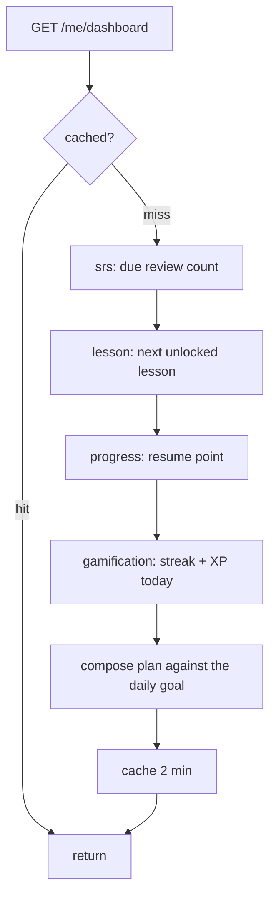
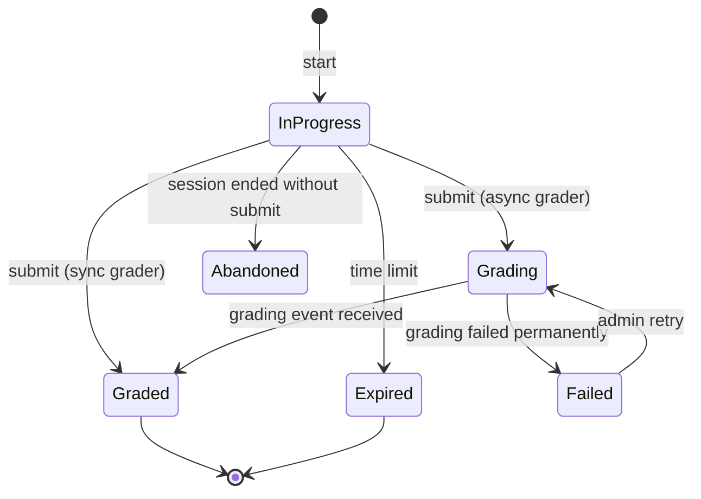

# learning — AGENT.md

> AI entry point for this module. Read [`/AGENT.md`](../../../AGENT.md) and
> [`/MODULE_INDEX.md`](../../../MODULE_INDEX.md) first if you have not.
> **Everything you need for this module is below. Do not scan other modules.**

| | |
|---|---|
| Tier | `learning` |
| Path | `internal/modules/learning` |
| Schema | `learn` |
| Delivery phase | 2 |
| Status | **DONE** |
| Owner | @learning-team |

---

## 1. Overview

### Local practice repair (2026-10-01)

- Daily sets are keyed by learner, local date **and CEFR level**. Migration
  `1700000950_daily_sets_by_level.sql` retains legacy unlabelled rows as history,
  but draws fresh A2/B1/B2 sets instead of relabelling the same activities.
- Resource practice checks the current `resource_classify.v2` suitability result
  before requesting, generating, or reading even an existing ready set. Old
  classifications require the owner's content revalidation; unrelated documents
  cannot become practice simply because their file format passed validation.

<!-- BEGIN GENERATED: overview -->
The learner's journey and the **exercise engine**. Owns enrolment, progress, attempts, session tracking, placement and the adaptive path — and defines the `ExerciseGrader` interface that every skill module implements.
<!-- END GENERATED: overview -->

**Context.** The exercise engine is the shared machinery: start an attempt, collect a response, dispatch to the right grader, record a score, update progress, emit events. Skill modules supply only the grader. This is the second half of ADR-0015 and the reason the six skill modules stay small.

## 2. Responsibilities

<!-- BEGIN GENERATED: responsibilities -->
**This module owns:**

- Enrolment in courses
- Progress: per activity, lesson, unit, course and skill
- The exercise engine: attempt lifecycle, response collection, grader dispatch, scoring
- Learning sessions: start, resume, complete, time tracking
- Placement test orchestration and level assignment
- The adaptive daily plan: what to study next and how much
- Unlocking evaluation against the rules `lesson` defines
- Skill radar and mastery estimation

**This module does NOT own:**

- How a specific skill is graded — each skill module implements `ExerciseGrader`
- Review scheduling — that is `srs`
- XP, streaks and badges — that is `gamification`
- Curriculum structure — that is `lesson`
<!-- END GENERATED: responsibilities -->

## 3. Entry points

<!-- BEGIN GENERATED: entrypoints -->
| File | Read it when |
|---|---|
| `internal/modules/learning/module.go` | You need to see what this module depends on and what it exposes |
| `internal/modules/learning/contract/` | You are calling this module from another module |
| `internal/modules/learning/service/` | You are changing behaviour |
| `db/migrations/learning/` | You need the real schema |
<!-- END GENERATED: entrypoints -->

## 4. Public API (contract)

Other modules may import **only** `internal/modules/learning/contract`.

<!-- BEGIN GENERATED: contract -->
| Kind | Name | Purpose |
|---|---|---|
| interface | `learning.ExerciseGrader` | `Grade(ctx, GradeRequest) (GradeResult, error)` — **implemented by every skill module**, registered by activity kind |
| struct | `learning.GradeResult` | `{Score, MaxScore, Correct, Feedback, Async, ReviewItems}` — `ReviewItem` is a `learning` type, not an `srs` one, so a grader in any skill module can return it |
| interface | `learning.ProgressReader` | `ProgressOf(ctx, userID, scope)` — used by `gamification`, `admin`, `analytics` |
| interface | `learning.UnlockChecker` | `IsUnlocked(ctx, userID, lessonIDs)` — used by `lesson` (batched to prevent N+1 queries). A prerequisite below the learner's placed level is met without being done |
| interface | `learning.PlacementListeningPolicy` | `PlacementListeningPlays(ctx, userID, sessionID, versionID)` — used by `listening`: one play, only for the current item of the caller's open session |
| interface | `learning.ItemVerifier` | `VerifyItem(ctx, req)` — six checks for community/generated items before learners can access them |
| interface | `learning.Generator` | `Generate(ctx, req)` — produces verified, spine-tagged educational content items |

### Events

| Event | Direction | Payload summary |
|---|---|---|
| `activity.completed` | publishes | `{user_id, activity_id, score, skill, duration_ms}` |
| `lesson.completed` | publishes | `{user_id, lesson_id, score, skill_focus}` |
| `course.completed` | publishes | `{user_id, course_id}` |
| `placement.completed` | publishes | `{user_id, level, per_skill}` |
| `learning.session_completed` | publishes | `{user_id, minutes, activities}` |
| `writing.graded` | consumes | Complete the asynchronous attempt and roll up progress |
| `speaking.scored` | consumes | Same, for speaking |
| `user.deleted` | consumes | Anonymise progress and attempts |
<!-- END GENERATED: contract -->

## 5. Database schema

<!-- BEGIN GENERATED: schema -->
All tables live in the `learn` schema and are owned exclusively by this module (rule DB1).
Migrations: `db/migrations/learning/` · Queries: `db/queries/learning/`

| Table | Purpose | Key columns / notes |
|---|---|---|
| `learn.enrollments` | Learner ↔ course | `user_id`, `course_id`, `status`, `started_at`, `completed_at` |
| `learn.progress` | Rolled-up state | `user_id`, `scope` (activity/lesson/unit/course), `scope_id`, `status`, `score`, `completed_at`. Unique on (user, scope, scope_id) |
| `learn.attempts` | One try at an activity | Partitioned monthly. `user_id`, `activity_id`, `response` jsonb, `score`, `max_score`, `grader`, `duration_ms`, `status` |
| `learn.learning_sessions` | A study session | `user_id`, `started_at`, `ended_at`, `activities_completed`, `minutes` |
| `learn.placement_results` | Placement outcome | `user_id`, `estimated_level`, `per_skill` jsonb, `taken_at` |
| `learn.skill_mastery` | Per-skill mastery estimate | `user_id`, `skill`, `level`, `confidence`, `updated_at` |
| `learn.answer_explanations` | Cached AI answer explanations | `content_version_id`, `user_answer` unique, `text`, `text_vi`, `is_correct` |
| `learn.item_exposures` | Learner item exposure log | `user_id`, `activity_id`, `first_served_at`. Primary key (user_id, activity_id). |
| `learn.daily_sets` | Daily practice set cache | `user_id`, `local_date`, `activity_ids`. Unique on (user_id, local_date). |
| `learn.placement_sessions` | One adaptive placement test | `user_id`, `status`, `stage`, `started_at`, `deadline_at`, `estimate` jsonb, `items` jsonb (served items with their attempts), `version`, `productive_status`, `productive_deadline_at`, `result_id`, `completed_at` |
| `learn.weekly_plans` | A learner's plan for one week | `user_id`, `week_start` (Monday, Asia/Ho_Chi_Minh), `minutes_goal`, `items` jsonb. Primary key (user_id, week_start); progress is read, not stored |
| `learn.node_mastery` | Per-node spine taxonomy mastery estimate | `user_id`, `node_id`, `attempts`, `correct`, `score`, `last_seen_at`. Primary key (user_id, node_id). |
| `learn.resource_practice_sets` | Private practice generated from a learner's own upload (WO 21 Stage B) | `resource_id` PK, `user_id`, `lesson_id`, `activity_ids`, `status` (generating/ready/failed), `failure_reason`, `generated_on`. Regenerable once a day; never part of the shared bank. |

**Indexes of note**

- `uq_progress_user_scope` — the read path for every dashboard
- `idx_attempts_user_activity_time` — attempt history
- `idx_attempts_activity_time` — item statistics for `questionbank`
- `uq_answer_explanations` — unique on (content_version_id, user_answer) for lazy deduplication
- `uq_placement_sessions_one_in_progress` — partial unique on (user_id) where the session is in progress
- `idx_placement_sessions_open_deadline` — the expiry sweep
- `idx_node_mastery_user_score` — learner weak node lookup
<!-- END GENERATED: schema -->

## 6. HTTP endpoints

Full definitions are in [`api/openapi/openapi.yaml`](../../../api/openapi/openapi.yaml)
(tag: `learning`). Per-endpoint detail is in §15.

<!-- BEGIN GENERATED: endpoints -->
| Method | Path | Permission | Purpose |
|---|---|---|---|
| `POST` | `/api/v1/courses/{id}/enroll` | `self` | Enrol |
| `GET` | `/api/v1/me/dashboard` | `self` | Today's plan, due reviews, continue-where-you-left-off |
| `GET` | `/api/v1/me/progress` | `self` | Progress across courses and skills |
| `POST` | `/api/v1/activities/{id}/attempts` | `self` | Start an attempt |
| `POST` | `/api/v1/attempts/{id}/submit` | `self` | Submit a response for grading |
| `GET` | `/api/v1/attempts/{id}` | `self` | Attempt state and result |
| `POST` | `/api/v1/activities/{id}/grade` | `public` | Grade a response without recording anything |
| `GET` | `/api/v1/practice/daily` | `self` | Fetch today's practice set |
| `POST` | `/api/v1/me/sessions` | `self` | Start a study session |
| `POST` | `/api/v1/me/sessions/{id}/complete` | `self` | End a session |
| `GET` | `/api/v1/me/placement` | `self` | The current placement result, a session in progress, when a retake is available, and whether to invite |
| `POST` | `/api/v1/me/placement` | `self` | Start a 20-minute adaptive placement test |
| `GET` | `/api/v1/me/placement/sessions/{id}` | `self` | A session: the current item redacted, the server's remaining seconds, the stage, or the result |
| `POST` | `/api/v1/me/placement/sessions/{id}/answers` | `self` | Answer the current item; returns the next item or the result |
| `POST` | `/api/v1/me/placement/sessions/{id}/productive` | `self` | Start or skip the writing and speaking part |
| `GET` | `/api/v1/me/path` | `self` | Recommended courses for the learner's level and the lesson to start at in each |
| `GET` | `/api/v1/me/weekly-plan` | `self` | This week's plan, built on the first request of the week, with progress read now |
| `GET` | `/api/v1/me/foundation/path` | `self` | Learning path to a target foundation topic with user mastery |
| `GET` | `/api/v1/me/foundation/next` | `self` | Next foundation topic to learn across strands |
| `POST` | `/api/v1/me/resources/{id}/practice` | `self` | Generate one private set of ten practice items from the caller's own resource (WO 21 Stage B); regenerable once a day |
| `GET` | `/api/v1/me/resources/{id}/practice` | `self` | The private practice set generated from one of the caller's resources, with its activities once ready |
<!-- END GENERATED: endpoints -->

## 7. Folder map

<!-- BEGIN GENERATED: folders -->
| Path | Contains |
|---|---|
| `contract/` | Interfaces, DTOs and event types other modules may import — the only public package |
| `domain/` | Entities, value objects, invariants, domain errors. Pure Go, no I/O |
| `service/` | Use cases, orchestration, transactions, event publishing |
| `repository/` | sqlc-generated queries and row↔domain mappers |
| `transport/http/` | Handlers, request/response DTOs, route registration |
| `job/` | Background job handlers owned by this module |
| `module.go` | `New(deps)` — wiring; the only symbol `cmd/` imports |
<!-- END GENERATED: folders -->

## 8. Related modules

<!-- BEGIN GENERATED: related -->
| Module | Direction | Why |
|---|---|---|
| [`lesson`](../../modules/lesson/AGENT.md) | → depends on | Structure, activities, unlocking rules, the curriculum catalogue for the starting path |
| [`content`](../../modules/content/AGENT.md) | → depends on | Rendering activity content |
| [`srs`](../../modules/srs/AGENT.md) | → depends on | Push review items produced by a graded attempt; due reviews and review pace for the weekly plan |
| [`resource`](../../modules/resource/AGENT.md) | → depends on | The learner's own upload: its extracted text and classification are the source for private practice (WO 21 Stage B) |
| [`user`](../../modules/user/AGENT.md) | → depends on | The learning profile: declared level, target level, weekly minutes |
| [`admin`](../../modules/admin/AGENT.md) | → depends on | The `placement.invite` flag |
| [`cache`](../../platform/cache/AGENT.md) | → depends on | Dashboard and progress reads |
| [`job`](../../platform/job/AGENT.md) | → depends on | Asynchronous grading completion and rollups |
| [`gamification`](../../modules/gamification/AGENT.md) | ← used by | consumes this module's contract |
| [`analytics`](../../modules/analytics/AGENT.md) | ← used by | consumes this module's contract |
| [`admin`](../../modules/admin/AGENT.md) | ← used by | consumes this module's contract |
| [`exam`](../../modules/exam/AGENT.md) | ← used by | consumes this module's contract |
| [`vocabulary`](../../modules/vocabulary/AGENT.md) | ← used by | consumes this module's contract |
| [`grammar`](../../modules/grammar/AGENT.md) | ← used by | consumes this module's contract |
| [`reading`](../../modules/reading/AGENT.md) | ← used by | consumes this module's contract |
| [`listening`](../../modules/listening/AGENT.md) | ← used by | consumes this module's contract |
| [`speaking`](../../modules/speaking/AGENT.md) | ← used by | consumes this module's contract |
| [`writing`](../../modules/writing/AGENT.md) | ← used by | consumes this module's contract |
<!-- END GENERATED: related -->

**Boundary reminder:** you may call these through their `contract` package only.
Reaching into `service/`, `repository/`, `domain/` or their tables violates rules L1/L2
and fails `go-arch-lint` in CI.

## 9. Business rules

<!-- BEGIN GENERATED: rules -->
1. **BR-LEARNING-01** — Scoring happens on the server. The client never sends a score, only a response.
2. **BR-LEARNING-02** — An attempt is immutable once graded. A retake creates a new attempt; the history is kept.
3. **BR-LEARNING-03** — A grader is selected by activity kind from a registry populated at startup; an unknown kind is a startup error.
4. **BR-LEARNING-04** — Asynchronous graders (writing, speaking) return `Async: true`; the attempt stays `grading` until the completing event arrives.
5. **BR-LEARNING-05** — Submitting requires an `Idempotency-Key`; a replay returns the original result rather than creating a second attempt.
6. **BR-LEARNING-06** — Progress rolls up on completion: activity → lesson → unit → course, in one transaction.
7. **BR-LEARNING-07** — A lesson is complete when every required activity is complete; optional activities do not block it.
8. **BR-LEARNING-08** — Attempts older than the activity's time limit are expired by a job and cannot be submitted.
9. **BR-LEARNING-09** — Skill mastery is an exponentially weighted estimate over recent attempts, not a raw average — recent performance must dominate.
10. **BR-LEARNING-10** — The placement test adapts: item difficulty follows the running estimate, and it stops when the confidence interval is narrow enough or the item budget is exhausted.
11. **BR-LEARNING-11** — Placement completes nothing: no progress row, no `activity.completed`, no review card. A placement opens lessons below the placed level; a declared level opens nothing.
12. **BR-LEARNING-12** — A node is weak only after three attempts, and mastered only after five (score >= 0.8).
13. **BR-LEARNING-13** — The daily set labels the one item drawn for the learner's weakest node, so why it is in today's list is visible; the label is recomputed at read time, not stored.
<!-- END GENERATED: rules -->

## 10. Common tasks

<!-- BEGIN GENERATED: tasks -->
### Add a skill grader

1. Implement `learning.ExerciseGrader` in the skill module.
2. Register it by activity kind in `cmd/api` and `cmd/worker`.
3. Decide synchronous or asynchronous — anything over ~2 seconds is asynchronous.
4. Return `ReviewItems` if the material should enter spaced repetition.
5. Add golden-file tests for the scoring, and a test that the registry contains the kind.

### Add a progress dimension

1. Extend the `scope` enum and the rollup function.
2. Backfill with a job, not a migration, if the table is large.
3. Add it to the dashboard composition and invalidate the cache key on the relevant event.
4. Verify the dashboard query count has not grown.
<!-- END GENERATED: tasks -->

## 11. Known limitations

<!-- BEGIN GENERATED: limitations -->
- Mastery estimation is exponentially weighted, not item-response-theory based; it is good enough to drive a plan, not to certify a level.
- The adaptive path is rule-based rather than learned.
- Progress rollups are synchronous within the submit transaction; at high volume this becomes a candidate for asynchronous rollup.
- There is no offline attempt sync.
<!-- END GENERATED: limitations -->

## 12. Coding conventions (module-specific)

Global rules: [`docs/CONVENTIONS.md#coding-standard`](../../../docs/CONVENTIONS.md#coding-standard). Deviations and additions
for this module:

<!-- BEGIN GENERATED: conventions -->
_No deviations from the global standard._
<!-- END GENERATED: conventions -->

### Cache strategy

| Key | TTL | Invalidated by |
|---|---|---|
| `fluentra:{env}:learning:dashboard:{user_id}:v1` | 2 min | A graded submission, an enrolment, a completed session |
| `fluentra:{env}:learning:progress:{user_id}:v1` | 5 min | The same three |

Both keys are per learner, not per course: `GET /me/progress` answers for every enrolled
course in one response, so a key per course would have to be reassembled from N entries to
serve one request. Invalidation happens **after** the transaction commits and a failed delete
is logged rather than returned — a Redis outage must not fail a submit. One staleness window
survives that: `Cache.GetOrLoad` writes its loaded value back on a goroutine, so a read that
began before a concurrent submit can land ahead of the delete, and the TTL is what clears it.

The per-lesson unlock cache this table used to name is deferred; see `TODO.md`.

### Error codes owned by this module

| Code | Status | Meaning |
|---|---|---|
| `ALREADY_ENROLLED` | 409 | Duplicate enrolment |
| `LESSON_LOCKED` | 403 | Prerequisites not met |
| `ACTIVITY_ALREADY_COMPLETED` | 409 | Re-submission not allowed for this activity kind |
| `ATTEMPT_EXPIRED` | 409 | Time limit exceeded |
| `ATTEMPT_NOT_FOUND` | 404 | No such attempt |
| `FORBIDDEN` | 403 | The attempt belongs to another learner — an idempotency key is not an authorisation token |
| `ALREADY_GRADED` | 409 | The attempt has left `in_progress` and a fresh submission cannot claim it |
| `IDEMPOTENCY_CONFLICT` | 409 | A different `Idempotency-Key` was presented for an attempt already claimed — a conflict, not a retry |
| `INVALID_IDEMPOTENCY_KEY` | 422 | `Idempotency-Key` header missing or not a UUID |
| `UNSUPPORTED_ACTIVITY_KIND` | 422 | No grader is registered for the activity kind. The kinds a deployment declares are validated at boot, so reaching this means the data asked for a kind that was never declared — one request fails, not the process |

## 13. Testing

<!-- BEGIN GENERATED: testing -->
Coverage target: **85% service, 90% domain (the engine is the most reused code in the product)**

```bash
go test ./internal/modules/learning/...                    # unit
go test -tags=integration ./internal/modules/learning/...  # integration (testcontainers)
```

**Focus areas**

- Idempotent submission: a replayed key returns the original result
- Grader dispatch selects the right grader and fails loudly for an unknown kind
- Async attempt completes only on the corresponding event, and is idempotent on redelivery
- Progress rollup correctness including optional activities
- Unlock evaluation matches the prerequisite graph
- Expiry job does not expire an attempt that was submitted a moment earlier
- Placement adaptation terminates and produces a defensible level: 1,000 simulated learners per band are placed within one band in 95% and exactly in 70%
- A placement answer after the deadline plus five seconds is refused; an abandoned session is finished by the sweep and by a read
- A placement item is never drawn into a daily set or an exam sitting, and neither pool's items into a placement
<!-- END GENERATED: testing -->

## 14. Do NOT

<!-- BEGIN GENERATED: donot -->
- Do not accept a score from the client.
- Do not implement skill-specific grading here — write a grader in the skill module.
- Do not mutate a graded attempt.
- Do not let the dashboard grow into an N+1 across five modules — it is cached and its query count is asserted in a test.
- Do not couple to a skill module's internals; graders are registered through the interface.
<!-- END GENERATED: donot -->

## 15. API detail

### Endpoint detail

<!-- BEGIN GENERATED: api-detail -->
#### `POST /api/v1/courses/{id}/enroll`

Enrol

| | |
|---|---|
| Permission | `self` |
| Success | 201 |
| Errors | `ALREADY_ENROLLED`, `COURSE_NOT_FOUND` |

#### `GET /api/v1/me/dashboard`

Today's plan, due reviews, continue-where-you-left-off

| | |
|---|---|
| Permission | `self` |
| Success | 200 |
| Errors | standard set |

#### `GET /api/v1/me/progress`

Progress across courses and skills

| | |
|---|---|
| Permission | `self` |
| Success | 200 |
| Errors | standard set |

#### `POST /api/v1/activities/{id}/attempts`

Start an attempt

| | |
|---|---|
| Permission | `self` |
| Success | 201 |
| Errors | `NOT_ENROLLED`, `LESSON_LOCKED`, `ACTIVITY_ALREADY_COMPLETED` |

#### `POST /api/v1/attempts/{id}/submit`

Submit a response for grading

| | |
|---|---|
| Permission | `self` |
| Success | 200 |
| Errors | `ATTEMPT_EXPIRED`, `VALIDATION_FAILED` |
| Notes | Requires an `Idempotency-Key`. Returns 202 when the grader is asynchronous. |

#### `GET /api/v1/attempts/{id}`

Attempt state and result

| | |
|---|---|
| Permission | `self` |
| Success | 200 |
| Errors | standard set |

#### `POST /api/v1/activities/{id}/grade`

Grade a response without recording anything

| | |
|---|---|
| Permission | `public` |
| Success | 200 |
| Errors | `VALIDATION_FAILED`, `GRADER_NOT_REGISTERED` |
| Notes | Public (ADR-0025). No attempt, no progress, no review card, no event; `saved` is always false. A signed-in learner uses the attempt flow instead. |

#### `GET /api/v1/practice/daily`

Fetch today's practice set

| | |
|---|---|
| Permission | `self` |
| Success | 200 |
| Errors | standard set |

#### `POST /api/v1/me/sessions`

Start a study session

| | |
|---|---|
| Permission | `self` |
| Success | 201 |
| Errors | standard set |

#### `POST /api/v1/me/sessions/{id}/complete`

End a session

| | |
|---|---|
| Permission | `self` |
| Success | 200 |
| Errors | `SESSION_NOT_FOUND`, `INVALID_ACTIVITY_COUNT` |

#### `GET /api/v1/me/placement`

The current placement result, a session in progress, when a retake is available, and whether to invite

| | |
|---|---|
| Permission | `self` |
| Success | 200 |
| Errors | standard set |
| Notes | A session past its deadline is finished by the read. `invite_available` needs the flag `placement.invite`. |

#### `POST /api/v1/me/placement`

Start a 20-minute adaptive placement test

| | |
|---|---|
| Permission | `self` |
| Success | 201 |
| Errors | `PLACEMENT_IN_PROGRESS`, `PLACEMENT_RETAKE_TOO_SOON`, `PLACEMENT_UNAVAILABLE` |

#### `GET /api/v1/me/placement/sessions/{id}`

A session: the current item redacted, the server's remaining seconds, the stage, or the result

| | |
|---|---|
| Permission | `self` |
| Success | 200 |
| Errors | `PLACEMENT_SESSION_NOT_FOUND` |

#### `POST /api/v1/me/placement/sessions/{id}/answers`

Answer the current item; returns the next item or the result

| | |
|---|---|
| Permission | `self` |
| Success | 200 |
| Errors | `PLACEMENT_SESSION_EXPIRED`, `PLACEMENT_NOT_CURRENT_ITEM`, `PLACEMENT_SESSION_CHANGED` |
| Notes | Requires an `Idempotency-Key`. Every answer is a `learn.attempts` row. After the result the same route answers the writing and speaking items. |

#### `POST /api/v1/me/placement/sessions/{id}/productive`

Start or skip the writing and speaking part

| | |
|---|---|
| Permission | `self` |
| Success | 200 |
| Errors | `PLACEMENT_PRODUCTIVE_UNAVAILABLE` |

#### `GET /api/v1/me/path`

Recommended courses for the learner's level and the lesson to start at in each

| | |
|---|---|
| Permission | `self` |
| Success | 200 |
| Errors | standard set |

#### `GET /api/v1/me/weekly-plan`

This week's plan, built on the first request of the week, with progress read now

| | |
|---|---|
| Permission | `self` |
| Success | 200 |
| Errors | standard set |

#### `GET /api/v1/me/foundation/path`

Learning path to a target foundation topic with user mastery

| | |
|---|---|
| Permission | `self` |
| Success | 200 |
| Errors | `NOT_FOUND`, `VALIDATION_FAILED` |

#### `GET /api/v1/me/foundation/next`

Next foundation topic to learn across strands

| | |
|---|---|
| Permission | `self` |
| Success | 200 |
| Errors | `NOT_FOUND` |

#### `POST /api/v1/me/resources/{id}/practice`

Generate one private set of ten practice items from the caller's own resource (WO 21 Stage B); regenerable once a day

| | |
|---|---|
| Permission | `self` |
| Success | 202 |
| Errors | `RESOURCE_NOT_FOUND`, `RESOURCE_PRACTICE_NO_TEXT`, `RESOURCE_PRACTICE_UNCLASSIFIED` |

#### `GET /api/v1/me/resources/{id}/practice`

The private practice set generated from one of the caller's resources, with its activities once ready

| | |
|---|---|
| Permission | `self` |
| Success | 200 |
| Errors | `RESOURCE_NOT_FOUND`, `RESOURCE_PRACTICE_NOT_FOUND` |

<!-- END GENERATED: api-detail -->

### Error codes

<!-- BEGIN GENERATED: api-errors -->
| Code | Status | Meaning |
|---|---|---|
| `ALREADY_ENROLLED` | 409 | Duplicate enrolment |
| `LESSON_LOCKED` | 403 | Prerequisites not met |
| `ACTIVITY_ALREADY_COMPLETED` | 409 | Re-submission not allowed for this activity kind |
| `ATTEMPT_EXPIRED` | 409 | Time limit exceeded |
| `ATTEMPT_NOT_FOUND` | 404 | No such attempt |
| `FORBIDDEN` | 403 | The attempt belongs to another learner — an idempotency key is not an authorisation token |
| `ALREADY_GRADED` | 409 | The attempt has left `in_progress` and a fresh submission cannot claim it |
| `IDEMPOTENCY_CONFLICT` | 409 | A different `Idempotency-Key` was presented for an attempt already claimed — a conflict, not a retry |
| `INVALID_IDEMPOTENCY_KEY` | 422 | `Idempotency-Key` header missing or not a UUID |
| `UNSUPPORTED_ACTIVITY_KIND` | 422 | No grader is registered for the activity kind. The kinds a deployment declares are validated at boot, so reaching this means the data asked for a kind that was never declared — one request fails, not the process |
| `NOT_ENROLLED` | 403 | The learner has no active enrolment in the course the activity belongs to — its own code, because “enrol first” and “not your attempt” ask the client for different things |
| `COURSE_NOT_FOUND` | 404 | Enrolment named a course that does not exist — mapped from the `fk_enrollments_course` violation, because `learn.courses` belongs to `lesson` |
| `SESSION_NOT_FOUND` | 404 | No such learning session, or it belongs to another learner — an id is not an authorisation |
| `INVALID_ACTIVITY_COUNT` | 422 | `activities_completed` was negative |
| `INVALID_DURATION` | 422 | A session would end before it started |
<!-- END GENERATED: api-errors -->

### Rate limits

<!-- BEGIN GENERATED: api-rate -->
Standard limits apply — see [/docs/CONVENTIONS.md](../../../docs/CONVENTIONS.md#rate-limiting).
<!-- END GENERATED: api-rate -->

## 16. Flows

### Attempt lifecycle with grader dispatch

```mermaid
sequenceDiagram
    autonumber
    actor U as Learner
    participant LE as learning (engine)
    participant G as skill grader
    participant SR as srs
    participant DB as PostgreSQL

    U->>LE: POST /activities/{id}/attempts
    LE->>LE: check unlock + not already completed
    LE->>DB: INSERT attempts (status=in_progress)
    LE-->>U: 201 { attempt_id, expires_at }

    U->>LE: POST /attempts/{id}/submit (Idempotency-Key)
    LE->>LE: validate response shape for the activity kind
    LE->>G: Grade(request)
    alt synchronous grader
        G-->>LE: { score, feedback, review_items }
        LE->>DB: BEGIN
        LE->>DB: UPDATE attempt (graded, score)
        LE->>DB: roll up progress
        LE->>SR: upsert review cards from review_items
        LE->>DB: INSERT outbox(activity.completed [, lesson.completed])
        LE->>DB: COMMIT
        LE-->>U: 200 { score, feedback }
    else asynchronous grader
        G-->>LE: { async: true }
        LE->>DB: attempt status = grading; enqueue the skill's job
        LE-->>U: 202 { attempt_id, stream_url }
        Note over LE: the skill module's completion event finishes the attempt
    end
```

### Daily plan composition

The dashboard is the most-requested endpoint in the product; it composes from four modules and is therefore cached aggressively and invalidated by events.



<!-- END GENERATED: flows -->

<!-- BEGIN GENERATED: states -->
### State machine

Attempt states. `grading` exists only for asynchronous graders and is the state a learner sees while an AI job runs.



<!-- END GENERATED: states -->

### Failure paths

<!-- BEGIN GENERATED: failures -->
| Failure | Detected by | Behaviour |
|---|---|---|
| Async grading never completes | Attempts stuck in `grading` beyond an SLO | Job retry; after final failure the attempt is `failed`, the learner is told, and the attempt does not count against them |
| Grader registry missing a kind | Startup validation | The process refuses to start — better than failing on a learner's submission |
<!-- END GENERATED: failures -->

## 17. Decisions

### Decisions taken

<!-- BEGIN GENERATED: decisions -->
| Question | Decision | Rationale |
|---|---|---|
| One engine or per-skill flows? | One engine, pluggable graders | Attempt lifecycle, idempotency, progress rollup and event emission are identical across skills; only scoring differs. Six copies would drift and each would need its own idempotency bug fixed separately |
| Where do review items come from? | The grader returns them | Only the grader knows what was actually tested; `srs` should not have to reverse-engineer that from a score |
| Server-side scoring only? | Yes, without exception | Client-side scoring is trivially manipulable, and progress data that cannot be trusted is worthless for both the learner and analytics |
| Where does the idempotency key travel on attempt submission? | Required `Idempotency-Key` HTTP header with UUIDv7 format | ADR-0015 requires idempotent submission. Carrying it in the standard HTTP header makes it part of the formal OpenAPI contract rather than an internal backend detail, enabling clients to safely retry on network failure (P8.1 Trap 2) |
| Single-lesson or batched lock checking in `UnlockChecker`? | Batched (`IsUnlocked(ctx, userID, lessonIDs)` returning `map[uuid.UUID]bool`) | Rendering a course detail fetches lock status for all lessons in the course (e.g. 40 lessons). Batching avoids an N+1 call into learning and matches the pattern established by `content.Reader.GetManyVersions` (P8.1 Trap 3) |
| What is the asynchronous attempt state called? | `grading` | WP8 P8.3 calls it `pending` in prose. The wire name is `grading`, because the client shows "being marked" and `pending` is what an unsubmitted attempt would sound like. Recorded because a name that differs between the work package and the spec is found the day the handler is written (P8.1) |
| Which module owns `ReviewItem` returned by `ExerciseGrader`? | `learning` module in `internal/modules/learning/contract` | All six skill modules implement `ExerciseGrader` and return `GradeResult`. If `ReviewItem` came from `srs`, modules like reading/listening/speaking/writing would violate architecture boundary rules by depending on `c_srs`. Boundary mapping to `srs` occurs in `learning` service (P8.1 Trap 1) |
| How is submission idempotency enforced on partitioned `attempts`? | A conditional claim on the attempt row, not a unique index on the key | A unique constraint on a partitioned table must include the partition key, so `UNIQUE (idempotency_key)` is unavailable and `UNIQUE (idempotency_key, created_at)` would hold only within one calendar month. The invariant that matters is narrower: **one attempt row is graded at most once**. `ClaimAttemptForGrading` carries `AND status = 'in_progress'`, so of two concurrent submissions exactly one updates the row and the other returns no rows — the database arbitrates, not a check-then-write in the service. The loser reads the attempt back: a matching `idempotency_key` means its own retry already succeeded and the stored result is the answer, a different one is a conflict. Proved by `TestLearningSchema_OneAttemptIsGradedAtMostOnce`, which fails with 2 of 2 claims when the status guard is removed (P8.2 Trap 1) |
| What mechanism and lock ID schedules monthly partition rotation? | `job.CronJob` with Postgres advisory lock `1_700_000_210` | Repository schedules periodic maintenance through `internal/platform/job` with advisory locks, not River. Lock ID `1_700_000_210` matches migration `1700000210` and is unique across all modules. Rotation runs periodically and at worker boot to prevent partition lapse outages (P8.2 Traps 3 and 4) |
| How is an activity resolved across course hierarchy without cross-module SQL joins? | Extend `lesson/contract.Reader` with `ResolveActivity(ctx, activityID)` | Resolving an activity ID to its kind, content_version_id, lesson_id, unit_id, course_id and skill_focus in one call avoids three round trips per attempt on the hottest path in the product, preserving DB1/DB2 module boundaries without cross-schema joins (P8.3 Trap 1) |
| How is the grader registry validated at startup — against the kinds in the database, or the kinds the module declares? | Registry-declared: `Deps.DeclaredKinds` checked against the registered graders in `New` | ADR-0015 requires the registry validated at startup and P8.3 §4 offers two readings. Registry-complete would have `cmd/api` read `learn.activities.kind` at boot, which makes a content author able to stop the next deploy — `kind` is free text bounded only by length. Registry-declared splits the two failures by who caused them: a wiring mistake, where a deployment claims a kind it registered no grader for, stops the process in `New` with the kind named; data asking for a kind nobody declared fails that one request with `UNSUPPORTED_ACTIVITY_KIND` (422), also naming the kind. What neither reading permits is a registry returning nil for an unknown kind, so `Get` reports absence and the service never dispatches to nil. Phase 2 declares nothing because WP9 writes the first real grader, and `New` registers nothing it was not handed (P8.3 Trap 2) |
| Is `m_learning` one arch-lint component or four? | Four, against P8.3 §2's instruction to inherit the single one | The brief says `m_learning` is one component and "you inherit that". It stops being possible the moment the module has more than one package: with `in: modules/learning/**`, go-arch-lint treats every package under it as its own import target, so module.go importing `learning/service` is a component-to-component dependency and is rejected. Naming the component in its own `mayDependOn` does not help — both forms were tried and both produce the same ten violations. Every module in this repository that has real layered code (`auth`, `rbac`, `audit`, `admin`, `content`, `lesson`) is split the same way; the `**` form survives only while a module is a single package, which is what `learning` was when the brief was written. The package layout still follows `lesson`'s, which is what §9 actually asks for (P8.3 §2) |
| Why does `GradeRequest` carry only IDs? | Pass IDs only, let graders read what they need | Carrying resolved content in GradeRequest couples all six skill modules to content representations and makes interface evolution impossible; passing IDs preserves clean boundaries (P8.3 Trap 3) |
| How does asynchronous grading behave on submit? | Returns 202 Accepted with status `grading`, leaving score unset | Synchronous graders answer 200 with score; AI-based graders (writing, speaking) return Async: true, which preserves grading status until completed by asynchronous event consumers in Phase 3 (P8.3 Trap 5) |
| What does a duplicate submission see while the caller holding the claim is still grading? | It waits, bounded, for that transaction to commit and then returns the stored result | The grade, the rollup and the status change are one transaction, so until it commits the duplicate reads the row as `ClaimAttemptForGrading` left it — `grading`, with no score. Answering from that read returned `async: true` and a 202 for an activity whose grader is synchronous, so the two callers of one submission got different bodies; CI caught it as a failing assertion, not a race. `awaitSettledAttempt` re-reads for up to 40 × 5 ms. The bound is not an error path: a grader that really is asynchronous never settles, and 202 is the right answer then. Proved by `TestSubmitAttempt_DuplicateWaitsForTheClaimHolder`, which forces the window with a grader that parks and a hook on the repository's reads, and fails on the `async` assertion with the wait removed (P8.3 Trap 4) |
| What does a replayed submission return for `feedback`? | Null — the stored attempt has no prose to read back | P8.3 Trap 4 asks the loser of the claim to return the stored result rather than a fresh grade. `learn.attempts` stores `score`, `max_score`, `grader`, `duration_ms` and `status`, and P8.2 created no column for the grader's prose, so score and status replay exactly and `feedback` cannot. It briefly returned the constant `domain.FakeGrader` happens to emit, which matched the winner's body only while the fake was the only grader and told a learner who scored 0 that they were correct. Null is the honest answer; making the bodies identical needs a `feedback` column, which is a schema change this task does not own (P8.3 Trap 4) |
| How is progress rollup and event emission coordinated? | Single database transaction enclosing attempt update, progress rollup, and outbox event writes | Atomic progress update across activity, lesson, unit, and course boundaries ensures partial rollups cannot occur; outbox writes inside the transaction guarantee event delivery without dual-write race conditions (P8.3 Trap 6) |
| How are lesson prerequisites checked for unlocking? | Batched: `lesson.Reader.ListPrerequisitesForLessons` for the rules, `learning`’s own progress for the answer, with `min_score` enforced | `learn.lesson_prerequisites` belongs to `lesson` and `learn.progress` belongs to `learning`, so neither module can answer alone and a SQL join across the two would break DB1 silently. `lesson` keeps its locally declared consumer interface — `m_lesson_service` still may not depend on `c_learning` — and only its signature changed to the batched shape. Unlocked means the prerequisite is complete **and** scored at or above `min_score`: a checker that reads only the status unlocks a lesson for a learner who failed the one before it (P8.4 Trap 1) |
| Which enrolment statuses may be written? | `active` and `completed` only | The OpenAPI enum admits `active`, `completed` and `paused`, while the CHECK constraint admits `active`, `completed` and `dropped`, so `paused` cannot be stored and `dropped` cannot be returned, and nothing in CI compares the two. The intersection is the two values Phase 2 actually needs; nothing here pauses or drops an enrolment. `uq_enrollments_user_course` makes a second enrolment a 409 `ALREADY_ENROLLED`, mapped from the constraint rather than raced in the service, and a course id with no course is a 404 `COURSE_NOT_FOUND` mapped from `fk_enrollments_course` (P8.4 Trap 2) |
| When is a course complete? | When every unit in it is complete — not when its last lesson is | `rollupCourse` asked `NextLesson(course, currentLesson) == nil`, which is “is this the last lesson”, not “is the course finished”: a learner who opened only the final unit and completed it published `course.completed` with two thirds of the course untouched, and `gamification` and `analytics` consume that event in Phase 3. The rollup now reads unit-scope progress for every unit of the course, and flips `enrollments.status` to `completed` with `completed_at` in the same transaction as the course progress row and the outbox write (P8.4 Trap 3) |
| How is mastery estimated across attempts? | Exponentially weighted (alpha = 0.35) onto CEFR bands, with an unrecognised skill focus skipped rather than failing the submission | BR-LEARNING-09 requires recent performance to dominate, so a running average is not enough. The write happens inside the grading transaction, which is why the skill is normalised first: `learn.skill_mastery.skill` is a CHECK over six values while `learn.lessons.skill_focus` is free text, and an author who types `vocab` would otherwise abort the rollup and fail the learner’s submission (P8.4 Trap 4) |
| How is a mastery estimate carried between attempts when only the band is stored? | The prior estimate is read back from the band’s midpoint | `learn.skill_mastery` keeps `level` and `confidence` and nothing else — P8.2 created no column for a raw estimate and P8.4 adds none, because a new column is a schema change this task does not own. The estimate therefore restarts each update from the midpoint of the stored band, which loses precision inside a band but not direction: ten poor attempts still walk the level down and three strong ones walk it back up. If Phase 3’s skill radar needs the finer signal, it needs a column first (P8.4 Trap 4) |
| What does the dashboard get for a learner who has started nothing? | An explicit state, never null and never a 404 | `DashboardResponse.state` is one of `not_started`, `in_progress` and `completed`, and `next_activity` is absent in two of the three. No enrolment at all is `not_started`; enrolments that have all ended is `completed`. That is the common case during the alpha and the state the client renders as its empty screen (P8.4 Trap 5) |
| How many reads may resolving the next activity cost? | One per unit in the course, never one per lesson | Walking the course with `NextLesson` costs a call for every lesson already finished, so a learner 39 lessons into a 40-lesson course pays 39 calls on the endpoint every app open hits — the same N+1 the batched `UnlockChecker` exists to remove, on the same page. Resolution lists the course’s units once, then the lessons of each unit, then reads only the chosen lesson. `NextActivity.title` is the lesson’s title, because `learn.activities` has no title column (P8.4 Trap 5) |
| Where does `total_activities` for a course come from? | `lesson/contract.Reader.ListActivitiesByCourseIDs`, batched over every enrolled course | `learn.progress` records one row per scope and nothing on an activity-scope row says which course the activity belongs to, so both halves of the fraction need `lesson`. Walking units → lessons → activities would cost a read per lesson on the endpoint whose acceptance is a query count, and reading `learn.activities` from this module's SQL would break DB1 where nothing in CI could see it. One call answers for every course a learner is enrolled in; `/me/progress` costs four repository reads and one contract read whatever the course count (P8.5 Trap 1) |
| What is the dashboard's query budget, exactly? | Constant in lessons and activities; one `ListLessons` per unit, inherited from next-activity resolution | The endpoint is asserted against three fixtures: 3 units × 10 lessons, 3 units × 40 lessons and 20 units × 20 lessons. Repository reads and every contract read except `ListLessons` are identical across all three, and `ListLessons` is pinned at one per unit rather than left unasserted — P8.4 resolves the next activity by listing each unit's lessons, and collapsing that into the same batched call would be a deliberate edit to the test rather than a silent drift (P8.5 Trap 2) |
| Which key does `/me/progress` cache under, given the documented key named a course? | `fluentra:{env}:learning:progress:{user_id}:v1` — one key per learner, not per course | The AGENT.md table was written before the endpoint: `GET /me/progress` returns every enrolled course in one response, so a key per course would need assembling from N cache entries to answer one request. The table now names what the code writes (P8.5 Trap 3) |
| How stale can a cached dashboard be after the learner's own submit? | Invalidated after commit; bounded by the 2-minute TTL in one race | Submission, enrolment and session completion all delete the learner's dashboard and progress keys once their transaction has committed, and a failed delete is logged rather than returned so a Redis outage cannot fail a write. One window remains: `Cache.GetOrLoad` writes a loaded value back on a goroutine, so a read that started before a concurrent submit can land its pre-submit value after the delete, and the TTL is what clears it. That is the same write-back the catalogue counter avoids by using `Get`, and here it costs at most one stale dashboard for two minutes rather than a wrong lock verdict (P8.5 Trap 3) |
| What does `due_reviews_count` return in Phase 2? | A literal zero, with no `srs` dependency of any kind | `internal/modules/srs/contract` holds one file and no types; WP9 P9.1 writes them. The field is `required` in `DashboardResponse`, so it is present and zero rather than omitted, and `m_learning_service` still may not depend on `c_srs` — that edge belongs to WP9's diff, with WP9's test behind it (P8.5 Trap 4) |
| How are a course's progress status and percentage derived? | Integer division truncating toward zero, and a status that is not the enrolment status | `percentage` is `completed * 100 / total`, truncating, and `0/0` is 0 rather than a panic or a 100. `CourseProgress.status` is one of `not_started`, `in_progress` and `completed` and is derived from the activity counts plus a completed enrolment — deliberately not the enrolment's own `active` / `completed`, which answers a different question (P8.5 Traps 1 and 5) |
| How are learning sessions timed, and who may complete one? | The server computes the minutes; a session belonging to another learner is a 404 | `CompleteSessionRequest` carries only `activities_completed`, so the duration is derived from `started_at` and the clock — a client-supplied duration is the same class of mistake as a client-supplied score (BR-LEARNING-01). A negative activity count is rejected as `INVALID_ACTIVITY_COUNT` before the CHECK constraint turns it into a 500, and `learning.session_completed` is written to the outbox inside the completing transaction (P8.4 Trap 6) |
| Which score and duration does an exam report, and how is a time limit enforced? | The server's, and a server-held deadline | CompletionScreen counts both in the browser, so a learner who closes the tab and returns has a client count of zero beside a server score that is right. learn.progress at lesson scope and learn.attempts.duration_ms already hold the authoritative record. A time limit has to be enforced where the learner cannot edit it, which makes the deadline a property of the lesson or the attempt rather than a setTimeout (work order 8 Part B) |
| Which activity kind carries a placement vocabulary question? | `grammar_tense_choice`, in its own slot lesson with skill focus `vocabulary` | Every vocabulary grader reads a word sense from `skill.word_senses`, so a vocabulary kind is not self-contained and a generated question has no sense to point at. The tense-choice body is one question with four options and its key, graded synchronously by the grammar grader and blind-solvable. The slot, not the kind, says it measures vocabulary, and the estimate records the observation as `vocabulary` (work order 13 §3.3) |
| How is placement estimated? | A probability over five bands A1–C1 at θ = −2…2, updated by Bayes' rule with P(correct) = c + (1 − c)·σ(1.7(θ − d)) | The result has to be a band, the items carry a band, and BR-LEARNING-10 asks for a stopping rule on confidence; a distribution over bands gives all three directly. c is 1/options for multiple choice and 0 otherwise, and each question of a passage or clip is one observation. The start is uniform: a declared level is a claim, and a prior built on it would bias the measurement it is meant to check. C2 is not placed (work order 13 §3.4) |
| When does the adaptive part stop, and what comes next? | The most probable band reaches 0.80 after at least eight responses, or 25 responses, or 20 minutes | Vocabulary and grammar alternate at the band nearest the mean until the rule would stop or 14 responses; then one passage and one clip at the provisional level; then, while the rule has not stopped and three more responses fit the budget, a passage or clip one band towards the side holding more probability. Items are drawn among the learner's unseen items, from the nearer neighbouring band when the asked band has none, and a skill with nothing left at any band is skipped. Simulated with fixed seeds: within one band 99.6–100%, exact 81–92% (work order 13 §3.4) |
| Does placement complete lessons? | No — it opens them. A prerequisite is met when its lesson's `cefr_level` is below the placed level | Marking a lesson done would award progress and XP the learner did not earn, and `learn.progress` is what every dashboard, streak and certificate reads. `IsUnlocked` skips such a prerequisite and writes nothing, so the course reads 0%. The required lesson's level comes with the prerequisite from `lesson` in the same batched read. A declared level opens nothing (work order 13 §3.6) |
| How does a graded writing or speaking score become a placement band? | From the grader's 0–100 score: below 30 A1, below 50 A2, below 70 B1, below 85 B2, otherwise C1 | Both graders report a 0–100 rubric score in `GradeResult`; the IELTS-style band lives only in each module's feedback table, which `learning` may not read. The table follows `CEFRFromScore`, capped at C1 because C2 is not placed, so a skill mastery written from placement and one written from practice agree on what a score means (work order 13 §3.5) |
| What does a placement write into skill mastery? | Each measured skill's band at confidence 0.40, only where the existing confidence is lower | A placement is one short measurement; a learner whose practice has already raised confidence above 0.40 has better evidence than the test. Each skill's band is its own estimate, drawn towards the overall one in proportion to how few responses it had (n / (n + 5)), and a skill with no responses is not written (work order 13 §3.5) |
| How many plays does a placement clip get? | One, and only while it is the current item of the caller's open session | A placement is a test, so it takes the exam's rule rather than practice's three. The context is checked by `learning` through `PlacementListeningPolicy`: a client-chosen context id would be a fresh set of plays every time (work order 13 §3.5) |
| Which kinds does the practice pool generate? | All six an exam sitting draws — reading, tense choice, sentence transform, listening, writing and both speaking tasks — at every level | It generated three, so a daily set was reading and grammar and nothing else: a learner could practise every day and never be asked to listen, write or speak, and every `listening_comprehension` item in the database belonged to `pool-exam` or `pool-placement`, which no learner opens. Vocabulary stays out on purpose — those kinds are built from the learner's own dictionary by `vocabulary`, and a generic vocabulary drill teaches words nobody is learning |
| How deep is each pool slot kept? | Per slot, not one number for all of them: 50 tense choices down to 15 writing prompts and speaking tasks, with a ceiling of four times the target | Items are not equally cheap or equally consumed. A daily set takes three grammar drills and one writing prompt, and a listening clip cannot be drawn at all until `cmd/tts` has rendered it — filling every slot to fifty spent the AI budget building a backlog of essays and unplayable clips while the grammar slot ran short |
| How is the weekly plan composed? | By estimated minutes: 40% next lessons, 30% daily sets of 10 minutes, 20% due reviews in 5-minute blocks at the learner's pace, one 15-minute writing or speaking task | Items are whole and the plan is trimmed from the share furthest over while it would still meet the goal, so it never exceeds the goal by more than one item; the productive task is never trimmed. The weakest skill — the lowest mastery band, as a gap below the target level when set — takes the least important item's place: a review block, else a practice set, else a lesson. Pace is the learner's average `elapsed_ms` over their last 200 answers in 30 days, 20 seconds with none (work order 13 §3.7) |
<!-- END GENERATED: decisions -->

### Related repository ADRs

<!-- BEGIN GENERATED: decisions-adr -->
- [ADR-0015](../../../docs/adr/ADR-0015-content-exercise-core.md) — Shared content + exercise engine
<!-- END GENERATED: decisions-adr -->

### Open questions

<!-- BEGIN GENERATED: decisions-open -->
- Do we move to item response theory for mastery in Phase 5, and what would it require from `questionbank`?
<!-- END GENERATED: decisions-open -->

## 18. Backlog

### Phase 2

- [ ] Enrolment, progress and attempt tables with partitioning
- [ ] Exercise engine with grader registry and idempotent submission
- [ ] Synchronous grading path end to end with the vocabulary grader
- [ ] Progress rollup activity → lesson → unit → course
- [ ] Dashboard endpoint with caching and a query-count assertion
- [ ] Session tracking
- [ ] Unlock evaluation

### Phase 3

- [ ] Asynchronous grading path for writing and speaking
- [ ] Skill mastery estimation and the skill radar
- [ ] Adaptive daily plan

### Phase 4

- [ ] Adaptive placement test (work order 13)
- [ ] Personalised path: starting point and weekly plan from placement plus mastery (work order 13)
- [ ] Recalibrate item difficulty from real placement responses
<!-- END GENERATED: todo -->

### Progress

- [x] Scope daily-set persistence and concurrent-save recovery by CEFR level;
  preserve old sets without serving them under a different level.
- [x] Require current English-learning suitability before any resource-practice
  request, background generation, or existing-set read.

The list above is generated from `tools/docgen/data/learning.json`, so its checkboxes cannot be
ticked by hand — `make docs` rewrites the block and `make docs-check` fails until it matches.
Completed work is recorded here instead.

| Task | Done | What landed |
|---|---|---|
| P8.1 | 2026-08-24 | Contract types in `internal/modules/learning/contract/contract.go` (`ExerciseGrader`, `GradeResult`, `ProgressReader`, batched `UnlockChecker`, `ReviewItem`, `GradeRequest`, and 5 published event payloads); OpenAPI 3.1 surface with 8 paths, `Idempotency-Key` header parameter on attempt submit, component schemas in `api/openapi/components/learning.yaml` expressing both new-learner dashboard states and async grading results; generated Go server/client interfaces and TypeScript API types. |
| P8.2 | 2026-08-24 | Database schema in `db/migrations/learning/1700000210_create_learning_tables.sql` for the 6 `learn` tables (`enrollments`, `progress`, `attempts` with monthly range partitioning, `learning_sessions`, `placement_results`, `skill_mastery`); partition management function `learn.ensure_partitions`; `ClaimAttemptForGrading`, the conditional claim that makes submission idempotent without a unique index the partitioning forbids; sqlc queries and generated Go code; worker cron job and start-up partition rotation wired in `cmd/worker/main.go` with advisory lock `1_700_000_210`; architecture lint boundaries configured; full schema integration test suite in `db/migrations/learning/schema_integration_test.go`. |
| P8.3 | 2026-08-24 | Exercise engine and attempt lifecycle: grader registry with startup validation (Trap 2); fake synchronous and asynchronous graders in `learning/domain`; atomic claim `ClaimAttemptForGrading` enforcing at-most-once grading and concurrent double-submission idempotency (Trap 4); asynchronous grading support returning 202 Accepted (Trap 5); single-transaction progress rollup (`activity` → `lesson` → `unit` → `course`) with outbox events `activity.completed`, `lesson.completed`, `course.completed` (Trap 6); `lesson/contract.Reader` extended with `ResolveActivity` to avoid cross-module SQL joins (Trap 1); HTTP handlers mounted in `cmd/api/modules.go`; comprehensive unit, boundary, and concurrent race tests. |
| P8.4 | 2026-08-24 | Enrolment, unlocking, mastery, sessions and next-activity resolution: `ProgressReader` and the batched `UnlockChecker` implemented and wired into `lesson` through a lazy adapter in `cmd/api` (Trap 1), with `min_score` enforced; `lesson/contract.Reader` grew `ListPrerequisitesForLessons` and `ListUnitsByCourseID`; enrolment restricted to the statuses both the CHECK constraint and the OpenAPI enum allow, with `ALREADY_ENROLLED` and `COURSE_NOT_FOUND` mapped from the constraints (Trap 2); `rollupCourse` rewritten to require every unit complete and to close the enrolment in the same transaction (Trap 3); EWMA skill mastery written inside the grading transaction, skipping an unrecognised `skill_focus` rather than failing the submission (Trap 4); next-activity resolution in three explicit states with reads bounded by units, not lessons (Trap 5); `StartAttempt` now enforces enrolment and unlocking, sessions timed server-side with `learning.session_completed` in the completing transaction (Trap 6); enrol and session endpoints mounted. |
| P8.5 | 2026-08-24 | Learning dashboard and progress endpoints: `GET /me/dashboard` and `GET /me/progress` implemented and mounted; `lesson/contract.Reader` grew `ListActivitiesByCourseIDs` with single-round-trip batched resolution in `lesson` queries (Trap 1); bounded query budget assertions verifying constant database queries regardless of course size (30 vs 400 lessons fixture) (Trap 2); Redis caching with 2 min TTL for dashboard and 5 min TTL for progress, and post-commit cache invalidation in attempt submission, enrollment, and session completion (Trap 3); `due_reviews_count` explicitly returns 0 with no srs imports (Trap 4); JSON marshaling asserts empty array `[]` (never `null`), omitted `next_activity` for `not_started` and `completed` states, and status mappings (Trap 5); zero-division protection and percentage integer rounding tested (Trap 6). |
| WP17 | 2026-09-03 | Phase 3 WP17 AI Answer Explanations: Migration `1700000450_answer_explanations.sql` creating `learn.answer_explanations` with unique index `(content_version_id, user_answer)`; bilingual AI prompt `explain_answer.v1.md` generating English and Vietnamese explanations in a single model completion; lazy generation on first encounter with permanent database caching across all learners; graceful quota fallback with zero disruption; OpenAPI schema and client codegen; full frontend exercise runner integration with `ExerciseFeedback` and `LessonPage`. |
| WO11 §3.0 | 2026-09-11 | Attempt claim recovery on grading error: `SubmitAttempt` releases claim via `UnclaimAttempt` (`status = 'in_progress'`, `idempotency_key = NULL`, `response = '{}'`), leaving attempt resubmittable on grader error. Foreign key `fk_attempts_activity` set to `ON DELETE RESTRICT`. Proved by integration test. |
| WO11 review | 2026-09-12 | Corrections to §3.3 and §3.11: the claim records `grader`, and the daily writing limit counts `grading` as well as `graded` attempts (`CountAttemptsTowardLimitSince`), so essays still being graded count; the practice pool publishes under the first admin (`Deps.GeneratorAuthorID`) and stands down when there is none, where it had published with no author and could never fill; pool SQL no longer joins `lesson` tables (L2) — slots are read through `lesson/contract.Reader`, and `learn` holds only exposures and daily sets; a first open that loses the race returns the stored set and records no exposure for items never shown; the pool course is left off the dashboard, progress and next activity; `idx_item_exposures_activity` covers the activity foreign key; the level a set is drawn at is chosen once and kept in `core.user_preferences.practice_level` rather than one browser's storage. Each fix has a test that fails without it. |
| WO13 | 2026-09-14 | Adaptive placement test and personal path roadmap: Migration `1700000710_create_placement_and_weekly_plan_tables.sql` for `placement_sessions` and `weekly_plans`; Bayesian adaptive calibration engine with 3-stage progression (fast convergence, receptive, optional productive), discrete 5-band CEFR model (A1-C1), 30-day cooldown, and server timer; OpenAPI 3.1 endpoints mounted for `/me/placement`, `/me/placement/sessions/{id}`, `/answers`, `/productive`, `/me/path`, `/me/weekly-plan`; starting roadmap resolving unlocked courses without premature completion flags; frontend `/welcome` onboarding wizard, full-screen `/placement` adaptive test runner with productive skip/grade and CEFR result card, Dashboard weekly plan & placement invitation cards, and Account Settings learning profile tab with complete English & Vietnamese translations. |
| Practice coverage | 2026-09-19 | The practice pool generates all six kinds an exam sitting draws, not three: `listening_comprehension`, `writing_prompt` and both speaking tasks joined reading and the two grammar kinds, at every level. A slot is now identified by name rather than by kind, because speaking has two of them, and `poolSlotSpec` is shared with the exam pool so a kind added to one cannot stay missing from the other. Slot depth is per slot (50 tense choices down to 15 writing prompts, ceiling 4x) rather than 50 everywhere, because a sitting takes three grammar drills and one essay prompt and a clip cannot be drawn until `cmd/tts` renders it. `dailySetComposition` is 10 items across all five skills, was 9 across two. `grammar_tense_choice` was falling through the shared candidate switch to "unsupported kind" and is routed to `checkCandidate` with the other answer-bearing kinds. The listening slot is filtered by rendered audio in the daily draw, as a sitting already filtered it. Two tests guard the gap: every slot exists at every level, and the daily set spans every skill in the stated proportions. |
| Listening in the runner | 2026-09-19 | `listening_comprehension` renders. The kind was graded on the server and played in an exam, but the lesson runner had no renderer, so every listening item in the database sat in `pool-exam` or `pool-placement` and Practice offered nothing to listen to. `ExerciseListening` plays the clip through the play route's `attempt` context (three plays, already specified and implemented), answers the same question set reading uses — extracted to `QuestionList` rather than copied — and offers the transcript after grading. `listening-practice` is seeded beside the other three courses, with the script on the body only; its audio is rendered by `make tts`, and until that runs the player says the recording is not ready. |
| WO19 Stage C | 2026-09-21 | Generation service (P6): `Generator` contract and implementation in `learning/service` producing verified, spine-tagged educational content items; taxonomy grounding with `content.taxonomies`; provenance recording under `_provenance` in body; `ItemVerifier` validation; authoring through `EnsureDraft` (foundation, bank, resource) and `EnsurePublished` (practice). |
| WO19 Stage J | 2026-09-21 | Foundation learning path (P12): `GET /me/foundation/path` and `GET /me/foundation/next` endpoints; `FoundationPathView` and `FoundationTopicPage` components; prerequisite gating, node mastery evaluation (min 5 attempts, score >= 0.8, first guess tuning noted); route `/foundation/topics/$code`; full bilingual i18n support. |

### Deferred (deliberately not doing yet)

<!-- BEGIN GENERATED: todo-deferred -->
- A per-lesson unlock cache (`fluentra:{env}:learning:unlock:{user_id}:{lesson_id}:v1`). `IsUnlocked` is two batched reads for a whole course tree, so the cache would save less than the invalidation it needs: a lesson completion changes the verdict for every lesson downstream of it, and the keys are per lesson. Revisit if the course-detail page shows up in latency work (P8.5)
<!-- END GENERATED: todo-deferred -->

### Future improvements

<!-- BEGIN GENERATED: todo-future -->
- Item response theory for mastery
- Learned rather than rule-based adaptation
- Offline attempt sync
- Asynchronous progress rollup
<!-- END GENERATED: todo-future -->

---

_Generated by `tools/docgen` from `tools/docgen/data/`. Hand-written text outside the
GENERATED markers is preserved. Update the manifest, then run `make docs`._
