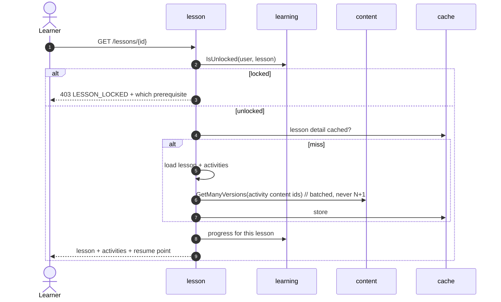

# lesson — AGENT.md

> AI entry point for this module. Read [`/AGENT.md`](../../../AGENT.md) and
> [`/MODULE_INDEX.md`](../../../MODULE_INDEX.md) first if you have not.
> **Everything you need for this module is below. Do not scan other modules.**

| | |
|---|---|
| Tier | `learning` |
| Path | `internal/modules/lesson` |
| Schema | `learn` |
| Delivery phase | 2 |
| Status | **DONE** |
| Owner | @learning-team |

---

## 1. Overview

<!-- BEGIN GENERATED: overview -->
Structure: courses contain units, units contain lessons, lessons contain activities, and activities point at content versions. Owns prerequisites, ordering and unlocking rules.
<!-- END GENERATED: overview -->

## 2. Responsibilities

<!-- BEGIN GENERATED: responsibilities -->
**This module owns:**

- Course, unit, lesson and activity structure and ordering
- Activity → content version binding
- Prerequisites and unlocking rules
- Estimated duration and skill/level metadata
- Course catalogue and lesson detail queries
- Draft/published state for structure, mirroring content

**This module does NOT own:**

- Learner progress through the structure — that is `learning`
- The material itself — that is `content`
- Grading — that is the exercise engine plus the skill graders
<!-- END GENERATED: responsibilities -->

## 3. Entry points

<!-- BEGIN GENERATED: entrypoints -->
| File | Read it when |
|---|---|
| `internal/modules/lesson/module.go` | You need to see what this module depends on and what it exposes |
| `internal/modules/lesson/contract/` | You are calling this module from another module |
| `internal/modules/lesson/service/` | You are changing behaviour |
| `db/migrations/lesson/` | You need the real schema |
<!-- END GENERATED: entrypoints -->

## 4. Public API (contract)

Other modules may import **only** `internal/modules/lesson/contract`.

<!-- BEGIN GENERATED: contract -->
| Kind | Name | Purpose |
|---|---|---|
| interface | `lesson.Reader` | `GetLesson`, `ListLessons`, `ListLessonsByCourseID`, `NextLesson`, `ResolveActivity`, `ResolveActivities` (batch), `ListActivitiesByCourseIDs` — used heavily by `learning` and `exam` |
| struct | `lesson.Activity` | `{ID, Kind, ContentVersionID, Config, Weight}` |
| struct | `lesson.ActivityHierarchy` | `{ActivityID, LessonID, UnitID, CourseID, Kind, ContentVersionID, Config, Weight, LessonSkillFocus}` — single-call structural resolution for activity attempts (P8.3 Trap 1) |

### Events

| Event | Direction | Payload summary |
|---|---|---|
| `lesson.published` | publishes | `{lesson_id, course_id, skill_focus}` |
| `content.archived` | consumes | Flag lessons whose content was archived |
<!-- END GENERATED: contract -->

## 5. Database schema

<!-- BEGIN GENERATED: schema -->
All tables live in the `learn` schema and are owned exclusively by this module (rule DB1).
Migrations: `db/migrations/lesson/` · Queries: `db/queries/lesson/`

| Table | Purpose | Key columns / notes |
|---|---|---|
| `learn.courses` | Top-level container | `slug` UNIQUE, `cefr_from`, `cefr_to`, `status`, `estimated_hours` |
| `learn.course_units` | Group of lessons | `course_id`, `position`, `title` |
| `learn.lessons` | Schedulable learning unit | `unit_id`, `position`, `skill_focus`, `estimated_minutes`, `status` |
| `learn.activities` | One thing the learner does | `lesson_id`, `position`, `kind`, `content_version_id`, `config` jsonb, `weight` |
| `learn.lesson_prerequisites` | Unlocking graph | `lesson_id`, `requires_lesson_id`, `min_score` |

<!-- END GENERATED: schema -->

## 6. HTTP endpoints

Full definitions are in [`api/openapi/openapi.yaml`](../../../api/openapi/openapi.yaml)
(tag: `lesson`). Per-endpoint detail is in §15.

<!-- BEGIN GENERATED: endpoints -->
| Method | Path | Permission | Purpose |
|---|---|---|---|
| `GET` | `/api/v1/courses` | `content.read.published` | Catalogue with level filters |
| `GET` | `/api/v1/courses/{slug}` | `content.read.published` | Course with units and lesson summaries |
| `GET` | `/api/v1/lessons/{id}` | `content.read.published` | Lesson with its activities and resolved content |
| `POST` | `/api/v1/admin/courses` | `content.create` | Create a course |
| `PUT` | `/api/v1/admin/lessons/{id}/activities` | `content.edit` | Reorder or replace the activity list |
| `POST` | `/api/v1/admin/lessons/{id}/publish` | `content.publish` | Publish an approved lesson |
<!-- END GENERATED: endpoints -->

## 7. Folder map

<!-- BEGIN GENERATED: folders -->
| Path | Contains |
|---|---|
| `contract/` | Interfaces, DTOs and event types other modules may import — the only public package |
| `domain/` | Entities, value objects, invariants, domain errors. Pure Go, no I/O |
| `service/` | Use cases, orchestration, transactions, event publishing |
| `repository/` | sqlc-generated queries and row↔domain mappers |
| `transport/http/` | Handlers, request/response DTOs, route registration |
| `module.go` | `New(deps)` — wiring; the only symbol `cmd/` imports |
<!-- END GENERATED: folders -->

## 8. Related modules

<!-- BEGIN GENERATED: related -->
| Module | Direction | Why |
|---|---|---|
| [`content`](../../modules/content/AGENT.md) | → depends on | see its contract |
| [`cache`](../../platform/cache/AGENT.md) | → depends on | see its contract |
| [`storage`](../../platform/storage/AGENT.md) | → depends on | see its contract |
| [`learning`](../../modules/learning/AGENT.md) | ← used by | consumes this module's contract |
| [`admin`](../../modules/admin/AGENT.md) | ← used by | consumes this module's contract |
| [`search`](../../platform/search/AGENT.md) | ← used by | consumes this module's contract |
<!-- END GENERATED: related -->

**Boundary reminder:** you may call these through their `contract` package only.
Reaching into `service/`, `repository/`, `domain/` or their tables violates rules L1/L2
and fails `go-arch-lint` in CI.

## 9. Business rules

<!-- BEGIN GENERATED: rules -->
1. **BR-LESSON-01** — An activity binds to a **content version**, not a content item — republishing content does not silently change a lesson a learner is halfway through.
2. **BR-LESSON-02** — A lesson cannot be published while any activity points at unpublished content.
3. **BR-LESSON-03** — Prerequisites form a directed acyclic graph; a cycle is rejected at write time.
4. **BR-LESSON-04** — Reordering activities does not affect in-flight attempts; those reference the activity ID.
5. **BR-LESSON-05** — A published lesson's activity list is versioned — changing it creates a new lesson version rather than mutating the live one.
6. **BR-LESSON-06** — Estimated duration is the sum of activity estimates and is recalculated on change, because it drives the learner's daily plan.
7. **BR-LESSON-07** — Unlocking is evaluated by `learning`, using rules this module defines — the rule lives here, the learner state lives there.
8. **BR-LESSON-08** — Material URLs are issued at read time, after the paywall, and expire; a signed URL is never written into the lesson cache.
<!-- END GENERATED: rules -->

## 10. Common tasks

<!-- BEGIN GENERATED: tasks -->
### Add an activity kind

1. Register the kind and its `config` schema.
2. Ensure the corresponding content kind exists in `content`.
3. Implement the grader in the owning skill module (it implements `learning.ExerciseGrader`).
4. Add the React renderer in `web/src/features/lesson/activities/`.
5. Add a fixture lesson containing the new activity and an E2E path through it.
<!-- END GENERATED: tasks -->

## 11. Known limitations

<!-- BEGIN GENERATED: limitations -->
- Structure is linear with prerequisites; there is no branching or conditional path in v1.
- No per-learner lesson variants.
- Duration estimates are static rather than learned from real completion times.
<!-- END GENERATED: limitations -->

## 12. Coding conventions (module-specific)

Global rules: [`docs/CONVENTIONS.md#coding-standard`](../../../docs/CONVENTIONS.md#coding-standard). Deviations and additions
for this module:

<!-- BEGIN GENERATED: conventions -->
_No deviations from the global standard._
<!-- END GENERATED: conventions -->

### Cache strategy

Foundation lessons created before their published content can be repaired with
`go run ./cmd/seed -foundation-courses-only`. This reuses the existing admin and
published content, without reseeding accounts or replaying fixtures. Set the same
`APP_ENV`, `DB_DSN` and `REDIS_URL` as the API: the seed wires lesson caches so
`SyncActivities` invalidates cached empty details. It preserves activity references
through the existing in-place sync. An empty lesson is shown as an empty state in
the web runner, never as “Activity 1 of 0” or a completed lesson.

| Key | TTL | Invalidated by |
|---|---|---|
| `fluentra:{env}:lesson:detail:{lesson_id}:v1` | 1 h | `lesson.published`, an activities write, `content.archived` |
| `fluentra:{env}:lesson:tree:{slug}:v1` | 1 h | `lesson.published`, an activities write |
| `fluentra:{env}:lesson:catalogue:{filter_hash}:v1` | 15 min | A generation bump (see below) |
| `fluentra:{env}:lesson:catalogue:generation:v1` | 24 h | Written, never deleted |

`{filter_hash}` is `g{generation}_{level}_{limit}_{offset}`. `Cache.Delete` takes
explicit keys and the catalogue has one per filter combination, so a publish bumps the
generation counter instead: every key of the previous generation becomes unreachable at
once and Redis evicts it on TTL. The counter is read with `Get`, never `GetOrLoad` — a
read that writes back could land its `generation = 1` after a concurrent publish wrote
`generation = 2`.

The tree key holds only the static hierarchy. Per-learner lock state is evaluated on
every request against the cached tree, so two learners never share a lock verdict.

Reads go through `Cache[T].GetOrLoad`, which falls through to the loader when Redis is
unreachable; an invalidation that fails is logged and does not fail the publish. Both
the API and the worker hold these caches, and they point at the same Redis.

### Error codes owned by this module

| Code | Status | Meaning |
|---|---|---|
| `LESSON_LOCKED` | 403 | Prerequisites not met |
| `PREREQUISITE_CYCLE` | 422 | The proposed graph contains a cycle |
| `ACTIVITY_CONTENT_UNPUBLISHED` | 409 | Cannot publish a lesson pointing at draft content |
| `EMPTY_ACTIVITIES` | 422 | A lesson must carry at least one activity |
| `TOO_MANY_ACTIVITIES` | 422 | More activities than `MaxActivitiesPerLesson` |
| `INVALID_WEIGHT` | 422 | Activity weight outside 0..100 |

## 13. Testing

<!-- BEGIN GENERATED: testing -->
Coverage target: **80% service, 90% domain**

```bash
go test ./internal/modules/lesson/...                    # unit
go test -tags=integration ./internal/modules/lesson/...  # integration (testcontainers)
```

**Focus areas**

- Prerequisite cycle detection
- Lesson publish blocked on draft content
- Activity content resolution is batched (assert the query count)
- Reordering does not disturb in-flight attempts
- Locked lesson returns 403 naming the missing prerequisite
<!-- END GENERATED: testing -->

## 14. Do NOT

<!-- BEGIN GENERATED: donot -->
- Do not bind an activity to a content item.
- Do not resolve content one activity at a time.
- Do not store learner progress here.
- Do not publish a lesson whose content is not published.
<!-- END GENERATED: donot -->

## 15. API detail

### Endpoint detail

<!-- BEGIN GENERATED: api-detail -->
#### `GET /api/v1/courses`

Catalogue with level filters

| | |
|---|---|
| Permission | `content.read.published` |
| Success | 200 |
| Errors | standard set |

#### `GET /api/v1/courses/{slug}`

Course with units and lesson summaries

| | |
|---|---|
| Permission | `content.read.published` |
| Success | 200 |
| Errors | standard set |

#### `GET /api/v1/lessons/{id}`

Lesson with its activities and resolved content

| | |
|---|---|
| Permission | `content.read.published` |
| Success | 200 |
| Errors | `LESSON_LOCKED` |

#### `POST /api/v1/admin/courses`

Create a course

| | |
|---|---|
| Permission | `content.create` |
| Success | 201 |
| Errors | standard set |

#### `PUT /api/v1/admin/lessons/{id}/activities`

Reorder or replace the activity list

| | |
|---|---|
| Permission | `content.edit` |
| Success | 200 |
| Errors | `EMPTY_ACTIVITIES`, `TOO_MANY_ACTIVITIES`, `INVALID_WEIGHT`, `INVALID_POSITION`, `INVALID_ACTIVITY_KIND` |

#### `POST /api/v1/admin/lessons/{id}/publish`

Publish an approved lesson

| | |
|---|---|
| Permission | `content.publish` |
| Success | 200 |
| Errors | `ACTIVITY_CONTENT_UNPUBLISHED`, `EMPTY_ACTIVITIES` |

<!-- END GENERATED: api-detail -->

### Error codes

<!-- BEGIN GENERATED: api-errors -->
| Code | Status | Meaning |
|---|---|---|
| `LESSON_LOCKED` | 403 | Prerequisites not met |
| `PREREQUISITE_CYCLE` | 422 | The proposed graph contains a cycle |
| `ACTIVITY_CONTENT_UNPUBLISHED` | 409 | Cannot publish a lesson pointing at draft content |
<!-- END GENERATED: api-errors -->

### Rate limits

<!-- BEGIN GENERATED: api-rate -->
Standard limits apply — see [/docs/CONVENTIONS.md](../../../docs/CONVENTIONS.md#rate-limiting).
<!-- END GENERATED: api-rate -->

## 16. Flows

### Rendering a lesson



<!-- END GENERATED: flows -->

<!-- BEGIN GENERATED: states -->
_This module has no explicit state machine._
<!-- END GENERATED: states -->

### Failure paths

<!-- BEGIN GENERATED: failures -->
_None yet._
<!-- END GENERATED: failures -->

## 17. Decisions

### Decisions taken

<!-- BEGIN GENERATED: decisions -->
| Question | Decision | Rationale |
|---|---|---|
| Bind activities to items or versions? | Versions | A learner's attempt must be interpretable against exactly what they saw; item binding would let a republish change the meaning of past results |
| Where do unlocking rules live? | Defined here, evaluated by `learning` | The rule is structural (a property of the curriculum); the state is personal (a property of the learner). Splitting them keeps both modules honest |
| Are the course and lesson reads public? | No — signed in, with `content.read.published` | A lesson response carries its activities and their resolved content versions, so an anonymous `/lessons/{id}` publishes the whole course and removes the surface Phase 4 attaches entitlements to. The `user` role holds the read permission; writing courses and reordering activities stays with `admin` |
| How to invalidate the catalogue cache without wildcards? | Generation counter in Redis | The catalogue key has one hash per level/limit/offset permutation. Storing a generation counter in Redis and bumping it on publish invalidates all filter combinations instantly without an expensive SCAN in the request path (P7.5 Trap 1) |
| When does cache invalidation take place relative to publish? | Synchronously in service post-commit, plus outbox event backstop | Outbox events reach subscribers through `cmd/worker`, so an event-only invalidation leaves a window in which an author reloads the course and still sees the pre-publish tree. `PublishLesson` therefore deletes the keys itself once the transaction commits; Redis is shared, so that delete is visible to every process immediately. A `lesson.published` consumer in the worker repeats it as the backstop for a delete that failed while Redis was unreachable — a failed delete only warns, it never fails the publish (P7.5 Traps 2 and 3) |
<!-- END GENERATED: decisions -->

### Related repository ADRs

<!-- BEGIN GENERATED: decisions-adr -->
_None specific to this module._
<!-- END GENERATED: decisions-adr -->

### Open questions

<!-- BEGIN GENERATED: decisions-open -->
_None._
<!-- END GENERATED: decisions-open -->

## 18. Backlog

### Phase 2

- [ ] Course/unit/lesson/activity model and admin CRUD
- [ ] Prerequisite graph with cycle detection
- [ ] Batched content resolution
- [ ] Catalogue and lesson detail endpoints with caching
- [ ] Publish validation against content state
- [ ] Lesson player shell in the web app
<!-- END GENERATED: todo -->

### Progress

- [x] Repair stale Foundation lesson bindings from existing published content with
  `-foundation-courses-only`, without changing accounts or fixtures; invalidate
  detail caches and render genuinely empty lessons without phantom activities.

The list above is generated from `tools/docgen/data/learning.json`, so its checkboxes cannot be
ticked by hand — `make docs` rewrites the block and `make docs-check` fails until it matches.
Completed work is recorded here instead.

| Task | Done | What landed |
|---|---|---|
| P7.4 | 2026-08-23 | Schema `learn` with the five tables, `activities.content_version_id` a bare uuid because DB4 forbids the cross-schema foreign key, and an integration test that asserts DB4 rather than assuming it; prerequisite DAG with cycle detection over all seven graph shapes; `UnlockChecker` declared in `service` so `lesson` does not depend on `learning`, nil-safe to unlocked until WP8; lock reason a sentence naming every prerequisite, carried to the client on the 403 through `Problem.meta`; activity content resolved through one `content.Reader.GetManyVersions` call, proven by a counting reader that also asserts `GetVersion` was never called; every learner query published-only in SQL, with the lesson read joining up to the course; `GET /courses` implements the `level` filter the spec declares and its page size bounded in the spec and clamped in the domain. Coverage **86.1%**, measured with `-coverpkg` against postgres 17 |
| P7.5 | 2026-08-23 | Lesson publish endpoint `POST /admin/lessons/{id}/publish` guarded by `content.publish`, enforcing BR-LESSON-02 (409 when an activity points at a draft or archived content version) and a non-empty activity list (422), idempotent on an already published lesson, and emitting the `lesson.published` outbox event. Duration recalculation stays where it was, on the activities write. Typed caching for course tree (`GetCourseDetail`), lesson detail (`GetLessonDetail`), and catalogue (`ListCourses`) using `platform/cache.Cache[T]` with singleflight, generation counter for catalogue keys avoiding wildcards (Trap 1), synchronous post-commit invalidation with a `lesson.published` worker consumer as the backstop (Trap 2), a cache outage degrading to the loader rather than to a 500 (Trap 3), and reverse-lookup detail invalidation on the `content.archived` worker event (Part C). Proved against a real Redis and a query-counting `pgx` tracer in `cache_integration_test.go`; `latency_integration_test.go` measures the learner reads on an eight-lesson course (opt-in, `LESSON_LATENCY=1`). `activities` is bounded in the spec and in the domain (at most 100 activities, weight 0..100), which is what makes the int32 `estimated_minutes` safe. Coverage **90.3%** on `internal/modules/lesson/...`. |
| P8.4 | 2026-08-24 | `UnlockChecker` adopted in its batched form — the locally declared interface is now `IsUnlocked(ctx, userID, lessonIDs)`, `GetCourseDetail` asks once for every lesson in the tree instead of once per lesson, and `cmd/api` supplies `learning`’s implementation through a lazy adapter. `contract.Reader` grew `ListPrerequisitesForLessons` and `ListUnitsByCourseID` so `learning` can answer unlocking and course completion without reading this module’s tables. Landed with `learning` P8.4. |
| P8.5 | 2026-08-25 | `contract.Reader` grew `ListActivitiesByCourseIDs`, one round trip for every activity id in a set of courses, so `learning` can answer `total_activities` on `/me/progress` without walking the tree or reading this module’s tables. Backed by `ListCourseActivityIDs` in the repository and covered by `course_activities_integration_test.go`. Landed with `learning` P8.5. |
| WO11 §3.0 | 2026-09-11 | Practice generator attempt preservation: replace destructive `ReplaceActivities` with in-place `SyncActivities` by position; add `retired_at` to `learn.activities` with partial unique index; retire rather than delete activities with references; alter `learn.attempts.fk_attempts_activity` to `ON DELETE RESTRICT`. Proved by integration tests. |
| WO13 §3.3 | 2026-09-14 | Placement pool & calibration support: placement course & lesson hierarchies authored and queried through contract; prerequisite unlocking below placed CEFR level verified without completing lessons. |

### Carried into P8.4 / P11.1

- [ ] **Adopt the batched `IsUnlocked`.** `GetCourseDetail` evaluates the lock once per
      lesson, so a forty-lesson course is forty calls into `learning`. P8.1 has now taken
      the decision this item asked for: `learning.UnlockChecker` is
      `IsUnlocked(ctx, userID, lessonIDs) (map[uuid.UUID]bool, error)`, the shape
      `content.Reader.GetManyVersions` established. `service.UnlockChecker` here still
      declares the single-lesson copy, because there was nothing to adopt while `learning`
      had no implementation. Whoever lands P8.4 changes both sides in one diff — and the
      course tree is cached, so this evaluation is the only remaining per-lesson work on a
      warm read.

### Deferred (deliberately not doing yet)

<!-- BEGIN GENERATED: todo-deferred -->
_Nothing deferred._
<!-- END GENERATED: todo-deferred -->

### Future improvements

<!-- BEGIN GENERATED: todo-future -->
- Branching paths by performance
- Learned duration estimates
- Per-learner lesson variants
- Course cloning for A/B curriculum tests
<!-- END GENERATED: todo-future -->

---

_Generated by `tools/docgen` from `tools/docgen/data/`. Hand-written text outside the
GENERATED markers is preserved. Update the manifest, then run `make docs`._
