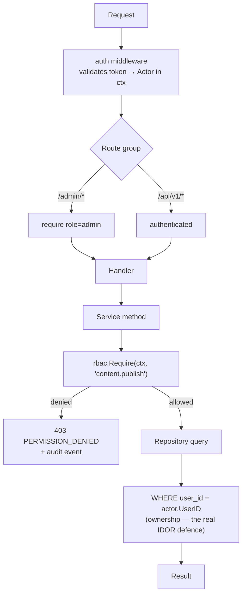

# rbac — AGENT.md

> AI entry point for this module. Read [`/AGENT.md`](../../../AGENT.md) and
> [`/MODULE_INDEX.md`](../../../MODULE_INDEX.md) first if you have not.
> **Everything you need for this module is below. Do not scan other modules.**

| | |
|---|---|
| Tier | `core` |
| Path | `internal/modules/rbac` |
| Schema | `core` |
| Delivery phase | 1 |
| Status | **PLANNED** |
| Owner | @backend-team |

---

## 1. Overview

<!-- BEGIN GENERATED: overview -->
Answers "may this actor do this?". Holds roles, named permissions, and the mapping between them, and provides the guard used by every service method. There are exactly two roles — `admin` and `user` — but permissions are named so that adding a role later is a data change, not a code change.
<!-- END GENERATED: overview -->

## 2. Responsibilities

<!-- BEGIN GENERATED: responsibilities -->
**This module owns:**

- Role definitions and role assignment to users
- The permission catalogue (named capabilities)
- Role→permission mapping
- The `Require(ctx, permission)` guard used by service methods
- The route-group middleware for `/admin/*`
- Cached permission resolution

**This module does NOT own:**

- Proving identity — that is `auth`
- Ownership checks (`WHERE user_id = actor`) — those live in each module's queries, because only that module knows what ownership means for its data
- Audit logging of denied attempts — it emits, `audit` persists
<!-- END GENERATED: responsibilities -->

## 3. Entry points

<!-- BEGIN GENERATED: entrypoints -->
| File | Read it when |
|---|---|
| `internal/modules/rbac/module.go` | You need to see what this module depends on and what it exposes |
| `internal/modules/rbac/contract/` | You are calling this module from another module |
| `internal/modules/rbac/service/` | You are changing behaviour |
| `db/migrations/rbac/` | You need the real schema |
<!-- END GENERATED: entrypoints -->

## 4. Public API (contract)

Other modules may import **only** `internal/modules/rbac/contract`.

<!-- BEGIN GENERATED: contract -->
| Kind | Name | Purpose |
|---|---|---|
| interface | `rbac.Authorizer` | `Require(ctx, permission) error` and `Can(ctx, permission) bool` — the guard every service uses |
| interface | `rbac.RoleReader` | `RolesOf(ctx, userID)` — used by `auth` when minting a token |
| const | `rbac.Perm*` | Typed permission constants; a permission is never a bare string at a call site |

### Events

| Event | Direction | Payload summary |
|---|---|---|
| `rbac.role_assigned` | publishes | `{user_id, role, actor_id}` |
| `user.deleted` | consumes | Remove role assignments |
<!-- END GENERATED: contract -->

## 5. Database schema

<!-- BEGIN GENERATED: schema -->
All tables live in the `core` schema and are owned exclusively by this module (rule DB1).
Migrations: `db/migrations/rbac/` · Queries: `db/queries/rbac/`

| Table | Purpose | Key columns / notes |
|---|---|---|
| `core.roles` | Role catalogue | Seeded with exactly `admin` and `user`; adding one is a migration plus a decision |
| `core.permissions` | Named capabilities | `name` UNIQUE, e.g. `content.publish`; `description` is shown in the admin UI |
| `core.role_permissions` | Mapping | Composite PK (role_id, permission_id) |
| `core.user_roles` | Assignment | Composite PK (user_id, role_id); `granted_by`, `granted_at` |

<!-- END GENERATED: schema -->

### What exists today (P1.3, `db/migrations/rbac/1700000020_create_rbac_tables.sql`)

All four tables, plus the reference data.

`1700000021` added `user.reinstate` and `user.manage_sessions`. `1700000180`
added the Phase 2 content permissions — `content.read.published`,
`content.create`, `content.edit`, `content.review`, `content.publish` —
backing the `/courses`, `/lessons/{id}`, `/content/*` reads and the
`/admin/content/*`, `/admin/courses`, `/admin/lessons/*` writes declared in
P7.1.

**`content.read.published` is the one named permission the `user` role holds.**
A signed-in learner reads published courses, lessons and content versions;
create, edit, review, publish and archive stay with `admin`. That is the
product rule, and the split is deliberate — read is a grant, write is not.

It is also the first crack in "a learner holds nothing", so it is fenced
rather than left to convention. `module_integration_test.go` declares the
learner's permitted set as a list of one and asserts **both** directions:
a learner who lacks the read permission fails, and a learner who holds
anything outside that list fails. Granting a learner a write permission
therefore cannot happen quietly — it has to edit that list, in a diff someone
reads. A second test drives the guard itself: the same account passes
`Require(content.read.published)` and is refused all four writes.

**The roles, the permission catalogue and the admin mapping are in the migration, not in
`db/seeds/rbac.sql`.** Authorization is deny-by-default, so a database with an empty catalogue is
one where every administrative operation is refused and nobody can grant themselves the ability
to fix it. A deployment that ran migrations but not seeds would be unadministrable. The seed file
does the part that genuinely is development data: giving a local account the admin role.

`admin` holds every permission, expressed as a `CROSS JOIN` rather than a list — so a permission
added by a later migration is granted without this one having to be edited, and the two cannot
drift apart. `user` held none until Phase 2: reading your own profile is not a named permission,
it is what the `/me` routes mean. It now holds exactly one, `content.read.published`, because
published material is the first thing a learner reads that is **not** their own data and `self`
cannot express that. The paragraph above says how that stays a set of one.

**The `user` role is granted by `GrantBaselineRole`, at account creation, with no actor.**
`AssignRole` is administrative — it requires an actor holding `rbac.assign`, and its only caller
is the admin handler — so until this existed nothing granted `user` to anybody. An access token
still called the account `user`, because `HighestRole` of an empty set is `user`, while the guard
read `core.user_roles` and found nothing. The two disagreed harmlessly for as long as the role
held no permissions; P7.1 ended that. `user` calls it through a one-method interface it declares
itself, so this module does not know `user` exists and the composition root is what joins them.

## 6. HTTP endpoints

Full definitions are in [`api/openapi/openapi.yaml`](../../../api/openapi/openapi.yaml)
(tag: `rbac`). Per-endpoint detail is in §15.

<!-- BEGIN GENERATED: endpoints -->
| Method | Path | Permission | Purpose |
|---|---|---|---|
| `GET` | `/api/v1/me/permissions` | `self` | The caller's effective permissions — the frontend uses this to hide unavailable actions |
| `GET` | `/api/v1/admin/roles` | `rbac.read` | List roles and their permissions |
| `POST` | `/api/v1/admin/users/{id}/roles` | `rbac.assign` | Grant a role |
| `DELETE` | `/api/v1/admin/users/{id}/roles/{role}` | `rbac.assign` | Revoke a role |
<!-- END GENERATED: endpoints -->

### Implemented (P1.3)

All four. Two things to know before adding a fifth:

- **The `/admin` group has a middleware _and_ every handler calls `Require`.** The middleware says
  "you are staff"; the guard says "you may do this particular thing". Neither replaces the other,
  and an operation reached by a job or an event consumer has no middleware at all.
- **A malformed user id in the path is a 404, not a 400.** Telling an unauthorised caller that
  their input was not a uuid tells them something about what they are probing.

## 7. Folder map

<!-- BEGIN GENERATED: folders -->
| Path | Contains |
|---|---|
| `contract/` | Interfaces, DTOs and event types other modules may import — the only public package |
| `domain/` | Entities, value objects, invariants, domain errors. Pure Go, no I/O |
| `service/` | Use cases, orchestration, transactions, event publishing |
| `repository/` | sqlc-generated queries and row↔domain mappers |
| `transport/http/` | Handlers, request/response DTOs, route registration |
| `module.go` | `New(deps)` — wiring; the only symbol `cmd/` imports |
<!-- END GENERATED: folders -->

## 8. Related modules

<!-- BEGIN GENERATED: related -->
| Module | Direction | Why |
|---|---|---|
| [`cache`](../../platform/cache/AGENT.md) | → depends on | Permission sets are read on nearly every request |
| [`audit`](../../modules/audit/AGENT.md) | → depends on | Role changes and denials are security-relevant |
| [`auth`](../../modules/auth/AGENT.md) | ← used by | consumes this module's contract |
| [`admin`](../../modules/admin/AGENT.md) | ← used by | consumes this module's contract |
| [`content`](../../modules/content/AGENT.md) | ← used by | consumes this module's contract |
| [`questionbank`](../../modules/questionbank/AGENT.md) | ← used by | consumes this module's contract |
| [`exam`](../../modules/exam/AGENT.md) | ← used by | consumes this module's contract |
| [`user`](../../modules/user/AGENT.md) | ← used by | consumes this module's contract |
<!-- END GENERATED: related -->

**Boundary reminder:** you may call these through their `contract` package only.
Reaching into `service/`, `repository/`, `domain/` or their tables violates rules L1/L2
and fails `go-arch-lint` in CI.

## 9. Business rules

<!-- BEGIN GENERATED: rules -->
1. **BR-RBAC-01** — Deny by default: an operation with no declared permission is refused, not allowed.
2. **BR-RBAC-02** — Exactly three roles exist — `admin`, `user`, `moderator` (ADR-0026). Introducing a fourth requires an ADR — it changes the product's shape, not just its data.
3. **BR-RBAC-03** — Permissions are named `<resource>.<action>[.<qualifier>]` and are additive; there are no negative permissions.
4. **BR-RBAC-04** — A user cannot grant themselves a role they do not already have, and cannot remove their own admin role.
5. **BR-RBAC-05** — The last remaining admin cannot be demoted or suspended — the system must never become unadministrable.
6. **BR-RBAC-06** — Granting `admin` forces MFA enrolment on that account's next login.
7. **BR-RBAC-07** — A permission check failure is logged at `warn` with the permission name and raises an audit event.
8. **BR-RBAC-08** — Frontend permission data is advisory only; every server call re-checks.
<!-- END GENERATED: rules -->

## 10. Common tasks

<!-- BEGIN GENERATED: tasks -->
### Add a permission

1. Add the constant to `contract/permissions.go`.
2. Add the row in a migration and map it to the roles that should hold it.
3. Call `rbac.Require` in the service method that needs it.
4. Add `x-permission` to the operation in `openapi.yaml`.
5. Add a test asserting that a user without it receives 403 and that the denial is audited.
6. Update §5 of this file.
<!-- END GENERATED: tasks -->

## 11. Known limitations

<!-- BEGIN GENERATED: limitations -->
- No resource-scoped permissions ("can edit *these* lessons"). If content ownership becomes a requirement, that is a new design, not a new row.
- No time-bounded grants.
- Permission changes take up to 5 minutes to propagate through the cache unless explicitly busted.
<!-- END GENERATED: limitations -->

- BR-RBAC-06 (granting `admin` forces MFA enrolment) is not implemented: MFA arrives with WP2.
  The grant succeeds and enrolment is not yet demanded.
- BR-RBAC-07 raises the `warn` log today. The audit event type exists in `contract`
  (`rbac.access_denied`) but nothing publishes it: a denial happens outside any transaction, so it
  cannot go through the outbox the way a role change does. It is wired when `audit` lands (P1.4).

## 12. Coding conventions (module-specific)

Global rules: [`docs/CONVENTIONS.md#coding-standard`](../../../docs/CONVENTIONS.md#coding-standard). Deviations and additions
for this module:

<!-- BEGIN GENERATED: conventions -->
- Never write a permission as a string literal at a call site — use the typed constant.
<!-- END GENERATED: conventions -->

### Cache strategy

| Key | TTL | Invalidated by |
|---|---|---|
| `fluentra:{env}:rbac:perms:{user_id}:v1` | 5 min | `rbac.role_assigned`, role-permission change, `user.deleted` |
| `fluentra:{env}:rbac:role_perms:{role}:v1` | 30 min | Migration or admin edit |

### Error codes owned by this module

| Code | Status | Meaning |
|---|---|---|
| `PERMISSION_DENIED` | 403 | Authenticated but lacking the required permission |
| `SELF_ELEVATION_FORBIDDEN` | 403 | An actor tried to grant themselves a role |
| `LAST_ADMIN_PROTECTED` | 409 | Would leave the system with no administrator |

### Security considerations

- The guard is called in the **service** layer, not only in middleware — middleware protects a route, the guard protects an operation.
- Ownership filtering is separate and mandatory; a `user` with `self.*` permissions must still only see their own rows.
- Cached permissions have a short TTL so a revocation takes effect within 5 minutes; an immediate revocation also busts the key.

## 13. Testing

<!-- BEGIN GENERATED: testing -->
Coverage target: **80% service, 90% domain**

```bash
go test ./internal/modules/rbac/...                    # unit
go test -tags=integration ./internal/modules/rbac/...  # integration (testcontainers)
```

**Focus areas**

- Deny by default: an unguarded operation must fail a lint/test, not silently allow
- A `user` calling any `/admin/*` route receives 403
- Self-elevation and last-admin protection
- Cache invalidation on role change takes effect
- Every user-owned resource returns 404 (not 403) for another user's row
<!-- END GENERATED: testing -->

## 14. Do NOT

<!-- BEGIN GENERATED: donot -->
- Do not add a third role without an ADR.
- Do not rely on middleware alone — call the guard in the service.
- Do not use the frontend's permission list as an authorization decision.
- Do not implement ownership checks here; they belong in the owning module's query.
<!-- END GENERATED: donot -->

## 15. API detail

### What is live

All four operations exist as of **P1.3**. `GET /api/v1/me/permissions` needs only a caller;
the three `/admin` operations require the `admin` role _and_ the permission named below.

The permission list is advisory (BR-RBAC-08). It exists so the interface can hide actions that
would fail — every server call re-checks, and a client holding the list is no closer to using a
permission it was not granted.

### Endpoint detail

<!-- BEGIN GENERATED: api-detail -->
#### `GET /api/v1/me/permissions`

The caller's effective permissions — the frontend uses this to hide unavailable actions

| | |
|---|---|
| Permission | `self` |
| Success | 200 |
| Errors | standard set |
| Notes | Hiding a control is UX, not security; the server still enforces every call |

#### `GET /api/v1/admin/roles`

List roles and their permissions

| | |
|---|---|
| Permission | `rbac.read` |
| Success | 200 |
| Errors | standard set |

#### `POST /api/v1/admin/users/{id}/roles`

Grant a role

| | |
|---|---|
| Permission | `rbac.assign` |
| Success | 200 |
| Errors | `PERMISSION_DENIED`, `SELF_ELEVATION_FORBIDDEN` |

#### `DELETE /api/v1/admin/users/{id}/roles/{role}`

Revoke a role

| | |
|---|---|
| Permission | `rbac.assign` |
| Success | 204 |
| Errors | `LAST_ADMIN_PROTECTED` |

<!-- END GENERATED: api-detail -->

### Error codes

<!-- BEGIN GENERATED: api-errors -->
| Code | Status | Meaning |
|---|---|---|
| `PERMISSION_DENIED` | 403 | Authenticated but lacking the required permission |
| `SELF_ELEVATION_FORBIDDEN` | 403 | An actor tried to grant themselves a role |
| `LAST_ADMIN_PROTECTED` | 409 | Would leave the system with no administrator |
<!-- END GENERATED: api-errors -->

### Rate limits

<!-- BEGIN GENERATED: api-rate -->
Standard limits apply — see [/docs/CONVENTIONS.md](../../../docs/CONVENTIONS.md#rate-limiting).
<!-- END GENERATED: api-rate -->

## 16. Flows

### Three-layer authorization

Each layer catches a different mistake. Middleware catches a route wired to the wrong group; the guard catches a service method called from an unexpected path; the ownership filter catches the IDOR that the other two cannot see.



<!-- END GENERATED: flows -->

<!-- BEGIN GENERATED: states -->
_This module has no explicit state machine._
<!-- END GENERATED: states -->

### Failure paths

<!-- BEGIN GENERATED: failures -->
_None yet._
<!-- END GENERATED: failures -->

## 17. Decisions

### Decisions taken

<!-- BEGIN GENERATED: decisions -->
| Question | Decision | Rationale |
|---|---|---|
| Casbin, OPA, or a table? | A table plus a guard function | Two roles and ~40 permissions do not justify a policy engine, a policy language, and its evaluation semantics. Casbin becomes worth it at resource-scoped or hierarchical policies — recorded in ADR-0008 so the option is not forgotten |
| Roles in the JWT or looked up per request? | Role in the token, permissions resolved from cache | The role is stable and small; permissions can change without reissuing tokens, and a 5-minute cache bounds staleness |
<!-- END GENERATED: decisions -->

### Related repository ADRs

<!-- BEGIN GENERATED: decisions-adr -->
- [ADR-0008](../../../docs/adr/ADR-0008-rbac-simple-policy.md) — Table-driven permissions, no Casbin/OPA
<!-- END GENERATED: decisions-adr -->

### Open questions

<!-- BEGIN GENERATED: decisions-open -->
_None._
<!-- END GENERATED: decisions-open -->

## 18. Backlog

### Phase 1

- [ ] Roles, permissions, mappings seeded via migration
- [ ] `Require`/`Can` guard with cached resolution
- [ ] `/admin/*` route-group middleware
- [ ] `GET /me/permissions`
- [ ] Self-elevation and last-admin protections
- [ ] A CI check that every non-public OpenAPI operation declares `x-permission`
<!-- END GENERATED: todo -->

### Progress

The list above is generated from `tools/docgen/data/core.json`, so its checkboxes cannot be ticked
by hand. Completed work is recorded here instead.

| Task | Done | What landed |
|---|---|---|
| P1.3 | 2026-08-10 | Four tables, the seeded role and permission catalogue, `Authorizer.Require`/`Can` with cached resolution and eager invalidation, the `/admin/*` middleware, `GET /me/permissions`, the role catalogue and grant/revoke operations, self-elevation and last-admin protections |
| — | 2026-08-27 | `GrantBaselineRole`: the system grant of `user` at account creation. `AssignRole` needs an actor holding `rbac.assign` and is only reachable from the admin handler, so no account created by registration or by `make seed` ever held a role — invisible until P7.1 gave `user` its first permission, and every learner's catalogue a 403 from that commit on. Wired into `user` through a one-method interface the composition root satisfies. |

Still open in Phase 1: MFA enrolment on an `admin` grant (BR-RBAC-06, needs WP2), and publishing
`rbac.access_denied` to the audit trail (BR-RBAC-07, needs P1.4).

### Deferred (deliberately not doing yet)

<!-- BEGIN GENERATED: todo-deferred -->
_Nothing deferred._
<!-- END GENERATED: todo-deferred -->

### Future improvements

<!-- BEGIN GENERATED: todo-future -->
- Resource-scoped permissions if content ownership becomes a requirement
- Temporary elevated access with automatic expiry
<!-- END GENERATED: todo-future -->

---

_Generated by `tools/docgen` from `tools/docgen/data/`. Hand-written text outside the
GENERATED markers is preserved. Update the manifest, then run `make docs`._
