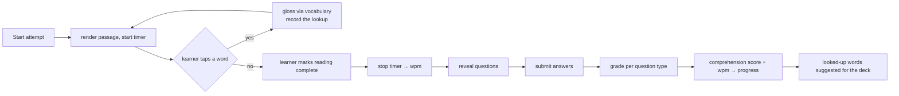

# reading — AGENT.md

> AI entry point for this module. Read [`/AGENT.md`](../../../AGENT.md) and
> [`/MODULE_INDEX.md`](../../../MODULE_INDEX.md) first if you have not.
> **Everything you need for this module is below. Do not scan other modules.**

| | |
|---|---|
| Tier | `learning` |
| Path | `internal/modules/reading` |
| Schema | `skill` |
| Delivery phase | 3 |
| Status | **IMPLEMENTED** |
| Owner | @learning-team |

---

## 1. Overview

<!-- BEGIN GENERATED: overview -->
Reading passages and comprehension: passage rendering, question sets, span-based answers, reading speed measurement, inline glossing, and difficulty estimation.
<!-- END GENERATED: overview -->

## 2. Responsibilities

<!-- BEGIN GENERATED: responsibilities -->
**This module owns:**

- Passages with paragraph structure, word count and estimated difficulty
- Comprehension question sets bound to a passage
- Span answers (locate the evidence in the text)
- Reading speed (words per minute) measurement
- Inline vocabulary glossing via `vocabulary`
- Reading graders: multiple choice, true/false/not-given, matching, gap-fill, span

**This module does NOT own:**

- Question authoring — that is `questionbank`
- Word definitions — that is `vocabulary`
- Passage sourcing and licensing — an editorial concern
<!-- END GENERATED: responsibilities -->

## 3. Entry points

<!-- BEGIN GENERATED: entrypoints -->
| File | Read it when |
|---|---|
| `internal/modules/reading/module.go` | You need to see what this module depends on and what it exposes |
| `internal/modules/reading/contract/` | You are calling this module from another module |
| `internal/modules/reading/service/` | You are changing behaviour |
| `db/migrations/reading/` | You need the real schema |
<!-- END GENERATED: entrypoints -->

## 4. Public API (contract)

Other modules may import **only** `internal/modules/reading/contract`.

<!-- BEGIN GENERATED: contract -->
| Kind | Name | Purpose |
|---|---|---|
| interface | `reading.Grader` | Implements `learning.ExerciseGrader` for reading activity kinds |

### Events

| Event | Direction | Payload summary |
|---|---|---|
| `reading.attempt_completed` | publishes | `{user_id, passage_id, wpm, score}` |
<!-- END GENERATED: contract -->

## 5. Database schema

<!-- BEGIN GENERATED: schema -->
All tables live in the `skill` schema and are owned exclusively by this module (rule DB1).
Migrations: `db/migrations/reading/` · Queries: `db/queries/reading/`

_None yet._

<!-- END GENERATED: schema -->

## 6. HTTP endpoints

Full definitions are in [`api/openapi/openapi.yaml`](../../../api/openapi/openapi.yaml)
(tag: `reading`). Per-endpoint detail is in §15.

<!-- BEGIN GENERATED: endpoints -->
| Method | Path | Permission | Purpose |
|---|---|---|---|
| `GET` | `/api/v1/reading/passages/{id}` | `content.read.published` | Passage with glossing hints |
| `POST` | `/api/v1/reading/attempts` | `self` | Start a timed reading attempt |
| `POST` | `/api/v1/reading/attempts/{id}/submit` | `self` | Submit answers |
<!-- END GENERATED: endpoints -->

## 7. Folder map

<!-- BEGIN GENERATED: folders -->
| Path | Contains |
|---|---|
| `contract/` | Interfaces, DTOs and event types other modules may import — the only public package |
| `domain/` | Entities, value objects, invariants, domain errors. Pure Go, no I/O |
| `service/` | Use cases, orchestration, transactions, event publishing |
| `repository/` | sqlc-generated queries and row↔domain mappers |
| `transport/http/` | Handlers, request/response DTOs, route registration |
| `module.go` | `New(deps)` — wiring; the only symbol `cmd/` imports |
<!-- END GENERATED: folders -->

## 8. Related modules

<!-- BEGIN GENERATED: related -->
| Module | Direction | Why |
|---|---|---|
| [`content`](../../modules/content/AGENT.md) | → depends on | see its contract |
| [`questionbank`](../../modules/questionbank/AGENT.md) | → depends on | see its contract |
| [`vocabulary`](../../modules/vocabulary/AGENT.md) | → depends on | see its contract |
| [`learning`](../../modules/learning/AGENT.md) | → depends on | see its contract |
| [`learning`](../../modules/learning/AGENT.md) | ← used by | consumes this module's contract |
| [`exam`](../../modules/exam/AGENT.md) | ← used by | consumes this module's contract |
| [`analytics`](../../modules/analytics/AGENT.md) | ← used by | consumes this module's contract |
<!-- END GENERATED: related -->

**Boundary reminder:** you may call these through their `contract` package only.
Reaching into `service/`, `repository/`, `domain/` or their tables violates rules L1/L2
and fails `go-arch-lint` in CI.

## 9. Business rules

<!-- BEGIN GENERATED: rules -->
1. **BR-READING-01** — Reading speed is measured from the first render to the moment the learner requests the questions, not to submission — thinking time is not reading time.
2. **BR-READING-02** — Questions are hidden until the learner finishes reading, for question types that require it.
3. **BR-READING-03** — True/false/not-given grading treats "not given" as a distinct third answer, never as a wrong "false".
4. **BR-READING-04** — Span answers accept any span that fully contains the expected evidence, within a configured tolerance.
5. **BR-READING-05** — Glossing is on demand and is recorded — a looked-up word is a signal that it belongs in the learner's vocabulary.
6. **BR-READING-06** — Difficulty combines Flesch-Kincaid, CEFR word coverage and an AI estimate; the author confirms the final value.
7. **BR-READING-07** — Passage attribution and licence are mandatory metadata; unattributed third-party text cannot be published.
<!-- END GENERATED: rules -->

## 10. Common tasks

<!-- BEGIN GENERATED: tasks -->
### Add a reading question type

1. Add the type to `questionbank` with its answer schema.
2. Implement the grading branch here.
3. Add the renderer and answer control in the web app.
4. Add golden tests including the ambiguous cases — reading questions are where grading disputes come from.
<!-- END GENERATED: tasks -->

## 11. Known limitations

<!-- BEGIN GENERATED: limitations -->
- Reading speed is self-reported in the sense that the learner marks completion; there is no eye tracking.
- Span tolerance is a character-offset heuristic.
- No adaptive passage selection within a session.
<!-- END GENERATED: limitations -->

## 12. Coding conventions (module-specific)

Global rules: [`docs/CONVENTIONS.md#coding-standard`](../../../docs/CONVENTIONS.md#coding-standard). Deviations and additions
for this module:

<!-- BEGIN GENERATED: conventions -->
_No deviations from the global standard._
<!-- END GENERATED: conventions -->

### Error codes owned by this module

| Code | Status | Meaning |
|---|---|---|
| `PASSAGE_NOT_FOUND` | 404 | Unknown or unpublished passage |
| `QUESTIONS_LOCKED` | 403 | Questions requested before reading was marked complete |

## 13. Testing

<!-- BEGIN GENERATED: testing -->
Coverage target: **80% service, 90% domain**

```bash
go test ./internal/modules/reading/...                    # unit
go test -tags=integration ./internal/modules/reading/...  # integration (testcontainers)
```

**Focus areas**

- WPM calculation across pauses and re-reads
- Not-given is graded as its own answer
- Span tolerance boundaries
- Questions locked until reading completion
- Glossing lookups recorded and surfaced as suggestions
<!-- END GENERATED: testing -->

## 14. Do NOT

<!-- BEGIN GENERATED: donot -->
- Do not duplicate question storage — reference `questionbank`.
- Do not treat not-given as false.
- Do not include question-answering time in reading speed.
- Do not publish a passage without attribution.
<!-- END GENERATED: donot -->

## 15. API detail

### Endpoint detail

<!-- BEGIN GENERATED: api-detail -->
#### `GET /api/v1/reading/passages/{id}`

Passage with glossing hints

| | |
|---|---|
| Permission | `content.read.published` |
| Success | 200 |
| Errors | standard set |

#### `POST /api/v1/reading/attempts`

Start a timed reading attempt

| | |
|---|---|
| Permission | `self` |
| Success | 201 |
| Errors | standard set |

#### `POST /api/v1/reading/attempts/{id}/submit`

Submit answers

| | |
|---|---|
| Permission | `self` |
| Success | 200 |
| Errors | `ATTEMPT_EXPIRED` |

<!-- END GENERATED: api-detail -->

### Error codes

<!-- BEGIN GENERATED: api-errors -->
| Code | Status | Meaning |
|---|---|---|
| `PASSAGE_NOT_FOUND` | 404 | Unknown or unpublished passage |
| `QUESTIONS_LOCKED` | 403 | Questions requested before reading was marked complete |
<!-- END GENERATED: api-errors -->

### Rate limits

<!-- BEGIN GENERATED: api-rate -->
Standard limits apply — see [/docs/CONVENTIONS.md](../../../docs/CONVENTIONS.md#rate-limiting).
<!-- END GENERATED: api-rate -->

## 16. Flows

### Timed reading attempt



<!-- END GENERATED: flows -->

<!-- BEGIN GENERATED: states -->
_This module has no explicit state machine._
<!-- END GENERATED: states -->

### Failure paths

<!-- BEGIN GENERATED: failures -->
_None yet._
<!-- END GENERATED: failures -->

## 17. Decisions

### Decisions taken

<!-- BEGIN GENERATED: decisions -->
| Question | Decision | Rationale |
|---|---|---|
| Where do reading questions live? | In content version bodies | Passage and questions are bundled directly into self-contained `content.versions` rows, avoiding separate tables; revisit when `exam` is built |
| Measure reading speed how? | First render to reading-complete | Including question time would conflate reading with reasoning and make the metric useless for progress |
<!-- END GENERATED: decisions -->

### Related repository ADRs

<!-- BEGIN GENERATED: decisions-adr -->
_None specific to this module._
<!-- END GENERATED: decisions-adr -->

### Open questions

<!-- BEGIN GENERATED: decisions-open -->
_None._
<!-- END GENERATED: decisions-open -->

## 18. Backlog

### Phase 3

- [ ] Passages with difficulty metadata and attribution
- [ ] Question set binding to `questionbank`
- [ ] Timed attempt with WPM measurement
- [ ] Graders for MCQ, T/F/NG, matching, gap-fill and span
- [ ] Inline glossing with lookup recording
- [ ] Reading player in the web app
<!-- END GENERATED: todo -->

### Deferred (deliberately not doing yet)

<!-- BEGIN GENERATED: todo-deferred -->
_Nothing deferred._
<!-- END GENERATED: todo-deferred -->

### Future improvements

<!-- BEGIN GENERATED: todo-future -->
- Adaptive passage selection
- Extensive-reading mode with a library
- Automatic question generation reviewed by an admin
<!-- END GENERATED: todo-future -->

### Shipped in work orders 10 & 11

The boxes above are unticked because docgen renders every generated item that
way. What exists in code today:

- [x] `reading.Grader` implements `learning.ExerciseGrader` for
      `reading_comprehension`, registered through `cmd/api/modules.go` and
      rendered by `ExerciseReading.tsx`.
- [x] Passages and question sets are authored and generated as self-contained `content.versions` bodies.
- [x] Practice pool generation and daily practice set integration (§3.11).

#### Schema rationalisation (tables retired)

- `passages` and `passage_questions`: retired because reading passages and question sets are stored directly in `content.versions` (kind `reading_comprehension`), eliminating separate passage tables.
- `reading_attempts`: retired per ADR-0015; all attempt lifecycles are centralized in `learn.attempts`.

The module `reading` owns 0 database tables (`tables: []`).

---

_Generated by `tools/docgen` from `tools/docgen/data/`. Hand-written text outside the
GENERATED markers is preserved. Update the manifest, then run `make docs`._
