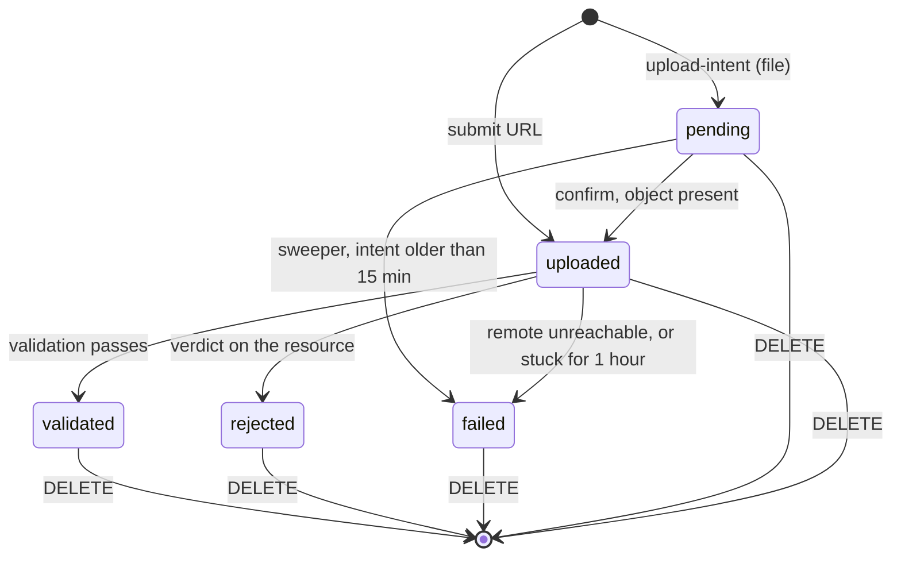

# resource — AGENT.md

> AI entry point for this module. Read [`/AGENT.md`](../../../AGENT.md) and
> [`/MODULE_INDEX.md`](../../../MODULE_INDEX.md) first if you have not.
> **Everything you need for this module is below. Do not scan other modules.**

| | |
|---|---|
| Tier | `learning` |
| Path | `internal/modules/resource` |
| Schema | `resource` |
| Delivery phase | 4 |
| Status | **IMPLEMENTED** |
| Owner | @learning-team |

---

## 1. Overview

### Content suitability and processing states (2026-10-01)

- List/detail responses include the same derived `processing_status`, computed
  from **all** rendition states. The list batches its rendition read, avoiding
  per-file queries; missing signed preview URLs do not mean rendering is pending.
- File `status=validated` means byte/MIME validation, not learning relevance.
  `resource_classify.v2` checks English-learning relevance before CEFR tagging.
  Empty CEFR/skill/node metadata records an unsuitable result; old prompt versions
  expose `learning_suitable=null` and cannot authorize practice generation.
- Owner-only `POST /me/resources/{id}/revalidate` clears the old classification
  and queues a fresh, uncached content check in one transaction. It uses existing
  extracted text and preserves the original file. Foreign resources return 404.

<!-- BEGIN GENERATED: overview -->
Intake for material a learner brings: an uploaded file or a submitted URL becomes an owned, validated resource with a status its owner can watch. Stops at validated; renditions, extraction and generation are later steps.
<!-- END GENERATED: overview -->

**Context.** Resource acts as the single entry point for external content (PDFs, audio, URLs) into the Fluentra learning engine. It enforces ownership isolation, validates byte streams against MIME spoofing, secures external URL fetching against SSRF, and schedules async validation via River jobs.

## 2. Responsibilities

<!-- BEGIN GENERATED: responsibilities -->
**This module owns:**

- Upload intents: a presigned POST policy into fluentra-uploads that pins the content type and a 1 B to 50 MB size range, valid 5 minutes
- Confirming an upload and submitting a URL, each writing its row and enqueuing resource.validate in one transaction
- Lifecycle pending, uploaded, then validated, rejected or failed
- File validation by magic bytes against an allow-list: PDF, DOC, DOCX, XLS, XLSX, PPT, PPTX, PNG, JPEG, WebP, MP3, WAV, M4A, MP4, WebM
- URL validation that stores the page title and never the body, through a client whose dialer refuses non-public addresses
- Per-user quotas: 50 resources and 250 MB, counting everything not rejected or failed
- Presigned GET for a validated file its owner requests
- Derived visual, audio, and video renditions in fluentra-derived for validated file resources
- Extracting text from PDF and Office document resources
- Transcribing audio and video resources via media.HTTPTranscriber
- Grounding and classifying extracted text into CEFR levels, skills, and spine taxonomy nodes
- Deleting a resource together with its stored object, derived renditions, extraction and classification
- A cron sweep that fails abandoned intents and deletes their objects, and fails uploads whose validation never finished
- Reading one resource for its owner and copying its original and ready renditions into a published course's own storage (WO 20)

**This module does NOT own:**

- Generating exercises from a resource (P6)
- Byte storage and serving (platform/storage)
<!-- END GENERATED: responsibilities -->

## 3. Entry points

<!-- BEGIN GENERATED: entrypoints -->
| File | Read it when |
|---|---|
| `internal/modules/resource/module.go` | You need to see what this module depends on and what it exposes |
| `internal/modules/resource/contract/` | You are calling this module from another module |
| `internal/modules/resource/service/` | You are changing behaviour |
| `db/migrations/resource/` | You need the real schema |
<!-- END GENERATED: entrypoints -->

## 4. Public API (contract)

Other modules may import **only** `internal/modules/resource/contract`.

<!-- BEGIN GENERATED: contract -->
| Kind | Name | Purpose |
|---|---|---|
| interface | `resource.ResourceReader` | `GetResource(ctx, id, userID)`: one resource, for its owner only. No consumer yet |
| struct | `resource.Resource` | `{ID, UserID, Kind, Title, ObjectKey, OriginalFilename, DeclaredMIME, DetectedMIME, ByteSize, Checksum, SourceURL, Status, FailureReason, DownloadURL, CreatedAt, UpdatedAt, ValidatedAt}` |
| interface | `resource.MaterialPublisher` | `MaterialForOwner(ctx, ownerID, resourceID)` and `CopyForPublication(ctx, resourceID, destPrefix)`: the read-and-copy surface `studio` uses to publish a material into a course |

### Events

| Event | Direction | Payload summary |
|---|---|---|
| `user.deleted` | consumes |  |
<!-- END GENERATED: contract -->

## 5. Database schema

<!-- BEGIN GENERATED: schema -->
All tables live in the `resource` schema and are owned exclusively by this module (rule DB1).
Migrations: `db/migrations/resource/` · Queries: `db/queries/resource/`

| Table | Purpose | Key columns / notes |
|---|---|---|
| `resource.resources` | One uploaded file or submitted URL | `user_id`, `kind` (file or url), `title`, `object_key`, `original_filename`, `declared_mime`, `detected_mime`, `byte_size`, `checksum`, `source_url`, `status`, `failure_reason`, `validated_at`. `ck_resources_shape`: a file has an object and no URL, a URL the reverse. `ck_resources_rejected_has_reason`. |
| `resource.renditions` | Derived visual, audio, and video renditions of validated file resources | `resource_id`, `kind`, `status`, `object_key`, `mime_type`, `width`, `height`, `duration_ms`, `byte_size`, `tool_version`, `attempts`, `failure_reason`. `uq_renditions_resource_kind`, `uq_renditions_object_key`. |
| `resource.extractions` | Extracted text from validated documents and audio/video transcripts | `resource_id`, `source` ('pdf_text', 'ocr', 'transcript'), `text`, `char_count` (max 400,000), `truncated`, `language`, `tool_version`. |
| `resource.classifications` | CEFR estimate, targeted skill, and grounded spine taxonomy node codes | `resource_id`, `cefr_estimate`, `skill`, `node_codes`, `prompt_version`, `model`, `ai_request_id`. |

**Indexes of note**

- `idx_resources_user` on `(user_id, created_at DESC)` for listing
- `idx_resources_pending` on `created_at` where status is pending or uploaded, for the sweeper
- `uq_resources_object_key`
<!-- END GENERATED: schema -->

## 6. HTTP endpoints

Full definitions are in [`api/openapi/openapi.yaml`](../../../api/openapi/openapi.yaml)
(tag: `resource`). Per-endpoint detail is in §15.

<!-- BEGIN GENERATED: endpoints -->
| Method | Path | Permission | Purpose |
|---|---|---|---|
| `POST` | `/api/v1/me/resources/upload-intent` | `self` | Presigned upload into fluentra-uploads; creates the row at pending |
| `POST` | `/api/v1/me/resources` | `self` | Confirm an uploaded file or submit a URL; queues validation |
| `GET` | `/api/v1/me/resources` | `self` | The caller's resources, newest first, filterable by status and kind |
| `GET` | `/api/v1/me/resources/{id}` | `self` | One resource, with a presigned GET for a validated file |
| `DELETE` | `/api/v1/me/resources/{id}` | `self` | Delete the resource and its stored object |
<!-- END GENERATED: endpoints -->

## 7. Folder map

<!-- BEGIN GENERATED: folders -->
| Path | Contains |
|---|---|
| `contract/` | Interfaces, DTOs and event types other modules may import — the only public package |
| `domain/` | Entities, value objects, invariants, domain errors. Pure Go, no I/O |
| `service/` | Use cases, orchestration, transactions, event publishing |
| `repository/` | sqlc-generated queries and row↔domain mappers |
| `transport/http/` | Handlers, request/response DTOs, route registration |
| `job/` | Background job handlers owned by this module |
| `module.go` | `New(deps)` — wiring; the only symbol `cmd/` imports |
<!-- END GENERATED: folders -->

## 8. Related modules

<!-- BEGIN GENERATED: related -->
| Module | Direction | Why |
|---|---|---|
| [`storage`](../../platform/storage/AGENT.md) | → depends on | Presigned PUT and GET, stat, read and delete in fluentra-uploads |
| [`job`](../../platform/job/AGENT.md) | → depends on | The resource.validate River worker and the resource.sweep_pending cron |
| [`user`](../../modules/user/AGENT.md) | → depends on | Account erasure event user.deleted to purge user resources |
| [`studio`](../../modules/studio/AGENT.md) | ← used by | consumes this module's contract |
<!-- END GENERATED: related -->

**Boundary reminder:** you may call these through their `contract` package only.
Reaching into `service/`, `repository/`, `domain/` or their tables violates rules L1/L2
and fails `go-arch-lint` in CI.

## 9. Business rules

<!-- BEGIN GENERATED: rules -->
1. **BR-RESOURCE-01** — **BR-RESOURCE-01**: A resource belongs to one user and is visible only to them. Another user's id answers 404, never 403.
2. **BR-RESOURCE-02** — **BR-RESOURCE-02**: The stored original is never modified or replaced. Derived forms go to fluentra-derived (P3).
3. **BR-RESOURCE-03** — **BR-RESOURCE-03**: A URL resource keeps its title and metadata, never the fetched body.
4. **BR-RESOURCE-04** — **BR-RESOURCE-04**: A file is classified by its bytes. A declared kind that disagrees with the detected kind is a rejection.
5. **BR-RESOURCE-05** — **BR-RESOURCE-05**: rejected always carries a reason, and the database enforces it. Reasons are fixed learner-facing sentences; the detail goes to the log.
6. **BR-RESOURCE-06** — **BR-RESOURCE-15**: Erasing an account deletes that user's resources, originals and renditions.
7. **BR-RESOURCE-07** — **BR-RESOURCE-06**: Deleting a resource deletes its object. If storage cannot be reached the delete fails and the row stays.
8. **BR-RESOURCE-08** — **BR-RESOURCE-07**: An intent never confirmed within 15 minutes is swept to failed and its object removed. The sweeper marks the row before deleting, so a row confirmed meanwhile is left alone.
9. **BR-RESOURCE-09** — **BR-RESOURCE-08**: Quotas bound each user to 50 resources and 250 MB, counting everything not rejected or failed.
10. **BR-RESOURCE-10** — **BR-RESOURCE-09**: rejected is a verdict on the resource; failed is ours and retryable. A timeout or a 5xx never rejects a link.
11. **BR-RESOURCE-11** — **BR-RESOURCE-10**: The URL fetcher checks the address it is connecting to, in the dialer, on every hop, and never uses a proxy. Checking DNS first and connecting later is not a check.
12. **BR-RESOURCE-12** — Extracted text and anything generated from it is private to the resource's owner.
13. **BR-RESOURCE-13** — Classification stores only spine codes that exist; the rest are dropped.
14. **BR-RESOURCE-14** — A transcript is queued by cmd/media in the transaction that settles the audio_web rendition, ready or skipped. Video gets an audio_web rendition for its soundtrack.
15. **BR-RESOURCE-15** — An extraction and its classification job are written in one transaction.
16. **BR-RESOURCE-16** — **BR-RESOURCE-16**: A resource leaves its owner's private space only by being copied into a published course, and only its owner can start that copy.
<!-- END GENERATED: rules -->

## 10. Common tasks

<!-- BEGIN GENERATED: tasks -->
_No recipes recorded yet. Add one the first time you do something twice._
<!-- END GENERATED: tasks -->

## 11. Known limitations

Validated means intake succeeded, not that previews/text are ready. File renditions
remain pending until `cmd/media` runs. Local Compose starts `media-renderer` with
`make dev`; host-run API/worker setups need `make dev-infra` then `make dev-media`.
It polls pending renditions every 15 seconds, including previously uploaded files;
the normal worker consumes the resulting classification/transcription jobs.
See `internal/platform/media/AGENT.md` for runtime tools and workspace lifetime.

<!-- BEGIN GENERATED: limitations -->
_None recorded. Add one the moment you take a shortcut._
<!-- END GENERATED: limitations -->

## 12. Coding conventions (module-specific)

Global rules: [`docs/CONVENTIONS.md#coding-standard`](../../../docs/CONVENTIONS.md#coding-standard). Deviations and additions
for this module:

<!-- BEGIN GENERATED: conventions -->
_No deviations from the global standard._
<!-- END GENERATED: conventions -->

### Cache strategy

_None yet._

### Error codes owned by this module

| Code | Status | Meaning |
|---|---|---|
| `RESOURCE_NOT_FOUND` | 404 | Resource does not exist or belongs to another user |
| `RESOURCE_TYPE_NOT_SUPPORTED` | 422 | File MIME type or kind is not supported |
| `RESOURCE_URL_NOT_ALLOWED` | 422 | Submitted URL points to private/internal IP or invalid scheme |
| `QUOTA_EXCEEDED` | 422 | User storage quota (100MB) exceeded |
| `INVALID_PAYLOAD` | 400 | Malformed JSON request body |
| `STORAGE_UNAVAILABLE` | 503 | Underlying storage service unreachable |

## 13. Testing

<!-- BEGIN GENERATED: testing -->
Coverage target: **80% service, 90% domain**

```bash
go test ./internal/modules/resource/...                    # unit
go test -tags=integration ./internal/modules/resource/...  # integration (testcontainers)
```

**Focus areas**

_None yet._
<!-- END GENERATED: testing -->

## 14. Do NOT

<!-- BEGIN GENERATED: donot -->
- Do not return 403 for another user's resource. Return 404.
- Do not store a fetched URL body in the database or in storage.
- Do not validate a URL by resolving its host and then connecting separately. Check in the dialer.
- Do not give the URL fetcher a proxy.
- Do not write err.Error() into failure_reason. Learners read it.
- Do not delete an object before the guarded status update that owns it has matched.
- Do not delete a file resource without deleting its object.
<!-- END GENERATED: donot -->

## 15. API detail

### Endpoint detail

<!-- BEGIN GENERATED: api-detail -->
#### `POST /api/v1/me/resources/upload-intent`

Presigned upload into fluentra-uploads; creates the row at pending

| | |
|---|---|
| Permission | `self` |
| Success | 200 |
| Errors | `RESOURCE_TYPE_NOT_SUPPORTED`, `RESOURCE_QUOTA_EXCEEDED` |

#### `POST /api/v1/me/resources`

Confirm an uploaded file or submit a URL; queues validation

| | |
|---|---|
| Permission | `self` |
| Success | 202 |
| Errors | `RESOURCE_NOT_FOUND`, `RESOURCE_NOT_UPLOADED`, `RESOURCE_URL_NOT_ALLOWED`, `RESOURCE_QUOTA_EXCEEDED`, `INVALID_STATUS_TRANSITION` |

#### `GET /api/v1/me/resources`

The caller's resources, newest first, filterable by status and kind

| | |
|---|---|
| Permission | `self` |
| Success | 200 |
| Errors | standard set |

#### `GET /api/v1/me/resources/{id}`

One resource, with a presigned GET for a validated file

| | |
|---|---|
| Permission | `self` |
| Success | 200 |
| Errors | `RESOURCE_NOT_FOUND` |

#### `DELETE /api/v1/me/resources/{id}`

Delete the resource and its stored object

| | |
|---|---|
| Permission | `self` |
| Success | 204 |
| Errors | `RESOURCE_NOT_FOUND` |

<!-- END GENERATED: api-detail -->

### Error codes

<!-- BEGIN GENERATED: api-errors -->
| Code | Status | Meaning |
|---|---|---|
| `RESOURCE_NOT_FOUND` | 404 | No such resource for this caller, the same answer another user's id gets |
| `RESOURCE_QUOTA_EXCEEDED` | 429 | The caller is at 50 resources or 250 MB |
| `RESOURCE_TYPE_NOT_SUPPORTED` | 422 | The declared type is not in the allow-list |
| `RESOURCE_URL_NOT_ALLOWED` | 422 | A scheme other than http or https, or a host with a non-public address |
| `RESOURCE_NOT_UPLOADED` | 409 | Confirmation arrived for a key with no object behind it |
| `INVALID_STATUS_TRANSITION` | 400 | Confirmation of a resource that is not pending |
| `INVALID_REQUEST_BODY` | 400 | The body is not valid JSON |
<!-- END GENERATED: api-errors -->

### Rate limits

<!-- BEGIN GENERATED: api-rate -->
Standard limits apply — see [/docs/CONVENTIONS.md](../../../docs/CONVENTIONS.md#rate-limiting).
<!-- END GENERATED: api-rate -->

## 16. Flows

### File upload and validation

Upload intent, a direct PUT to storage, then a confirmation that writes the row and enqueues validation in one transaction. Every validation outcome is conditional on the row still being uploaded.

```mermaid
sequenceDiagram
    autonumber
    actor U as Learner
    participant R as resource
    participant S as storage (fluentra-uploads)
    participant DB as PostgreSQL
    participant J as River worker

    U->>R: POST /me/resources/upload-intent {filename, content_type}
    R->>R: declared type in allow-list?
    R->>DB: count and bytes in use (50 resources, 250 MB)
    R->>S: PresignPut (pins type, 1 B to 50 MB, 5 min)
    R->>DB: INSERT resources (status=pending)
    R-->>U: 200 {id, upload_url, object_key, expires_at}
    U->>S: PUT the bytes
    U->>R: POST /me/resources {resource_id}
    R->>S: Stat (409 RESOURCE_NOT_UPLOADED if absent)
    R->>DB: BEGIN; UPDATE status=uploaded WHERE status=pending
    R->>DB: enqueue resource.validate; COMMIT
    R-->>U: 202 {id, status=uploaded}
    J->>S: Stat, then read the first 1024 bytes
    J->>J: sniff; declared and detected kinds must agree
    alt allowed and consistent
        J->>DB: UPDATE status=validated, detected_mime, byte_size, checksum WHERE status=uploaded
    else wrong type, empty, or too large
        J->>DB: UPDATE status=rejected, failure_reason WHERE status=uploaded
    else storage unreachable
        J-->>J: return error, River retries (3 attempts)
    end
```

### URL submission

A synchronous early check for a friendly 422, then the real guard: the dialer refuses any non-public address it is about to connect to, which also covers redirects and DNS rebinding.

```mermaid
sequenceDiagram
    autonumber
    actor U as Learner
    participant R as resource
    participant DB as PostgreSQL
    participant J as River worker
    participant EXT as Remote site

    U->>R: POST /me/resources {url, title?}
    R->>R: scheme http or https, host resolves to public addresses only
    R->>DB: BEGIN; INSERT resources (kind=url, status=uploaded)
    R->>DB: enqueue resource.validate; COMMIT
    R-->>U: 202 {id, status=uploaded}
    J->>EXT: GET via the safe client (no proxy, at most 5 redirects)
    Note over J,EXT: the dialer refuses any non-public address it is about to connect to, on every hop
    alt 2xx
        J->>J: read up to 512 KB for og:title or title, then discard the body
        J->>DB: UPDATE status=validated WHERE status=uploaded
    else refused address, or 4xx
        J->>DB: UPDATE status=rejected, failure_reason WHERE status=uploaded
    else timeout, refused connection, or 5xx
        J->>DB: UPDATE status=failed, failure_reason WHERE status=uploaded
    end
```

### Sweeping

Abandoned intents and stuck uploads, closed out so nothing waits for ever.

```mermaid
sequenceDiagram
    autonumber
    participant C as Cron (every 10 min)
    participant R as resource
    participant DB as PostgreSQL
    participant S as storage

    C->>R: resource.sweep_pending
    R->>DB: pending rows older than 15 min
    loop each expired intent
        R->>DB: UPDATE status=failed WHERE status=pending
        alt a row matched
            R->>S: delete the object, if one was uploaded
        else confirmed in the meantime
            R-->>R: skip, it is no longer ours to sweep
        end
    end
    R->>DB: uploaded rows untouched for 1 hour
    loop each stuck upload
        R->>DB: UPDATE status=failed WHERE status=uploaded
        Note over R,S: the object is kept; deleting it is the learner's call
    end
```

<!-- END GENERATED: flows -->

<!-- BEGIN GENERATED: states -->
### State machine

Every status change after pending is conditional on the status it expects, in SQL, so a late job or a racing sweeper matches no row instead of overwriting one.



<!-- END GENERATED: states -->

### Failure paths

<!-- BEGIN GENERATED: failures -->
| Failure | Detected by | Behaviour |
|---|---|---|
| Storage unreachable during validation | Stat or Get returns an error | The job returns the error and River retries. After an hour at uploaded the sweeper marks it failed |
| Remote site down or slow | Timeout, refused connection or 5xx | failed with a try-again reason, never rejected |
| Enqueue fails after the row write | EnqueueTx returns an error | The whole transaction rolls back; the learner gets an error and nothing is left half-done |
| Resource deleted while its job is queued | The row is gone, or a guarded update matches nothing | The job finishes quietly instead of retrying for ever |
| Learner confirms just as the sweeper runs | The sweeper's guarded update matches nothing | The row and its object are left alone |
<!-- END GENERATED: failures -->

## 17. Decisions

### Decisions taken

<!-- BEGIN GENERATED: decisions -->
| Question | Decision | Rationale |
|---|---|---|
| One table or two? (D17-1) | One table, resource.resources | One upload is one file. P4 can add a child table when it finds per-item work. |
| Store a URL's body? (D17-2) | No, the title only | Plan D8. A study tool, not a copy of someone else's page. |
| Ever modify the original? (D17-3) | Never | Plan D9. Renditions are new objects in fluentra-derived. |
| Trust the declared type? (D17-4) | No, sniff the bytes | The content type is a string the client chose. |
| Where do limits live? (D17-5) | Go constants in resource/domain | The AvatarMaxBytes convention. UPLOAD_MAX_MB in .env.example is read by nothing. |
| Does delete remove the object? (D17-6) | Yes, in the same operation | Otherwise storage grows without bound and a deleted file still exists. |
| How is ownership enforced? (D17-7) | In the service, answering 404 | A 403 confirms the id exists; a check living in one SQL clause is one refactor from gone. |
| Where is the SSRF check? | In the dialer, on the connected address | Resolving first and connecting later lets a rebinding DNS server answer differently the second time; a proxy would bypass it entirely. |
| Which writes share a transaction with the job enqueue? | Confirm and URL submit, through explicit Tx repository methods | A row written outside the transaction survives a failed enqueue and is never validated. Explicit methods avoid a repository adapter that go-arch-lint deep scan refuses. |
<!-- END GENERATED: decisions -->

### Related repository ADRs

<!-- BEGIN GENERATED: decisions-adr -->
_None specific to this module._
<!-- END GENERATED: decisions-adr -->

### Open questions

<!-- BEGIN GENERATED: decisions-open -->
_None._
<!-- END GENERATED: decisions-open -->

## 18. Backlog

### Next, in order

- [ ] audio_web is transcoded for every audio upload; WO 18 asks for it only when the source is WAV or over 256 kbit/s. Needs an ffprobe bitrate check before the transcode
- [ ] Video renditions are measured against the 10-minute limit after the transcode, not before it: a long video spends the whole encode budget and is then skipped
- [ ] classifications.ai_request_id stays null until platform/ai returns the ai_requests row id
- [ ] OCR for text-heavy images (WO 19 B.1, optional; the first thing cut)
- [ ] Publish resource.validated and resource.rejected through the outbox once something consumes them
- [ ] A sweeper for `course-materials/{course_id}` copies no published version references (WO 20 Stage C; out of scope, the copies are cheap and correct to keep)
- [ ] A DOC/PPT material has no PDF rendition (WO 18 renders only thumbnail and preview), so its card opens the original download; a `pdf` rendition is a future step
<!-- END GENERATED: todo -->

### Completed local processing repair (2026-09-30)

- [x] Document and wire automatic local rendition rendering, so validated DOCX/PDF uploads do not wait indefinitely for an unconfigured GitHub Actions dispatcher. Existing pending uploads are picked up without resubmission.

### Completed intake UX repair (2026-10-01)

- [x] Return explicit, matching rendition processing states on resource lists and
  details, with one batched rendition read for the list.
- [x] Check English-learning suitability before tagging uploaded content, and
  offer owner-only asynchronous revalidation without reuploading.

### Deferred (deliberately not doing yet)

<!-- BEGIN GENERATED: todo-deferred -->
- Retention of untouched resources. Needs a last-opened column, which P4 can add when it starts opening them.
- Sharing a resource with another learner. Resources are private; sharing is a visibility column, not a redesign.
<!-- END GENERATED: todo-deferred -->

### Future improvements

<!-- BEGIN GENERATED: todo-future -->
- Multi-part uploads for large video files
- A per-user rate limit on intents. RATE_LIMIT_UPLOAD_PER_HOUR exists in .env.example and is read by nothing
<!-- END GENERATED: todo-future -->

---

_Generated by `tools/docgen` from `tools/docgen/data/`. Hand-written text outside the
GENERATED markers is preserved. Update the manifest, then run `make docs`._
