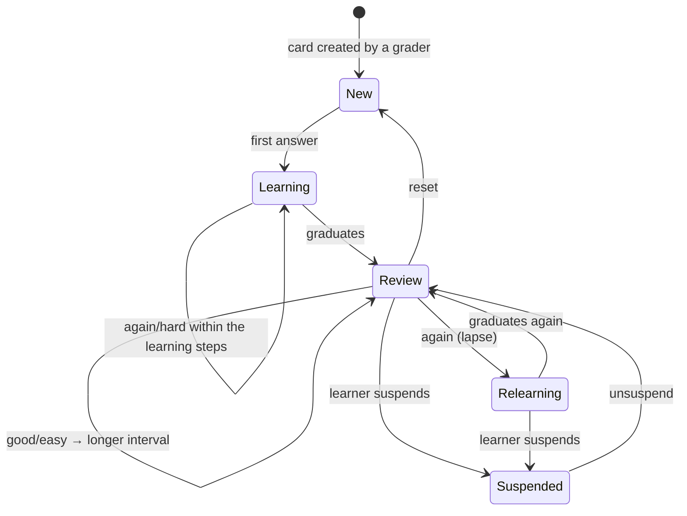

# srs — AGENT.md

> AI entry point for this module. Read [`/AGENT.md`](../../../AGENT.md) and
> [`/MODULE_INDEX.md`](../../../MODULE_INDEX.md) first if you have not.
> **Everything you need for this module is below. Do not scan other modules.**

| | |
|---|---|
| Tier | `learning` |
| Path | `internal/modules/srs` |
| Schema | `learn` |
| Delivery phase | 2 |
| Status | **DONE** |
| Owner | @learning-team |

---

## 1. Overview

<!-- BEGIN GENERATED: overview -->
Spaced repetition. Owns review cards, the FSRS scheduler, review logs, due queues and retention forecasting. Any material worth remembering long-term enters this module and comes back at the right time.
<!-- END GENERATED: overview -->

**Context.** FSRS (Free Spaced Repetition Scheduler) replaces SM-2: it models memory stability and difficulty explicitly and typically reaches the same retention with 20–30 % fewer reviews (ADR-0016). The algorithm is documented in `docs/knowledge/fsrs.md` — read it before touching the scheduler.

## 2. Responsibilities

<!-- BEGIN GENERATED: responsibilities -->
**This module owns:**

- Review cards: one per (learner, learnable item)
- FSRS scheduling: stability, difficulty, retrievability, next due date
- Review logs: every grade, for scheduler improvement and analytics
- Due queue construction with daily limits and interleaving
- Suspend, bury and reset operations
- Retention forecasting and workload projection
- Per-learner parameter optimisation (later phase)

**This module does NOT own:**

- Deciding what is worth remembering — graders return `ReviewItems`
- Rendering a review — the skill module supplies the renderer
- XP and streaks — that is `gamification`
<!-- END GENERATED: responsibilities -->

## 3. Entry points

<!-- BEGIN GENERATED: entrypoints -->
| File | Read it when |
|---|---|
| `internal/modules/srs/module.go` | You need to see what this module depends on and what it exposes |
| `internal/modules/srs/contract/` | You are calling this module from another module |
| `internal/modules/srs/service/` | You are changing behaviour |
| `db/migrations/srs/` | You need the real schema |
<!-- END GENERATED: entrypoints -->

## 4. Public API (contract)

Other modules may import **only** `internal/modules/srs/contract`.

<!-- BEGIN GENERATED: contract -->
| Kind | Name | Purpose |
|---|---|---|
| interface | `srs.CardWriter` | `UpsertCards(ctx, userID, items)` after grading, and `SetCardsSuspended(ctx, userID, contentVersionIDs, suspended)` when a skill module learns the content is already known |
| interface | `srs.QueueReader` | `DueCount`, `DueCards` — used by the dashboard and by `gamification` |

### Events

| Event | Direction | Payload summary |
|---|---|---|
| `review.card_answered` | publishes | `{user_id, card_id, grade, interval_days}` |
| `review.session_completed` | publishes | `{user_id, reviewed, correct, minutes}` |
| `review.due_soon` | publishes | `{user_id, due_count}` — emitted by a scheduled job for reminders |
| `content.archived` | consumes | Suspend cards whose content is gone |
| `user.deleted` | consumes | Delete cards and logs |
<!-- END GENERATED: contract -->

## 5. Database schema

<!-- BEGIN GENERATED: schema -->
All tables live in the `learn` schema and are owned exclusively by this module (rule DB1).
Migrations: `db/migrations/srs/` · Queries: `db/queries/srs/`

| Table | Purpose | Key columns / notes |
|---|---|---|
| `learn.review_cards` | Scheduling state per learner per item | `user_id`, `content_version_id`, `skill`, `stability`, `difficulty`, `due_at`, `reps`, `lapses`, `state`, `suspended_at`. Unique on (user_id, content_version_id) |
| `learn.review_logs` | Every review answered | Partitioned monthly. `card_id`, `grade`, `elapsed_ms`, `stability_before/after`, `scheduled_days`, `reviewed_at` |
| `learn.srs_params` | FSRS weights | Global defaults; per-user overrides once enough review history exists |
| `learn.review_daily_stats` | Per-day counters | Drives limits, forecasting and the heat map |

**Indexes of note**

- `idx_review_cards_user_due` — partial `WHERE suspended_at IS NULL`; **the hottest query in the product**
- `idx_review_logs_card_time` — history and scheduler analysis
<!-- END GENERATED: schema -->

## 6. HTTP endpoints

Full definitions are in [`api/openapi/openapi.yaml`](../../../api/openapi/openapi.yaml)
(tag: `srs`). Per-endpoint detail is in §15.

<!-- BEGIN GENERATED: endpoints -->
| Method | Path | Permission | Purpose |
|---|---|---|---|
| `GET` | `/api/v1/reviews/session` | `self` | Build a review session from due cards |
| `GET` | `/api/v1/reviews/due-count` | `self` | Badge count |
| `POST` | `/api/v1/reviews/{card_id}/answer` | `self` | Record a grade and reschedule |
| `POST` | `/api/v1/reviews/session/complete` | `self` | Close the session |
| `POST` | `/api/v1/reviews/{card_id}/suspend` | `self` | Stop scheduling this card |
| `POST` | `/api/v1/reviews/{card_id}/reset` | `self` | Treat as new again |
| `GET` | `/api/v1/reviews/forecast` | `self` | Projected workload for the next 30 days |
<!-- END GENERATED: endpoints -->

## 7. Folder map

<!-- BEGIN GENERATED: folders -->
| Path | Contains |
|---|---|
| `contract/` | Interfaces, DTOs and event types other modules may import — the only public package |
| `domain/` | Entities, value objects, invariants, domain errors. Pure Go, no I/O |
| `service/` | Use cases, orchestration, transactions, event publishing |
| `repository/` | sqlc-generated queries and row↔domain mappers |
| `transport/http/` | Handlers, request/response DTOs, route registration |
| `job/` | Background job handlers owned by this module |
| `module.go` | `New(deps)` — wiring; the only symbol `cmd/` imports |
<!-- END GENERATED: folders -->

## 8. Related modules

<!-- BEGIN GENERATED: related -->
| Module | Direction | Why |
|---|---|---|
| [`cache`](../../platform/cache/AGENT.md) | → depends on | Due-count caching |
| [`job`](../../platform/job/AGENT.md) | → depends on | Daily partition rotation and stats aggregation |
| [`content`](../../modules/content/AGENT.md) | → depends on | Word sense and lesson content versions |
| [`user`](../../modules/user/AGENT.md) | → depends on | Learner timezone lookup for local midnight due queue boundaries |
| [`learning`](../../modules/learning/AGENT.md) | ← used by | consumes this module's contract |
| [`vocabulary`](../../modules/vocabulary/AGENT.md) | ← used by | consumes this module's contract |
| [`grammar`](../../modules/grammar/AGENT.md) | ← used by | consumes this module's contract |
| [`gamification`](../../modules/gamification/AGENT.md) | ← used by | consumes this module's contract |
| [`notification`](../../modules/notification/AGENT.md) | ← used by | consumes this module's contract |
| [`analytics`](../../modules/analytics/AGENT.md) | ← used by | consumes this module's contract |
<!-- END GENERATED: related -->

**Boundary reminder:** you may call these through their `contract` package only.
Reaching into `service/`, `repository/`, `domain/` or their tables violates rules L1/L2
and fails `go-arch-lint` in CI.

## 9. Business rules

<!-- BEGIN GENERATED: rules -->
1. **BR-SRS-01** — Scheduling is FSRS, implemented in `domain/` as pure functions with no I/O — it must be testable and provable without a database.
2. **BR-SRS-02** — Grades are exactly four: `again`, `hard`, `good`, `easy`. Do not add a fifth without reading the algorithm's assumptions.
3. **BR-SRS-03** — A card's next due date depends only on its state, the grade, the elapsed time and the parameters — never on the time of day or the session.
4. **BR-SRS-04** — Reviews answered before they are due update stability but do not shorten the schedule punitively; early review is allowed and modelled.
5. **BR-SRS-05** — Daily new-card and review limits are per learner and enforced when building the session, not by refusing an answer mid-session.
6. **BR-SRS-06** — A session interleaves skills and avoids presenting two cards from the same word family consecutively.
7. **BR-SRS-07** — A lapse (grading `again` on a mature card) reduces stability according to the algorithm — it does not reset to zero.
8. **BR-SRS-08** — Suspended cards never appear in a queue and are excluded from forecasts.
9. **BR-SRS-09** — Every answer writes a review log; the log is the raw material for future parameter optimisation and must never be pruned before the retention window.
10. **BR-SRS-10** — The scheduler is versioned: a parameter change records the version on each log so past scheduling remains explainable.
<!-- END GENERATED: rules -->

## 10. Common tasks

<!-- BEGIN GENERATED: tasks -->
### Tune scheduler parameters

1. Read `docs/knowledge/fsrs.md` first — the parameters are not independent knobs.
2. Change the values in `srs_params`, never in code.
3. Bump the scheduler version so past logs remain interpretable.
4. Simulate against historical review logs before shipping; the simulation harness lives in `test/fixtures/srs/`.
5. Roll out behind a feature flag and compare retention over at least four weeks — SRS effects are slow and noisy.

### Make new material reviewable

1. Have the skill's grader return `ReviewItems` from `Grade`.
2. Confirm the content version is stable and published — cards reference versions.
3. Add the renderer for that card type in the review player.
4. Test the full path: attempt → card created → due tomorrow → answered → rescheduled.
<!-- END GENERATED: tasks -->

## 11. Known limitations

<!-- BEGIN GENERATED: limitations -->
- Parameters are global in Phase 2; per-learner optimisation needs several hundred reviews per learner and arrives later.
- There is no cross-device offline review queue.
- Interleaving is heuristic rather than optimised.
- The forecast assumes the learner reviews everything on time, which is optimistic.
<!-- END GENERATED: limitations -->

## 12. Coding conventions (module-specific)

Global rules: [`docs/CONVENTIONS.md#coding-standard`](../../../docs/CONVENTIONS.md#coding-standard). Deviations and additions
for this module:

<!-- BEGIN GENERATED: conventions -->
- All scheduling logic lives in `domain/fsrs.go` as pure functions. If a scheduling decision needs a database read, the design is wrong.
- Property-based tests (`rapid`) assert the algorithm's invariants: intervals are monotonic in grade, stability never goes negative, a lapse never increases the interval.
<!-- END GENERATED: conventions -->

### Cache strategy

| Key | TTL | Invalidated by |
|---|---|---|
| `fluentra:{env}:srs:due_count:{user_id}:v1` | 60 s | Any answer |
| `fluentra:{env}:srs:forecast:{user_id}:v1` | 1 h | Nightly rebuild job |

### Error codes owned by this module

| Code | Status | Meaning |
|---|---|---|
| `REVIEW_CARD_SUSPENDED` | 409 | Card is suspended |
| `REVIEW_NOT_DUE` | 409 | Answered a card outside the session, before it was due |
| `DAILY_LIMIT_REACHED` | 409 | New-card limit reached for today |

## 13. Testing

<!-- BEGIN GENERATED: testing -->
Coverage target: **95% domain (the scheduler is pure and must be provably correct), 85% service**

```bash
go test ./internal/modules/srs/...                    # unit
go test -tags=integration ./internal/modules/srs/...  # integration (testcontainers)
```

**Focus areas**

- FSRS invariants under property-based testing
- Interval monotonicity across grades
- Lapse reduces but does not zero stability
- Early review does not punish the learner
- Daily limits applied at session build time
- Due-count cache invalidation on every answer
- Timezone correctness for 'today' across DST
- Concurrent answers to the same card produce one log
<!-- END GENERATED: testing -->

## 14. Do NOT

<!-- BEGIN GENERATED: donot -->
- Do not put I/O in the scheduling functions.
- Do not add a fifth grade.
- Do not reset stability to zero on a lapse.
- Do not change parameters without simulating against historical logs.
- Do not let cards reference mutable content items.
- Do not prune review logs before the retention window — they are the training data for future tuning.
<!-- END GENERATED: donot -->

## 15. API detail

### Endpoint detail

<!-- BEGIN GENERATED: api-detail -->
#### `GET /api/v1/reviews/session`

Build a review session from due cards

| | |
|---|---|
| Permission | `self` |
| Success | 200 |
| Errors | standard set |

#### `GET /api/v1/reviews/due-count`

Badge count

| | |
|---|---|
| Permission | `self` |
| Success | 200 |
| Errors | standard set |

#### `POST /api/v1/reviews/{card_id}/answer`

Record a grade and reschedule

| | |
|---|---|
| Permission | `self` |
| Success | 200 |
| Errors | `REVIEW_CARD_SUSPENDED`, `REVIEW_NOT_DUE` |

#### `POST /api/v1/reviews/session/complete`

Close the session

| | |
|---|---|
| Permission | `self` |
| Success | 200 |
| Errors | standard set |

#### `POST /api/v1/reviews/{card_id}/suspend`

Stop scheduling this card

| | |
|---|---|
| Permission | `self` |
| Success | 200 |
| Errors | standard set |

#### `POST /api/v1/reviews/{card_id}/reset`

Treat as new again

| | |
|---|---|
| Permission | `self` |
| Success | 200 |
| Errors | standard set |

#### `GET /api/v1/reviews/forecast`

Projected workload for the next 30 days

| | |
|---|---|
| Permission | `self` |
| Success | 200 |
| Errors | standard set |

<!-- END GENERATED: api-detail -->

### Error codes

<!-- BEGIN GENERATED: api-errors -->
| Code | Status | Meaning |
|---|---|---|
| `REVIEW_CARD_SUSPENDED` | 409 | Card is suspended |
| `REVIEW_NOT_DUE` | 409 | Answered a card outside the session, before it was due |
| `DAILY_LIMIT_REACHED` | 409 | New-card limit reached for today |
<!-- END GENERATED: api-errors -->

### Rate limits

<!-- BEGIN GENERATED: api-rate -->
Standard limits apply — see [/docs/CONVENTIONS.md](../../../docs/CONVENTIONS.md#rate-limiting).
<!-- END GENERATED: api-rate -->

## 16. Flows

### Review session

```mermaid
sequenceDiagram
    autonumber
    actor U as Learner
    participant S as srs
    participant C as Redis
    participant DB as PostgreSQL
    participant CO as content

    U->>S: GET /reviews/session?limit=20
    S->>DB: SELECT due cards ORDER BY due_at, id LIMIT 20
    S->>S: apply daily limits, interleave skills, avoid family clustering
    S->>CO: GetManyVersions (batched)
    S-->>U: cards with content and prefetch hints

    loop each card
        U->>S: POST /reviews/{card}/answer { grade, elapsed_ms }
        S->>S: FSRS: update stability, difficulty, next due
        S->>DB: BEGIN; UPDATE review_cards; INSERT review_logs
        S->>DB: INSERT outbox(review.card_answered); COMMIT
        S->>C: DEL due_count
        S-->>U: { next_due_at, interval_days }
    end

    U->>S: POST /reviews/session/complete
    S->>DB: INSERT outbox(review.session_completed)
    Note over DB: gamification awards XP and updates the streak
    S-->>U: { reviewed, accuracy, next_session_at }
```

<!-- END GENERATED: flows -->

<!-- BEGIN GENERATED: states -->
### State machine

FSRS card states. `Relearning` is the path back after a lapse — it is not the same as `Learning`, because prior stability is partially retained.



<!-- END GENERATED: states -->

### Failure paths

<!-- BEGIN GENERATED: failures -->
_None yet._
<!-- END GENERATED: failures -->

## 17. Decisions

### Decisions taken

<!-- BEGIN GENERATED: decisions -->
| Question | Decision | Rationale |
|---|---|---|
| FSRS or SM-2? | FSRS | Explicit stability and difficulty modelling, published parameters, and materially fewer reviews for the same retention. SM-2 is simpler but leaves measurable learning value on the table (ADR-0016) |
| Four grades or six? | Four | The algorithm is defined for four; more options increase learner hesitation without improving scheduling accuracy |
| Cards reference versions or items? | Versions | A card must test what the learner actually learned; if the content is revised, a new card is correct |
| How does the dashboard learn the due count? | learning injects srs.QueueReader | Keeps dashboard assembly consolidated inside learning while honoring architecture boundaries (P9.1 Decision 7.1) |
| Who writes review cards, and in which transaction? | Post-commit via contract call with outbox backstop | Avoids cross-module transaction coupling; activity.completed in outbox serves as replayable backstop (P9.1 Decision 7.2) |
| Does answering a review immediately invalidate the dashboard cache? | No, accept 2-minute staleness for alpha | Dashboard has 2-minute TTL; cross-module invalidation deferred to Phase 3 (P9.1 Decision 7.3) |
| One ReviewItem struct or two? | One struct owned by learning/contract | Used by all skill graders implementing ExerciseGrader without requiring c_srs dependencies across 6 skill modules (P9.1 Decision 7.4 / Trap 1) |
| Is GET /reviews/forecast implemented in Phase 2? | Implemented | P9.1 Decision 7.5 deferred it, and the deferral produced a handler answering 200 with an empty day list — a specced endpoint telling every learner they have nothing due. The grouped query is smaller than the workaround, buckets by the learner local day like the due queue, and no screen depends on it either way |
| How does another module stop scheduling content a learner already knows? | srs.CardWriter.SetCardsSuspended, through the contract | learn.review_cards belongs to srs. vocabulary marking a word known has to reach the due queue, and the alternative — a second suspension flag in skill.user_word_state that the due query would have to join — is the table duplication ADR-0015 exists to prevent |
<!-- END GENERATED: decisions -->

### Related repository ADRs

<!-- BEGIN GENERATED: decisions-adr -->
- [ADR-0016](../../../docs/adr/ADR-0016-srs-fsrs.md) — FSRS instead of SM-2
<!-- END GENERATED: decisions-adr -->

### Open questions

<!-- BEGIN GENERATED: decisions-open -->
_None._
<!-- END GENERATED: decisions-open -->

## 18. Backlog

### Phase 2

- [ ] FSRS implementation in `domain/` with property-based tests
- [ ] Cards, logs and daily stats tables with partitioning
- [ ] Session building with limits and interleaving
- [ ] Answer endpoint with rescheduling and event emission
- [ ] Due-count caching with correct invalidation
- [ ] Suspend, bury and reset
- [ ] `GET /reviews/forecast`, bucketed by the learner local day
- [ ] Review player in the web app

### Phase 3

- [ ] Workload load-balancing across days
- [ ] Heat map
- [ ] `review.due_soon` reminder job

### Phase 5

- [ ] Per-learner parameter optimisation from review logs
<!-- END GENERATED: todo -->

### Deferred (deliberately not doing yet)

<!-- BEGIN GENERATED: todo-deferred -->
_Nothing deferred._
<!-- END GENERATED: todo-deferred -->

### Future improvements

<!-- BEGIN GENERATED: todo-future -->
- Per-learner FSRS optimisation
- Load balancing to smooth daily workload
- Cross-skill interference modelling
- Offline review queue
<!-- END GENERATED: todo-future -->

### Done in work order 8

- [x] **Deck-by-deck review sessions.** `ListDueCardsByDeck` joins `review_cards` through
      `word_senses` and `deck_items`, so no column was added to `learn.review_cards`. The deck
      is optional and absent still means every due card — the dashboard's "Reviews Due" count
      answers that question and must not be narrowed silently.

---

_Generated by `tools/docgen` from `tools/docgen/data/`. Hand-written text outside the
GENERATED markers is preserved. Update the manifest, then run `make docs`._
