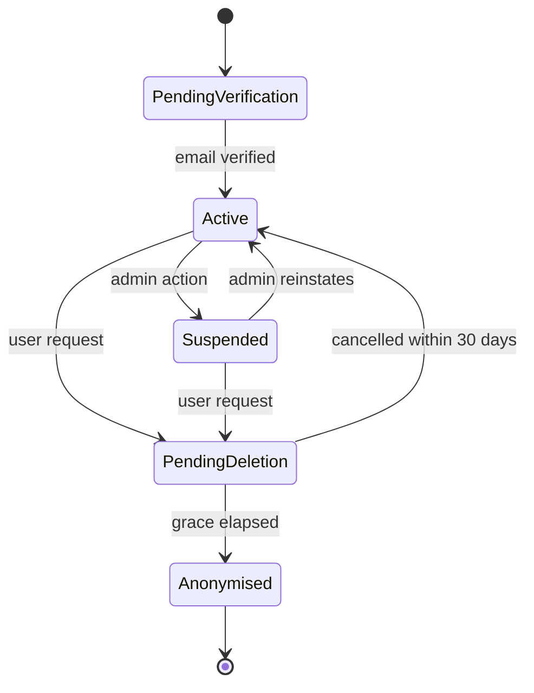

# user — AGENT.md

> AI entry point for this module. Read [`/AGENT.md`](../../../AGENT.md) and
> [`/MODULE_INDEX.md`](../../../MODULE_INDEX.md) first if you have not.
> **Everything you need for this module is below. Do not scan other modules.**

| | |
|---|---|
| Tier | `core` |
| Path | `internal/modules/user` |
| Schema | `core` |
| Delivery phase | 1 |
| Status | **PLANNED** |
| Owner | @backend-team |

---

## 1. Overview

<!-- BEGIN GENERATED: overview -->
Owns the user record and everything descriptive about a person: profile, preferences, locale, timezone, avatar, learning goals, and the account lifecycle including export and deletion. It is the canonical source of `core.users`, which every other module references by ID.
<!-- END GENERATED: overview -->

## 2. Responsibilities

<!-- BEGIN GENERATED: responsibilities -->
**This module owns:**

- The `core.users` record: identity, status, timestamps
- Profile: display name, avatar, country, timezone, locale, date of birth (for the age gate)
- Preferences: notification settings, daily goal, UI theme, AI processing opt-out
- Learning profile: self-declared level, goals, target exam, study reminders
- Account status transitions: active, suspended, pending deletion
- Data export (async) and erasure (30-day grace, then anonymisation)
- Avatar upload coordination through `platform/storage`

**This module does NOT own:**

- Passwords, sessions, tokens — that is `auth`
- Roles and permissions — that is `rbac`
- Learning progress and statistics — that is `learning`
- Subscription state — that is `subscription`
<!-- END GENERATED: responsibilities -->

## 3. Entry points

<!-- BEGIN GENERATED: entrypoints -->
| File | Read it when |
|---|---|
| `internal/modules/user/module.go` | You need to see what this module depends on and what it exposes |
| `internal/modules/user/contract/` | You are calling this module from another module |
| `internal/modules/user/service/` | You are changing behaviour |
| `db/migrations/user/` | You need the real schema |
<!-- END GENERATED: entrypoints -->

## 4. Public API (contract)

Other modules may import **only** `internal/modules/user/contract`.

<!-- BEGIN GENERATED: contract -->
| Kind | Name | Purpose |
|---|---|---|
| interface | `user.Reader` | `GetByID`, `GetManyByIDs`, `Exists` — batched to avoid N+1 across modules |
| interface | `user.Creator` | `CreateUser` — used only by `auth` during registration |
| struct | `user.Summary` | `{ID, DisplayName, AvatarURL, Locale, Timezone, Status}` — the shape other modules render |
| event | `user.DeletionRequested` | Every module holding personal data reacts to this |
| interface | `user.LearningProfileReader` | `GetLearningProfile(ctx, userID)` returning `found=false` rather than an error — used by `learning` for the declared level, target level and weekly minutes |

### Events

| Event | Direction | Payload summary |
|---|---|---|
| `user.profile_updated` | publishes | `{user_id, changed_fields}` |
| `user.learning_profile_updated` | publishes | `{user_id, changed_fields, actor_id}` — the names of what changed, never the values; nothing when nothing changed |
| `user.deletion_requested` | publishes | `{user_id, execute_after}` |
| `user.deleted` | publishes | `{user_id}` — modules must purge or anonymise their data |
| `user.suspended` | publishes | `{user_id, reason, actor_id}` |
| `subscription.activated` | consumes | Cache the entitlement tier on the profile for fast reads |
<!-- END GENERATED: contract -->

## 5. Database schema

<!-- BEGIN GENERATED: schema -->
All tables live in the `core` schema and are owned exclusively by this module (rule DB1).
Migrations: `db/migrations/user/` · Queries: `db/queries/user/`

| Table | Purpose | Key columns / notes |
|---|---|---|
| `core.users` | Canonical user identity | `email` (citext, UNIQUE), `status`, `email_verified_at`, `created_at`. **The one table other schemas may FK to** (ADR-0004) |
| `core.profiles` | Descriptive profile data | 1:1 with users; display name, avatar asset ID, country, timezone |
| `core.user_preferences` | Settings | Locale, theme, daily goal, notification channels, quiet hours, `ai_processing_opt_out`, `practice_level` (A2–B2, null until chosen) |
| `core.learning_profiles` | Self-declared learning context | Declared level, target level, target exam, weekly minutes goal, motivations |
| `core.user_deletions` | Erasure workflow | `requested_at`, `execute_after`, `cancelled_at`, `completed_at` |
| `core.user_exports` | Data export jobs and artefacts | `status`, `object_key`, `expires_at` |
| `core.avatar_assets` | Uploaded avatar images | `user_id`, `storage_key`, `content_type`, `byte_size`, `created_at` |

<!-- END GENERATED: schema -->

### What exists today (P1.1, `db/migrations/user/1700000010_create_core_user_tables.sql`)

Four of the six tables above are real: `users`, `profiles`, `user_preferences`,
`learning_profiles`. `user_deletion_requests` and `user_exports` arrive with WP3 (P3.2, P3.3).

| Object | Notes |
|---|---|
| extension `citext` | Created by this migration. It is what makes BR-USER-01 a database guarantee instead of a convention every query has to remember |
| enum `core.user_status` | `active`, `suspended`, `pending_deletion`, `deleted` |
| enum `core.ui_theme` | `light`, `dark`, `system` |
| enum `core.cefr_level` | `a1`…`c2`, lower-case |
| enum `core.target_exam` | `ielts`, `toeic`, `none` |

`core.users` carries exactly six columns — `id`, `email`, `status`, `email_verified_at`,
`created_at`, `updated_at` — and an integration test fails if a seventh appears. Everything
descriptive belongs to `profiles`, every setting to `user_preferences`.

The three satellite tables are 1:1 with `users` via a `UNIQUE` constraint on `user_id`, which
is also the index the foreign key needs; they cascade on delete.

The enums are written as bare `CREATE TYPE` rather than guarded by a `DO` block, because sqlc
parses the migration as its schema source and cannot see inside a `DO` block — guarded, every
enum column generates `interface{}` instead of a typed Go constant.

## 6. HTTP endpoints

Full definitions are in [`api/openapi/openapi.yaml`](../../../api/openapi/openapi.yaml)
(tag: `user`). Per-endpoint detail is in §15.

<!-- BEGIN GENERATED: endpoints -->
| Method | Path | Permission | Purpose |
|---|---|---|---|
| `GET` | `/api/v1/me` | `self` | Full profile of the caller |
| `PATCH` | `/api/v1/me` | `self` | Update profile fields |
| `GET` | `/api/v1/me/preferences` | `self` | Read preferences |
| `PUT` | `/api/v1/me/preferences` | `self` | Replace preferences |
| `GET` | `/api/v1/me/learning-profile` | `self` | Read the caller's learning profile |
| `PUT` | `/api/v1/me/learning-profile` | `self` | Replace the caller's learning profile |
| `POST` | `/api/v1/me/avatar/upload-intent` | `self` | Get a presigned URL for an avatar upload |
| `PUT` | `/api/v1/me/avatar` | `self` | Confirm the uploaded avatar |
| `GET` | `/api/v1/storage/avatars/{assetId}` | `authenticated` | Serve a stored avatar image |
| `POST` | `/api/v1/me/export` | `self` | Request a data export |
| `GET` | `/api/v1/me/export/{id}` | `self` | Get status of a data export request |
| `DELETE` | `/api/v1/me` | `self` | Request account deletion (30-day grace) |
| `POST` | `/api/v1/me/deletion/cancel` | `self` | Cancel a pending deletion |
| `GET` | `/api/v1/me/deletion/{id}` | `self` | Get status of an account deletion request |
| `GET` | `/api/v1/admin/users` | `user.list` | Search and list users |
| `GET` | `/api/v1/admin/users/{id}` | `user.read` | Read one user |
| `POST` | `/api/v1/admin/users/{id}/suspend` | `user.suspend` | Suspend an account |
| `POST` | `/api/v1/admin/users/{id}/reinstate` | `user.reinstate` | Reinstate a suspended account |
<!-- END GENERATED: endpoints -->

### Implemented (P1.2)

`GET`/`PATCH /api/v1/me` and `GET`/`PUT /api/v1/me/preferences`. The rest of the table above is
specification, not code.

Two decisions worth knowing before you add the fifth:

- **The actor comes from the request context, never from the request.** `httpx.ActorFrom` returns
  `(Actor, bool)` and the handlers refuse the request when it is false. No route in this module
  carries a user id. Adding one is how the "impossible by construction" property gets lost.
- **Request DTOs are hand-written, not taken from `api/openapi`.** A business module importing the
  generated models would couple it to every other module's spec. What keeps them honest is
  `contract_test.go`, which validates real responses against `openapi.bundle.yaml` — run it with
  `make test-contract`. If you change a response shape, that test is the one that tells you the
  spec no longer matches.

## 7. Folder map

<!-- BEGIN GENERATED: folders -->
| Path | Contains |
|---|---|
| `contract/` | Interfaces, DTOs and event types other modules may import — the only public package |
| `domain/` | Entities, value objects, invariants, domain errors. Pure Go, no I/O |
| `service/` | Use cases, orchestration, transactions, event publishing |
| `repository/` | sqlc-generated queries and row↔domain mappers |
| `transport/http/` | Handlers, request/response DTOs, route registration |
| `job/` | Background job handlers owned by this module |
| `module.go` | `New(deps)` — wiring; the only symbol `cmd/` imports |
<!-- END GENERATED: folders -->

## 8. Related modules

<!-- BEGIN GENERATED: related -->
| Module | Direction | Why |
|---|---|---|
| [`storage`](../../platform/storage/AGENT.md) | → depends on | Avatar upload and export artefacts |
| [`mailer`](../../platform/mailer/AGENT.md) | → depends on | Deletion confirmation, export-ready notice |
| [`audit`](../../modules/audit/AGENT.md) | → depends on | Record profile and status changes |
| [`auth`](../../modules/auth/AGENT.md) | ← used by | consumes this module's contract |
| [`admin`](../../modules/admin/AGENT.md) | ← used by | consumes this module's contract |
| [`learning`](../../modules/learning/AGENT.md) | ← used by | consumes this module's contract |
| [`notification`](../../modules/notification/AGENT.md) | ← used by | consumes this module's contract |
| [`subscription`](../../modules/subscription/AGENT.md) | ← used by | consumes this module's contract |
| [`gamification`](../../modules/gamification/AGENT.md) | ← used by | consumes this module's contract |
<!-- END GENERATED: related -->

**Boundary reminder:** you may call these through their `contract` package only.
Reaching into `service/`, `repository/`, `domain/` or their tables violates rules L1/L2
and fails `go-arch-lint` in CI.

## 9. Business rules

<!-- BEGIN GENERATED: rules -->
1. **BR-USER-01** — `core.users.email` is unique, case-insensitive (citext), and immutable after verification — changing it is a separate verified flow, not a profile edit.
2. **BR-USER-02** — A display name is 1–50 characters, must not impersonate staff (a reserved-word list), and is moderated on report.
3. **BR-USER-03** — Timezone must be a valid IANA name; all stored timestamps remain UTC.
4. **BR-USER-04** — Date of birth is used only for the age gate; users under 16 require a guardian email and receive no marketing.
5. **BR-USER-05** — Deletion is a 30-day grace period: the account is unusable immediately, cancellable by the user, and irreversible afterwards.
6. **BR-USER-06** — On execution, PII is hard-deleted and learning statistics are anonymised to a synthetic ID so aggregate analytics remain valid.
7. **BR-USER-07** — An export is produced asynchronously and delivered as a signed link valid for 24 hours; the artefact is deleted after 7 days.
8. **BR-USER-08** — Suspending a user revokes their sessions immediately via `auth`'s contract.
9. **BR-USER-09** — Setting `ai_processing_opt_out` disables AI grading only; deterministic exercises continue to work.
<!-- END GENERATED: rules -->

## 10. Common tasks

<!-- BEGIN GENERATED: tasks -->
### Add a profile field

1. Decide which table it belongs to: identity (`users`), descriptive (`profiles`), settings (`user_preferences`), or learning context (`learning_profiles`). Do **not** add it to `users`.
2. Write the migration in `db/migrations/user/`.
3. Add it to the sqlc query and the domain struct.
4. Add it to `contract/dto.go` only if another module needs it.
5. Update `openapi.yaml` and the frontend types via `make gen`.
6. Add validation, and a test for the boundary values.
7. Update this AGENT.md §5 and the front-matter `tables:` list.

### Add a module that stores personal data

1. Subscribe to `user.deletion_requested` and `user.deleted` in that module.
2. Implement idempotent purge or anonymisation.
3. Add the module to the erasure completeness check.
4. Document what it holds in `docs/security/data-inventory.md`.
<!-- END GENERATED: tasks -->

## 11. Known limitations

<!-- BEGIN GENERATED: limitations -->
- Email change is not implemented in Phase 1 — it requires a re-verification flow.
- Avatar moderation is manual and report-driven; there is no automated image classification.
- The export format is a ZIP of JSON and media; there is no interoperable standard we target.
<!-- END GENERATED: limitations -->

- `core.learning_profiles` has a table and queries but no endpoint. `GET /me` returns identity and
  profile only. It is wired in when onboarding needs it, rather than shipping a write path nothing
  calls.
- Avatar upload lifecycle is implemented under `/api/v1/me/avatar/upload-intent` and `/api/v1/me/avatar`,
  and the images are served by `GET /api/v1/storage/avatars/{assetID}` with an optional `?size=sm|md|lg`.
  That route proxies the bytes rather than redirecting to a presigned URL, so no bucket URL reaches the
  browser, and any signed-in learner may read any avatar because a leaderboard shows the faces of everyone
  the learner competes with.
- `core.avatar_assets` holds one row per stored variant. It exists because the object key embeds the year
  and month of the upload, so nothing could locate an avatar from its asset id alone: `avatar_url` named a
  route that was never mounted, and cleanup of a replaced avatar guessed the old key from
  `profiles.updated_at` and missed whenever anything else had touched the profile.
- Account deletion is implemented under `DELETE /api/v1/me`, `POST /api/v1/me/deletion/cancel`, and `GET /api/v1/me/deletion/{id}`
  with a 30-day grace period, daily `DeletionExecutor` cron job (advisory lock `1_700_000_050`), and event-driven data purging
  and user anonymisation (`user.deletion_requested`, `user.deleted`).

### Account deletion events

This module publishes the following domain events for account deletion:

#### `user.deletion_requested`

- **When:** Immediately when `DELETE /me` is called and a deletion request is created.
- **Purpose:** Signal to other modules (particularly `auth`) that the account is entering deletion grace period.
- **Subscribers:**
  - `auth` module: Revokes ALL active sessions immediately (before grace period begins).
- **Payload:**
  - `UserID uuid.UUID`: Target user ID
  - `ExecuteAfter time.Time`: Deadline (`now() + 30 days`)
  - `OccurredAt time.Time`: Timestamp
- **Why immediate revocation:** Account must be unusable during grace period for security. Learner can cancel and re-authenticate.

#### `user.deleted`

- **When:** After 30-day grace period expires and anonymisation completes successfully.
- **Purpose:** Signal cross-module data purge. Each module holding personal data subscribes and erases its own data.
- **Subscribers:**
  - `auth` module: Purges sessions, tokens, credentials, devices, OAuth links, challenges via `PurgeUser`.
  - `rbac` module: Deletes role assignments via `ForgetUser`.
- **Payload:**
  - `UserID uuid.UUID`: Target user ID
  - `OccurredAt time.Time`: Timestamp
- **Architecture note:** This event-driven design (vs CASCADE DELETE) follows Rule L4 (no transaction spans modules) and ensures GDPR erasure completeness can be verified per-module.

## 12. Coding conventions (module-specific)

Global rules: [`docs/CONVENTIONS.md#coding-standard`](../../../docs/CONVENTIONS.md#coding-standard). Deviations and additions
for this module:

<!-- BEGIN GENERATED: conventions -->
_No deviations from the global standard._
<!-- END GENERATED: conventions -->

### Cache strategy

| Key | TTL | Invalidated by |
|---|---|---|
| `fluentra:{env}:user:summary:{user_id}:v1` | 10 min | `user.profile_updated` |
| `fluentra:{env}:user:prefs:{user_id}:v1` | 10 min | Preference write |

### Error codes owned by this module

| Code | Status | Meaning |
|---|---|---|
| `DISPLAY_NAME_NOT_ALLOWED` | 422 | Reserved or moderated name |
| `INVALID_STATE_TRANSITION` | 409 | e.g. cancelling a deletion that already executed |
| `EXPORT_ALREADY_PENDING` | 409 | One export at a time |
| `AGE_RESTRICTED` | 403 | Under-16 account without guardian consent |

### Security considerations

- Only the account owner and an admin with `user.read` may read a profile; every query filters by actor.
- Admin reads of personal data are audited with the acting admin's ID.
- Export artefacts live in a private bucket and are reachable only through a short-lived presigned URL.
- Avatars are size- and type-limited, stripped of EXIF, and re-encoded before being made public.

## 13. Testing

<!-- BEGIN GENERATED: testing -->
Coverage target: **85% service, 90% domain**

```bash
go test ./internal/modules/user/...                    # unit
go test -tags=integration ./internal/modules/user/...  # integration (testcontainers)
```

**Focus areas**

- Deletion grace period: cancellable before, irreversible after
- Anonymisation preserves aggregate statistics while removing PII
- Every other module's purge handler is idempotent
- Timezone and locale validation, including odd IANA names
- Age gate boundaries around the 16th birthday
- Admin cannot read a profile without `user.read`, and the read is audited
<!-- END GENERATED: testing -->

## 14. Do NOT

<!-- BEGIN GENERATED: donot -->
- Do not add columns to `core.users` — use `profiles`, `user_preferences`, or your own module's table.
- Do not read another module's tables to build a profile response; call their contract.
- Do not expose `email` in any response other than the owner's own `/me`.
- Do not implement deletion as a cascade of `DELETE` statements from this module — publish the event.
<!-- END GENERATED: donot -->

## 15. API detail

### What is live

Four of the thirteen operations below exist as of **P1.2**:

| Method | Path | Notes |
|---|---|---|
| `GET` | `/api/v1/me` | Identity plus profile. The learning profile is not exposed yet |
| `PATCH` | `/api/v1/me` | `display_name`, `country`, `timezone`, `date_of_birth`. Unknown and null members are 422 |
| `GET` | `/api/v1/me/preferences` | |
| `PUT` | `/api/v1/me/preferences` | Full replacement; a missing member is 422, not "unchanged" |

The rest are specified here and not implemented: avatar and export arrive with WP3, the
`/admin/users` group with P4.1.

**There is no operation that takes a user id.** `GET /me` reads the actor from the access token,
and this module exposes no `/users/{id}` route at all, so one learner cannot reach another's
record by changing a path segment. That is a property of the routing table, not of a permission
check, and there is a test that fails if a user-id route ever appears.

### Endpoint detail

<!-- BEGIN GENERATED: api-detail -->
#### `GET /api/v1/me`

Full profile of the caller

| | |
|---|---|
| Permission | `self` |
| Success | 200 |
| Errors | standard set |

#### `PATCH /api/v1/me`

Update profile fields

| | |
|---|---|
| Permission | `self` |
| Success | 200 |
| Errors | `VALIDATION_FAILED` |

#### `GET /api/v1/me/preferences`

Read preferences

| | |
|---|---|
| Permission | `self` |
| Success | 200 |
| Errors | standard set |

#### `PUT /api/v1/me/preferences`

Replace preferences

| | |
|---|---|
| Permission | `self` |
| Success | 200 |
| Errors | standard set |

#### `GET /api/v1/me/learning-profile`

Read the caller's learning profile

| | |
|---|---|
| Permission | `self` |
| Success | 200 |
| Errors | `NOT_FOUND` |

#### `PUT /api/v1/me/learning-profile`

Replace the caller's learning profile

| | |
|---|---|
| Permission | `self` |
| Success | 200 |
| Errors | `VALIDATION_FAILED` |

#### `POST /api/v1/me/avatar/upload-intent`

Get a presigned URL for an avatar upload

| | |
|---|---|
| Permission | `self` |
| Success | 200 |
| Errors | `UNSUPPORTED_MEDIA_TYPE`, `TOO_LARGE` |

#### `PUT /api/v1/me/avatar`

Confirm the uploaded avatar

| | |
|---|---|
| Permission | `self` |
| Success | 200 |
| Errors | standard set |

#### `GET /api/v1/storage/avatars/{assetId}`

Serve a stored avatar image

| | |
|---|---|
| Permission | `authenticated` |
| Success | 200 |
| Errors | `AVATAR_NOT_FOUND` |

#### `POST /api/v1/me/export`

Request a data export

| | |
|---|---|
| Permission | `self` |
| Success | 202 |
| Errors | standard set |

#### `GET /api/v1/me/export/{id}`

Get status of a data export request

| | |
|---|---|
| Permission | `self` |
| Success | 200 |
| Errors | standard set |

#### `DELETE /api/v1/me`

Request account deletion (30-day grace)

| | |
|---|---|
| Permission | `self` |
| Success | 202 |
| Errors | standard set |

#### `POST /api/v1/me/deletion/cancel`

Cancel a pending deletion

| | |
|---|---|
| Permission | `self` |
| Success | 200 |
| Errors | `INVALID_STATE_TRANSITION` |

#### `GET /api/v1/me/deletion/{id}`

Get status of an account deletion request

| | |
|---|---|
| Permission | `self` |
| Success | 200 |
| Errors | standard set |

#### `GET /api/v1/admin/users`

Search and list users

| | |
|---|---|
| Permission | `user.list` |
| Success | 200 |
| Errors | standard set |

#### `GET /api/v1/admin/users/{id}`

Read one user

| | |
|---|---|
| Permission | `user.read` |
| Success | 200 |
| Errors | standard set |

#### `POST /api/v1/admin/users/{id}/suspend`

Suspend an account

| | |
|---|---|
| Permission | `user.suspend` |
| Success | 200 |
| Errors | `INVALID_STATE_TRANSITION` |

#### `POST /api/v1/admin/users/{id}/reinstate`

Reinstate a suspended account

| | |
|---|---|
| Permission | `user.reinstate` |
| Success | 200 |
| Errors | standard set |

<!-- END GENERATED: api-detail -->

### Error codes

<!-- BEGIN GENERATED: api-errors -->
| Code | Status | Meaning |
|---|---|---|
| `DISPLAY_NAME_NOT_ALLOWED` | 422 | Reserved or moderated name |
| `INVALID_STATE_TRANSITION` | 409 | e.g. cancelling a deletion that already executed |
| `EXPORT_ALREADY_PENDING` | 409 | One export at a time |
| `AGE_RESTRICTED` | 403 | Under-16 account without guardian consent |
<!-- END GENERATED: api-errors -->

### Rate limits

<!-- BEGIN GENERATED: api-rate -->
Standard limits apply — see [/docs/CONVENTIONS.md](../../../docs/CONVENTIONS.md#rate-limiting).
<!-- END GENERATED: api-rate -->

## 16. Flows

### Account deletion

Deletion fans out to every module holding personal data. Each module is responsible for its own erasure, driven by an event rather than a central script — that is what keeps the boundary intact.

```mermaid
sequenceDiagram
    autonumber
    actor U as User
    participant US as user
    participant A as auth
    participant J as job
    participant M as all modules

    U->>US: DELETE /me
    US->>US: INSERT deletion_request (execute_after = now + 30d)
    US->>US: users.status = pending_deletion
    US->>A: RevokeAllSessions(user_id)
    US->>US: publish user.deletion_requested
    US-->>U: 202 { execute_after }

    alt user cancels within 30 days
        U->>US: POST /me/deletion/cancel
        US->>US: status = active; cancel request
    else grace elapses
        J->>US: scheduled job picks up due requests
        US->>US: anonymise profile, hard-delete PII
        US->>M: publish user.deleted
        M->>M: each module purges or anonymises its own data
        US->>US: mark completed
    end
```

<!-- END GENERATED: flows -->

<!-- BEGIN GENERATED: states -->
### State machine

Account status. `auth` reads this on every login; a non-active status blocks authentication.



<!-- END GENERATED: states -->

### Failure paths

<!-- BEGIN GENERATED: failures -->
| Failure | Detected by | Behaviour |
|---|---|---|
| A module fails to purge on `user.deleted` | Erasure completeness job compares expected vs actual | Retries, then raises an alert — an incomplete erasure is a compliance incident |
| Export job exceeds its timeout on a very large account | Job timeout metric | Chunked export with resumable state; user notified when ready |
<!-- END GENERATED: failures -->

## 17. Decisions

### Decisions taken

<!-- BEGIN GENERATED: decisions -->
| Question | Decision | Rationale |
|---|---|---|
| One `users` table or split identity and profile? | Split | `users` is referenced by every schema; keeping it narrow and stable means profile churn never touches a table with a dozen inbound foreign keys |
| Hard delete or anonymise? | Hard-delete PII, anonymise statistics | Satisfies erasure while keeping historical aggregates truthful — deleting the rows outright would silently rewrite past reports |
| Who owns cross-module erasure? | Each module, driven by an event | A central deletion script would need to know every module's schema, which is exactly the coupling the architecture exists to prevent |
<!-- END GENERATED: decisions -->

### Related repository ADRs

<!-- BEGIN GENERATED: decisions-adr -->
_None specific to this module._
<!-- END GENERATED: decisions-adr -->

### Open questions

<!-- BEGIN GENERATED: decisions-open -->
- Do we need a verified email-change flow in Phase 2, or is support-assisted change acceptable?
<!-- END GENERATED: decisions-open -->

## 18. Backlog

### Phase 1

- [ ] `users`, `profiles`, `user_preferences` tables and CRUD
- [ ] `GET/PATCH /me` and preferences endpoints
- [ ] Avatar upload via presigned URL, with EXIF stripping
- [ ] Admin user list, search, suspend, reinstate — all audited
- [ ] Deletion request with 30-day grace and cancellation
- [ ] Export job producing a signed link
- [ ] `user.deleted` fan-out with an erasure completeness check
<!-- END GENERATED: todo -->

### Progress

The list above is generated from `tools/docgen/data/core.json`, so its checkboxes cannot be
ticked by hand — `make docs` would put them back. Completed work is recorded here instead.

| P1.1 | 2026-08-09 | `core.users`, `core.profiles`, `core.user_preferences`, `core.learning_profiles`, the four `core` enums and the `citext` extension; the sqlc query set in `db/queries/user/`; schema and query integration tests |
| P1.2 | 2026-08-09 | The vertical slice: `contract` (`Reader` with batched `GetManyByIDs`, `Creator`, `Summary`, events), `domain`, `repository`, `service`, `transport/http`. `GET`/`PATCH /me` and `GET`/`PUT /me/preferences` |
| P3.1 | 2026-08-15 | Avatar upload lifecycle: `POST /api/v1/me/avatar/upload-intent` presigned upload, `PUT /api/v1/me/avatar` confirmation, magic bytes sniffing, pure-Go JPEG image resizing to 3 sizes (64x64, 128x128, 256x256) with EXIF GPS stripping, outbox event publishing, and safe old-avatar cleanup |
| P3.2 | 2026-08-16 | GDPR User Data Export: `POST /api/v1/me/export` & `GET /api/v1/me/export/{id}`, River background export worker collecting data across modules (`user`, `auth`, `rbac`, `audit`), ZIP packaging with `metadata.json`, MinIO upload, 24h presigned URL email delivery, 7-day retention cleanup cron job |
| P3.3 | 2026-08-16 | GDPR User Account Deletion: `DELETE /api/v1/me`, `POST /api/v1/me/deletion/cancel`, `GET /api/v1/me/deletion/{id}` with 30-day grace period, immediate session revocation (`user.deletion_requested`), daily `DeletionExecutor` cron job (`1_700_000_050`), user/profile anonymisation preserving aggregate stats, preferences/learning profile deletion, and event-driven data purge (`user.deleted`) across `auth` and `rbac`. |
| WO11 §3.11 | 2026-09-12 | `core.user_preferences.practice_level` (migration `1700000530`; A2, B1, B2 or null): the level the daily practice set is drawn at, chosen once on the practice card and returned by `GET`/`PUT /me/preferences`, so it follows the learner between devices. A PUT that omits it stores null, so every web caller builds its body with `replacementFor`. `core.learning_profiles.declared_level` was not used: nothing writes it. |
| WO13 §3.5 | 2026-09-14 | Learning profile lifecycle for onboarding & calibration: `GetLearningProfile` and `ReplaceLearningProfile` in service, `Reader.GetLearningProfile` in contract, HTTP endpoints `GET/PUT /api/v1/me/learning-profile`, validating target exam, CEFR levels, weekly minutes, and motivations. Drives `/welcome` wizard and Account Settings. |

That closes the first three generated items, export (P3.2), deletion (P3.3), and the `user.deleted` fan-out. Still open in Phase 1: the
admin user group (P4.1).

Landed in WO13 §3.5: `core.learning_profiles` exposed through service, contract, and HTTP endpoints (`GET/PUT /api/v1/me/learning-profile`), wired to onboarding and settings.

### Deferred (deliberately not doing yet)

<!-- BEGIN GENERATED: todo-deferred -->
_Nothing deferred._
<!-- END GENERATED: todo-deferred -->

### Future improvements

<!-- BEGIN GENERATED: todo-future -->
- Verified email change
- Profile completeness prompts driving onboarding
- Per-user data-retention preferences
<!-- END GENERATED: todo-future -->

---

_Generated by `tools/docgen` from `tools/docgen/data/`. Hand-written text outside the
GENERATED markers is preserved. Update the manifest, then run `make docs`._
