# vocabulary — AGENT.md

> AI entry point for this module. Read [`/AGENT.md`](../../../AGENT.md) and
> [`/MODULE_INDEX.md`](../../../MODULE_INDEX.md) first if you have not.
> **Everything you need for this module is below. Do not scan other modules.**

| | |
|---|---|
| Tier | `learning` |
| Path | `internal/modules/vocabulary` |
| Schema | `skill` |
| Delivery phase | 2 |
| Status | **DONE** |
| Owner | @learning-team |

---

## 1. Overview

<!-- BEGIN GENERATED: overview -->
Words and how learners acquire them: senses, pronunciations, collocations, word families, learner decks, and the vocabulary graders. The first skill module built, and the reference implementation the other five follow.
<!-- END GENERATED: overview -->

## 2. Responsibilities

<!-- BEGIN GENERATED: responsibilities -->
**This module owns:**

- Word entries: lemma, part of speech, senses, CEFR level, frequency rank
- Pronunciation (IPA plus TTS audio) and example sentences
- Collocations and word families
- Learner decks and per-learner word state
- Vocabulary exercise graders: recognition, recall, spelling, cloze, matching
- Word lookup and dictionary search

**This module does NOT own:**

- Review scheduling — that is `srs`
- Content versioning — that is `content`
- Generating example sentences — it asks `platform/ai`
<!-- END GENERATED: responsibilities -->

## 3. Entry points

<!-- BEGIN GENERATED: entrypoints -->
| File | Read it when |
|---|---|
| `internal/modules/vocabulary/module.go` | You need to see what this module depends on and what it exposes |
| `internal/modules/vocabulary/contract/` | You are calling this module from another module |
| `internal/modules/vocabulary/service/` | You are changing behaviour |
| `db/migrations/vocabulary/` | You need the real schema |
<!-- END GENERATED: entrypoints -->

## 4. Public API (contract)

Other modules may import **only** `internal/modules/vocabulary/contract`.

<!-- BEGIN GENERATED: contract -->
| Kind | Name | Purpose |
|---|---|---|
| interface | `vocabulary.Grader` | Implements `learning.ExerciseGrader` for vocabulary activity kinds |
| interface | `vocabulary.Reader` | `LookupWord`, `GetSenses` — used by `reading` and `writing` for inline glossing |

### Events

| Event | Direction | Payload summary |
|---|---|---|
| `vocabulary.word_learned` | publishes | `{user_id, word_sense_id, cefr_level}` |
| `review.card_answered` | consumes | Update per-learner word state as cards mature |
<!-- END GENERATED: contract -->

## 5. Database schema

<!-- BEGIN GENERATED: schema -->
All tables live in the `skill` schema and are owned exclusively by this module (rule DB1).
Migrations: `db/migrations/vocabulary/` · Queries: `db/queries/vocabulary/`

| Table | Purpose | Key columns / notes |
|---|---|---|
| `skill.words` | Lemma-level entry | `lemma` + `pos` UNIQUE, `cefr_level`, `frequency_rank`, `ipa` |
| `skill.word_senses` | One meaning of a word | `word_id`, `definition`, `register`, `domain`, `examples` jsonb |
| `skill.word_relations` | Families, synonyms, collocations | `from_word_id`, `to_word_id`, `relation` |
| `skill.decks` | Learner or curated collection | `owner_id` (null = curated), `slug`, `name`, `is_public` |
| `skill.deck_items` | Word in a deck | Unique on (deck_id, word_sense_id) |
| `skill.user_word_state` | Per-learner status | `user_id`, `word_sense_id`, `status` (new/learning/known/ignored), `first_seen_at` |
| `skill.vocab_uploads` | Batch word uploads | `user_id`, `status`, `raw_text`, `item_count` |
| `skill.vocab_upload_items` | Parsed items in an upload | `upload_id`, `raw_entry`, `parsed_word`, `parsed_notes`, `status`, `reason`, `sense_id` |

<!-- END GENERATED: schema -->

### Two tables the generated docs do not list yet

| Table | Purpose |
|---|---|
| `skill.vocab_uploads` | One paste of a learner's own vocabulary, kept verbatim so a parser change can be re-run against the original |
| `skill.vocab_upload_items` | One word from it, and what became of it — verified, rejected with a reason the learner reads, or still pending |

Two tables rather than one because the two have different failure modes: the
submission is finished the moment it is stored, and each word in it is a
separate unit of work the verification job can succeed at, fail at or retry on
its own. One table would mean a single unresolvable word marking the whole paste
as failed.

## 6. HTTP endpoints

Full definitions are in [`api/openapi/openapi.yaml`](../../../api/openapi/openapi.yaml)
(tag: `vocabulary`). Per-endpoint detail is in §15.

<!-- BEGIN GENERATED: endpoints -->
| Method | Path | Permission | Purpose |
|---|---|---|---|
| `GET` | `/api/v1/vocabulary/words/{lemma}` | `content.read.published` | Dictionary lookup with senses, IPA, audio, examples |
| `GET` | `/api/v1/vocabulary/search` | `content.read.published` | Search the dictionary |
| `GET` | `/api/v1/vocabulary/decks` | `self` | The learner's decks plus curated ones |
| `POST` | `/api/v1/vocabulary/decks` | `self` | Create a deck |
| `GET` | `/api/v1/vocabulary/decks/{id}/words` | `self` | The word senses in a deck, with everything a flashcard renders |
| `POST` | `/api/v1/vocabulary/decks/{id}/words` | `self` | Add a word sense to a deck |
| `DELETE` | `/api/v1/vocabulary/decks/{id}/words/{sense_id}` | `self` | Remove |
| `POST` | `/api/v1/vocabulary/words/{sense_id}/state` | `self` | Mark known or ignored |
| `POST` | `/api/v1/me/vocabulary/uploads` | `self` | Submit your own vocabulary to be checked |
| `GET` | `/api/v1/me/vocabulary/uploads` | `self` | Your uploads, newest first |
| `GET` | `/api/v1/me/vocabulary/uploads/{id}` | `self` | One upload, with every word and what became of it |
| `GET` | `/api/v1/admin/vocabulary/words` | `content.edit` | List vocabulary words with source filter |
| `POST` | `/api/v1/admin/vocabulary/words` | `content.create` | Create a word entry |
| `DELETE` | `/api/v1/admin/vocabulary/words/{id}` | `content.edit` | Withdraw a word from the shared dictionary |
| `GET` | `/api/v1/admin/vocabulary/queue` | `content.edit` | List learner-contributed words queue |
| `PATCH` | `/api/v1/admin/vocabulary/senses/{id}` | `content.edit` | Update a word sense definition or examples |
| `DELETE` | `/api/v1/admin/vocabulary/senses/{id}` | `content.edit` | Withdraw one sense from the shared dictionary |
<!-- END GENERATED: endpoints -->

## 7. Folder map

<!-- BEGIN GENERATED: folders -->
| Path | Contains |
|---|---|
| `contract/` | Interfaces, DTOs and event types other modules may import — the only public package |
| `domain/` | Entities, value objects, invariants, domain errors. Pure Go, no I/O |
| `service/` | Use cases, orchestration, transactions, event publishing |
| `repository/` | sqlc-generated queries and row↔domain mappers |
| `transport/http/` | Handlers, request/response DTOs, route registration |
| `module.go` | `New(deps)` — wiring; the only symbol `cmd/` imports |
<!-- END GENERATED: folders -->

## 8. Related modules

<!-- BEGIN GENERATED: related -->
| Module | Direction | Why |
|---|---|---|
| [`content`](../../modules/content/AGENT.md) | → depends on | Word entries are content versions |
| [`srs`](../../modules/srs/AGENT.md) | → depends on | Words enter spaced repetition |
| [`media`](../../platform/media/AGENT.md) | → depends on | TTS pronunciation audio |
| [`ai`](../../platform/ai/AGENT.md) | → depends on | Example sentence generation |
| [`search`](../../platform/search/AGENT.md) | → depends on | Dictionary search |
| [`learning`](../../modules/learning/AGENT.md) | ← used by | consumes this module's contract |
| [`reading`](../../modules/reading/AGENT.md) | ← used by | consumes this module's contract |
| [`writing`](../../modules/writing/AGENT.md) | ← used by | consumes this module's contract |
| [`grammar`](../../modules/grammar/AGENT.md) | ← used by | consumes this module's contract |
<!-- END GENERATED: related -->

**Boundary reminder:** you may call these through their `contract` package only.
Reaching into `service/`, `repository/`, `domain/` or their tables violates rules L1/L2
and fails `go-arch-lint` in CI.

## 9. Business rules

<!-- BEGIN GENERATED: rules -->
1. **BR-VOCABULARY-01** — A learner learns a **sense**, not a lemma. "Bank" as a financial institution and as a riverbank are different cards.
2. **BR-VOCABULARY-02** — A word cannot appear twice in the same deck (unique on deck and sense).
3. **BR-VOCABULARY-03** — Deck count and size limits come from the learner's entitlement; the free tier is limited.
4. **BR-VOCABULARY-04** — Grading recall accepts minor spelling variation via edit distance, configured per activity; grading spelling does not.
5. **BR-VOCABULARY-05** — British and American spellings are both accepted unless the activity explicitly tests one variant.
6. **BR-VOCABULARY-06** — Example sentences are AI-generated but reviewed before publication — a wrong example teaches a wrong usage.
7. **BR-VOCABULARY-07** — Pronunciation audio is pre-generated at publish time and cached; it is never synthesised during a request.
8. **BR-VOCABULARY-08** — A word marked `ignored` never appears in a session again unless the learner reverses it.
<!-- END GENERATED: rules -->

## 10. Common tasks

<!-- BEGIN GENERATED: tasks -->
### Add a vocabulary exercise type

1. Define the activity kind and its `config` schema in `lesson`.
2. Define the content `body` schema in `content` if the item shape is new.
3. Implement the grading branch in `service/grader.go`.
4. Decide whether it produces review items, and with what initial grade.
5. Add the React renderer.
6. Add golden-file tests covering correct, near-miss and wrong answers.
<!-- END GENERATED: tasks -->

## 11. Known limitations

<!-- BEGIN GENERATED: limitations -->
- Sense disambiguation in reading glossing is heuristic (frequency plus context window), not a model.
- Collocation data is manually curated; there is no corpus-derived pipeline.
- No morphological analyser — inflected forms are mapped by a lookup table.
<!-- END GENERATED: limitations -->

## 12. Coding conventions (module-specific)

Global rules: [`docs/CONVENTIONS.md#coding-standard`](../../../docs/CONVENTIONS.md#coding-standard). Deviations and additions
for this module:

<!-- BEGIN GENERATED: conventions -->
_No deviations from the global standard._
<!-- END GENERATED: conventions -->

### Cache strategy

| Key | TTL | Invalidated by |
|---|---|---|
| `fluentra:{env}:vocabulary:word:{lemma}:v1` | 30 d | Version bump on republish |
| `fluentra:{env}:vocabulary:deck:{deck_id}:v1` | 10 min | Deck write |

### Error codes owned by this module

| Code | Status | Meaning |
|---|---|---|
| `DECK_LIMIT_REACHED` | 409 | Plan limit on deck count |
| `DECK_SIZE_LIMIT_REACHED` | 409 | Plan limit on words per deck |
| `WORD_ALREADY_IN_DECK` | 409 | Duplicate sense in the deck |
| `WORD_NOT_FOUND` | 404 | No entry for that lemma |

## 13. Testing

<!-- BEGIN GENERATED: testing -->
Coverage target: **80% service, 90% domain**

```bash
go test ./internal/modules/vocabulary/...                    # unit
go test -tags=integration ./internal/modules/vocabulary/...  # integration (testcontainers)
```

**Focus areas**

- Sense-level uniqueness in decks
- Edit-distance tolerance boundaries per activity kind
- British/American spelling acceptance
- Deck and size limits by entitlement
- Review items produced with the correct initial grade
- Lookup performance on the dictionary index
<!-- END GENERATED: testing -->

## 14. Do NOT

<!-- BEGIN GENERATED: donot -->
- Do not schedule reviews here — return review items and let `srs` schedule.
- Do not treat a lemma as the learnable unit.
- Do not synthesise audio during a request.
- Do not publish an AI-generated example without review.
<!-- END GENERATED: donot -->

## 15. API detail

### Endpoint detail

<!-- BEGIN GENERATED: api-detail -->
#### `GET /api/v1/vocabulary/words/{lemma}`

Dictionary lookup with senses, IPA, audio, examples

| | |
|---|---|
| Permission | `content.read.published` |
| Success | 200 |
| Errors | standard set |

#### `GET /api/v1/vocabulary/search`

Search the dictionary

| | |
|---|---|
| Permission | `content.read.published` |
| Success | 200 |
| Errors | standard set |

#### `GET /api/v1/vocabulary/decks`

The learner's decks plus curated ones

| | |
|---|---|
| Permission | `self` |
| Success | 200 |
| Errors | standard set |

#### `POST /api/v1/vocabulary/decks`

Create a deck

| | |
|---|---|
| Permission | `self` |
| Success | 201 |
| Errors | `DECK_LIMIT_REACHED` |

#### `GET /api/v1/vocabulary/decks/{id}/words`

The word senses in a deck, with everything a flashcard renders

| | |
|---|---|
| Permission | `self` |
| Success | 200 |
| Errors | standard set |

#### `POST /api/v1/vocabulary/decks/{id}/words`

Add a word sense to a deck

| | |
|---|---|
| Permission | `self` |
| Success | 201 |
| Errors | `WORD_ALREADY_IN_DECK` |

#### `DELETE /api/v1/vocabulary/decks/{id}/words/{sense_id}`

Remove

| | |
|---|---|
| Permission | `self` |
| Success | 204 |
| Errors | standard set |

#### `POST /api/v1/vocabulary/words/{sense_id}/state`

Mark known or ignored

| | |
|---|---|
| Permission | `self` |
| Success | 200 |
| Errors | standard set |

#### `POST /api/v1/me/vocabulary/uploads`

Submit your own vocabulary to be checked

| | |
|---|---|
| Permission | `self` |
| Success | 202 |
| Errors | standard set |
| Notes | Accepted, not applied: checking runs as a job so a learner never waits on a provider. |

#### `GET /api/v1/me/vocabulary/uploads`

Your uploads, newest first

| | |
|---|---|
| Permission | `self` |
| Success | 200 |
| Errors | standard set |

#### `GET /api/v1/me/vocabulary/uploads/{id}`

One upload, with every word and what became of it

| | |
|---|---|
| Permission | `self` |
| Success | 200 |
| Errors | standard set |

#### `GET /api/v1/admin/vocabulary/words`

List vocabulary words with source filter

| | |
|---|---|
| Permission | `content.edit` |
| Success | 200 |
| Errors | standard set |

#### `POST /api/v1/admin/vocabulary/words`

Create a word entry

| | |
|---|---|
| Permission | `content.create` |
| Success | 201 |
| Errors | standard set |

#### `DELETE /api/v1/admin/vocabulary/words/{id}`

Withdraw a word from the shared dictionary

| | |
|---|---|
| Permission | `content.edit` |
| Success | 204 |
| Errors | standard set |

#### `GET /api/v1/admin/vocabulary/queue`

List learner-contributed words queue

| | |
|---|---|
| Permission | `content.edit` |
| Success | 200 |
| Errors | standard set |

#### `PATCH /api/v1/admin/vocabulary/senses/{id}`

Update a word sense definition or examples

| | |
|---|---|
| Permission | `content.edit` |
| Success | 200 |
| Errors | standard set |

#### `DELETE /api/v1/admin/vocabulary/senses/{id}`

Withdraw one sense from the shared dictionary

| | |
|---|---|
| Permission | `content.edit` |
| Success | 204 |
| Errors | standard set |

<!-- END GENERATED: api-detail -->

### The flashcard body

A sense's content version body is untyped JSON (`vocab_flashcard` /
`vocabulary_quiz`), and the review card renders it directly. The pronunciation
fields are:

| Field | Meaning |
|---|---|
| `audio_url` | A human recording of the word, hosted upstream (the free dictionary serves Wikimedia Commons files). |
| `audio_attribution` | The page crediting the recording's author and licence. **Required**: a body with `audio_url` but no attribution does not play the recording. |
| `audio_licence` | The licence's short name, shown beside the credit (for example `BY-SA 3.0`). Optional, because not every source names one. |

The Wikimedia recordings are mostly CC BY-SA, and a licence that requires
attribution is not satisfied by playing the file. So the write path stores the
recording only when it can store the credit too, and the read path
(`web/src/features/review/model/flashcard.ts`) drops an uncredited recording,
falling back to the browser's speech synthesis. Lesson `vocab_flashcard`
activities carry the same three keys on `learn.activities.config`, which is what
the runner reads.

### Error codes

<!-- BEGIN GENERATED: api-errors -->
| Code | Status | Meaning |
|---|---|---|
| `DECK_LIMIT_REACHED` | 409 | Plan limit on deck count |
| `DECK_SIZE_LIMIT_REACHED` | 409 | Plan limit on words per deck |
| `WORD_ALREADY_IN_DECK` | 409 | Duplicate sense in the deck |
| `WORD_NOT_FOUND` | 404 | No entry for that lemma |
<!-- END GENERATED: api-errors -->

### Rate limits

<!-- BEGIN GENERATED: api-rate -->
Standard limits apply — see [/docs/CONVENTIONS.md](../../../docs/CONVENTIONS.md#rate-limiting).
<!-- END GENERATED: api-rate -->

## 16. Flows

### Learning a word end to end

```mermaid
flowchart LR
    A[Learner meets a word<br/>in a reading passage] --> B[taps for a gloss]
    B --> C["vocabulary.LookupWord"]
    C --> D[add to deck]
    D --> E[user_word_state = learning]
    E --> F[appears in the next lesson's<br/>vocabulary activity]
    F --> G[graded by vocabulary.Grader]
    G --> H["GradeResult.ReviewItems → srs"]
    H --> I[review card created]
    I --> J[due tomorrow, then in 3 days, then 8…]
    J --> K[status becomes known<br/>once stability passes the threshold]
```



<!-- END GENERATED: flows -->

<!-- BEGIN GENERATED: states -->
_This module has no explicit state machine._
<!-- END GENERATED: states -->

### Failure paths

<!-- BEGIN GENERATED: failures -->
_None yet._
<!-- END GENERATED: failures -->

## 17. Decisions

### Decisions taken

<!-- BEGIN GENERATED: decisions -->
| Question | Decision | Rationale |
|---|---|---|
| Lemma-level or sense-level learning? | Sense-level | Conflating senses teaches the wrong thing and makes scheduling meaningless for polysemous words, which are precisely the difficult ones |
| Generate example sentences at request time? | No — publish without manual review | Example sentences are generated at upload time and published without review, by the owner's decision on 2026-09-11, with the learner report button as the compensating control |
| What does a grader do when the activity content carries no answer key? | Return an error | The alternative that shipped first was to mark the learner correct. That inflates progress and schedules a review card for a word they may not know, silently and for everyone the broken content reaches. Unreadable content is a deployment fault and should look like one |
| Where does a sense audio URL come from? | Nowhere yet — `audio_url` is null | content.media_assets stores an object key, not a link, and turning one into something a browser can play needs a presigned URL reached through c_content. content.Reader exposes no media lookup, so the honest answer is null. The first version formatted `/api/v1/content/assets/{id}`, a path in no OpenAPI document, which would 404 in every flashcard |
| Withdrawal of a shared word from the dictionary? | Suspend every card on it, then delete the sense | Archiving the content version was the first answer and the schema forbids it: BR-CONTENT-01 raises on any UPDATE to a published content_versions row, and nothing filters archived versions out of GetManyVersions anyway, so the card would keep rendering. Suspending is the other option the work order named and it needs no migration. Order matters: learn.review_cards carries no foreign key to skill.word_senses — different schemas, different owners — so deleting first leaves every learner holding a live card on a word the dictionary no longer has, and failing after the suspend leaves the word merely hidden, which an admin can retry |
<!-- END GENERATED: decisions -->

### Related repository ADRs

<!-- BEGIN GENERATED: decisions-adr -->
_None specific to this module._
<!-- END GENERATED: decisions-adr -->

### Open questions

<!-- BEGIN GENERATED: decisions-open -->
_None._
<!-- END GENERATED: decisions-open -->

## 18. Backlog

### Phase 2

- [ ] Words, senses, relations, decks and learner state
- [ ] Dictionary lookup and search
- [ ] Deck CRUD with entitlement limits
- [ ] Recognition, recall, spelling and cloze graders
- [ ] Review item production feeding `srs`
- [ ] TTS pronunciation pre-generation
- [ ] Audio URL resolution: `content.Reader` exposes no media-asset lookup, so `audio_url` is null. It needs a `c_content` method returning a playable link for a `content.media_assets` object key; do not format a URL in this module
- [ ] Seed audio: the 200 senses P11.1 authors carry IPA, definitions and examples but no audio, because there is nothing to point `audio_asset_id` at until the lookup above exists. P11.1's acceptance asks for audio that resolves, and it is the one part of that task still open
- [ ] Seed dictionary of 2,000 A1–B1 senses
<!-- END GENERATED: todo -->

### Deferred (deliberately not doing yet)

<!-- BEGIN GENERATED: todo-deferred -->
_Nothing deferred._
<!-- END GENERATED: todo-deferred -->

### Future improvements

<!-- BEGIN GENERATED: todo-future -->
- Corpus-derived collocations
- Personalised word recommendation from reading history
- Morphological analyser
- Image mnemonics
<!-- END GENERATED: todo-future -->

### Done in work order 8

- [x] **A topic on every learner-added word.** `vocab_verify` asks for one from a closed
      list, `normaliseTopic` refuses anything outside it, and the sense carries it in
      `skill.word_senses.domain` — a column that had existed since `1700000230` with nothing
      writing to it. The learner's own choice is their deck membership: `my-words-<topic>`
      rather than the single `my-words` deck every word used to land in.
- [x] **The upload list shows what was decided, not what was typed.** `VocabUploadItem` now
      carries the definition, the Vietnamese gloss and the examples, so the screen stops
      repeating the learner's own note back at them.
- [x] **`vocabulary_quiz` dropped from `GradedKinds()`.** It was declared and seeded by
      nothing, and the seed's bidirectional check compares the seed against the runner, so
      nothing could ever have caught it.

### Done in work order 9

- [x] **Vocabulary administration & withdrawal.** Added `GET /admin/vocabulary/words` (with source filter for seed vs learner upload) and `DELETE /admin/vocabulary/words/{id}` to withdraw words and senses from the shared dictionary.
- [x] **Learner words queue inspection & moderation.** Added `GET /admin/vocabulary/queue` displaying model verification verdicts, target decks, and sense metadata.
- [x] **Word sense editing & sense withdrawal.** Added `PATCH /admin/vocabulary/senses/{id}` to correct definitions, Vietnamese glosses, topics, or examples, and `DELETE /admin/vocabulary/senses/{id}`.
- [x] **Withdrawal decision.** Recorded in `DECISIONS.md`: withdrawal suspends every review card
  on the material first, across all learners, and only then deletes the sense. Archiving the
  content version was the first answer and BR-CONTENT-01 forbids it — a published
  `content_versions` row cannot be updated at all.

### Done in work order 11

- [x] **Words typed wrong (§3.9).** A mistyped single word is corrected to a dictionary word
      within the spelling bound — one edit under five letters, two from five — and only when the
      dictionary has it and the model confirms the learner's meaning. The learner sees why:
      `spelling_corrected`, `meaning_corrected`, `spelling_suggestion` (no meaning given, nothing
      added) or `meaning_mismatch`. Phrases are not corrected.
- [x] **Candidates are bounded (review, 2026-09-12).** Each candidate costs a dictionary lookup
      and a model call, and a short word has many neighbours, so at most three are tried — the
      model's own `intended_term` first. The corrections migration is `1700000492`; it was
      numbered `1700000490`, which another directory already used, and goose refused to run.

The Phase 2 boxes above are unticked because docgen renders every generated item that way —
words, senses, decks, dictionary lookup and the four graders all shipped in Phase 2. Read the
code for status, not the box (`phase-3-next-steps.md` §4).

---

_Generated by `tools/docgen` from `tools/docgen/data/`. Hand-written text outside the
GENERATED markers is preserved. Update the manifest, then run `make docs`._
