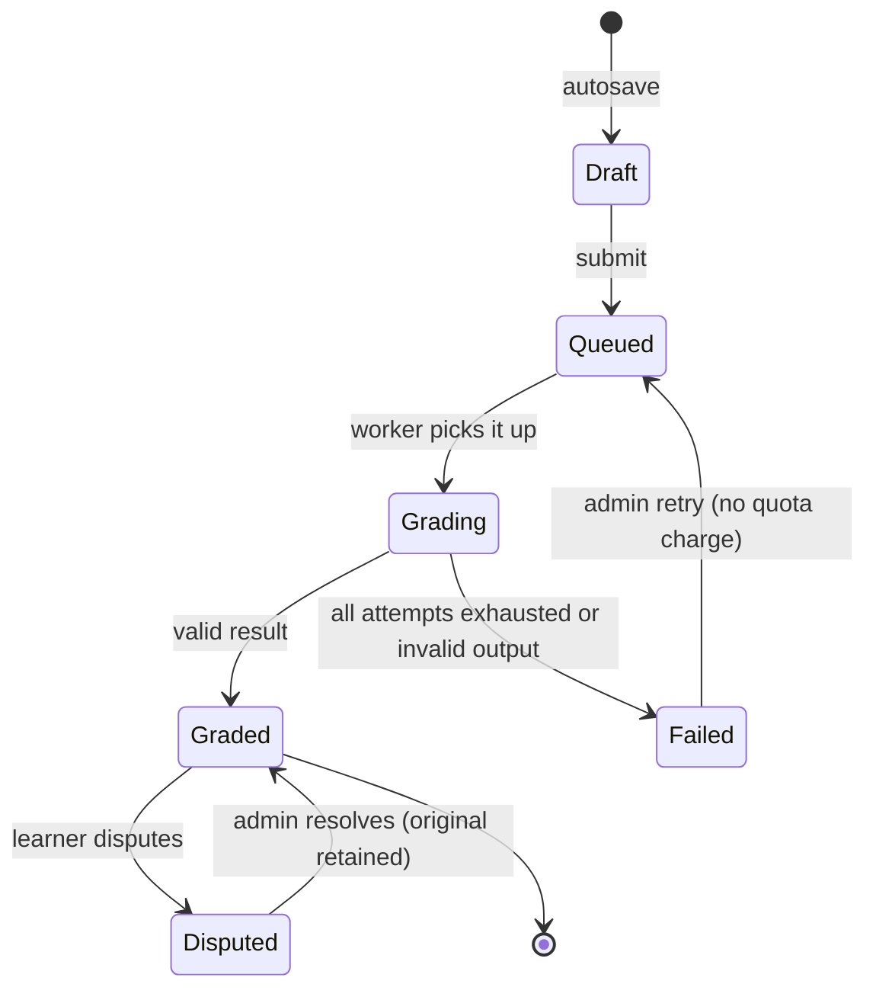

# writing — AGENT.md

> AI entry point for this module. Read [`/AGENT.md`](../../../AGENT.md) and
> [`/MODULE_INDEX.md`](../../../MODULE_INDEX.md) first if you have not.
> **Everything you need for this module is below. Do not scan other modules.**

| | |
|---|---|
| Tier | `learning` |
| Path | `internal/modules/writing` |
| Schema | `skill` |
| Delivery phase | 3 |
| Status | **IMPLEMENTED** |
| Owner | @learning-team |

---

## 1. Overview

<!-- BEGIN GENERATED: overview -->
Writing tasks, drafts, submissions and AI rubric grading. The most expensive feature in the product per use, and the one learners value most.
<!-- END GENERATED: overview -->

**Context.** Grading is asynchronous by necessity: a frontier model takes 10–30 seconds on a 250-word essay. The learner experience is therefore submit → 202 → streamed feedback, never a spinning request.

## 2. Responsibilities

<!-- BEGIN GENERATED: responsibilities -->
**This module owns:**

- Writing tasks: prompt, type (IELTS Task 1/2, email, essay, free), word bounds, time limit, rubric
- Drafts with autosave and revision history
- Submission lifecycle and idempotency
- AI rubric grading orchestration and streamed feedback
- Sub-scores per rubric criterion plus overall band
- Inline annotations mapped to text ranges
- Similarity checking against the learner's own history and a reference corpus

**This module does NOT own:**

- Calling a model directly — it asks `platform/ai` by task name
- The rubric's pedagogy — that lives in `docs/knowledge/cefr.md` and the prompt
- Awarding XP — that is `gamification`
<!-- END GENERATED: responsibilities -->

## 3. Entry points

<!-- BEGIN GENERATED: entrypoints -->
| File | Read it when |
|---|---|
| `internal/modules/writing/module.go` | You need to see what this module depends on and what it exposes |
| `internal/modules/writing/contract/` | You are calling this module from another module |
| `internal/modules/writing/service/` | You are changing behaviour |
| `db/migrations/writing/` | You need the real schema |
<!-- END GENERATED: entrypoints -->

## 4. Public API (contract)

Other modules may import **only** `internal/modules/writing/contract`.

<!-- BEGIN GENERATED: contract -->
| Kind | Name | Purpose |
|---|---|---|
| interface | `writing.Grader` | Implements `learning.ExerciseGrader`; always returns `Async: true` |
| interface | `writing.Reader` | `SubmissionHistory` — used by `analytics` and `admin` |

### Events

| Event | Direction | Payload summary |
|---|---|---|
| `writing.submission_created` | publishes | `{user_id, submission_id, task_id, word_count}` |
| `writing.graded` | publishes | `{user_id, submission_id, overall_band, criteria}` |
| `writing.grading_failed` | publishes | `{submission_id, reason}` |
<!-- END GENERATED: contract -->

## 5. Database schema

<!-- BEGIN GENERATED: schema -->
All tables live in the `skill` schema and are owned exclusively by this module (rule DB1).
Migrations: `db/migrations/writing/` · Queries: `db/queries/writing/`

| Table | Purpose | Key columns / notes |
|---|---|---|
| `skill.writing_feedback` | Grading output | `submission_id`, `criterion`, `score`, `comment`, `annotations` jsonb, `prompt_version`, `provider` |

<!-- END GENERATED: schema -->

## 6. HTTP endpoints

Full definitions are in [`api/openapi/openapi.yaml`](../../../api/openapi/openapi.yaml)
(tag: `writing`). Per-endpoint detail is in §15.

<!-- BEGIN GENERATED: endpoints -->
| Method | Path | Permission | Purpose |
|---|---|---|---|
| `GET` | `/api/v1/writing/tasks` | `content.read.published` | Available tasks by level and type |
| `PUT` | `/api/v1/writing/tasks/{id}/draft` | `self` | Autosave a draft |
| `POST` | `/api/v1/writing/submissions` | `self` | Submit for grading |
| `GET` | `/api/v1/writing/submissions/{id}` | `self` | Submission with feedback when ready |
| `GET` | `/api/v1/writing/submissions/{id}/stream` | `self` | SSE stream of grading progress and partial feedback |
| `GET` | `/api/v1/writing/submissions` | `self` | History with band progression |
| `POST` | `/api/v1/writing/submissions/{id}/dispute` | `self` | Flag a grade for human review |
| `GET` | `/api/v1/writing/attempts/{id}/feedback` | `self` | Read detailed writing feedback for an attempt |
<!-- END GENERATED: endpoints -->

## 7. Folder map

<!-- BEGIN GENERATED: folders -->
| Path | Contains |
|---|---|
| `contract/` | Interfaces, DTOs and event types other modules may import — the only public package |
| `domain/` | Entities, value objects, invariants, domain errors. Pure Go, no I/O |
| `service/` | Use cases, orchestration, transactions, event publishing |
| `repository/` | sqlc-generated queries and row↔domain mappers |
| `transport/http/` | Handlers, request/response DTOs, route registration |
| `job/` | Background job handlers owned by this module |
| `module.go` | `New(deps)` — wiring; the only symbol `cmd/` imports |
<!-- END GENERATED: folders -->

## 8. Related modules

<!-- BEGIN GENERATED: related -->
| Module | Direction | Why |
|---|---|---|
| [`ai`](../../platform/ai/AGENT.md) | → depends on | Rubric grading and quick hints |
| [`job`](../../platform/job/AGENT.md) | → depends on | Grading runs as a job |
| [`content`](../../modules/content/AGENT.md) | → depends on | Task definitions are content |
| [`learning`](../../modules/learning/AGENT.md) | → depends on | Attempt lifecycle and progress |
| [`notification`](../../modules/notification/AGENT.md) | → depends on | Tell the learner feedback is ready |
| [`learning`](../../modules/learning/AGENT.md) | ← used by | consumes this module's contract |
| [`analytics`](../../modules/analytics/AGENT.md) | ← used by | consumes this module's contract |
| [`gamification`](../../modules/gamification/AGENT.md) | ← used by | consumes this module's contract |
<!-- END GENERATED: related -->

**Boundary reminder:** you may call these through their `contract` package only.
Reaching into `service/`, `repository/`, `domain/` or their tables violates rules L1/L2
and fails `go-arch-lint` in CI.

## 9. Business rules

<!-- BEGIN GENERATED: rules -->
1. **BR-WRITING-01** — Grading is always asynchronous. The HTTP request returns 202 with a stream URL and never waits.
2. **BR-WRITING-02** — Word count bounds are enforced server-side before any model call — rejecting a 12-word essay costs nothing and should not cost a grading credit.
3. **BR-WRITING-03** — A submission body is immutable. A revision is a new submission, so band progression over time is real.
4. **BR-WRITING-04** — Quota and budget are checked before the job is enqueued, so a learner is told immediately rather than after a wait.
5. **BR-WRITING-05** — Sub-scores are validated against the rubric's range and checked for consistency with the overall band; an inconsistent result fails the job rather than reaching the learner.
6. **BR-WRITING-06** — Annotations reference character ranges in the immutable submitted body, so highlighting cannot drift.
7. **BR-WRITING-07** — Learner text is passed to the model only inside the untrusted-content wrapper.
8. **BR-WRITING-08** — If the learner has opted out of AI processing, submission is refused with a clear explanation rather than silently degraded.
9. **BR-WRITING-09** — A disputed grade is queued for admin review; the original feedback is retained alongside any correction.
10. **BR-WRITING-10** — Grading failure never counts against the learner's quota — the quota is decremented on success.
<!-- END GENERATED: rules -->

## 10. Common tasks

<!-- BEGIN GENERATED: tasks -->
### Add a writing task type

1. Add the type and its rubric to `docs/knowledge/cefr.md` and the rubric registry.
2. Create the task content kind and its schema.
3. Extend the runtime prompt input schema if the rubric shape differs — this means a new prompt version.
4. Add golden examples across CEFR levels to the eval suite and re-run it.
5. Add the editor variant in the web app.
6. Verify the band-consistency check still holds for the new rubric.
<!-- END GENERATED: tasks -->

## 11. Known limitations

<!-- BEGIN GENERATED: limitations -->
- Grading is single-pass; there is no second-opinion pass or model ensemble in Phase 3.
- Similarity checking covers the learner's own history and a small reference corpus only — it is not plagiarism detection against the web.
- Handwriting or image submission is not supported.
- Annotation ranges assume plain text; rich formatting is stripped before grading.
<!-- END GENERATED: limitations -->

## 12. Coding conventions (module-specific)

Global rules: [`docs/CONVENTIONS.md#coding-standard`](../../../docs/CONVENTIONS.md#coding-standard). Deviations and additions
for this module:

<!-- BEGIN GENERATED: conventions -->
_No deviations from the global standard._
<!-- END GENERATED: conventions -->

### Cache strategy

| Key | TTL | Invalidated by |
|---|---|---|
| `fluentra:{env}:writing:task:{task_id}:v1` | 24 h | Task republished |

### Error codes owned by this module

| Code | Status | Meaning |
|---|---|---|
| `SUBMISSION_TOO_SHORT` | 422 | Below the task's minimum word count |
| `SUBMISSION_TOO_LONG` | 422 | Above the maximum |
| `SUBMISSION_ALREADY_GRADED` | 409 | Immutable once graded |
| `GRADING_FAILED` | 500 | All grading attempts failed |
| `DISPUTE_ALREADY_OPEN` | 409 | One open dispute per submission |

### Security considerations

- Essays are sensitive personal content: only the author and an admin with an audited reason may read one.
- The prompt-injection defence is layered — wrapper, hardened preamble, schema validation, band clamping, and a red-team eval suite that must score 1.0.
- Similarity checking never exposes another learner's text; it reports a score, not a source.

## 13. Testing

<!-- BEGIN GENERATED: testing -->
Coverage target: **80% service, 90% domain**

```bash
go test ./internal/modules/writing/...                    # unit
go test -tags=integration ./internal/modules/writing/...  # integration (testcontainers)
```

**Focus areas**

- Word bounds rejected before any model call
- Idempotent submission
- Async attempt completes only on `writing.graded`, idempotently
- Band clamping and cross-criterion consistency
- Prompt-injection fixtures do not move the band
- Failure does not consume quota
- SSE reconnection resumes from `Last-Event-ID`
- Disputes preserve the original feedback
<!-- END GENERATED: testing -->

## 14. Do NOT

<!-- BEGIN GENERATED: donot -->
- Do not grade synchronously.
- Do not call a provider SDK — use `platform/ai` by task name.
- Do not trust the model's band without clamping and a consistency check.
- Do not charge quota for a failed grading.
- Do not mutate a submitted body.
- Do not put learner text into the instruction block of a prompt.
<!-- END GENERATED: donot -->

## 15. API detail

### Endpoint detail

<!-- BEGIN GENERATED: api-detail -->
#### `GET /api/v1/writing/tasks`

Available tasks by level and type

| | |
|---|---|
| Permission | `content.read.published` |
| Success | 200 |
| Errors | standard set |

#### `PUT /api/v1/writing/tasks/{id}/draft`

Autosave a draft

| | |
|---|---|
| Permission | `self` |
| Success | 200 |
| Errors | standard set |

#### `POST /api/v1/writing/submissions`

Submit for grading

| | |
|---|---|
| Permission | `self` |
| Success | 202 |
| Errors | `SUBMISSION_TOO_SHORT`, `SUBMISSION_TOO_LONG`, `AI_QUOTA_EXCEEDED`, `AI_OPTED_OUT` |
| Notes | Requires an `Idempotency-Key`; returns a stream URL |

#### `GET /api/v1/writing/submissions/{id}`

Submission with feedback when ready

| | |
|---|---|
| Permission | `self` |
| Success | 200 |
| Errors | standard set |

#### `GET /api/v1/writing/submissions/{id}/stream`

SSE stream of grading progress and partial feedback

| | |
|---|---|
| Permission | `self` |
| Success | 200 |
| Errors | standard set |

#### `GET /api/v1/writing/submissions`

History with band progression

| | |
|---|---|
| Permission | `self` |
| Success | 200 |
| Errors | standard set |

#### `POST /api/v1/writing/submissions/{id}/dispute`

Flag a grade for human review

| | |
|---|---|
| Permission | `self` |
| Success | 202 |
| Errors | standard set |

#### `GET /api/v1/writing/attempts/{id}/feedback`

Read detailed writing feedback for an attempt

| | |
|---|---|
| Permission | `self` |
| Success | 200 |
| Errors | standard set |

<!-- END GENERATED: api-detail -->

### Error codes

<!-- BEGIN GENERATED: api-errors -->
| Code | Status | Meaning |
|---|---|---|
| `SUBMISSION_TOO_SHORT` | 422 | Below the task's minimum word count |
| `SUBMISSION_TOO_LONG` | 422 | Above the maximum |
| `SUBMISSION_ALREADY_GRADED` | 409 | Immutable once graded |
| `GRADING_FAILED` | 500 | All grading attempts failed |
| `DISPUTE_ALREADY_OPEN` | 409 | One open dispute per submission |
<!-- END GENERATED: api-errors -->

### Rate limits

<!-- BEGIN GENERATED: api-rate -->
Standard limits apply — see [/docs/CONVENTIONS.md](../../../docs/CONVENTIONS.md#rate-limiting).
<!-- END GENERATED: api-rate -->

## 16. Flows

### Submit and stream feedback

```mermaid
sequenceDiagram
    autonumber
    actor U as Learner
    participant W as writing
    participant DB as PostgreSQL
    participant K as worker
    participant AI as platform/ai

    U->>W: POST /writing/submissions (Idempotency-Key)
    W->>W: word bounds, task validity, quota, opt-out
    W->>DB: BEGIN; INSERT submission(status=queued)
    W->>DB: INSERT river_job(writing.grade); INSERT outbox(submission_created); COMMIT
    W-->>U: 202 { submission_id, stream_url }
    U->>W: GET /writing/submissions/{id}/stream (SSE)

    K->>AI: Run(writing.grade_essay, { essay, rubric, level, locale })
    AI-->>K: streamed chunks
    K->>DB: append partial feedback
    K-->>W: chunk (pg NOTIFY)
    W-->>U: SSE chunk
    AI-->>K: final structured result
    K->>K: validate schema, clamp bands, consistency check
    alt invalid
        K->>DB: status=failed; do not consume quota
        W-->>U: SSE error with a safe message
    else valid
        K->>DB: BEGIN; UPDATE submission(graded, bands); INSERT feedback
        K->>DB: consume quota; INSERT outbox(writing.graded); COMMIT
        W-->>U: SSE done
    end
```

<!-- END GENERATED: flows -->

<!-- BEGIN GENERATED: states -->
### State machine



<!-- END GENERATED: states -->

### Failure paths

<!-- BEGIN GENERATED: failures -->
| Failure | Detected by | Behaviour |
|---|---|---|
| All AI providers down | `AI_UNAVAILABLE` from the chain | Job retries with backoff for up to an hour; the learner sees "still grading"; no quota charged |
| Output fails schema after repair | `ai_schema_violation_total` | Job fails; alert if the rate exceeds 5 %; the prompt version is a suspect |
| Learner disconnects mid-stream | SSE connection closed | Grading continues; partials are persisted; the result is waiting when they return |
<!-- END GENERATED: failures -->

## 17. Decisions

### Decisions taken

<!-- BEGIN GENERATED: decisions -->
| Question | Decision | Rationale |
|---|---|---|
| Synchronous or asynchronous grading? | Asynchronous with polling | 10–30 seconds is outside an acceptable request budget; adaptive polling on attempt status replaces SSE streaming with simpler reconnect and delivery semantics |
| Charge quota on submit or on success? | On success | A learner should never lose a credit to our infrastructure failure |
| Allow editing a submission? | No — resubmit instead | Band progression only means something if each submission is a fixed artefact |
<!-- END GENERATED: decisions -->

### Related repository ADRs

<!-- BEGIN GENERATED: decisions-adr -->
_None specific to this module._
<!-- END GENERATED: decisions-adr -->

### Open questions

<!-- BEGIN GENERATED: decisions-open -->
_None._
<!-- END GENERATED: decisions-open -->

## 18. Backlog

### Phase 3

- [ ] Tasks, drafts with autosave, revision snapshots
- [ ] Submission with idempotency and server-side bounds
- [ ] Async grading job calling `writing.grade_essay`
- [ ] SSE streaming with partial persistence and reconnection
- [ ] Band and criterion validation with clamping
- [ ] Feedback rendering with inline annotations
- [ ] History view with band progression
- [ ] Dispute flow and admin review queue
- [ ] Red-team eval suite for injection
<!-- END GENERATED: todo -->

### Deferred (deliberately not doing yet)

<!-- BEGIN GENERATED: todo-deferred -->
_Nothing deferred._
<!-- END GENERATED: todo-deferred -->

### Future improvements

<!-- BEGIN GENERATED: todo-future -->
- Second-opinion grading for borderline bands
- Model ensemble for high-stakes submissions
- Guided revision with tracked improvement
- Peer review
<!-- END GENERATED: todo-future -->

### Shipped in work orders 10 & 11

The boxes above are unticked because docgen renders every generated item that
way. What exists in code today:

- [x] `writing.Grader` implements `learning.ExerciseGrader` for
      `writing_prompt`, registered through `cmd/api/modules.go` and rendered by
      `ExerciseWriting.tsx`.
- [x] `writing_grade.v1.md` and `writing_grade.v2.md` prompts.
- [x] Background grading via River worker (`writingjob.GradeSubmissionWorker`).
- [x] `skill.writing_feedback` table storing structured IELTS feedback (criteria, located annotations, band scores).
- [x] `GET /writing/attempts/{id}/feedback` endpoint for reading learner feedback.
- [x] Grading guarantees, corrected in review on 2026-09-12. There is no synchronous path: without
      a queue the grader refuses with `WRITING_QUEUE_UNAVAILABLE` (BR-WRITING-01). No AI provider
      is an error, never a default band. Model output is checked against the rubric — score 0–100,
      bands 0–9, exactly four criteria — before it is stored. A provider error fails the attempt
      only on River's last attempt, so a retry can still grade it.

#### Schema rationalisation (tables retired)

- `writing_tasks`: prompts and rubrics are authored directly into `content.versions` (kind `writing_prompt`), eliminating a duplicate tasks table.
- `writing_drafts`: drafts are saved client-side in localStorage (`fluentra.writing_draft.<activityId>`), eliminating ephemeral database writes.
- `writing_revisions`: draft revisions are handled locally; server-side snapshot history is deferred until high-stakes exam tracking is built.

The only table `writing` owns is `writing_feedback`.

---

_Generated by `tools/docgen` from `tools/docgen/data/`. Hand-written text outside the
GENERATED markers is preserved. Update the manifest, then run `make docs`._
