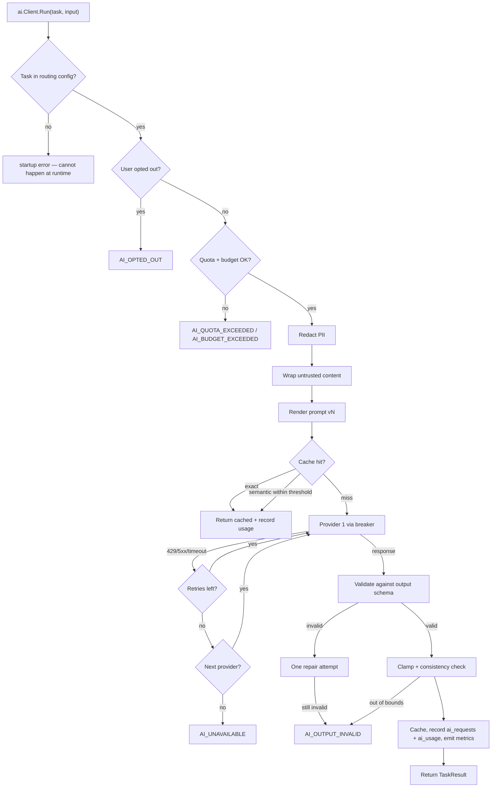
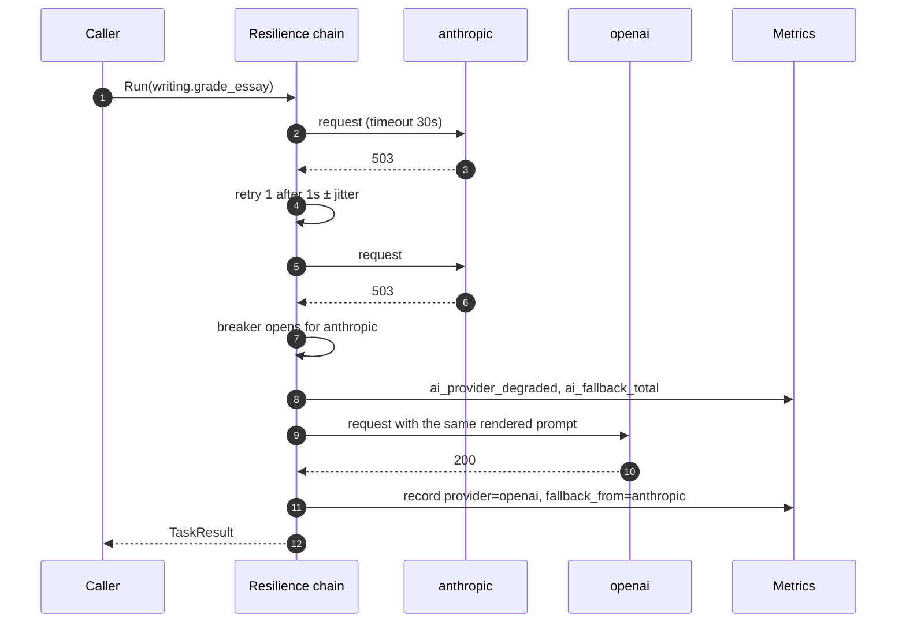
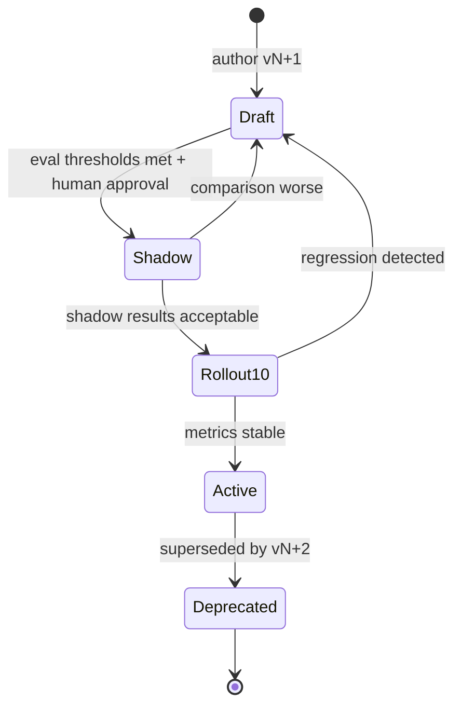

# ai — AGENT.md

> AI entry point for this module. Read [`/AGENT.md`](../../../AGENT.md) and
> [`/MODULE_INDEX.md`](../../../MODULE_INDEX.md) first if you have not.
> **Everything you need for this module is below. Do not scan other modules.**

---

## 0. What is built — read this before anything below it

The rest of this file is the module's **specification**. What exists today connects
the vocabulary upload verification job through `Router`, backed by persistent PostgreSQL
caching (`ai.ai_cache_entries`), budget enforcement (`ai.ai_budgets`), and usage auditing (`ai.ai_requests`, `ai.ai_usage`).

| Built | Not built |
|---|---|
| `ai.Client` — the one interface business code sees | Task routing by model tier |
| Versioned prompt registry with front-matter settings | Semantic caching (pgvector) |
| `MockProvider` — offline, the default | Circuit breaker |
| `OpenAICompatibleProvider` with named instances (Cerebras, Groq, Mistral, Ollama) | PII redaction, untrusted-content wrapping |
| `CompleteJSON` — tolerant structured-output parsing | Streaming, output repair pass, eval harness |
| `Router` — retry, backoff, multi-provider fallback chain | Quota per user — `ai.Request` carries no user id and `ai.ai_requests.user_id` is always NULL |
| 4 numbered provider slots (`AI_PROVIDER_1_*` .. `AI_PROVIDER_4_*`) | |
| Global daily budget enforcement (`DBBudgetChecker` against `ai.ai_budgets`) | |
| Exact-hash response caching (`MemoryCache` & `DBCache` on `ai.ai_cache_entries`) | |
| Usage & request auditing (`DBUsageRecorder` on `ai.ai_requests` & `ai.ai_usage`) | |

**Nothing on a request path, and nothing a learner is graded by, may use this
module until the rest of the specification is built.** There is no budget
ceiling, so an unbounded caller is an unbounded bill; there is no retry, so a
transient failure is a failed unit of work; and there is no usage trail, so a
cost cannot be attributed after the fact.

### Configuration

Runtime routers built by `ai.New` distribute uncached requests round-robin across
configured slots, while preserving each provider's budget check and independent
verifier model exclusions. Each provider attempt has a 45-second router deadline
(or a shorter adapter timeout); a deadline or permanent 4xx moves directly to the
next provider instead of retrying the stalled/refusing provider three times.
Parent cancellation never starts another provider. `RouterOptions` permits test
or composition overrides for balancing and attempt timeout.

This distributes independent calls; it does not fan out duplicate paid requests
or parallelize the individual items inside a vocabulary batch. River queue
concurrency remains the deployment's `WORKER_QUEUES` setting (default `ai:4`).

One adapter serves every OpenAI-compatible server, so the provider is two
environment variables. `.env.example` carries worked examples for Ollama,
OpenRouter and Groq. `AI_PROVIDER=mock` is the default so `make dev` works with
no key and no internet — and because it accepts every word it is given, a real
deployment must not leave it set.

### Where the prompts live

`internal/platform/ai/prompts/`, not `docs/prompts/runtime/`. Rule L11's intent
is met — versioned `.md` files, reviewable on their own, no prompt string in Go
— but two mechanics moved the folder: `//go:embed` cannot reach outside its own
package directory, and `.go-arch-lint.yml` sets `workdir: internal`, so a
package under `docs/` is outside every component it can declare.

| | |
|---|---|
| Tier | `platform` |
| Path | `internal/platform/ai` |
| Schema | `ai` |
| Delivery phase | 3 |
| Status | **IN_PROGRESS** |
| Owner | @ai-team |

---

## 1. Overview

<!-- BEGIN GENERATED: overview -->
The single door through which every LLM call passes. Business code asks for an **AI task** by name; this module decides which provider and model serve it, renders the versioned prompt, enforces quota and budget, caches, retries, falls back, validates the structured output, and records cost and usage.
<!-- END GENERATED: overview -->

**Context.** No other module may import a provider SDK (rule: `AGENT.md` §10). That rule is what makes the model choice a configuration decision instead of a code change, and what makes cost, quality and safety controllable in one place.

## 2. Responsibilities

<!-- BEGIN GENERATED: responsibilities -->
**This module owns:**

- Provider registry and adapters (anthropic, openai, gemini, openrouter, local, mock)
- Task routing: task → model tier → concrete model, from configuration
- Prompt registry: versioned templates with typed input and output schemas
- Resilience: timeout, retry with backoff, circuit breaker, provider fallback chain
- Caching: exact-hash and semantic (pgvector) with per-task policy
- Quota (per user) and budget (global daily) enforcement
- PII redaction before send and untrusted-content wrapping
- Structured output validation, one repair attempt, and sanity bounds
- Streaming (SSE) with partial persistence
- Usage, cost, latency and quality metrics; the `ai_requests` / `ai_usage` audit trail
- The evaluation harness that gates prompt changes

**This module does NOT own:**

- Deciding what a good essay score is — the rubric belongs to `writing`
- Storing a graded submission — that is the calling module's data
- Speech recognition or synthesis — that is `platform/media`
- Choosing when to call an LLM — see `docs/AI.md#working-with-and-building-on-llms` §B2 before you do
<!-- END GENERATED: responsibilities -->

## 3. Entry points

<!-- BEGIN GENERATED: entrypoints -->
| File | Read it when |
|---|---|
| `internal/platform/ai/module.go` | You need to see what this module depends on and what it exposes |
| `internal/platform/ai/contract/` | You are calling this module from another module |
| `internal/platform/ai/service/` | You are changing behaviour |
| `db/migrations/ai/` | You need the real schema |
<!-- END GENERATED: entrypoints -->

## 4. Public API (contract)

Other modules may import **only** `internal/platform/ai/contract`.

<!-- BEGIN GENERATED: contract -->
| Kind | Name | Purpose |
|---|---|---|
| interface | `ai.Client` | `Run(ctx, TaskRequest) (TaskResult, error)` and `Stream(ctx, TaskRequest) (iter, error)` — the only surface business code touches |
| struct | `ai.TaskRequest` | `{Task, Input (typed), UserID, Locale, IdempotencyKey}` — never a model name, never a raw prompt |
| struct | `ai.TaskResult` | `{Output (validated JSON), Provider, Model, PromptVersion, Tokens, CostUSD, CacheHit}` |
| interface | `ai.Provider` | The Strategy interface each adapter implements — internal, not for business code |

### Events

| Event | Direction | Payload summary |
|---|---|---|
| `ai.budget_threshold_reached` | publishes | `{scope, percent, date}` |
| `ai.provider_degraded` | publishes | `{provider, reason}` |
<!-- END GENERATED: contract -->

## 5. Database schema

<!-- BEGIN GENERATED: schema -->
All tables live in the `ai` schema and are owned exclusively by this module (rule DB1).
Migrations: `db/migrations/ai/` · Queries: `db/queries/ai/`

| Table | Purpose | Key columns / notes |
|---|---|---|
| `ai.ai_requests` | One row per LLM call | Partitioned monthly. `task`, `prompt_version`, `provider`, `model`, `status`, `attempt`, `fallback_from`, `cache_hit`, `latency_ms`, `trace_id`. Request/response bodies redacted and retained 30 days. |
| `ai.ai_usage` | Cost attribution | `user_id`, `task`, `tokens_in`, `tokens_out`, `cost_usd`, `occurred_on` — the source for per-user unit economics |
| `ai.prompt_versions` | Registry of deployed prompt versions | `task`, `version`, `status` (draft/shadow/active/deprecated), `checksum`, `activated_at` |
| `ai.ai_cache_entries` | Response cache index | `input_hash` UNIQUE, `task`, `prompt_version`, `embedding vector(1536)` for semantic lookup, `expires_at` |
| `ai.ai_budgets` | Daily spend accounting | `scope` (global/user), `date`, `spent_usd`, `cap_usd` |

<!-- END GENERATED: schema -->

## 6. HTTP endpoints

Full definitions are in [`api/openapi/openapi.yaml`](../../../api/openapi/openapi.yaml)
(tag: `ai`). Per-endpoint detail is in §15.

<!-- BEGIN GENERATED: endpoints -->
| Method | Path | Permission | Purpose |
|---|---|---|---|
| `GET` | `/api/v1/admin/ai/usage` | `ai.read` | Spend and volume by task, provider and day |
| `GET` | `/api/v1/admin/ai/requests/{id}` | `ai.read` | Inspect one call for debugging |
| `GET` | `/api/v1/admin/ai/prompts` | `ai.read` | Deployed prompt versions and their status |
| `POST` | `/api/v1/admin/ai/prompts/{task}/activate` | `ai.manage` | Promote a prompt version |
| `GET` | `/api/v1/admin/ai/budget` | `ai.read` | Budget consumption today |
<!-- END GENERATED: endpoints -->

## 7. Folder map

<!-- BEGIN GENERATED: folders -->
| Path | Contains |
|---|---|
| `contract/` | Interfaces, DTOs and event types other modules may import — the only public package |
| `domain/` | Entities, value objects, invariants, domain errors. Pure Go, no I/O |
| `service/` | Use cases, orchestration, transactions, event publishing |
| `repository/` | sqlc-generated queries and row↔domain mappers |
| `transport/http/` | Handlers, request/response DTOs, route registration |
| `job/` | Background job handlers owned by this module |
| `module.go` | `New(deps)` — wiring; the only symbol `cmd/` imports |
<!-- END GENERATED: folders -->

## 8. Related modules

<!-- BEGIN GENERATED: related -->
| Module | Direction | Why |
|---|---|---|
| [`cache`](../../platform/cache/AGENT.md) | → depends on | Response cache, quota counters, provider circuit state |
| [`telemetry`](../../platform/telemetry/AGENT.md) | → depends on | Spans and metrics on every call |
| [`job`](../../platform/job/AGENT.md) | → depends on | Long-running calls execute inside jobs; evals run on a schedule |
| [`writing`](../../modules/writing/AGENT.md) | ← used by | consumes this module's contract |
| [`speaking`](../../modules/speaking/AGENT.md) | ← used by | consumes this module's contract |
| [`grammar`](../../modules/grammar/AGENT.md) | ← used by | consumes this module's contract |
| [`questionbank`](../../modules/questionbank/AGENT.md) | ← used by | consumes this module's contract |
| [`content`](../../modules/content/AGENT.md) | ← used by | consumes this module's contract |
| [`reading`](../../modules/reading/AGENT.md) | ← used by | consumes this module's contract |
| [`media`](../../platform/media/AGENT.md) | ← used by | consumes this module's contract |
| [`learning`](../../modules/learning/AGENT.md) | ← used by | consumes this module's contract |
<!-- END GENERATED: related -->

**Boundary reminder:** you may call these through their `contract` package only.
Reaching into `service/`, `repository/`, `domain/` or their tables violates rules L1/L2
and fails `go-arch-lint` in CI.

## 9. Business rules

<!-- BEGIN GENERATED: rules -->
1. **BR-AI-01** — Business code names a **task**, never a model or a provider. A task not present in the routing config is a startup error, not a runtime surprise.
2. **BR-AI-02** — Prompts are loaded from `internal/platform/ai/prompts/<task>.v<N>.md`; a published version is immutable, and the active version is pinned by configuration.
3. **BR-AI-03** — Learner-supplied text is inserted only inside the untrusted-content wrapper; it is never concatenated into the instruction block.
4. **BR-AI-04** — Output must validate against the task's JSON schema. One repair attempt is allowed; a second failure fails the call with `AI_OUTPUT_INVALID`.
5. **BR-AI-05** — Numeric outputs are clamped to the rubric's range and cross-checked for internal consistency before being returned.
6. **BR-AI-06** — Every call checks the per-user quota and the global daily budget first; exceeding either fails fast without contacting a provider.
7. **BR-AI-07** — Retries apply only to 429, 5xx and timeouts. A refusal, a schema failure, or a content-policy rejection is not retried against the same provider.
8. **BR-AI-08** — When a provider's circuit is open, the next provider in the task's fallback chain is used and the substitution is recorded.
9. **BR-AI-09** — No call blocks an HTTP request for more than 2 seconds; anything longer runs in a job and streams or notifies.
10. **BR-AI-10** — Every call writes `ai_requests` and `ai_usage`, including cache hits and failures — otherwise cost attribution has holes.
11. **BR-AI-11** — In tests, the `mock` provider is used. Unit and integration tests never reach a network.
12. **BR-AI-12** — A prompt version cannot be activated unless its eval suite meets its thresholds and is no worse than the currently active version.
<!-- END GENERATED: rules -->

## 10. Common tasks

<!-- BEGIN GENERATED: tasks -->
### Add a provider

1. Create `provider/<name>/` implementing `ai.Provider`. The vendor SDK may be imported **only** inside this directory.
2. Map vendor errors onto the module's retryable/non-retryable classification.
3. Add config keys and register the provider in the registry.
4. Add `mock` fixtures so tests covering this provider stay offline.
5. Add it to the fallback chains that should use it, in config.
6. Run the eval suites against it and record the results in `docs/ai/provider-comparison.md`.

### Add an AI task

1. Follow the checklist in `docs/AI.md#working-with-and-building-on-llms` §B4 — it is the authoritative list.
2. Define the task in the routing config with tier, timeout, cache policy and budget.
3. Write `internal/platform/ai/prompts/<task>.v1.md` plus input and output schemas.
4. Build the golden set (≥ 30 examples) and `thresholds.yaml`, including red-team cases.
5. Add `mock` fixtures.
6. Call it from the owning module by task name only.

### Change the model for a task

1. Edit the routing config — **do not touch Go code**.
2. Run the eval suite; compare cost and quality deltas.
3. Shadow, then 10 %, then 100 %.
4. Record the change and its measured effect in `docs/ai/cost-model.md`.
<!-- END GENERATED: tasks -->

## 11. Known limitations

<!-- BEGIN GENERATED: limitations -->
- Semantic caching depends on `pgvector` and an embedding call, which itself costs money — it is enabled only for tasks where the hit rate justifies it.
- The repair attempt is a single retry with the validation error appended; there is no multi-turn negotiation.
- Streaming partials are persisted per chunk, which is chatty for long outputs.
- Cost figures are computed from a published price table in config and can drift from actual invoices; monthly reconciliation is manual.
<!-- END GENERATED: limitations -->

## 12. Coding conventions (module-specific)

Global rules: [`docs/CONVENTIONS.md#coding-standard`](../../../docs/CONVENTIONS.md#coding-standard). Deviations and additions
for this module:

<!-- BEGIN GENERATED: conventions -->
- Vendor SDK types never leave `provider/<name>/`.
- No prompt string literal anywhere in Go code.
- Every provider adapter has a `mock` fixture set covering success, refusal, timeout, rate limit and malformed output.
<!-- END GENERATED: conventions -->

### Cache strategy

| Key | TTL | Invalidated by |
|---|---|---|
| `fluentra:{env}:ai:resp:{task}:{prompt_version}:{input_hash}:v1` | per task (see docs/AI.md#prompt-library §2.5) | Prompt version bump |
| `fluentra:{env}:ai:quota:{user_id}:{date}:v1` | until midnight in the user's timezone | Natural expiry |
| `fluentra:{env}:ai:budget:{date}:v1` | 48 h | Natural expiry |
| `fluentra:{env}:ai:breaker:{provider}:v1` | 30 s | Half-open probe |

### Error codes owned by this module

| Code | Status | Meaning |
|---|---|---|
| `AI_QUOTA_EXCEEDED` | 429 | Per-user daily limit reached |
| `AI_BUDGET_EXCEEDED` | 503 | Global daily spend cap reached; non-critical tasks are shed first |
| `AI_UNAVAILABLE` | 503 | Every provider in the chain failed |
| `AI_TIMEOUT` | 504 | Provider exceeded the task timeout |
| `AI_OUTPUT_INVALID` | 500 | Output failed schema validation after the repair attempt |
| `AI_CONTENT_FLAGGED` | 422 | Moderation blocked the input |
| `AI_OPTED_OUT` | 403 | The user disabled AI processing |
| `EVAL_THRESHOLD_NOT_MET` | 409 | Prompt promotion blocked by its eval suite |

### Security considerations

- Provider API keys live in configuration only and never appear in a span, a log, or an error.
- PII redaction runs before send; the redaction map is retained only long enough to restore names in the response.
- Only providers contractually barred from training on API data receive learner content; `openrouter` is restricted to non-personal input.
- The untrusted-content wrapper plus a hardened system preamble is the primary prompt-injection defence; the eval suite includes a red-team subset that must score 1.0.
- Score sanity bounds are the second line of defence: an out-of-range or internally inconsistent score fails the job rather than reaching the learner.

## 13. Testing

<!-- BEGIN GENERATED: testing -->
Coverage target: **85% service, 90% domain**

```bash
go test ./internal/platform/ai/...                    # unit
go test -tags=integration ./internal/platform/ai/...  # integration (testcontainers)
```

**Focus areas**

- Fallback chain: killing provider 1 must produce a correct result from provider 2 with the substitution recorded
- Quota and budget enforcement, including the boundary at exactly the cap
- Schema validation and the single repair attempt
- Score clamping and consistency checks reject an out-of-range score
- Prompt injection: red-team fixtures must not change the output score
- Cache correctness: a different input must never return a cached response
- Cost accounting matches the token counts reported by the provider
- Streaming: a disconnect mid-stream does not lose already-generated content
<!-- END GENERATED: testing -->

## 14. Do NOT

<!-- BEGIN GENERATED: donot -->
- Do not import a provider SDK outside `provider/<name>/`.
- Do not name a model in business code — name a task.
- Do not inline a prompt string.
- Do not call an LLM synchronously in an HTTP handler for anything expected to take more than 2 seconds.
- Do not trust model output — validate the schema, clamp the numbers, check the consistency.
- Do not concatenate learner text into the instruction block.
- Do not skip the eval suite because "it's a small prompt change". That is exactly when regressions slip through.
- Do not use an LLM where an algorithm exists — read `docs/AI.md#working-with-and-building-on-llms` §B2 first.
<!-- END GENERATED: donot -->

## 15. API detail

### Endpoint detail

<!-- BEGIN GENERATED: api-detail -->
#### `GET /api/v1/admin/ai/usage`

Spend and volume by task, provider and day

| | |
|---|---|
| Permission | `ai.read` |
| Success | 200 |
| Errors | standard set |

#### `GET /api/v1/admin/ai/requests/{id}`

Inspect one call for debugging

| | |
|---|---|
| Permission | `ai.read` |
| Success | 200 |
| Errors | standard set |
| Notes | Bodies are redacted; full content requires `ai.read.sensitive` and is itself audited |

#### `GET /api/v1/admin/ai/prompts`

Deployed prompt versions and their status

| | |
|---|---|
| Permission | `ai.read` |
| Success | 200 |
| Errors | standard set |

#### `POST /api/v1/admin/ai/prompts/{task}/activate`

Promote a prompt version

| | |
|---|---|
| Permission | `ai.manage` |
| Success | 200 |
| Errors | `EVAL_THRESHOLD_NOT_MET` |

#### `GET /api/v1/admin/ai/budget`

Budget consumption today

| | |
|---|---|
| Permission | `ai.read` |
| Success | 200 |
| Errors | standard set |

<!-- END GENERATED: api-detail -->

### Error codes

<!-- BEGIN GENERATED: api-errors -->
| Code | Status | Meaning |
|---|---|---|
| `AI_QUOTA_EXCEEDED` | 429 | Per-user daily limit reached |
| `AI_BUDGET_EXCEEDED` | 503 | Global daily spend cap reached; non-critical tasks are shed first |
| `AI_UNAVAILABLE` | 503 | Every provider in the chain failed |
| `AI_TIMEOUT` | 504 | Provider exceeded the task timeout |
| `AI_OUTPUT_INVALID` | 500 | Output failed schema validation after the repair attempt |
| `AI_CONTENT_FLAGGED` | 422 | Moderation blocked the input |
| `AI_OPTED_OUT` | 403 | The user disabled AI processing |
| `EVAL_THRESHOLD_NOT_MET` | 409 | Prompt promotion blocked by its eval suite |
<!-- END GENERATED: api-errors -->

### Rate limits

<!-- BEGIN GENERATED: api-rate -->
Standard limits apply — see [/docs/CONVENTIONS.md](../../../docs/CONVENTIONS.md#rate-limiting).
<!-- END GENERATED: api-rate -->

## 16. Flows

### A task call, end to end



### Provider fallback

Fallback is per task, not global — a cheap task may have no fallback at all, while grading has two.



<!-- END GENERATED: flows -->

<!-- BEGIN GENERATED: states -->
### State machine

Prompt version lifecycle. A version never returns to an earlier state; rollback means activating the previous version, not editing this one.



<!-- END GENERATED: states -->

### Failure paths

<!-- BEGIN GENERATED: failures -->
| Failure | Detected by | Behaviour |
|---|---|---|
| All providers down | `ai_requests_total{result="unavailable"}` | Job retries with backoff; the learner sees "still grading", not an error; pages after 5 minutes |
| Provider silently changes a model behind an alias | Nightly eval score shift | Alert; models are pinned to exact IDs to make this rare |
| Schema violations spike after a prompt change | `ai_schema_violation_total` | Automatic rollback to the previous active version at > 5 % over 30 minutes |
| Cost spike | `ai_cost_usd_total` rate | 80 % budget alert; at 100 % non-critical tasks are shed while grading continues |
<!-- END GENERATED: failures -->

## 17. Decisions

### Decisions taken

<!-- BEGIN GENERATED: decisions -->
| Question | Decision | Rationale |
|---|---|---|
| Task-based or model-based API? | Task-based | Callers should not know or care which model runs; it makes model changes a config decision, keeps routing and cost policy in one place, and makes the eval story coherent |
| Where do prompts live? | Versioned Markdown in `internal/platform/ai/prompts/` | Reviewable by non-engineers, diffable, evaluable in CI, rollback-able by config — none of which is true of a Go string constant |
| Fail open or closed on budget exhaustion? | Shed non-critical tasks, keep grading | A learner who paid for grading should still get it; example-sentence generation can wait |
| Semantic cache everywhere? | Only where measured hit rate justifies the embedding cost | An embedding call to save a small-model call can be a net loss |
<!-- END GENERATED: decisions -->

### Related repository ADRs

<!-- BEGIN GENERATED: decisions-adr -->
- [ADR-0011](../../../docs/adr/ADR-0011-ai-provider-abstraction.md) — Task-based AI provider abstraction
- [ADR-0012](../../../docs/adr/ADR-0012-prompt-versioning.md) — Prompts as versioned, evaluated artefacts
<!-- END GENERATED: decisions-adr -->

### Open questions

<!-- BEGIN GENERATED: decisions-open -->
- Do we self-host a small model for high-volume cheap tasks once volume justifies it?
- Should the semantic cache be per-user or global for privacy-sensitive tasks?
<!-- END GENERATED: decisions-open -->

## 18. Backlog

### Phase 3 — foundation

- [ ] Provider interface, registry and the `mock` provider
- [ ] Anthropic and OpenAI adapters
- [ ] Routing config with tiers, timeouts and budgets
- [ ] Prompt registry loading versioned templates with schemas
- [ ] Resilience chain: timeout, retry, breaker, fallback
- [ ] Quota and budget enforcement
- [ ] `ai_requests` / `ai_usage` recording and the cost dashboard
- [ ] Output schema validation, repair, clamping
- [ ] Untrusted-content wrapper and PII redaction
- [ ] Eval harness and the CI gate

### Phase 3 — extensions

- [ ] Gemini and OpenRouter adapters
- [ ] Exact-hash response cache
- [ ] SSE streaming with partial persistence
- [ ] Semantic cache with pgvector
<!-- END GENERATED: todo -->

### Completed resilience repair (2026-10-01)

- [x] Balance independent uncached requests across configured providers while
  retaining quota checks, cache policy and independent-model exclusions.
- [x] Bound provider attempts and skip repeated timeouts/permanent 4xx before
  fallback; prove cancellation and concurrent balancing with race-safe tests.

Individual vocabulary-batch item concurrency and a provider circuit breaker
remain separate work; this repair does not add speculative duplicate calls.

### Deferred (deliberately not doing yet)

<!-- BEGIN GENERATED: todo-deferred -->
_Nothing deferred._
<!-- END GENERATED: todo-deferred -->

### Future improvements

<!-- BEGIN GENERATED: todo-future -->
- Automatic model selection from measured quality-per-dollar
- Per-learner model preference for feedback style
- Batch API usage for non-urgent tasks
- Self-hosted small model for high-volume tasks
<!-- END GENERATED: todo-future -->

---

_Generated by `tools/docgen` from `tools/docgen/data/`. Hand-written text outside the
GENERATED markers is preserved. Update the manifest, then run `make docs`._
