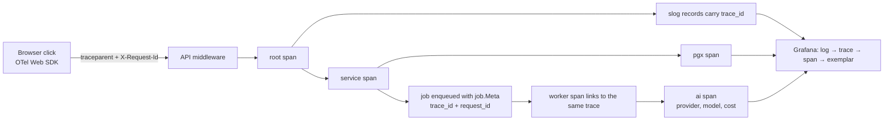

# telemetry — AGENT.md

> AI entry point for this module. Read [`/AGENT.md`](../../../AGENT.md) and
> [`/MODULE_INDEX.md`](../../../MODULE_INDEX.md) first if you have not.
> **Everything you need for this module is below. Do not scan other modules.**

| | |
|---|---|
| Tier | `platform` |
| Path | `internal/platform/telemetry` |
| Schema | `none` |
| Delivery phase | 1 |
| Status | **IN_PROGRESS** |
| Owner | @platform-team |

---

## 1. Overview

<!-- BEGIN GENERATED: overview -->
OpenTelemetry setup and the middleware that makes every request, query, job and external call observable: tracer, meter and logger providers, resource attributes, propagation, correlation IDs, and the standard metric instruments.
<!-- END GENERATED: overview -->

**Context.** This module ships in Phase 0 and is a prerequisite for everything else. Retrofitting observability costs several times what building it in does, and the first production incident is not the moment to discover you cannot see anything.

## 2. Responsibilities

<!-- BEGIN GENERATED: responsibilities -->
**This module owns:**

- Tracer, meter and logger provider construction and shutdown
- OTLP exporter configuration and resource attributes
- HTTP middleware: trace context extraction, request ID, span naming, panic recovery
- slog handler with the OTLP bridge and the PII redaction allowlist
- Standard instruments (HTTP, DB, cache, storage, jobs) so modules do not each invent their own
- Sampling configuration
- Health and readiness endpoints

**This module does NOT own:**

- Running Prometheus, Loki, Tempo or Grafana — those are `deploy/`
- Deciding what a module should measure — it provides the instruments, the module chooses
<!-- END GENERATED: responsibilities -->

## 3. Entry points

<!-- BEGIN GENERATED: entrypoints -->
| File | Read it when |
|---|---|
| `internal/platform/telemetry/module.go` | You need to see what this module depends on and what it exposes |
| `internal/platform/telemetry/contract/` | You are calling this module from another module |
| `internal/platform/telemetry/service/` | You are changing behaviour |
| `db/migrations/telemetry/` | You need the real schema |
<!-- END GENERATED: entrypoints -->

## 4. Public API (contract)

Other modules may import **only** `internal/platform/telemetry/contract`.

<!-- BEGIN GENERATED: contract -->
| Kind | Name | Purpose |
|---|---|---|
| func | `telemetry.Tracer` | Named tracer per module |
| func | `telemetry.Meter` | Named meter per module |
| func | `telemetry.Middleware` | The standard HTTP middleware chain |
| struct | `telemetry.Instruments` | Pre-built histograms and counters shared by all modules |

### Events

_None yet._
<!-- END GENERATED: contract -->

## 5. Database schema

<!-- BEGIN GENERATED: schema -->
This module owns no tables.
<!-- END GENERATED: schema -->

## 6. HTTP endpoints

Full definitions are in [`api/openapi/openapi.yaml`](../../../api/openapi/openapi.yaml)
(tag: `telemetry`). Per-endpoint detail is in §15.

<!-- BEGIN GENERATED: endpoints -->
| Method | Path | Permission | Purpose |
|---|---|---|---|
| `GET` | `/health` | `public` | Liveness — the process is running |
| `GET` | `/ready` | `public` | Readiness — dependencies reachable and migrations current |
| `GET` | `/version` | `public` | Build version and commit |
<!-- END GENERATED: endpoints -->

## 7. Folder map

<!-- BEGIN GENERATED: folders -->
| Path | Contains |
|---|---|
| `contract/` | Interfaces, DTOs and event types other modules may import — the only public package |
| `domain/` | Entities, value objects, invariants, domain errors. Pure Go, no I/O |
| `service/` | Use cases, orchestration, transactions, event publishing |
| `repository/` | sqlc-generated queries and row↔domain mappers |
| `transport/http/` | Handlers, request/response DTOs, route registration |
| `module.go` | `New(deps)` — wiring; the only symbol `cmd/` imports |
<!-- END GENERATED: folders -->

## 8. Related modules

<!-- BEGIN GENERATED: related -->
| Module | Direction | Why |
|---|---|---|
| [`ai`](../../platform/ai/AGENT.md) | ← used by | consumes this module's contract |
| [`cache`](../../platform/cache/AGENT.md) | ← used by | consumes this module's contract |
| [`storage`](../../platform/storage/AGENT.md) | ← used by | consumes this module's contract |
| [`job`](../../platform/job/AGENT.md) | ← used by | consumes this module's contract |
| [`media`](../../platform/media/AGENT.md) | ← used by | consumes this module's contract |
| [`search`](../../platform/search/AGENT.md) | ← used by | consumes this module's contract |
| [`mailer`](../../platform/mailer/AGENT.md) | ← used by | consumes this module's contract |
<!-- END GENERATED: related -->

**Boundary reminder:** you may call these through their `contract` package only.
Reaching into `service/`, `repository/`, `domain/` or their tables violates rules L1/L2
and fails `go-arch-lint` in CI.

## 9. Business rules

<!-- BEGIN GENERATED: rules -->
1. **BR-TELEMETRY-01** — The application exports only OTLP. Changing a backend is a Collector configuration change, never a code change.
2. **BR-TELEMETRY-02** — Span names are low-cardinality — route patterns, never concrete IDs.
3. **BR-TELEMETRY-03** — Metric labels are bounded: no user IDs, no free text, no unbounded identifiers. The budget is 10,000 series per metric.
4. **BR-TELEMETRY-04** — Every log record is emitted through the redaction handler, which allowlists loggable attribute keys — a new key is redacted until explicitly permitted.
5. **BR-TELEMETRY-05** — `trace_id`, `span_id` and `request_id` are attached by the middleware and the slog bridge, never by hand.
6. **BR-TELEMETRY-06** — Sampling is decided in the Collector (tail-based) so a decision can see the whole trace.
7. **BR-TELEMETRY-07** — `/ready` fails when a hard dependency is unreachable or the schema version is behind; `/health` reports only that the process is alive.
8. **BR-TELEMETRY-08** — Shutdown flushes exporters before the process exits — a lost trace at shutdown is a lost incident clue.
<!-- END GENERATED: rules -->

## 10. Common tasks

<!-- BEGIN GENERATED: tasks -->
### Instrument a new operation

1. Start a span named `<module>.<Operation>` with `module` and `operation` attributes.
2. Record errors on the span with the `apperr` code, not the raw message.
3. Use an existing instrument if one fits; add a new one only if it does not.
4. Check label cardinality before adding a label.
5. Add a dashboard panel if this is a new user-facing capability, and an alert plus runbook if it can fail visibly.
<!-- END GENERATED: tasks -->

## 11. Known limitations

<!-- BEGIN GENERATED: limitations -->
- Metric cardinality is enforced by review and a lint rule, not by the runtime — a careless label can still be shipped.
- The browser SDK adds bundle weight and is loaded lazily after first paint.
- There is no exemplar support from every instrument yet.
<!-- END GENERATED: limitations -->

## 12. Coding conventions (module-specific)

Global rules: [`docs/CONVENTIONS.md#coding-standard`](../../../docs/CONVENTIONS.md#coding-standard). Deviations and additions
for this module:

<!-- BEGIN GENERATED: conventions -->
_No deviations from the global standard._
<!-- END GENERATED: conventions -->

## 13. Testing

<!-- BEGIN GENERATED: testing -->
Coverage target: **80% service, 90% domain**

```bash
go test ./internal/platform/telemetry/...                    # unit
go test -tags=integration ./internal/platform/telemetry/...  # integration (testcontainers)
```

**Focus areas**

- Trace context propagates from HTTP through service, repository, job and AI call
- The redaction handler blocks a non-allowlisted attribute
- `/ready` fails correctly when Postgres or Redis is down
- Shutdown flushes pending spans
- Span names contain no IDs
<!-- END GENERATED: testing -->

## 14. Do NOT

<!-- BEGIN GENERATED: donot -->
- Do not put an ID in a span name or a metric label.
- Do not add `trace_id` to a log record by hand.
- Do not export directly to Prometheus or Tempo from application code.
- Do not log a value whose key is not on the allowlist.
- Do not skip instrumenting a new external call — it will be the one that fails.
<!-- END GENERATED: donot -->

## 15. API detail

### Endpoint detail

<!-- BEGIN GENERATED: api-detail -->
#### `GET /health`

Liveness — the process is running

| | |
|---|---|
| Permission | `public` |
| Success | 200 |
| Errors | standard set |

#### `GET /ready`

Readiness — dependencies reachable and migrations current

| | |
|---|---|
| Permission | `public` |
| Success | 200 |
| Errors | `DEPENDENCY_UNAVAILABLE` |

#### `GET /version`

Build version and commit

| | |
|---|---|
| Permission | `public` |
| Success | 200 |
| Errors | standard set |

<!-- END GENERATED: api-detail -->

### Error codes

<!-- BEGIN GENERATED: api-errors -->
_None yet._
<!-- END GENERATED: api-errors -->

### Rate limits

<!-- BEGIN GENERATED: api-rate -->
Standard limits apply — see [/docs/CONVENTIONS.md](../../../docs/CONVENTIONS.md#rate-limiting).
<!-- END GENERATED: api-rate -->

## 16. Flows

### Correlation across a request and its background work



<!-- END GENERATED: flows -->

<!-- BEGIN GENERATED: states -->
_This module has no explicit state machine._
<!-- END GENERATED: states -->

### Failure paths

<!-- BEGIN GENERATED: failures -->
_None yet._
<!-- END GENERATED: failures -->

## 17. Decisions

### Decisions taken

<!-- BEGIN GENERATED: decisions -->
| Question | Decision | Rationale |
|---|---|---|
| Direct exporters or a Collector? | Collector | One ingest point; backend changes, sampling and redaction become operational configuration instead of a deploy |
| Jaeger or Tempo? | Tempo in production, Jaeger only in the dev profile | Tempo shares MinIO for storage and integrates natively with Grafana; running both in production would double the operational surface for no benefit — see the plan review §6 |
| zap/zerolog or slog? | slog | Standard library, structured, and the performance difference is immaterial at our request volume |
<!-- END GENERATED: decisions -->

### Related repository ADRs

<!-- BEGIN GENERATED: decisions-adr -->
- [ADR-0013](../../../docs/adr/ADR-0013-observability-otel.md) — OTel SDK + Collector; Tempo over Jaeger
<!-- END GENERATED: decisions-adr -->

### Open questions

<!-- BEGIN GENERATED: decisions-open -->
_None._
<!-- END GENERATED: decisions-open -->

## 18. Backlog

### Phase 0

- [ ] Provider construction and graceful shutdown
- [ ] OTLP exporters with resource attributes including version and commit
- [ ] HTTP middleware: trace, request ID, recovery, structured access log
- [ ] slog handler with the OTLP bridge and redaction allowlist
- [ ] Standard instruments for HTTP, DB, cache, storage and jobs
- [ ] `/health`, `/ready`, `/version`
- [ ] Collector pipeline configuration including tail sampling
- [ ] The first Grafana dashboard, proving log→trace correlation works
<!-- END GENERATED: todo -->

### Deferred (deliberately not doing yet)

<!-- BEGIN GENERATED: todo-deferred -->
_Nothing deferred._
<!-- END GENERATED: todo-deferred -->

### Future improvements

<!-- BEGIN GENERATED: todo-future -->
- Continuous profiling with Pyroscope
- RUM metrics from the browser SDK
- Exemplars on all latency histograms
<!-- END GENERATED: todo-future -->

---

_Generated by `tools/docgen` from `tools/docgen/data/`. Hand-written text outside the
GENERATED markers is preserved. Update the manifest, then run `make docs`._
